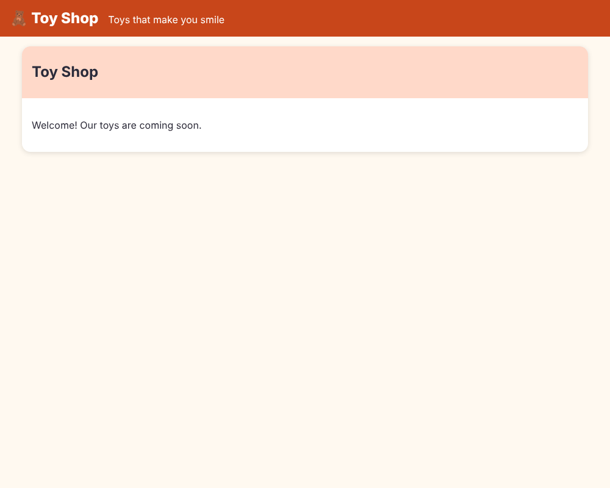

# Chapter 2: Components

> **Like I'm 5:** A component is a LEGO brick. It has a shape (HTML), paint (CSS), and a brain (TypeScript). You snap many bricks together to build the whole shop.

Concept reference: [02. Components](../concepts/02-components.md)

[Back: Chapter 1](01-set-up-and-meet-the-cli.md) · Next: [Chapter 3: Templates and data binding](03-templates-and-data-binding.md)

## What we build today

Two bricks for the shop:

1. **`SiteHeader`**: the orange bar at the top with the shop name.
2. **`Panel`**: a reusable card with a coloured title strip and a body. Anything can be put inside it.

Then we snap both into the root component.



## The big idea

Look at any website: a header, a menu, cards, a footer. Each of those is a **piece**. In Angular we build every piece once as a *component* and then use it as many times as we like, like a LEGO brick.

A component is three things that live together:

- **The brain**: a TypeScript class. It holds the data and the actions.
- **The shape**: an HTML template. It says what the piece looks like.
- **The paint**: a CSS file. Its styles belong to **this brick only**. They do not leak out and spoil other bricks.

**Grown-up words:**

- **Decorator** (`@Component(...)`): a label on a class that says "Angular, treat me as a component".
- **Selector**: the made-up HTML tag name of the component, like `app-site-header`.
- **Standalone component**: a component that lists what it needs in its own `imports`. This is how all components work in modern Angular. (Old Angular needed `NgModule` boxes. You can ignore those.)
- **Host element**: the tag the component sits in (`<app-site-header>`).
- **View encapsulation**: the rule that keeps a component's CSS inside the component. The default is called *Emulated*.
- **Content projection**: letting the user of a component put their own content inside it (`<ng-content>`).

## Step 1: Make the header component

Let the robot do the boring part:

```bash
ng generate component components/site-header
```

The short form is `ng g c components/site-header`. The CLI creates four files in `src/app/components/site-header/`: `site-header.ts` (brain), `site-header.html` (shape), `site-header.css` (paint), and `site-header.spec.ts` (a test). Open the brain:

**`src/app/components/site-header/site-header.ts`**

```ts
import { Component } from '@angular/core';

@Component({
  imports: [],
  selector: 'app-site-header',
  styleUrl: './site-header.css',
  templateUrl: './site-header.html',
})
export class SiteHeader {}
```

Read it slowly. It is only nine lines:

- `@Component({...})` marks the class as a component.
- `selector: 'app-site-header'` is the tag we will type in HTML. The `app-` part is a *prefix* (set in `angular.json`) that stops our names from clashing with real HTML tags.
- `templateUrl` and `styleUrl` point to the shape and the paint files.
- `imports: []` is the list of other bricks this brick uses inside its template. It is empty because the header uses no other bricks.
- `export class SiteHeader {}` is the brain. It is empty. A header has nothing to remember yet.

The CLI left the template almost empty, so write the shape:

**`src/app/components/site-header/site-header.html`**

```html
<header class="site-header">
  <span class="logo">🧸 Toy Shop</span>
  <span class="tagline">Toys that make you smile</span>
</header>
```

And the paint:

**`src/app/components/site-header/site-header.css`**

```css
.site-header {
  display: flex;
  align-items: baseline;
  gap: 1rem;
  padding: 0.75rem 1rem;
  background: var(--color-brand);
  color: #fff;
}

.logo {
  font-size: 1.5rem;
  font-weight: 800;
}
```

`var(--color-brand)` reads a colour that we define once for the whole shop. That is the next step.

## Step 2: Shop-wide paint

Some styles must be the same everywhere: colours, the font, buttons. Those go in the global file, `src/styles.css`. Replace its contents with:

**`src/styles.css`**

```css
/* Toy Shop global styles: colors, spacing, and a few helper classes. */
:root {
  --color-bg: #fff9f0;
  --color-surface: #ffffff;
  --color-text: #2b2b3a;
  --color-muted: #5f5f73;
  --color-brand: #c8461a;
  --color-brand-light: #ffd9c9;
  --color-accent: #0b7a75;
  --color-danger: #b4232f;
  --radius: 14px;
  --shadow: 0 2px 8px rgb(0 0 0 / 0.12);
}

* {
  box-sizing: border-box;
}

body {
  margin: 0;
  font-family:
    system-ui,
    -apple-system,
    'Segoe UI',
    Roboto,
    sans-serif;
  background: var(--color-bg);
  color: var(--color-text);
  line-height: 1.5;
}

h1,
h2,
h3 {
  line-height: 1.2;
}

a {
  color: var(--color-brand);
}

/* A centered column that holds each page. */
.page {
  max-width: 960px;
  margin: 0 auto;
  padding: 1rem;
}

/* A responsive grid: as many 220px columns as will fit. */
.grid {
  display: grid;
  grid-template-columns: repeat(auto-fill, minmax(220px, 1fr));
  gap: 1rem;
}

.btn {
  display: inline-block;
  padding: 0.5rem 1rem;
  border: 0;
  border-radius: var(--radius);
  background: var(--color-brand);
  color: #fff;
  font: inherit;
  font-weight: 600;
  cursor: pointer;
}

.btn:disabled {
  background: #9a9aa8;
  cursor: not-allowed;
}

.btn.secondary {
  background: var(--color-surface);
  color: var(--color-brand);
  border: 2px solid var(--color-brand);
}

/* Show a clear ring around whatever the keyboard is focused on. */
:focus-visible {
  outline: 3px solid var(--color-accent);
  outline-offset: 2px;
}
```

Two kinds of CSS now live in the shop:

| Kind | Where | Reaches |
|------|-------|---------|
| Global | `src/styles.css` | the whole page |
| Component | `site-header.css` | **only** that component |

The `:root { --color-brand: ... }` part makes CSS *variables*. Any component can read them with `var(--color-brand)`. Change one colour in one place, and the whole shop changes.

## Step 3: Use the header

A brick only appears when you place it. Two things are needed, and both are easy to forget:

1. **List it in `imports`** of the component that uses it.
2. **Write its tag** in that component's template.

Open `src/app/app.ts` and import `SiteHeader` (and `Panel`, which we make next):

**`src/app/app.ts`** (what changed)

```diff
@@ -1,8 +1,10 @@
 import { Component, signal } from '@angular/core';
 import { RouterOutlet } from '@angular/router';
+import { Panel } from './components/panel/panel';
+import { SiteHeader } from './components/site-header/site-header';
 
 @Component({
-  imports: [RouterOutlet],
+  imports: [RouterOutlet, SiteHeader, Panel],
   selector: 'app-root',
   styleUrl: './app.css',
   templateUrl: './app.html',
```

Then use the tags in `src/app/app.html`:

**`src/app/app.html`**

```html
<app-site-header />

<main class="page">
  <app-panel>
    <h2 panel-title>{{ title() }}</h2>
    <p>Welcome! Our toys are coming soon.</p>
  </app-panel>

  <router-outlet />
</main>
```

Wait. `Panel` does not exist yet, so the dev server will complain for a minute. That is fine. Let's build it.

## Step 4: A brick with slots, the Panel

```bash
ng generate component components/panel
```

The brain is again nothing but the generated label:

**`src/app/components/panel/panel.ts`**

```ts
import { Component } from '@angular/core';

@Component({
  imports: [],
  selector: 'app-panel',
  styleUrl: './panel.css',
  templateUrl: './panel.html',
})
export class Panel {}
```

The shape is where the new idea lives:

**`src/app/components/panel/panel.html`**

```html
<section class="panel">
  <header class="panel-title">
    <ng-content select="[panel-title]" />
  </header>
  <div class="panel-body">
    <ng-content />
  </div>
</section>
```

`<ng-content>` is a **slot**. It means "whatever the user puts between my tags goes here". Look at the two slots:

- `<ng-content select="[panel-title]" />` takes only the child that has a `panel-title` attribute.
- `<ng-content />` (no `select`) takes everything else.

That is why `app.html` can write:

```html
<app-panel>
  <h2 panel-title>{{ title() }}</h2>   <!-- goes in the title strip -->
  <p>Welcome! Our toys are coming soon.</p>   <!-- goes in the body -->
</app-panel>
```

Now the panel's paint:

**`src/app/components/panel/panel.css`**

```css
.panel {
  background: var(--color-surface);
  border-radius: var(--radius);
  box-shadow: var(--shadow);
  overflow: hidden;
}

.panel-title {
  padding: 0.5rem 1rem;
  background: var(--color-brand-light);
  font-weight: 700;
}

.panel-body {
  padding: 1rem;
}
```

Save everything. The page shows an orange header, and under it a card with the title strip "Toy Shop" and the welcome line inside.

## Step 5: Fix the test

The root component now shows the title in an `h2`, not an `h1`. Update the test from Chapter 1:

**`src/app/app.spec.ts`** (what changed)

```diff
@@ -18,6 +18,6 @@ describe('App', () => {
     const fixture = TestBed.createComponent(App);
     await fixture.whenStable();
     const compiled = fixture.nativeElement as HTMLElement;
-    expect(compiled.querySelector('h1')?.textContent).toContain('Toy Shop');
+    expect(compiled.querySelector('h2')?.textContent).toContain('Toy Shop');
   });
 });
```

The CLI also wrote one test per component. They say only "the component can be created" (`should create`). That is a fine start.

## Check it works

```bash
npx ng test --watch=false
```

```
 Test Files  3 passed (3)
      Tests  4 passed (4)
```

Open <http://localhost:4200/> (run `npm start` if it is not running). You should see the orange header with "🧸 Toy Shop" and a panel.

Now open the browser's developer tools (`F12`), choose **Elements**, and look at the header. You will see something like `<span class="logo" _ngcontent-ng-c123456>`. Those strange `_ngcontent-...` attributes are how Angular keeps the CSS of one component from touching another one. That is *view encapsulation* at work.

## What you learned

- A component = brain (class) + shape (template) + paint (CSS), tied together by `@Component`.
- `ng generate component` writes the boilerplate for you.
- A component must be in the `imports` of the place that uses it, and you place it with its selector tag.
- Component CSS stays inside the component; global CSS lives in `styles.css`.
- `<ng-content>` makes slots, so a component can wrap content that someone else provides.

## Try it yourself

1. Add a third piece of content to the panel in `app.html`: `<p>Open every day!</p>`. Which slot does it go in? Why?
2. Use `<app-panel>` a second time, with a different title. Notice that you wrote the brick once and used it twice.
3. Change `--color-brand` in `styles.css`. Which parts of the page change colour?
4. In `site-header.css`, add `.tagline { font-style: italic; }`. Does it change only the header's tagline?

## If something goes wrong

**The header tag shows nothing and the build fails:**

```
✘ [ERROR] NG8001: 'app-site-header' is not a known element:
1. If 'app-site-header' is an Angular component, then verify that it is included in the '@Component.imports' of this component.
```

You forgot to add `SiteHeader` to `imports` in `app.ts`. This is the most common beginner mistake in Angular. Read the message: it tells you exactly what to do.

**Your component's text shows but has no styles:** check that `styleUrl` in the `.ts` file points to the right file name.

**Global styles do not apply:** `src/styles.css` must be listed under `styles` in `angular.json`. The CLI does this for you, so you only need to check if you moved the file.

Next: [Chapter 3: Templates and data binding](03-templates-and-data-binding.md)
