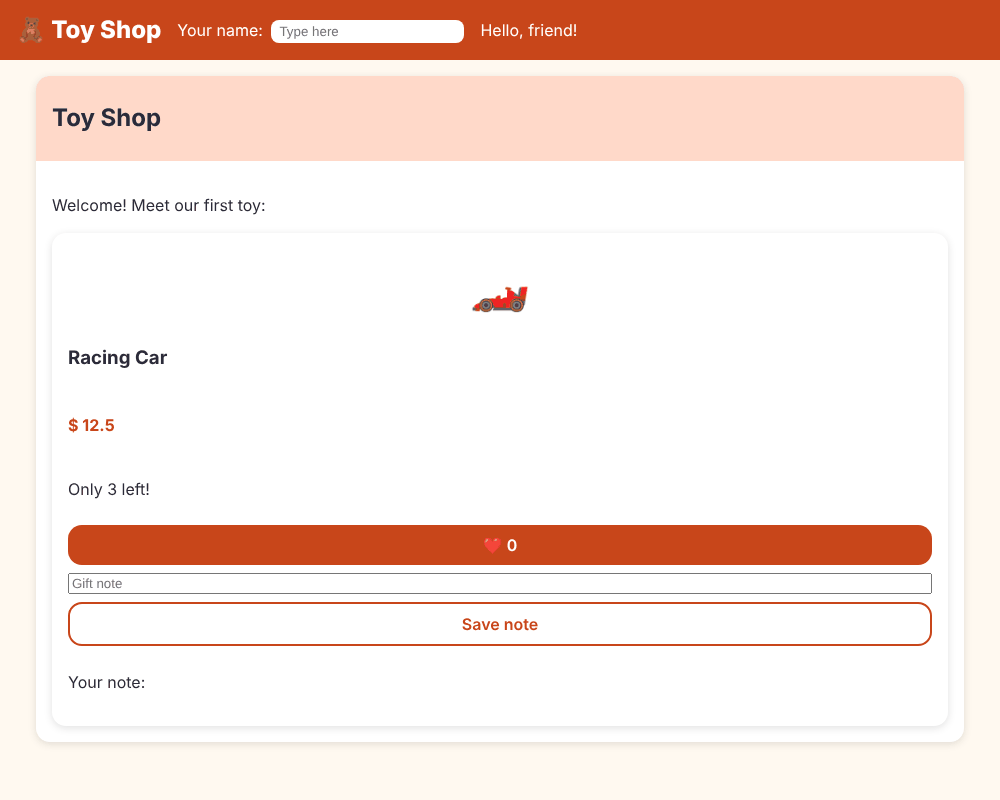

# Chapter 3: Templates and data binding

> **Like I'm 5:** A template is a picture with holes in it. Data binding is the glue that fills the holes with real words and numbers, and that also lets the picture tell the brain "someone poked me!".

Concept reference: [03. Templates and data binding](../concepts/03-templates-and-data-binding.md)

[Back: Chapter 2](02-components.md) · Next: [Chapter 4: Talking between components](04-talking-between-components.md)

## What we build today

Our first toy: a **product card** for the Racing Car. It shows a picture (an emoji), a name, a price, and how many are left. It has a heart button that counts likes, and a little box where you can write a gift note. We also teach the header to say hello to you by name as you type.



## The big idea

A component has a brain (the class) and a shape (the template). Data flows between them in four directions, and each direction has its own punctuation:

| You want to... | Write | Direction | Example |
|----------------|-------|-----------|---------|
| Show a value as text | `{{ value }}` | brain to screen | `{{ name }}` |
| Set a property of an element | `[property]="value"` | brain to screen | `[disabled]="soldOut"` |
| React to something the user did | `(event)="doSomething()"` | screen to brain | `(click)="like()"` |
| Do both at once (a box you can type in) | `[(ngModel)]="value"` | both ways | `[(ngModel)]="shopperName"` |

Easy way to remember: **square brackets `[ ]` push data into the page**, **round brackets `( )` listen to the page**, and `[( )]` (a "banana in a box") does both.

**Grown-up words:**

- **Interpolation**: `{{ }}`, printing a value inside text.
- **Property binding**: setting a DOM *property* (like `disabled`) from the brain.
- **Attribute binding**: `[attr.data-stock]`, for HTML attributes that are not properties.
- **Class binding**: `[class.sold-out]="soldOut"` switches one CSS class on or off.
- **Event binding**: `(click)` and friends.
- **Template reference variable**: `#giftNote` gives a name to an element so you can use it elsewhere in the same template.
- **`@let`**: a variable that lives in the template.

## Step 1: Make the product card

```bash
ng generate component components/product-card
```

Open `src/app/components/product-card/product-card.ts` and write the brain:

**`src/app/components/product-card/product-card.ts`**

```ts
import { Component, signal } from '@angular/core';

@Component({
  imports: [],
  selector: 'app-product-card',
  styleUrl: './product-card.css',
  templateUrl: './product-card.html',
})
export class ProductCard {
  // Plain fields: things that never change while the page is open.
  name = 'Racing Car';
  emoji = '🏎️';
  price = 12.5;
  stock = 3;

  // Signals: boxes that tell Angular when their content changes.
  likes = signal(0);
  note = signal('');

  like() {
    this.likes.update((n) => n + 1);
  }

  saveNote(text: string) {
    this.note.set(text);
  }
}
```

Two kinds of data live here:

- **Plain fields** (`name`, `emoji`, `price`, `stock`) never change while the page is open.
- **Signals** (`likes`, `note`) are *boxes that shout when their content changes*, so Angular knows to redraw. You read a signal by calling it like a function, `likes()`. You change it with `.set(...)` or `.update(...)`. Chapter 10 is all about them. For now: **if it changes, put it in a signal**.

`this.likes.update((n) => n + 1)` means: "take the number that is in the box, add one, and put the answer back".

## Step 2: Write the shape

**`src/app/components/product-card/product-card.html`**

```html
@let soldOut = stock === 0;

<article class="card" [class.sold-out]="soldOut">
  <div class="emoji" aria-hidden="true">{{ emoji }}</div>
  <h3>{{ name }}</h3>
  <p class="price">$ {{ price }}</p>
  <p [attr.data-stock]="stock">Only {{ stock }} left!</p>

  <button class="btn" type="button" [disabled]="soldOut" (click)="like()">❤️ {{ likes() }}</button>

  <input #giftNote aria-label="Gift note" placeholder="Gift note" />
  <button class="btn secondary" type="button" (click)="saveNote(giftNote.value)">Save note</button>
  <p>Your note: {{ note() }}</p>
</article>
```

Let's go through it line by line:

- `@let soldOut = stock === 0;` makes a little variable inside the template. It is `true` when no toys are left.
- `[class.sold-out]="soldOut"` adds the CSS class `sold-out` only when `soldOut` is true. (The CSS makes a sold-out card faded.)
- `{{ emoji }}`, `{{ name }}`, `{{ price }}`, `{{ stock }}` print the fields. `aria-hidden="true"` hides the emoji from screen readers, because it is only decoration.
- `[attr.data-stock]="stock"` writes `data-stock="3"` on the element. `data-*` things are *attributes* and have no matching property, so we say `attr.`.
- `[disabled]="soldOut"` switches the button off when sold out. `(click)="like()"` calls the brain's `like()` method.
- `{{ likes() }}` reads the signal. Remember the brackets!
- `<input #giftNote ...>` names the input `giftNote`. Then `(click)="saveNote(giftNote.value)"` hands the typed text straight to the brain, with no extra code to look the input up.

And the paint:

**`src/app/components/product-card/product-card.css`**

```css
.card {
  display: flex;
  flex-direction: column;
  gap: 0.5rem;
  padding: 1rem;
  background: var(--color-surface);
  border-radius: var(--radius);
  box-shadow: var(--shadow);
}

.card.sold-out {
  opacity: 0.6;
}

.emoji {
  font-size: 3rem;
  text-align: center;
}

.price {
  font-weight: 700;
  color: var(--color-brand);
}
```

## Step 3: Put the card on the page

The card must be imported and placed, as in Chapter 2:

**`src/app/app.ts`** (what changed)

```diff
@@ -1,10 +1,11 @@
 import { Component, signal } from '@angular/core';
 import { RouterOutlet } from '@angular/router';
 import { Panel } from './components/panel/panel';
+import { ProductCard } from './components/product-card/product-card';
 import { SiteHeader } from './components/site-header/site-header';
 
 @Component({
-  imports: [RouterOutlet, SiteHeader, Panel],
+  imports: [RouterOutlet, SiteHeader, Panel, ProductCard],
   selector: 'app-root',
   styleUrl: './app.css',
   templateUrl: './app.html',
```

**`src/app/app.html`** (what changed)

```diff
@@ -3,7 +3,8 @@
 <main class="page">
   <app-panel>
     <h2 panel-title>{{ title() }}</h2>
-    <p>Welcome! Our toys are coming soon.</p>
+    <p>Welcome! Meet our first toy:</p>
+    <app-product-card />
   </app-panel>
 
   <router-outlet />
```

## Step 4: A two-way box in the header

Let the header greet the shopper. Change the brain:

**`src/app/components/site-header/site-header.ts`**

```ts
import { Component, signal } from '@angular/core';
import { FormsModule } from '@angular/forms';

@Component({
  imports: [FormsModule],
  selector: 'app-site-header',
  styleUrl: './site-header.css',
  templateUrl: './site-header.html',
})
export class SiteHeader {
  shopperName = signal('');
}
```

`[(ngModel)]` belongs to the **forms** package, so we `import` `FormsModule` in this component, just like we import other bricks. The template:

**`src/app/components/site-header/site-header.html`**

```html
<header class="site-header">
  <span class="logo">🧸 Toy Shop</span>

  <label class="name-box">
    Your name:
    <input [(ngModel)]="shopperName" placeholder="Type here" />
  </label>

  <span>Hello, {{ shopperName() || 'friend' }}!</span>
</header>
```

Type your name into the box: the greeting changes on every key press. Two things are connected here. When you type, the signal `shopperName` is updated (screen to brain). When the signal changes, `Hello, {{ shopperName() }}!` redraws (brain to screen). If the box is empty, `|| 'friend'` fills in the word "friend".

A little paint for the new box:

**`src/app/components/site-header/site-header.css`** (what changed)

```diff
@@ -1,6 +1,7 @@
 .site-header {
   display: flex;
-  align-items: baseline;
+  flex-wrap: wrap;
+  align-items: center;
   gap: 1rem;
   padding: 0.75rem 1rem;
   background: var(--color-brand);
@@ -11,3 +12,10 @@
   font-size: 1.5rem;
   font-weight: 800;
 }
+
+.name-box input {
+  margin-left: 0.25rem;
+  padding: 0.25rem 0.5rem;
+  border-radius: 8px;
+  border: 0;
+}
```

## Check it works

```bash
npx ng test --watch=false
```

```
 Test Files  4 passed (4)
      Tests  5 passed (5)
```

In the browser:

- [ ] The card shows **Racing Car**, `$ 12.5`, and "Only 3 left!".
- [ ] Click the heart: the number goes up each time.
- [ ] Type a note, press **Save note**: "Your note: ..." shows your text.
- [ ] Type your name in the header: "Hello, ..." follows you.

One small thing is ugly: the price shows as `$ 12.5`, not `$12.50`. We fix that with a *pipe* in Chapter 7.

Fun fact: the bundle grew from about 195 kB to about 247 kB in this chapter. Almost all of that is `FormsModule` (the forms code). Every package you import costs the visitor some download. Keep that in mind; Chapter 27 shows how to measure it.

## What you learned

- `{{ }}` prints, `[ ]` pushes data in, `( )` listens, `[( )]` does both.
- `[class.x]`, `[attr.x]`, and `[disabled]` are three flavours of property binding.
- `#name` gives an element a name inside the template; `@let` makes a variable.
- A signal is a box that tells Angular when it changes. Read it with `()`.
- Anything from another package (like `FormsModule`) must be in the component's `imports`.

## Try it yourself

1. Change `stock` to `0` in the brain. What happens to the card? (Look for the faded card and the disabled button.) Change it back.
2. Add a `<p>` that shows `{{ likes() * 2 }}`. Template expressions can do small maths.
3. Show a message "Popular!" only when likes are above 5. (Hint: you will need `@if`. Chapter 5 teaches it, so a peek ahead is allowed.)
4. Make the **Save note** button also clear the input. (Hint: `giftNote.value = ''` inside the click handler.)

## If something goes wrong

**You use `[(ngModel)]` but forgot `FormsModule`:**

```
✘ [ERROR] NG8002: Can't bind to 'ngModel' since it isn't a known property of 'input'.
```

Add `FormsModule` to the component's `imports`.

**You misspell a field in the template:**

```
✘ [ERROR] TS2551: Property 'nme' does not exist on type 'ProductCard'. Did you mean 'name'?
```

Angular checks templates the way TypeScript checks code (this is called *strict templates*), so a typo becomes a build error, not a blank page. Read the "Did you mean" hint.

**The number does not change when you click:** you probably wrote `likes` instead of `likes()` in the template, or you changed a plain field instead of a signal.

Next: [Chapter 4: Talking between components](04-talking-between-components.md)
