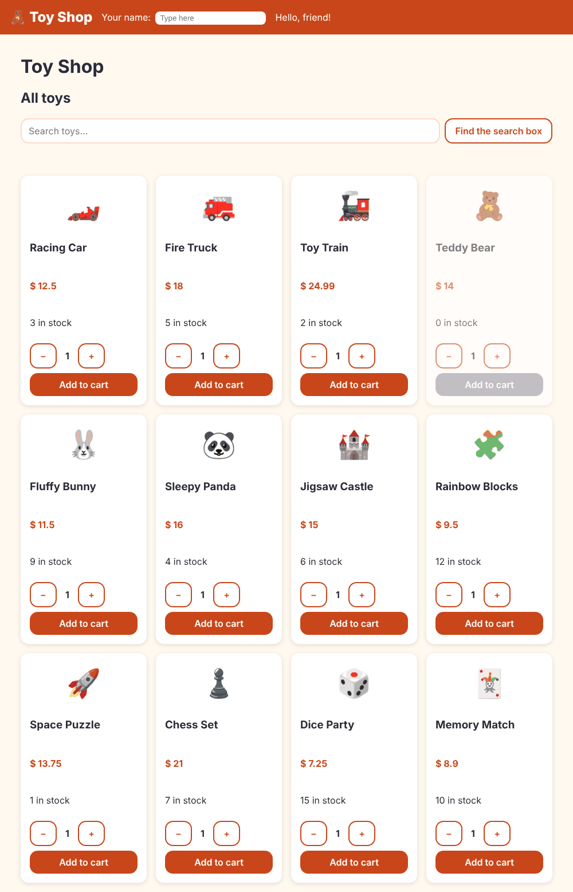

# Chapter 4: Talking between components

> **Like I'm 5:** Bricks in a toy shop need to talk. A parent hands a toy *down* to a child brick through a little mailbox. A child shouts *up* "I got picked!" through a bell. Some boxes work both ways, like a walkie-talkie.

Concept reference: [21. Component communication](../concepts/21-component-communication.md)

[Back: Chapter 3](03-templates-and-data-binding.md) · Next: [Chapter 5: Control flow](05-control-flow.md)

## What we build today

A real **home page** with a shelf of twelve toys. Each product card now:

- receives its toy from the page that contains it (data **down**),
- has a quantity stepper (a small component that works **both ways**), and
- shouts "added!" to the page when you press **Add to cart** (event **up**).

The page prints "Added: 2 × Racing Car" when that happens.



## The big idea

So far our product card knew its own toy (`name = 'Racing Car'`). A real shop needs one card brick that can show *any* toy. So the card must be able to **receive** a toy from outside, and **tell** the outside world when something happened.

Angular gives each direction its own tool:

| Direction | Tool | Parent writes | Picture |
|-----------|------|---------------|---------|
| Parent to child | `input()` | `[product]="p"` | a mailbox: the parent drops a toy in |
| Child to parent | `output()` | `(added)="onAdded($event)"` | a bell: the child rings it, the parent listens |
| Both ways | `model()` | `[(value)]="quantity"` | a walkie-talkie: both can talk |
| Parent reaches in | `viewChild()` | `#searchBox` | the parent looks at one of its own pieces |

Rule of thumb: **data flows down, events flow up.** A child never changes its parent's data directly. It politely asks by shouting an event, and the parent decides.

**Grown-up words:**

- **Input / output**: the public mailbox and bell of a component.
- **Required input**: `input.required<T>()`; Angular refuses to build if the parent forgets to send it.
- **`model()`**: an input and an output glued together, used for two-way binding `[( )]`.
- **`$event`**: the thing the child sent with its shout. For an `output<T>()`, it is a `T`.
- **View query** (`viewChild`): finding an element or child component in your own template.

## Step 1: Describe a toy

TypeScript can describe the *shape* of a toy so we cannot forget a piece. Create `src/app/models/product.ts`:

**`src/app/models/product.ts`**

```ts
export type Category = 'cars' | 'soft' | 'puzzles' | 'games';

export interface Product {
  id: number;
  name: string;
  emoji: string;
  price: number;
  category: Category;
  stock: number;
  rating: number;
  description: string;
}
```

`interface Product` is a promise: "every Product has an id, a name, an emoji, ...". `Category` is a *union type*: only one of those four words is allowed. Typing `'cats'` instead of `'cars'` becomes an error as you type.

Now some toys to play with. Create `src/app/data/sample-products.ts`. It is only data, so you can copy it:

**`src/app/data/sample-products.ts`**

```ts
import { Product } from '../models/product';

// A few toys to play with while we learn. Later we will load them from a "server".
export const sampleProducts: Product[] = [
  {
    id: 1,
    name: 'Racing Car',
    emoji: '🏎️',
    price: 12.5,
    category: 'cars',
    stock: 3,
    rating: 4.5,
    description: 'A fast red racing car with shiny wheels. It zooms around every corner!',
  },
  {
    id: 2,
    name: 'Fire Truck',
    emoji: '🚒',
    price: 18,
    category: 'cars',
    stock: 5,
    rating: 4.7,
    description: 'A big red fire truck with a ladder that goes up and down. Wee-oo wee-oo!',
  },
  {
    id: 3,
    name: 'Toy Train',
    emoji: '🚂',
    price: 24.99,
    category: 'cars',
    stock: 2,
    rating: 4.8,
    description: 'A little steam train with three carriages and a track you can build.',
  },
  {
    id: 4,
    name: 'Teddy Bear',
    emoji: '🧸',
    price: 14,
    category: 'soft',
    stock: 0,
    rating: 4.9,
    description: 'The softest teddy bear in the world. Perfect for hugs and bedtime.',
  },
  {
    id: 5,
    name: 'Fluffy Bunny',
    emoji: '🐰',
    price: 11.5,
    category: 'soft',
    stock: 9,
    rating: 4.4,
    description: 'A fluffy bunny with long floppy ears and a tiny pink nose.',
  },
  {
    id: 6,
    name: 'Sleepy Panda',
    emoji: '🐼',
    price: 16,
    category: 'soft',
    stock: 4,
    rating: 4.6,
    description: 'A sleepy panda who loves naps, bamboo, and cuddles.',
  },
  {
    id: 7,
    name: 'Jigsaw Castle',
    emoji: '🏰',
    price: 15,
    category: 'puzzles',
    stock: 6,
    rating: 4.3,
    description: 'A 100-piece jigsaw puzzle of a castle with towers and a moat.',
  },
  {
    id: 8,
    name: 'Rainbow Blocks',
    emoji: '🧩',
    price: 9.5,
    category: 'puzzles',
    stock: 12,
    rating: 4.1,
    description: 'Colorful wooden blocks to stack, sort, and build into anything.',
  },
  {
    id: 9,
    name: 'Space Puzzle',
    emoji: '🚀',
    price: 13.75,
    category: 'puzzles',
    stock: 1,
    rating: 4.7,
    description: 'A glow-in-the-dark puzzle of rockets, planets, and stars.',
  },
  {
    id: 10,
    name: 'Chess Set',
    emoji: '♟️',
    price: 21,
    category: 'games',
    stock: 7,
    rating: 4.5,
    description: 'A wooden chess set with a folding board. Think like a king or queen!',
  },
  {
    id: 11,
    name: 'Dice Party',
    emoji: '🎲',
    price: 7.25,
    category: 'games',
    stock: 15,
    rating: 4.0,
    description: 'Six dice and a cup. Roll high, roll low, and play five fun games.',
  },
  {
    id: 12,
    name: 'Memory Match',
    emoji: '🃏',
    price: 8.9,
    category: 'games',
    stock: 10,
    rating: 4.2,
    description: 'Flip the cards and find the pairs. Can you remember where they are?',
  },
];
```

Later (Chapter 13) these toys will arrive from a "server". Using a plain list first lets us concentrate on components.

## Step 2: A card that receives a toy

Rewrite the brain of the product card. The fixed `name = 'Racing Car'` fields go away. Instead, the card gets a `product`:

**`src/app/components/product-card/product-card.ts`**

```ts
import { Component, input, output, signal } from '@angular/core';
import { Product } from '../../models/product';
import { QuantityStepper } from '../quantity-stepper/quantity-stepper';

export interface AddedEvent {
  product: Product;
  quantity: number;
}

@Component({
  imports: [QuantityStepper],
  selector: 'app-product-card',
  styleUrl: './product-card.css',
  templateUrl: './product-card.html',
})
export class ProductCard {
  // The parent hands us a toy. It is required, so Angular warns if it is missing.
  product = input.required<Product>();

  // We shout "added!" to the parent when the button is pressed.
  added = output<AddedEvent>();

  quantity = signal(1);

  add() {
    this.added.emit({ product: this.product(), quantity: this.quantity() });
  }
}
```

- `input.required<Product>()` is the mailbox. It is **required**, so a card without a toy is impossible. Read it with `this.product()`. It is a signal, so you call it.
- `added = output<AddedEvent>()` is the bell. `this.added.emit({...})` rings it and attaches a small package (`AddedEvent`: which toy, how many).
- `quantity = signal(1)` is how many the shopper wants.

The shape changes to use `product()`:

**`src/app/components/product-card/product-card.html`**

```html
@let p = product();

<article class="card" [class.sold-out]="p.stock === 0">
  <div class="emoji" aria-hidden="true">{{ p.emoji }}</div>
  <h3>{{ p.name }}</h3>
  <p class="price">$ {{ p.price }}</p>
  <p>{{ p.stock }} in stock</p>

  <app-quantity-stepper [(value)]="quantity" [max]="p.stock" />

  <button class="btn" type="button" [disabled]="p.stock === 0" (click)="add()">Add to cart</button>
</article>
```

- `@let p = product();` saves a few keystrokes: from now on `p.name`, `p.price`.
- `<app-quantity-stepper [(value)]="quantity" [max]="p.stock" />` is a child brick we make next. `[(value)]` is the walkie-talkie and `[max]` is a mailbox.

## Step 3: A stepper that talks both ways

```bash
ng generate component components/quantity-stepper
```

**`src/app/components/quantity-stepper/quantity-stepper.ts`**

```ts
import { Component, input, model } from '@angular/core';

@Component({
  imports: [],
  selector: 'app-quantity-stepper',
  styleUrl: './quantity-stepper.css',
  templateUrl: './quantity-stepper.html',
})
export class QuantityStepper {
  // model() is a two-way mailbox: the parent can read it and write it.
  value = model(1);

  // input() is a one-way mailbox: the parent sends, we only read.
  min = input(1);
  max = input(10);

  decrease() {
    this.value.update((v) => Math.max(this.min(), v - 1));
  }

  increase() {
    this.value.update((v) => Math.min(this.max(), v + 1));
  }
}
```

- `value = model(1)` is a two-way mailbox. The parent can read it **and** the stepper can change it. When the stepper changes `value`, the parent's `quantity` changes too.
- `min` and `max` are ordinary inputs with default values (`input(1)`, `input(10)`), so they are optional.
- `Math.max(this.min(), v - 1)` stops the number from going below `min`. `Math.min(...)` stops it above `max`.

The shape:

**`src/app/components/quantity-stepper/quantity-stepper.html`**

```html
<div class="stepper" role="group" aria-label="Quantity">
  <button
    class="btn secondary"
    type="button"
    aria-label="One less"
    [disabled]="value() <= min()"
    (click)="decrease()"
  >
    −
  </button>
  <output>{{ value() }}</output>
  <button
    class="btn secondary"
    type="button"
    aria-label="One more"
    [disabled]="value() >= max()"
    (click)="increase()"
  >
    +
  </button>
</div>
```

The buttons switch themselves off at the ends (`[disabled]="value() <= min()"`). The `aria-label`s give the plus and minus buttons proper names for screen readers (Chapter 21 explains why). And a bit of paint:

**`src/app/components/quantity-stepper/quantity-stepper.css`**

```css
.stepper {
  display: inline-flex;
  align-items: center;
  gap: 0.5rem;
}

output {
  min-width: 2ch;
  text-align: center;
  font-weight: 700;
}
```

## Step 4: A page that holds the shelf

Pages are components too. We put them in their own folder, `pages`:

```bash
ng generate component pages/home
```

**`src/app/pages/home/home.ts`**

```ts
import { Component, ElementRef, signal, viewChild } from '@angular/core';
import { AddedEvent, ProductCard } from '../../components/product-card/product-card';
import { sampleProducts } from '../../data/sample-products';

@Component({
  imports: [ProductCard],
  selector: 'app-home',
  styleUrl: './home.css',
  templateUrl: './home.html',
})
export class Home {
  products = sampleProducts;
  lastAdded = signal('');

  // viewChild finds something inside our own template, like a search box.
  searchBox = viewChild.required<ElementRef<HTMLInputElement>>('searchBox');

  focusSearch() {
    this.searchBox().nativeElement.focus();
  }

  onAdded(event: AddedEvent) {
    this.lastAdded.set(`${event.quantity} × ${event.product.name}`);
  }
}
```

- `products = sampleProducts` is the list the page shows.
- `onAdded(event: AddedEvent)` is the listener for the card's bell. It stores a message in a signal.
- `searchBox = viewChild.required<ElementRef<HTMLInputElement>>('searchBox')` finds the element in *this* template that is tagged `#searchBox`. `focusSearch()` then moves the cursor there. `viewChild` can also find a *child component*, and then you can call its public methods.

The shape:

**`src/app/pages/home/home.html`**

```html
<h2>All toys</h2>

<div class="toolbar">
  <input #searchBox type="search" aria-label="Search toys" placeholder="Search toys…" />
  <button class="btn secondary" type="button" (click)="focusSearch()">Find the search box</button>
</div>

<p class="added" aria-live="polite">{{ lastAdded() ? 'Added: ' + lastAdded() : '' }}</p>

<div class="grid">
  @for (p of products; track p.id) {
    <app-product-card [product]="p" (added)="onAdded($event)" />
  }
</div>
```

Look at the heart of it:

```html
@for (p of products; track p.id) {
  <app-product-card [product]="p" (added)="onAdded($event)" />
}
```

`@for` repeats a block for each toy (Chapter 5 explains it fully). For every toy `p` we put a card on the shelf, send the toy in with `[product]="p"`, and listen with `(added)="onAdded($event)"`. `$event` is the package the card sent.

Some paint:

**`src/app/pages/home/home.css`**

```css
.toolbar {
  display: flex;
  flex-wrap: wrap;
  gap: 0.5rem;
  margin-bottom: 0.5rem;
}

.toolbar input {
  flex: 1;
  min-width: 12rem;
  padding: 0.5rem 0.75rem;
  border: 2px solid var(--color-brand-light);
  border-radius: var(--radius);
  font: inherit;
}

.added {
  min-height: 1.5rem;
  font-weight: 600;
  color: var(--color-accent);
}
```

## Step 5: Show the page

Replace the panel and the lone card in the root component with the new page:

**`src/app/app.html`** (what changed)

```diff
@@ -1,11 +1,7 @@
 <app-site-header />
 
 <main class="page">
-  <app-panel>
-    <h2 panel-title>{{ title() }}</h2>
-    <p>Welcome! Meet our first toy:</p>
-    <app-product-card />
-  </app-panel>
-
+  <h1>{{ title() }}</h1>
+  <app-home />
   <router-outlet />
 </main>
```

**`src/app/app.ts`** (what changed)

```diff
@@ -1,11 +1,10 @@
 import { Component, signal } from '@angular/core';
 import { RouterOutlet } from '@angular/router';
-import { Panel } from './components/panel/panel';
-import { ProductCard } from './components/product-card/product-card';
 import { SiteHeader } from './components/site-header/site-header';
+import { Home } from './pages/home/home';
 
 @Component({
-  imports: [RouterOutlet, SiteHeader, Panel, ProductCard],
+  imports: [RouterOutlet, SiteHeader, Home],
   selector: 'app-root',
   styleUrl: './app.css',
   templateUrl: './app.html',
```

The test for the root component looks for the `h1` again, so change `h2` back to `h1` in `app.spec.ts`:

**`src/app/app.spec.ts`** (what changed)

```diff
@@ -18,6 +18,6 @@ describe('App', () => {
     const fixture = TestBed.createComponent(App);
     await fixture.whenStable();
     const compiled = fixture.nativeElement as HTMLElement;
-    expect(compiled.querySelector('h2')?.textContent).toContain('Toy Shop');
+    expect(compiled.querySelector('h1')?.textContent).toContain('Toy Shop');
   });
 });
```

## Step 6: Test the talking

The generated card test just said "should create". Now that the card needs a toy, create it with one and check what it does:

**`src/app/components/product-card/product-card.spec.ts`**

```ts
import { ComponentFixture, TestBed } from '@angular/core/testing';
import { sampleProducts } from '../../data/sample-products';
import { ProductCard } from './product-card';

describe('ProductCard', () => {
  let fixture: ComponentFixture<ProductCard>;

  beforeEach(async () => {
    await TestBed.configureTestingModule({
      imports: [ProductCard],
    }).compileComponents();

    fixture = TestBed.createComponent(ProductCard);
    fixture.componentRef.setInput('product', sampleProducts[0]);
    await fixture.whenStable();
  });

  it('shows the toy name', () => {
    expect(fixture.nativeElement.textContent).toContain('Racing Car');
  });

  it('tells the parent when "Add to cart" is pressed', () => {
    let received: unknown;
    fixture.componentInstance.added.subscribe((e) => (received = e));

    fixture.nativeElement.querySelector('button.btn:not(.secondary)').click();

    expect(received).toEqual({ product: sampleProducts[0], quantity: 1 });
  });
});
```

Two new testing tricks:

- `fixture.componentRef.setInput('product', ...)` plays the part of the parent, sending the required input. (Without it, the test fails with `NG0950: Input "product" is required but no value is available yet.`)
- `fixture.componentInstance.added.subscribe(...)` listens for the bell; then we click the button and check what arrived.

## Check it works

```bash
npx ng test --watch=false
```

```
 Test Files  6 passed (6)
      Tests  8 passed (8)
```

In the browser:

- [ ] Twelve cards appear.
- [ ] Press **+** on the Racing Car: the number goes up, but stops at 3 (its stock). The **−** button is dead at 1.
- [ ] Press **Add to cart**: the page says "Added: 2 × Racing Car" (or whatever you chose).
- [ ] The Teddy Bear (stock 0) is faded and its button is disabled.
- [ ] **Find the search box** moves your cursor into the search box.

## What you learned

- `input()` receives data from a parent; `input.required()` makes it mandatory.
- `output()` lets a child tell its parent something happened; the parent listens with `(name)="..."`.
- `model()` is for two-way binding with `[( )]`.
- `viewChild()` finds a piece of your own template so the class can use it.
- Data flows down, events flow up.
- Components can be pages, too.

## Try it yourself

1. Make the Racing Car's stock `10` in `sample-products.ts`. Does the stepper allow more now?
2. Give the stepper an input `step = input(1)`, and make the plus and minus buttons change by `step()`. Use `[step]="2"` for one card.
3. Add an output to the product card called `liked`, and a heart button that rings it. Show the last liked toy on the home page.
4. What happens if you remove `[product]="p"` from the home page? Read the error message. (It is in the "If something goes wrong" list below, but try first.)

## If something goes wrong

**The required input is missing:**

In the browser or in a test:

```
NG0950: Input "product" is required but no value is available yet.
```

In a test, you did not call `setInput`. In a template, you do not even get this far, because the build stops first:

```
✘ [ERROR] NG8008: Required input 'product' from component ProductCard must be specified.
```

The parent forgot `[product]="..."`.

**`$event` has the wrong type:** the type of `$event` comes from `output<T>()`. If your handler says `onAdded(event: string)` while the output sends an `AddedEvent`, the build fails with a type error. Fix the handler's type.

**Changing a child's `input` from inside the child:** an `input()` is read-only inside the child. Use `model()` when the child must write, or `output()` to ask the parent.

Next: [Chapter 5: Control flow](05-control-flow.md)
