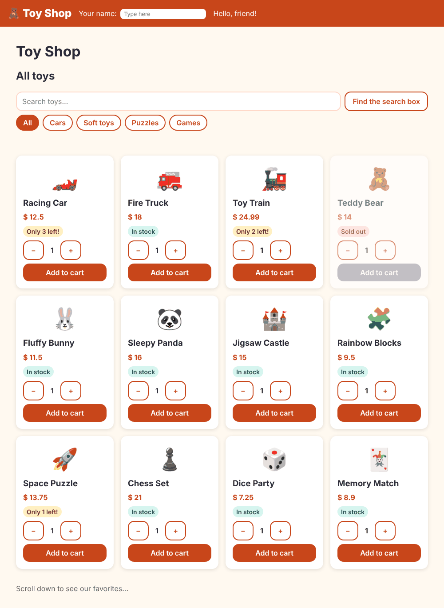

# Chapter 5: Control flow

> **Like I'm 5:** A template can make choices. "IF it is raining, show the umbrella." "FOR EACH toy on the shelf, draw a card." "SWITCH on the colour: red toys go here, blue toys go there." And "wait until the customer walks to this shelf before you unpack the fancy toys."

Concept reference: [05. Control flow](../concepts/05-control-flow.md)

[Back: Chapter 4](04-talking-between-components.md) · Next: [Chapter 6: Directives](06-directives.md)

## What we build today

The home page learns to think:

- **Group buttons** (All, Cars, Soft toys, Puzzles, Games) that filter the shelf,
- a friendly **stock badge** on every card ("In stock", "Only 3 left!", "Sold out"),
- a message **"No toys here yet"** when a group is empty, and
- an **"Our favorites"** list at the bottom that is only loaded when you scroll to it.



## The big idea

Until now every template drew exactly the same thing. Real pages must decide: show or hide, repeat for every item, pick one of several looks. Angular has a small set of **control flow blocks**. They start with `@`:

| Block | Plain words |
|-------|-------------|
| `@if (...) { } @else { }` | Show this only when a condition is true |
| `@for (item of list; track item.id) { } @empty { }` | Repeat for every item; show the `@empty` part if the list is empty |
| `@switch (value) { @case (a) { } @default { } }` | Pick one of many |
| `@defer (on viewport) { } @placeholder { }` | Do not even load this part until it is needed |

These replace the old `*ngIf`, `*ngFor`, and `ngSwitch`. The new blocks read like normal code, need no imports, and are faster.

**Grown-up words:**

- **`track`**: how Angular recognises each item in a repeated list. Give it something unique, like `id`. When the list changes, Angular then moves existing cards instead of throwing them all away and redrawing. `track` is **required**.
- **`computed()`**: a signal whose value is *worked out* from other signals. It updates itself when they change.
- **Deferrable view**: a part of the template that is downloaded and shown later (`@defer`).
- **Trigger**: what starts the loading: `on viewport`, `on idle`, `on interaction`, `on hover`, `on timer(...)`, or `when condition`.

## Step 1: Pick a group (the filter)

Open `src/app/pages/home/home.ts`. We add a list of groups, a signal to remember the chosen one, and two `computed()` answers:

**`src/app/pages/home/home.ts`**

```ts
import { Component, computed, ElementRef, signal, viewChild } from '@angular/core';
import { AddedEvent, ProductCard } from '../../components/product-card/product-card';
import { RecommendedToys } from '../../components/recommended-toys/recommended-toys';
import { sampleProducts } from '../../data/sample-products';
import { Category } from '../../models/product';

type CategoryChoice = 'all' | Category;

@Component({
  imports: [ProductCard, RecommendedToys],
  selector: 'app-home',
  styleUrl: './home.css',
  templateUrl: './home.html',
})
export class Home {
  products = sampleProducts;
  lastAdded = signal('');

  categories: { id: CategoryChoice; label: string }[] = [
    { id: 'all', label: 'All' },
    { id: 'cars', label: 'Cars' },
    { id: 'soft', label: 'Soft toys' },
    { id: 'puzzles', label: 'Puzzles' },
    { id: 'games', label: 'Games' },
  ];
  category = signal<CategoryChoice>('all');

  // Only the toys that match the chosen category.
  visible = computed(() => {
    const chosen = this.category();
    return chosen === 'all' ? this.products : this.products.filter((p) => p.category === chosen);
  });

  // The three toys with the best stars.
  topRated = computed(() => [...this.products].sort((a, b) => b.rating - a.rating).slice(0, 3));

  searchBox = viewChild.required<ElementRef<HTMLInputElement>>('searchBox');

  focusSearch() {
    this.searchBox().nativeElement.focus();
  }

  onAdded(event: AddedEvent) {
    this.lastAdded.set(`${event.quantity} × ${event.product.name}`);
  }
}
```

Read the three new things:

- `category = signal<CategoryChoice>('all')` remembers which button is chosen.
- `visible = computed(...)` is *"the toys that match the chosen group"*. It reads `category()`. Whenever `category` changes, `visible` is recalculated by itself. You never write "now update the list". That is the beauty of `computed`.
- `topRated = computed(...)` sorts a **copy** of the list (`[...this.products]`) by rating and keeps the first three. (We copy first because `sort` changes the array it is called on.)

## Step 2: Draw the buttons and the shelf

**`src/app/pages/home/home.html`**

```html
<h2>All toys</h2>

<div class="toolbar">
  <input #searchBox type="search" aria-label="Search toys" placeholder="Search toys…" />
  <button class="btn secondary" type="button" (click)="focusSearch()">Find the search box</button>
</div>

<div class="chips" role="group" aria-label="Toy groups">
  @for (c of categories; track c.id) {
    <button
      type="button"
      class="chip"
      [class.active]="category() === c.id"
      [attr.aria-pressed]="category() === c.id"
      (click)="category.set(c.id)"
    >
      {{ c.label }}
    </button>
  }
</div>

<p class="added" aria-live="polite">
  @if (lastAdded()) {
    Added: {{ lastAdded() }}
  }
</p>

<div class="grid">
  @for (p of visible(); track p.id) {
    <app-product-card [product]="p" (added)="onAdded($event)" />
  } @empty {
    <p>No toys here yet. 🧸</p>
  }
</div>

@defer (on viewport) {
  <app-recommended-toys [toys]="topRated()" />
} @placeholder {
  <p class="placeholder">Scroll down to see our favorites…</p>
} @loading (minimum 300ms) {
  <p>Loading favorites…</p>
} @error {
  <p>Sorry, we could not load the favorites.</p>
}
```

- `@for (c of categories; track c.id)` makes one button per group. `[class.active]` paints the chosen one, and `[attr.aria-pressed]` tells screen readers which one is on.
- `(click)="category.set(c.id)"` changes the signal *right inside the template*. No method needed for something this small.
- `@if (lastAdded()) { Added: ... }` shows the "Added" message only when there is one.
- `@for (p of visible(); track p.id)` draws a card for each visible toy. `@empty { ... }` draws the friendly message when `visible()` is empty. Try it later by adding a group that has no toys.
- `@defer (on viewport)` is the fancy part. Read it below.

Add some paint for the buttons:

**`src/app/pages/home/home.css`** (what changed)

```diff
@@ -19,3 +19,31 @@
   font-weight: 600;
   color: var(--color-accent);
 }
+
+.chips {
+  display: flex;
+  flex-wrap: wrap;
+  gap: 0.5rem;
+  margin-bottom: 0.5rem;
+}
+
+.chip {
+  padding: 0.25rem 0.875rem;
+  border: 2px solid var(--color-brand);
+  border-radius: 999px;
+  background: var(--color-surface);
+  color: var(--color-brand);
+  font: inherit;
+  font-weight: 600;
+  cursor: pointer;
+}
+
+.chip.active {
+  background: var(--color-brand);
+  color: #fff;
+}
+
+.placeholder {
+  margin-top: 2rem;
+  color: var(--color-muted);
+}
```

## Step 3: A stock badge with `@switch`

The card knows how many toys are left. Let it say so in words. In `product-card.ts` add a `computed`:

**`src/app/components/product-card/product-card.ts`** (what changed)

```diff
@@ -1,4 +1,4 @@
-import { Component, input, output, signal } from '@angular/core';
+import { Component, computed, input, output, signal } from '@angular/core';
 import { Product } from '../../models/product';
 import { QuantityStepper } from '../quantity-stepper/quantity-stepper';
 
@@ -14,14 +14,17 @@ export interface AddedEvent {
   templateUrl: './product-card.html',
 })
 export class ProductCard {
-  // The parent hands us a toy. It is required, so Angular warns if it is missing.
   product = input.required<Product>();
-
-  // We shout "added!" to the parent when the button is pressed.
   added = output<AddedEvent>();
-
   quantity = signal(1);
 
+  // computed() works out an answer from other boxes, and updates by itself.
+  stockLevel = computed(() => {
+    const stock = this.product().stock;
+    if (stock === 0) return 'out';
+    return stock <= 3 ? 'low' : 'ok';
+  });
+
   add() {
     this.added.emit({ product: this.product(), quantity: this.quantity() });
   }
```

Then, in the template, `@switch` picks one of three badges:

**`src/app/components/product-card/product-card.html`**

```html
@let p = product();

<article class="card" [class.sold-out]="stockLevel() === 'out'">
  <div class="emoji" aria-hidden="true">{{ p.emoji }}</div>
  <h3>{{ p.name }}</h3>
  <p class="price">$ {{ p.price }}</p>

  @switch (stockLevel()) {
    @case ('out') {
      <p class="badge out">Sold out</p>
    }
    @case ('low') {
      <p class="badge low">Only {{ p.stock }} left!</p>
    }
    @default {
      <p class="badge ok">In stock</p>
    }
  }

  <app-quantity-stepper [(value)]="quantity" [max]="p.stock" />

  <button class="btn" type="button" [disabled]="p.stock === 0" (click)="add()">Add to cart</button>
</article>
```

`@switch (stockLevel())` looks at the answer and runs the matching `@case`. `@default` catches everything else. Only the chosen block exists in the page. The other two are not even created.

Paint for the three badge colours:

**`src/app/components/product-card/product-card.css`** (what changed)

```diff
@@ -8,6 +8,11 @@
   box-shadow: var(--shadow);
 }
 
+.card h3,
+.card p {
+  margin: 0;
+}
+
 .card.sold-out {
   opacity: 0.6;
 }
@@ -21,3 +26,26 @@
   font-weight: 700;
   color: var(--color-brand);
 }
+
+.badge {
+  align-self: flex-start;
+  padding: 0.125rem 0.5rem;
+  border-radius: 999px;
+  font-size: 0.875rem;
+  font-weight: 600;
+}
+
+.badge.ok {
+  background: #d6f5ef;
+  color: #064e4a;
+}
+
+.badge.low {
+  background: #fff0c2;
+  color: #6b4a00;
+}
+
+.badge.out {
+  background: #ffd9dc;
+  color: #7a121b;
+}
```

## Step 4: A shy block with `@defer`

The "Our favorites" list is below the shelf. Visitors who never scroll that far should not pay for it. `@defer` loads a part of the page only when needed:

```html
@defer (on viewport) {
  <app-recommended-toys [toys]="topRated()" />
} @placeholder {
  <p class="placeholder">Scroll down to see our favorites…</p>
} @loading (minimum 300ms) {
  <p>Loading favorites…</p>
} @error {
  <p>Sorry, we could not load the favorites.</p>
}
```

- The main block appears **when the placeholder scrolls into view** (`on viewport`).
- `@placeholder` is what you see before that.
- `@loading` is shown while the code downloads. `minimum 300ms` stops it from flashing by too fast.
- `@error` is shown if the download fails.

The deferred piece is a new component. Make it:

```bash
ng generate component components/recommended-toys
```

**`src/app/components/recommended-toys/recommended-toys.ts`**

```ts
import { Component, input } from '@angular/core';
import { Product } from '../../models/product';

@Component({
  imports: [],
  selector: 'app-recommended-toys',
  styleUrl: './recommended-toys.css',
  templateUrl: './recommended-toys.html',
})
export class RecommendedToys {
  toys = input.required<Product[]>();
}
```

**`src/app/components/recommended-toys/recommended-toys.html`**

```html
<section class="recommended">
  <h2>Our favorites ⭐</h2>
  <ol>
    @for (t of toys(); track t.id) {
      <li>{{ t.emoji }} {{ t.name }} (rated {{ t.rating }} out of 5)</li>
    }
  </ol>
</section>
```

**`src/app/components/recommended-toys/recommended-toys.css`**

```css
.recommended {
  margin-top: 2rem;
  padding: 1rem;
  background: var(--color-brand-light);
  border-radius: var(--radius);
}
```

It uses `@for` again. The `toys` input is required, so the list must come from the page (`[toys]="topRated()"`).

## Step 5: Tests for the new behaviour

The card test now checks the badges:

**`src/app/components/product-card/product-card.spec.ts`** (what changed)

```diff
@@ -5,20 +5,33 @@ import { ProductCard } from './product-card';
 describe('ProductCard', () => {
   let fixture: ComponentFixture<ProductCard>;
 
+  async function show(index: number) {
+    fixture.componentRef.setInput('product', sampleProducts[index]);
+    await fixture.whenStable();
+  }
+
   beforeEach(async () => {
     await TestBed.configureTestingModule({
       imports: [ProductCard],
     }).compileComponents();
 
     fixture = TestBed.createComponent(ProductCard);
-    fixture.componentRef.setInput('product', sampleProducts[0]);
-    await fixture.whenStable();
+    await show(0);
   });
 
   it('shows the toy name', () => {
     expect(fixture.nativeElement.textContent).toContain('Racing Car');
   });
 
+  it('warns when only a few are left', () => {
+    expect(fixture.nativeElement.textContent).toContain('Only 3 left!');
+  });
+
+  it('says "Sold out" when there is no stock', async () => {
+    await show(3); // Teddy Bear has stock 0
+    expect(fixture.nativeElement.textContent).toContain('Sold out');
+  });
+
   it('tells the parent when "Add to cart" is pressed', () => {
     let received: unknown;
     fixture.componentInstance.added.subscribe((e) => (received = e));
```

And the new component gets a test that sends it two toys:

**`src/app/components/recommended-toys/recommended-toys.spec.ts`**

```ts
import { ComponentFixture, TestBed } from '@angular/core/testing';
import { sampleProducts } from '../../data/sample-products';
import { RecommendedToys } from './recommended-toys';

describe('RecommendedToys', () => {
  let fixture: ComponentFixture<RecommendedToys>;

  beforeEach(async () => {
    await TestBed.configureTestingModule({
      imports: [RecommendedToys],
    }).compileComponents();

    fixture = TestBed.createComponent(RecommendedToys);
    // "toys" is a required input, so the test must hand some toys over.
    fixture.componentRef.setInput('toys', sampleProducts.slice(0, 2));
    await fixture.whenStable();
  });

  it('lists the toys it was given', () => {
    const items = fixture.nativeElement.querySelectorAll('li');
    expect(items.length).toBe(2);
    expect(items[0].textContent).toContain('Racing Car');
  });
});
```

## Check it works

```bash
npx ng test --watch=false
```

```
 Test Files  7 passed (7)
      Tests  11 passed (11)
```

In the browser:

- [ ] Click **Cars**: only three cards remain. Click **All**: twelve cards.
- [ ] The Racing Car says "Only 3 left!", the Teddy Bear says "Sold out", the Fluffy Bunny says "In stock".
- [ ] Scroll to the bottom: "Scroll down to see our favorites…" turns into the list of three best-rated toys.

Prove that `@defer` really splits the code. Run a production build:

```bash
npm run build
```

```
Initial total    | 281.74 kB |                78.30 kB

Lazy chunk files | Names            |  Raw size | Estimated transfer size
chunk-7KX2XGVU.js | recommended-toys | 793 bytes |               793 bytes
```

`recommended-toys` is now its own small file (a *lazy chunk*) that the browser only downloads when it is needed. It is tiny here, but the same trick works for big charts, editors, and maps.

## What you learned

- `@if`, `@for`, `@switch`, and `@defer` are the template's decisions and loops.
- `@for` needs a `track` expression, and `@empty` handles the empty list.
- `computed()` derives a value from other signals and keeps it up to date.
- `@defer` with a trigger postpones loading part of the page, and `@placeholder`, `@loading`, `@error` handle every moment of the wait.

## Try it yourself

1. Add an `@else` to `@if (lastAdded())` that says "Nothing added yet".
2. Inside the `@for` of categories, show the position of each button with `$index`. (The loop also gives you `$first`, `$last`, `$even`, `$odd`, and `$count`.)
3. Change the trigger to `@defer (on timer(2s))`. What happens when you reload the page?
4. Add a new group called `'robots'`: first to the `Category` type in `product.ts`, then to the `categories` list in `home.ts`. No toy belongs to it yet. What does the shelf show when you click the new button? Which block makes that happen?

## If something goes wrong

**You forget `track`:**

```
✘ [ERROR] NG5002: @for loop must have a "track" expression
```

Write `track item.id` (or `track $index` if the items have no id).

**An old tutorial tells you to write `*ngIf` or `*ngFor`:** they still work if you import `NgIf` or `NgFor`, but the new `@if` and `@for` need no import and are the better choice.

**The deferred block never appears:** `on viewport` waits for the *placeholder* to be visible. A placeholder that has no height, or that is already off-screen, may never trigger. Give the placeholder some content, as we did.

Next: [Chapter 6: Directives](06-directives.md)
