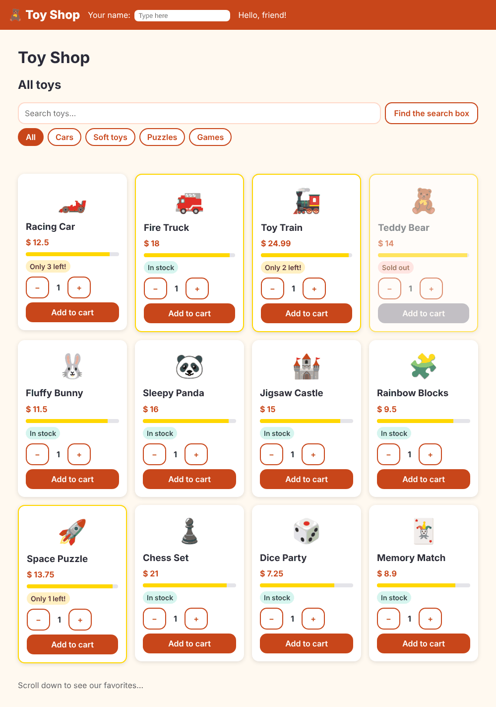

# Chapter 6: Directives

> **Like I'm 5:** A directive is a sticker you put on a toy. Some stickers change how the toy looks (a gold border). Some stickers make it do a trick (glow when you point at it). The toy is still the same toy.

Concept reference: [04. Directives](../concepts/04-directives.md)

[Back: Chapter 5](05-control-flow.md) · Next: [Chapter 7: Pipes](07-pipes.md)

## What we build today

Three little upgrades for the product card:

1. Popular toys (rated 4.7 or more) get a **gold border**.
2. A **star bar** shows the rating as a coloured line.
3. When you point the mouse at a price, it **lights up** (a directive we write ourselves).



## The big idea

A component is "an element with its own template". A **directive** is "behaviour you attach to an element that already exists". You add it like an attribute.

There are three kinds:

| Kind | What it does | Example |
|------|--------------|---------|
| **Component** | A directive that has a template | `<app-product-card>` |
| **Attribute directive** | Changes how an element looks or acts | `[ngClass]`, `[ngStyle]`, `appHighlight` |
| **Structural directive** | Adds or removes pieces of the page | the old `*ngIf` and `*ngFor` (now `@if` and `@for`, see Chapter 5) |

Angular ships two helpful attribute directives:

- **`ngClass`**: turn several CSS classes on or off at once, from an object.
- **`ngStyle`**: set several CSS styles at once, from an object.

(For *one* class or *one* style, prefer `[class.x]="..."` and `[style.width.%]="..."`. They are simpler.)

**Grown-up words:**

- **Host element**: the element a directive is stuck on.
- **`host` metadata**: how a directive listens to events on, and sets properties of, its host element.
- **Input alias**: the name you write in the template can differ from the field name in the class.
- **Composition (`hostDirectives`)**: a component or directive that brings other directives along.

## Step 1: Several classes at once, with `ngClass`

Until now the card used `[class.sold-out]="..."` for one class. Now it needs two: `sold-out` and `popular`. `ngClass` takes an object where each key is a class name and each value says whether the class is on.

Change the card's brain:

**`src/app/components/product-card/product-card.ts`** (what changed)

```diff
@@ -1,4 +1,6 @@
+import { NgClass, NgStyle } from '@angular/common';
 import { Component, computed, input, output, signal } from '@angular/core';
+import { Highlight } from '../../directives/highlight';
 import { Product } from '../../models/product';
 import { QuantityStepper } from '../quantity-stepper/quantity-stepper';
 
@@ -8,7 +10,7 @@ export interface AddedEvent {
 }
 
 @Component({
-  imports: [QuantityStepper],
+  imports: [QuantityStepper, NgClass, NgStyle, Highlight],
   selector: 'app-product-card',
   styleUrl: './product-card.css',
   templateUrl: './product-card.html',
@@ -18,13 +20,21 @@ export class ProductCard {
   added = output<AddedEvent>();
   quantity = signal(1);
 
-  // computed() works out an answer from other boxes, and updates by itself.
   stockLevel = computed(() => {
     const stock = this.product().stock;
     if (stock === 0) return 'out';
     return stock <= 3 ? 'low' : 'ok';
   });
 
+  // ngClass takes an object: "add this class when the answer is true".
+  cardClasses = computed(() => ({
+    'sold-out': this.stockLevel() === 'out',
+    popular: this.product().rating >= 4.7,
+  }));
+
+  // ngStyle takes an object of CSS values. Here: how wide the star bar is.
+  ratingPercent = computed(() => (this.product().rating / 5) * 100);
+
   add() {
     this.added.emit({ product: this.product(), quantity: this.quantity() });
   }
```

- `NgClass` and `NgStyle` come from `@angular/common`, and, like every brick, they go into `imports`.
- `cardClasses` is a `computed`. It returns `{ 'sold-out': true/false, popular: true/false }` and updates by itself when the toy changes.
- `ratingPercent` turns a rating like 4.5 into a percentage (90). That will be the width of the star bar.

## Step 2: The star bar and the lit-up price

Change the template. The `article` uses `ngClass`, the price gets our (soon to exist) `appHighlight`, and the star bar uses `ngStyle`:

**`src/app/components/product-card/product-card.html`** (what changed)

```diff
@@ -1,9 +1,18 @@
 @let p = product();
 
-<article class="card" [class.sold-out]="stockLevel() === 'out'">
+<article class="card" [ngClass]="cardClasses()">
   <div class="emoji" aria-hidden="true">{{ p.emoji }}</div>
   <h3>{{ p.name }}</h3>
-  <p class="price">$ {{ p.price }}</p>
+  <p class="price" appHighlight="#ffe08a">$ {{ p.price }}</p>
+
+  <div
+    class="stars"
+    role="img"
+    [attr.aria-label]="'Rated ' + p.rating + ' out of 5'"
+    title="Rated {{ p.rating }} out of 5"
+  >
+    <div class="stars-fill" [ngStyle]="{ width: ratingPercent() + '%' }"></div>
+  </div>
 
   @switch (stockLevel()) {
     @case ('out') {
```

- `[ngClass]="cardClasses()"` replaces the single `[class.sold-out]`.
- `[ngStyle]="{ width: ratingPercent() + '%' }"` sets the width of the gold bar inside the grey bar.
- `role="img"` plus `aria-label` make the bar understandable for people who cannot see it. `title="Rated {{ p.rating }} out of 5"` shows the same text as a tooltip. (Chapter 21 is about accessibility.)

And the paint:

**`src/app/components/product-card/product-card.css`** (what changed)

```diff
@@ -49,3 +49,20 @@
   background: #ffd9dc;
   color: #7a121b;
 }
+
+.card.popular {
+  border: 2px solid gold;
+}
+
+/* A grey bar with a gold bar on top. The gold bar's width is the rating. */
+.stars {
+  height: 0.5rem;
+  border-radius: 999px;
+  background: #e3e3ea;
+  overflow: hidden;
+}
+
+.stars-fill {
+  height: 100%;
+  background: gold;
+}
```

## Step 3: Write your own directive

Now the fun part: our own sticker. We want `<p appHighlight="#ffe08a">` to light up when the mouse comes near.

```bash
ng generate directive directives/highlight
```

Replace the generated class with:

**`src/app/directives/highlight.ts`**

```ts
import { Directive, input, signal } from '@angular/core';

@Directive({
  selector: '[appHighlight]',
  // "host" lets the directive talk to the element it is stuck on.
  host: {
    '(mouseenter)': 'turnOn()',
    '(mouseleave)': 'turnOff()',
    '[style.background-color]': 'background()',
  },
})
export class Highlight {
  // Usage: <p appHighlight="#ffe08a">  (if you give no color, we use yellow)
  color = input('', { alias: 'appHighlight' });

  protected background = signal('');

  turnOn() {
    this.background.set(this.color() || '#ffe08a');
  }

  turnOff() {
    this.background.set('');
  }
}
```

Read it piece by piece:

- `selector: '[appHighlight]'`: the square brackets mean "match any element that has this **attribute**".
- `host: { ... }` says how the directive talks to the element it sits on:
  - `'(mouseenter)': 'turnOn()'`: when the mouse enters, run `turnOn()`.
  - `'(mouseleave)': 'turnOff()'`: when it leaves, run `turnOff()`.
  - `'[style.background-color]': 'background()'`: keep the element's background colour equal to our signal.
- `color = input('', { alias: 'appHighlight' })`: the colour is passed as `appHighlight="#ffe08a"`. The alias lets the attribute and the input have the same name.
- If no colour is given, we use a soft yellow (`this.color() || '#ffe08a'`).

The directive has no template. It only watches and paints. That is why it is a directive and not a component.

## Step 4: Test the sticker

A directive needs an element to stick on, so the test makes a small **host component** that uses it:

**`src/app/directives/highlight.spec.ts`**

```ts
import { Component } from '@angular/core';
import { TestBed } from '@angular/core/testing';
import { Highlight } from './highlight';

@Component({
  imports: [Highlight],
  template: `<p appHighlight="#ff0000">Hover me</p>`,
})
class TestHost {}

describe('Highlight', () => {
  it('paints the element when the mouse comes in, and clears it when it leaves', async () => {
    const fixture = TestBed.createComponent(TestHost);
    await fixture.whenStable();
    const p: HTMLElement = fixture.nativeElement.querySelector('p');

    p.dispatchEvent(new Event('mouseenter'));
    await fixture.whenStable();
    expect(p.style.backgroundColor).toBe('rgb(255, 0, 0)');

    p.dispatchEvent(new Event('mouseleave'));
    await fixture.whenStable();
    expect(p.style.backgroundColor).toBe('');
  });
});
```

The test fakes the mouse with `dispatchEvent(new Event('mouseenter'))`, waits, and checks the background colour. Colours come back from the browser as `rgb(...)`, so we compare with `rgb(255, 0, 0)`.

## Check it works

```bash
npx ng test --watch=false
```

```
 Test Files  8 passed (8)
      Tests  12 passed (12)
```

In the browser:

- [ ] Teddy Bear (4.9), Toy Train (4.8), Fire Truck (4.7), and Space Puzzle (4.7) have a gold border; Dice Party (4.0) does not.
- [ ] Every card has a grey bar with a gold part. The better the rating, the longer the gold part.
- [ ] Move the mouse over a price: it gets a yellow background. Move away: it goes back.

## Bonus lab: two more kinds of stickers

The Toy Shop does not need these, but you will meet them in real projects, and interviewers love them. The files are in [`extras/ch06`](extras/ch06/). To try them, copy that folder to `src/app/extras/` in your project and run the tests.

**A structural directive** decides *how many copies of a piece of template* to draw. `*appRepeat="3"` draws its element three times:

**`src/app/extras/repeat.ts`**

```ts
import { Directive, effect, inject, input, TemplateRef, ViewContainerRef } from '@angular/core';

// A structural directive: it decides how many copies of a template to draw.
// Usage:  <span *appRepeat="3">⭐</span>
@Directive({ selector: '[appRepeat]' })
export class Repeat {
  times = input.required<number>({ alias: 'appRepeat' });

  private template = inject(TemplateRef);
  private container = inject(ViewContainerRef);

  constructor() {
    effect(() => {
      this.container.clear();
      for (let i = 0; i < this.times(); i++) {
        this.container.createEmbeddedView(this.template, { $implicit: i });
      }
    });
  }
}
```

- `TemplateRef` is the blueprint (the element the star sits on).
- `ViewContainerRef` is the place where copies can be drawn.
- The `*` in `*appRepeat="3"` is a shortcut. Angular wraps the element in an `<ng-template>` for you.
- `effect()` runs again whenever `times()` changes, so the number of stars follows the number.

You would write `<span *appRepeat="3; let i">⭐{{ i }}</span>` in a template. In modern Angular, `@for` covers most needs, so you rarely write structural directives. But now you know what was behind `*ngIf`.

**Composition** with `hostDirectives` lets a component carry a directive with it, so users do not have to add the sticker themselves:

**`src/app/extras/fancy-note.ts`**

```ts
import { Component } from '@angular/core';
import { Highlight } from '../directives/highlight';

// hostDirectives: this component comes with the Highlight sticker already stuck on.
@Component({
  selector: 'app-fancy-note',
  hostDirectives: [{ directive: Highlight, inputs: ['appHighlight: color'] }],
  template: `<ng-content />`,
})
export class FancyNote {}
```

`<app-fancy-note color="#ff0000">Hi</app-fancy-note>` now lights up on hover. `inputs: ['appHighlight: color']` renames the directive's input to `color` for the component's users.

**`src/app/extras/extras.spec.ts`**

```ts
import { Component } from '@angular/core';
import { TestBed } from '@angular/core/testing';
import { FancyNote } from './fancy-note';
import { Repeat } from './repeat';

@Component({
  imports: [Repeat, FancyNote],
  template: `
    <p><span *appRepeat="count; let i" class="star">⭐{{ i }}</span></p>
    <app-fancy-note color="#ff0000">Hi</app-fancy-note>
  `,
})
class Host {
  count = 3;
}

describe('extra directives', () => {
  it('*appRepeat draws the template N times', async () => {
    const fixture = TestBed.createComponent(Host);
    await fixture.whenStable();
    expect(fixture.nativeElement.querySelectorAll('.star').length).toBe(3);
    expect(fixture.nativeElement.querySelector('.star').textContent).toContain('⭐0');
  });

  it('the host directive paints the component on hover', async () => {
    const fixture = TestBed.createComponent(Host);
    await fixture.whenStable();
    const note: HTMLElement = fixture.nativeElement.querySelector('app-fancy-note');
    note.dispatchEvent(new Event('mouseenter'));
    await fixture.whenStable();
    expect(note.style.backgroundColor).toBe('rgb(255, 0, 0)');
  });
});
```

## What you learned

- A directive adds behaviour to an existing element; a component is a directive with a template.
- `ngClass` and `ngStyle` take objects. For a single class or style, `[class.x]` and `[style.x]` are simpler.
- A custom attribute directive uses `selector: '[name]'`, and `host` to listen to events and set properties on its element.
- `input(..., { alias })` lets the template name differ from the field name.
- Structural directives use `TemplateRef` and `ViewContainerRef`; `hostDirectives` brings directives along with a component.

## Try it yourself

1. Change `popular` to start at a rating of 4.5. Which cards get the gold border now?
2. Add a second input to `Highlight`, `delay`, so that the highlight turns on after a number of milliseconds. (Hint: `setTimeout` and `clearTimeout` in `turnOn` and `turnOff`.)
3. Put `appHighlight` on the toy's name too, with a different colour. Reuse is the point of directives!
4. Make a directive `appBold` that sets `font-weight` to 800 on its host using `host: { '[style.font-weight]': '"800"' }`.

## If something goes wrong

**You forget to import a directive that is used as a plain attribute:** nothing happens, and there is no error. HTML allows any attribute on any element, so Angular cannot tell a typo from a directive. If a sticker does nothing, check the component's `imports` first.

**You import something you do not use:** the compiler warns you:

```
▲ [WARNING] NG8113: Highlight is not used within the template of ProductCard
```

Remove it from `imports`. This keeps your bundle small.

**`Can't bind to 'ngClass' since it isn't a known property`:** you forgot to import `NgClass`. Properties like `[ngClass]` do raise an error, unlike plain attributes.

Next: [Chapter 7: Pipes](07-pipes.md)
