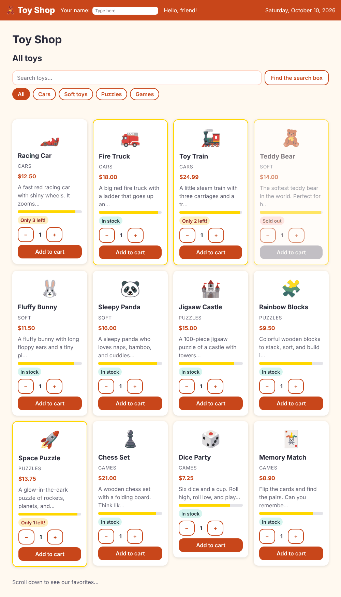

# Chapter 7: Pipes

> **Like I'm 5:** A pipe is a little machine on a conveyor belt. A plain number goes in one end (12.5) and a nicely dressed price comes out the other end ($12.50). The number itself is not changed, only how it looks.

Concept reference: [06. Pipes](../concepts/06-pipes.md)

[Back: Chapter 6](06-directives.md) · Next: [Chapter 8: Lifecycle hooks](08-lifecycle-hooks.md)

## What we build today

We tidy up how things look:

- Prices become real prices: `$12.50`.
- Categories get capital letters: `Cars`.
- Long descriptions get cut short with "…" (a pipe we write ourselves).
- The header shows today's date written out in full.



## The big idea

Data is often not in the shape people want to read. `12.5` is a number; people want `$12.50`. A `Date` object is a pile of milliseconds; people want "Saturday, October 10". We could fix this in the brain of the component, but then every component repeats the same code.

A **pipe** does the formatting *in the template*, using the `|` ("pipe") sign:

```html
{{ price | currency }}          → $12.50
{{ 'cars' | titlecase }}        → Cars
{{ today | date: 'fullDate' }}  → Saturday, October 10, 2026
{{ text | truncate: 50 }}       → The first fifty letters…
```

Parts after a colon are arguments: `date: 'fullDate'`. You can chain pipes: `{{ name | uppercase | slice: 0 : 3 }}`.

**Built-in pipes** you will use a lot:

| Pipe | What it does |
|------|--------------|
| `currency` | numbers to money (`$12.50`) |
| `number` | decimals and thousands (`1,234.50`) |
| `percent` | `0.25` to `25%` |
| `date` | dates in many styles |
| `uppercase`, `lowercase`, `titlecase` | letter case |
| `slice` | part of a string or an array |
| `json` | an object as text (good for debugging) |
| `keyvalue` | loop over an object's keys |
| `async` | unwrap an Observable (Chapter 12) |

**Grown-up words:**

- **Pure pipe**: runs again only when its **input value** changes. All built-in pipes (except `async`) and the pipes you write by default are pure. They are fast.
- **Impure pipe**: runs every time Angular checks the page. Rarely a good idea.
- **Transform**: the one method every pipe has, `transform(value, ...args)`.

## Step 1: Use the built-in pipes

Open `product-card.html` and change three lines. A category in title case, the price as currency, and a short description:

**`src/app/components/product-card/product-card.html`** (what changed)

```diff
@@ -3,7 +3,9 @@
 <article class="card" [ngClass]="cardClasses()">
   <div class="emoji" aria-hidden="true">{{ p.emoji }}</div>
   <h3>{{ p.name }}</h3>
-  <p class="price" appHighlight="#ffe08a">$ {{ p.price }}</p>
+  <p class="category">{{ p.category | titlecase }}</p>
+  <p class="price" appHighlight="#ffe08a">{{ p.price | currency }}</p>
+  <p class="description">{{ p.description | truncate: 50 }}</p>
 
   <div
     class="stars"
```

Every pipe is a little class, so it must be in `imports`. Two come from `@angular/common` and one is ours (next step):

**`src/app/components/product-card/product-card.ts`** (what changed)

```diff
@@ -1,7 +1,8 @@
-import { NgClass, NgStyle } from '@angular/common';
+import { CurrencyPipe, NgClass, NgStyle, TitleCasePipe } from '@angular/common';
 import { Component, computed, input, output, signal } from '@angular/core';
 import { Highlight } from '../../directives/highlight';
 import { Product } from '../../models/product';
+import { TruncatePipe } from '../../pipes/truncate-pipe';
 import { QuantityStepper } from '../quantity-stepper/quantity-stepper';
 
 export interface AddedEvent {
@@ -10,7 +11,15 @@ export interface AddedEvent {
 }
 
 @Component({
-  imports: [QuantityStepper, NgClass, NgStyle, Highlight],
+  imports: [
+    QuantityStepper,
+    NgClass,
+    NgStyle,
+    Highlight,
+    CurrencyPipe,
+    TitleCasePipe,
+    TruncatePipe,
+  ],
   selector: 'app-product-card',
   styleUrl: './product-card.css',
   templateUrl: './product-card.html',
```

A little paint for the new lines:

**`src/app/components/product-card/product-card.css`** (what changed)

```diff
@@ -66,3 +66,14 @@
   height: 100%;
   background: gold;
 }
+
+.category {
+  color: var(--color-muted);
+  font-size: 0.875rem;
+  text-transform: uppercase;
+  letter-spacing: 0.05em;
+}
+
+.description {
+  color: var(--color-muted);
+}
```

## Step 2: Write your own pipe

There is no built-in pipe for "cut the text and add dots", so make one:

```bash
ng generate pipe pipes/truncate
```

Fill in the generated file `src/app/pipes/truncate-pipe.ts` (pipes get a `-pipe` ending in their file name in Angular 22):

**`src/app/pipes/truncate-pipe.ts`**

```ts
import { Pipe, PipeTransform } from '@angular/core';

@Pipe({
  name: 'truncate',
})
export class TruncatePipe implements PipeTransform {
  // Usage: {{ text | truncate: 40 }}   or   {{ text | truncate: 40 : '...' }}
  transform(value: string | null | undefined, limit = 40, ellipsis = '…'): string {
    if (!value) return '';
    return value.length > limit ? value.slice(0, limit).trimEnd() + ellipsis : value;
  }
}
```

- `@Pipe({ name: 'truncate' })` is the name you will type after the `|`.
- `transform(value, limit = 40, ellipsis = '…')` is the machine. The first parameter is whatever comes in from the left. The others are the arguments after the colons. `limit` and `ellipsis` have defaults, so `{{ text | truncate }}` works too.
- If the text is missing (`null` or `undefined`) we return an empty string instead of crashing.
- `value.slice(0, limit).trimEnd()` takes the first `limit` letters and removes any space at the end, so we do not get "toys …".

A pipe is a plain class with no Angular in its logic, so the test is very easy, with no component or browser involved:

**`src/app/pipes/truncate-pipe.spec.ts`**

```ts
import { TruncatePipe } from './truncate-pipe';

describe('TruncatePipe', () => {
  const pipe = new TruncatePipe();

  it('leaves short text alone', () => {
    expect(pipe.transform('Hello', 10)).toBe('Hello');
  });

  it('cuts long text and adds an ellipsis', () => {
    expect(pipe.transform('A very long sentence about toys', 11)).toBe('A very long…');
  });

  it('handles missing text', () => {
    expect(pipe.transform(undefined)).toBe('');
    expect(pipe.transform(null)).toBe('');
  });
});
```

## Step 3: Today's date in the header

Teach the header to show the date:

**`src/app/components/site-header/site-header.ts`** (what changed)

```diff
@@ -1,12 +1,14 @@
+import { DatePipe } from '@angular/common';
 import { Component, signal } from '@angular/core';
 import { FormsModule } from '@angular/forms';
 
 @Component({
-  imports: [FormsModule],
+  imports: [FormsModule, DatePipe],
   selector: 'app-site-header',
   styleUrl: './site-header.css',
   templateUrl: './site-header.html',
 })
 export class SiteHeader {
   shopperName = signal('');
+  today = new Date();
 }
```

**`src/app/components/site-header/site-header.html`** (what changed)

```diff
@@ -7,4 +7,5 @@
   </label>
 
   <span>Hello, {{ shopperName() || 'friend' }}!</span>
+  <span class="today">{{ today | date: 'fullDate' }}</span>
 </header>
```

**`src/app/components/site-header/site-header.css`** (what changed)

```diff
@@ -19,3 +19,7 @@
   border-radius: 8px;
   border: 0;
 }
+
+.today {
+  margin-left: auto;
+}
```

`date: 'fullDate'` is a ready-made format. You can also write your own pattern, like `date: 'dd/MM/yyyy'`, or `'shortTime'`, `'mediumDate'`.

## Check it works

```bash
npx ng test --watch=false
```

```
 Test Files  9 passed (9)
      Tests  15 passed (15)
```

In the browser:

- [ ] Prices show as `$12.50`, `$18.00`, `$24.99`.
- [ ] Categories read `Cars`, `Soft`, `Puzzles`, `Games`.
- [ ] Long descriptions end with "…".
- [ ] The header shows today's date written out in full, on the right.

## Bonus lab: pure and impure pipes

"Why is a pure pipe fast?" is a favourite interview question, so let's *see* it. The file [`extras/ch07/pure-impure.spec.ts`](extras/ch07/pure-impure.spec.ts) has two pipes that count how often they run. Copy it to `src/app/extras/` and run the tests.

**`src/app/extras/pure-impure.spec.ts`**

```ts
import { ChangeDetectionStrategy, Component, Pipe, PipeTransform, signal } from '@angular/core';
import { TestBed } from '@angular/core/testing';

let pureCalls = 0;
let impureCalls = 0;

// A normal ("pure") pipe runs again only when its input value changes.
@Pipe({ name: 'pureCount' })
class PureCount implements PipeTransform {
  transform(value: number) {
    pureCalls++;
    return value;
  }
}

// An impure pipe runs every time Angular checks the page. Use with great care!
@Pipe({ name: 'impureCount', pure: false })
class ImpureCount implements PipeTransform {
  transform(value: number) {
    impureCalls++;
    return value;
  }
}

// Eager = "check me on every round". (In Angular 22 components are OnPush by default, and an
// untouched OnPush component is skipped, which would hide the difference we want to see.)
@Component({
  changeDetection: ChangeDetectionStrategy.Eager,
  imports: [PureCount, ImpureCount],
  template: `{{ n() | pureCount }} {{ n() | impureCount }}`,
})
class Host {
  n = signal(1);
}

describe('pure and impure pipes', () => {
  it('a pure pipe runs once per new value, an impure pipe runs on every check', async () => {
    const fixture = TestBed.createComponent(Host);
    await fixture.whenStable();

    // Ask Angular to check the page five more times. Nothing changed.
    for (let i = 0; i < 5; i++) fixture.detectChanges();
    expect(pureCalls).toBe(1);
    expect(impureCalls).toBeGreaterThan(5);

    // Now the value really changes: the pure pipe runs one more time.
    fixture.componentInstance.n.set(2);
    await fixture.whenStable();
    expect(pureCalls).toBe(2);
  });
});
```

After five "nothing changed" checks, the pure pipe has run **once**; the impure one has run more than five times. When the value really changes, the pure pipe runs once more. That is why you should do a heavy job in a pure pipe or a `computed()`, never in a plain method call inside the template (a method is called on every check, like an impure pipe).

Look at the comment about `Eager`. In Angular 22 components skip unchanged checks by default, and the demo only works if we ask for the "check me every time" mode. Chapter 16 explains why.

## What you learned

- Pipes change how a value is shown without changing the value, with `|`.
- Arguments follow colons; pipes can be chained.
- Pipes you use must be listed in `imports`, like any other brick.
- A custom pipe is a class with `@Pipe` and a `transform` method, and it is easy to unit-test.
- Pure pipes run only when their input changes; impure ones run on every check.

## Try it yourself

1. Show the rating as a percentage with `percent`: `{{ p.rating / 5 | percent }}`.
2. Change `date: 'fullDate'` to `date: 'EEE, d MMM'` and see how the pattern letters work.
3. Make the card say `{{ p.name | uppercase }}`. Then chain: `{{ p.name | uppercase | slice: 0 : 5 }}`.
4. Write a pipe `stars` that turns `4.5` into `★★★★½`. Test it without any component.

## If something goes wrong

**The pipe is not found:**

```
✘ [ERROR] NG8004: No pipe found with name 'truncate'.
```

Add `TruncatePipe` to the component's `imports`. (The name in the template, `truncate`, comes from `@Pipe({ name })`. The class name, `TruncatePipe`, goes into `imports`.)

**The currency shows a different symbol or format:** pipes use the app's *locale*. We switch to Hindi and other formats in Chapter 22.

**Numbers like `12.5` look odd with the `number` pipe:** the pattern is `{{ value | number: '1.2-2' }}` which means "at least 1 digit before the point, and exactly 2 after".

Next: [Chapter 8: Lifecycle hooks](08-lifecycle-hooks.md)
