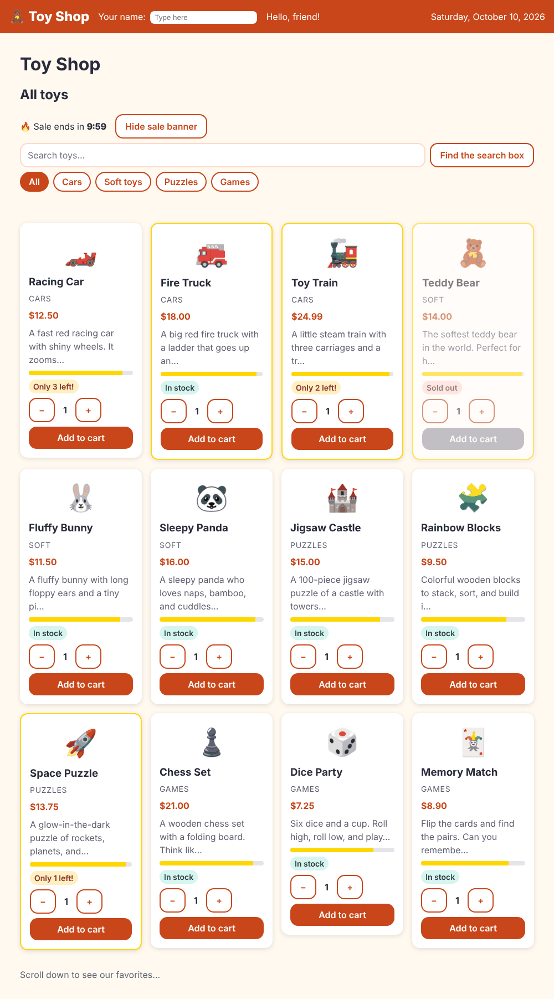

# Chapter 8: Lifecycle hooks

> **Like I'm 5:** A toy goes through a life. It is built in the factory, put on the shelf, played with, and finally put away. A lifecycle hook is a little note that says "tell me when the toy is built", or "tell me when it is put away, so I can switch off its batteries".

Concept reference: [07. Lifecycle hooks](../concepts/07-lifecycle-hooks.md)

[Back: Chapter 7](07-pipes.md) · Next: [Chapter 9: Services and dependency injection](09-services-and-dependency-injection.md)

## What we build today

A **sale countdown** ("Sale ends in 9:58") that ticks every second, and a button that hides and shows the sale banner. Hiding the banner destroys the countdown, so we must switch its clock off properly. If we forget, the clock keeps ticking in the dark (a "memory leak"). This is the best way to see why lifecycle hooks exist.



## The big idea

Every component is born, lives, and dies. Angular lets you hook into the important moments:

| Moment | Hook | What it is good for |
|--------|------|---------------------|
| Born | `constructor` | Only to receive helpers (Chapter 9). No real work yet. |
| An input changed | `ngOnChanges` | React when the parent sends something new |
| Ready to work | `ngOnInit` | The inputs have arrived. Start work, load data, start timers. |
| Checked | `ngDoCheck` | Rare. Runs on every check. |
| Pieces drawn | `ngAfterContentInit`, `ngAfterViewInit` | Touch projected content or child views |
| On the screen | `afterNextRender`, `afterEveryRender` | Things that need the **real DOM** in the browser |
| Leaving | `ngOnDestroy` | Clean up: stop timers, close connections |

Three rules to remember:

1. **Constructor = get helpers.** `ngOnInit` = start work.
2. **Whatever you start, you stop.** Timers, listeners, and subscriptions must be cleaned up in `ngOnDestroy` (or with `DestroyRef`, shown below).
3. **Browser-only code goes in `afterNextRender`.** It never runs on a server, which matters in Chapter 28.

**Grown-up words:**

- **Memory leak**: something keeps running, or keeps memory, after it is no longer needed.
- **Interface `OnInit`/`OnDestroy`**: optional labels (`implements OnInit`) that make the compiler check you spelled the hook right.
- **`afterNextRender` / `afterEveryRender`**: the modern hooks that run after Angular has put the page on the screen, for work that needs the real browser.

## Step 1: The countdown component

```bash
ng generate component components/sale-countdown
```

**`src/app/components/sale-countdown/sale-countdown.ts`**

```ts
import { afterNextRender, Component, input, OnDestroy, OnInit, signal } from '@angular/core';

@Component({
  imports: [],
  selector: 'app-sale-countdown',
  styleUrl: './sale-countdown.css',
  templateUrl: './sale-countdown.html',
})
export class SaleCountdown implements OnInit, OnDestroy {
  endsAt = input.required<Date>();
  remaining = signal('');

  private timer?: ReturnType<typeof setInterval>;

  constructor() {
    // The constructor is only for getting helpers. Real work waits for later hooks.
    console.debug('1. constructor: I was just born');

    // afterNextRender runs once, after the first drawing is really on the screen.
    afterNextRender(() => console.debug('3. afterNextRender: I am on the screen'));
  }

  ngOnInit() {
    console.debug('2. ngOnInit: my inputs are ready, start the clock');
    this.tick();
    this.timer = setInterval(() => this.tick(), 1000);
  }

  ngOnDestroy() {
    console.debug('4. ngOnDestroy: I am leaving, stop the clock');
    clearInterval(this.timer);
  }

  private tick() {
    const ms = Math.max(0, this.endsAt().getTime() - Date.now());
    const minutes = Math.floor(ms / 60_000);
    const seconds = Math.floor((ms % 60_000) / 1000);
    this.remaining.set(`${minutes}:${seconds.toString().padStart(2, '0')}`);
  }
}
```

Read the numbers `1.` to `4.` in the `console.debug` lines. They are the order in which things happen:

1. **`constructor`**: the object exists. The input `endsAt` has **not** arrived yet, so we do not touch it.
2. **`ngOnInit`**: the parent has sent `endsAt`. We calculate the first time and start a one-second timer: `setInterval(() => this.tick(), 1000)`.
3. **`afterNextRender`**: the first drawing is on the screen. We registered it in the constructor, and it runs once.
4. **`ngOnDestroy`**: the component is leaving. We call `clearInterval` to stop the timer.

`tick()` does the sums: how many milliseconds are left, turned into `minutes:seconds`. `padStart(2, '0')` writes `5` as `05`.

The template is a single line, and a pinch of paint:

**`src/app/components/sale-countdown/sale-countdown.html`**

```html
<span class="countdown" role="timer" aria-live="off">{{ remaining() }}</span>
```

**`src/app/components/sale-countdown/sale-countdown.css`**

```css
.countdown {
  font-variant-numeric: tabular-nums;
  font-weight: 800;
}
```

`role="timer"` tells screen readers this is a clock. `aria-live="off"` keeps it from reading out every second.

## Step 2: Show it on the home page, with a switch

**`src/app/pages/home/home.ts`** (what changed)

```diff
@@ -1,13 +1,14 @@
 import { Component, computed, ElementRef, signal, viewChild } from '@angular/core';
 import { AddedEvent, ProductCard } from '../../components/product-card/product-card';
 import { RecommendedToys } from '../../components/recommended-toys/recommended-toys';
+import { SaleCountdown } from '../../components/sale-countdown/sale-countdown';
 import { sampleProducts } from '../../data/sample-products';
 import { Category } from '../../models/product';
 
 type CategoryChoice = 'all' | Category;
 
 @Component({
-  imports: [ProductCard, RecommendedToys],
+  imports: [ProductCard, RecommendedToys, SaleCountdown],
   selector: 'app-home',
   styleUrl: './home.css',
   templateUrl: './home.html',
@@ -16,6 +17,10 @@ export class Home {
   products = sampleProducts;
   lastAdded = signal('');
 
+  // The sale ends ten minutes from now.
+  saleEnds = new Date(Date.now() + 10 * 60 * 1000);
+  showSale = signal(true);
+
   categories: { id: CategoryChoice; label: string }[] = [
     { id: 'all', label: 'All' },
     { id: 'cars', label: 'Cars' },
```

**`src/app/pages/home/home.html`** (what changed)

```diff
@@ -1,5 +1,14 @@
 <h2>All toys</h2>
 
+<div class="sale">
+  @if (showSale()) {
+    <p>🔥 Sale ends in <app-sale-countdown [endsAt]="saleEnds" /></p>
+  }
+  <button class="btn secondary" type="button" (click)="showSale.set(!showSale())">
+    {{ showSale() ? 'Hide' : 'Show' }} sale banner
+  </button>
+</div>
+
 <div class="toolbar">
   <input #searchBox type="search" aria-label="Search toys" placeholder="Search toys…" />
   <button class="btn secondary" type="button" (click)="focusSearch()">Find the search box</button>
```

**`src/app/pages/home/home.css`** (what changed)

```diff
@@ -47,3 +47,15 @@
   margin-top: 2rem;
   color: var(--color-muted);
 }
+
+.sale {
+  display: flex;
+  flex-wrap: wrap;
+  align-items: center;
+  gap: 1rem;
+  margin-bottom: 0.5rem;
+}
+
+.sale p {
+  margin: 0;
+}
```

`@if (showSale())` creates or destroys the countdown. The button flips `showSale`. When the banner is hidden, Angular removes the component, and **`ngOnDestroy` runs**.

## Step 3: Watch the lifecycle happen

Open the browser's console (`F12`, **Console**). If the debug lines are hidden, open the log-level menu and turn on **Verbose**. Then reload the page, click **Hide sale banner**, then **Show sale banner**. The console writes:

```
1. constructor: I was just born
2. ngOnInit: my inputs are ready, start the clock
3. afterNextRender: I am on the screen
      (click "Hide sale banner")
4. ngOnDestroy: I am leaving, stop the clock
      (click "Show sale banner")
1. constructor: I was just born
2. ngOnInit: my inputs are ready, start the clock
3. afterNextRender: I am on the screen
```

That output was captured from the real app. A new component is born every time the banner comes back. The old one is gone, and its clock was stopped.

## Step 4: Test it with a fake clock

Waiting a real second in a test is slow and flaky. Instead we use a **fake clock** and move time forward by hand:

**`src/app/components/sale-countdown/sale-countdown.spec.ts`**

```ts
import { ComponentFixture, TestBed } from '@angular/core/testing';
import { SaleCountdown } from './sale-countdown';

describe('SaleCountdown', () => {
  let fixture: ComponentFixture<SaleCountdown>;

  beforeEach(async () => {
    // Fake clock: we decide when time moves, so the test never has to wait.
    vi.useFakeTimers();
    await TestBed.configureTestingModule({ imports: [SaleCountdown] }).compileComponents();

    fixture = TestBed.createComponent(SaleCountdown);
    fixture.componentRef.setInput('endsAt', new Date(Date.now() + 65_000));
    fixture.detectChanges();
  });

  afterEach(() => vi.useRealTimers());

  it('shows the time left', () => {
    expect(fixture.nativeElement.textContent).toContain('1:05');
  });

  it('counts down every second', () => {
    vi.advanceTimersByTime(1000);
    fixture.detectChanges();
    expect(fixture.nativeElement.textContent).toContain('1:04');
  });

  it('stops its clock when it is destroyed', () => {
    const stop = vi.spyOn(globalThis, 'clearInterval');
    fixture.destroy();
    expect(stop).toHaveBeenCalled();
  });
});
```

- `vi.useFakeTimers()` replaces the real timers. Time only moves when we say so.
- `vi.advanceTimersByTime(1000)` jumps one second ahead, and the countdown must say `1:04`.
- The last test destroys the component and checks that `clearInterval` was called. **That test is a guard against the memory leak.**
- We call `fixture.detectChanges()`, not `whenStable()`, because with a fake clock Angular's own "wait until stable" can never finish.

## Check it works

```bash
npx ng test --watch=false
```

```
 Test Files  10 passed (10)
      Tests  18 passed (18)
```

- [ ] The home page shows "🔥 Sale ends in 10:00" and counts down.
- [ ] **Hide sale banner** removes it. The console says `4. ngOnDestroy`.
- [ ] **Show sale banner** brings it back. It shows the *remaining* time, not a new ten minutes, because the end time (`saleEnds`) is kept by the home page, not by the countdown.

## Bonus: the modern way to clean up

Instead of `ngOnDestroy`, a component can register its cleanup right where it starts something, using `DestroyRef`:

```ts
import { DestroyRef, inject } from '@angular/core';

constructor() {
  const destroyRef = inject(DestroyRef);
  const timer = setInterval(() => this.tick(), 1000);
  destroyRef.onDestroy(() => clearInterval(timer));
}
```

Start and stop sit next to each other, so you cannot forget the stop. The same idea is used by `takeUntilDestroyed()` for RxJS (Chapter 12) and by Angular's own services (Chapter 9). In Chapter 28 we move our timer to `afterNextRender` too, so a server does not start a clock nobody will see.

## What you learned

- Components are born (`constructor`), get their inputs (`ngOnInit`), appear on screen (`afterNextRender`), and leave (`ngOnDestroy`).
- Start work in `ngOnInit`; stop it in `ngOnDestroy` or with `DestroyRef`.
- `@if` really destroys a component, so its cleanup really runs.
- Fake timers make time-based code easy to test.

## Try it yourself

1. Add `ngOnChanges(changes: SimpleChanges)` to `SaleCountdown` and log `changes`. When does it run? (Hint: it runs when the parent sends a value, before `ngOnInit`.)
2. Move `clearInterval` into a `DestroyRef.onDestroy` call and delete `ngOnDestroy`. Do the tests still pass?
3. Comment out the `clearInterval` line. Which test fails? (Always check that your tests can fail.)
4. Add `ngAfterViewInit` and log. In what order do the hooks fire compared with `afterNextRender`?

## If something goes wrong

**`Cannot read properties of undefined` in the constructor:** you used an input in the constructor. Inputs arrive after construction. Move the code to `ngOnInit`, or use `computed()` / `effect()`.

**The timer test hangs:** with fake timers, do not wait for `fixture.whenStable()`. Use `fixture.detectChanges()`.

**The countdown keeps running after you hide the banner:** your cleanup is missing. Open the console and check that `4. ngOnDestroy` appears.

Next: [Chapter 9: Services and dependency injection](09-services-and-dependency-injection.md)
