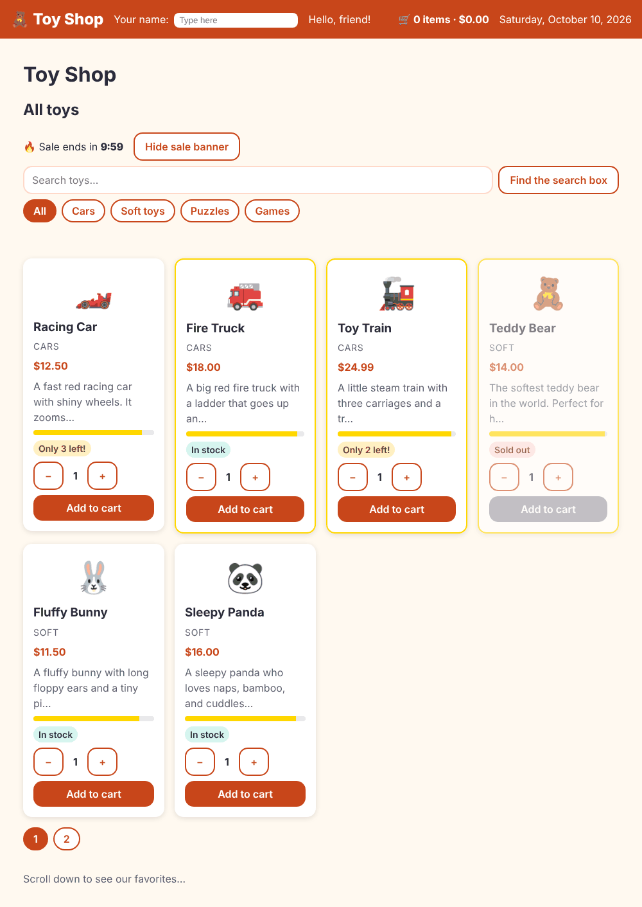

# Chapter 10: Signals

> **Like I'm 5:** A signal is a magic box with a bell. When you put a new toy in the box, the bell rings, and everybody who was looking at the box looks again. Nobody has to keep asking "did it change? did it change?".

Concept reference: [09. Signals](../concepts/09-signals.md)

[Back: Chapter 9](09-services-and-dependency-injection.md) · Next: [Chapter 11: Routing](11-routing.md)

## What we build today

A real **shopping cart**:

- Pressing **Add to cart** puts toys in a cart that the whole app shares.
- The header shows "🛒 3 items · $46.44" and updates by itself.
- The cart is **remembered** when you close the browser.
- The shelf is split into **pages of six toys**, and the page goes back to 1 when you pick another group.



## The big idea

We have already used signals in small ways (`likes = signal(0)`, `computed(...)`). Now let's understand them.

A **signal** is a box that holds a value and *knows who is looking at it*. There are four tools:

| Tool | What it is | Picture |
|------|-----------|---------|
| `signal(value)` | A box you can change with `.set()` and `.update()` | the toy box |
| `computed(() => ...)` | A box whose content is **worked out** from other boxes | a sign that always shows "number of toys × price" |
| `effect(() => ...)` | A little robot that **does something** whenever the boxes it reads change | a robot that writes every change into the notebook |
| `linkedSignal(...)` | A box that can be changed by hand **and** resets itself when another box changes | a page marker that goes back to page 1 when you change shelf |

Why signals instead of plain fields? Because Angular then knows *exactly* which parts of the page depend on which box, and redraws only those. Chapter 16 shows how much that helps.

Rules of thumb:

1. **Read** a signal by calling it: `count()`.
2. **Change** it with `.set(5)` or `.update(n => n + 1)`.
3. **Derive** with `computed`. Do not copy a value into another signal by hand.
4. **Effects are for the outside world**: saving to storage, logging, drawing on a canvas. Do not use an effect to compute one signal from another; that is what `computed` is for.
5. **Never change a signal's content in place** (`list().push(...)`). Replace it with a new one (`[...list, item]`). The box compares the old and new value to decide whether to ring the bell.

**Grown-up words:**

- **Reactive**: the page updates by itself when data changes.
- **Dependency tracking**: a `computed` or `effect` automatically notices which signals it read.
- **Memoization**: a `computed` remembers its answer until one of its ingredients changes.
- **`asReadonly()`**: gives out a box that others can read but not change.
- **`untracked()`**: reads a signal without becoming dependent on it.

## Step 1: The cart service

The cart must be shared (the home page adds, the header shows). A shared thing is a service (Chapter 9), and the signals live inside it.

First, what is in a cart? Describe a line of the cart in `src/app/models/cart-item.ts`:

**`src/app/models/cart-item.ts`**

```ts
import { Product } from './product';

export interface CartItem {
  product: Product;
  quantity: number;
}
```

Now the service:

```bash
ng generate service services/cart
```

**`src/app/services/cart-service.ts`**

```ts
import { computed, effect, inject, Service, signal } from '@angular/core';
import { CartItem } from '../models/cart-item';
import { Product } from '../models/product';
import { TAX_RATE } from '../tokens';

const STORAGE_KEY = 'toyshop-cart';

@Service()
export class CartService {
  private taxRate = inject(TAX_RATE);

  // A private box we can change, and a read-only view that everyone else uses.
  private readonly _items = signal<CartItem[]>(this.load());
  readonly items = this._items.asReadonly();

  // computed() boxes work themselves out from other boxes.
  readonly count = computed(() => this._items().reduce((n, i) => n + i.quantity, 0));
  readonly subtotal = computed(() =>
    this._items().reduce((sum, i) => sum + i.product.price * i.quantity, 0),
  );
  readonly tax = computed(() => this.subtotal() * this.taxRate);
  readonly total = computed(() => this.subtotal() + this.tax());

  constructor() {
    // effect() runs by itself every time the cart changes: save it for next time.
    effect(() => {
      localStorage.setItem(STORAGE_KEY, JSON.stringify(this._items()));
    });
  }

  add(product: Product, quantity = 1) {
    this._items.update((list) => {
      const found = list.find((i) => i.product.id === product.id);
      if (!found) {
        return [...list, { product, quantity: Math.min(quantity, product.stock) }];
      }
      return list.map((i) =>
        i.product.id === product.id
          ? { ...i, quantity: Math.min(i.quantity + quantity, product.stock) }
          : i,
      );
    });
  }

  setQuantity(productId: number, quantity: number) {
    if (quantity <= 0) {
      this.remove(productId);
      return;
    }
    this._items.update((list) =>
      list.map((i) => (i.product.id === productId ? { ...i, quantity } : i)),
    );
  }

  remove(productId: number) {
    this._items.update((list) => list.filter((i) => i.product.id !== productId));
  }

  clear() {
    this._items.set([]);
  }

  private load(): CartItem[] {
    try {
      return JSON.parse(localStorage.getItem(STORAGE_KEY) ?? '[]');
    } catch {
      return [];
    }
  }
}
```

Let's read it as a story:

- `_items = signal<CartItem[]>(this.load())` is the cart itself: a list in a box. It starts with whatever was saved last time. The underscore and `private` mean only the service may change it.
- `items = this._items.asReadonly()` is what everyone else gets: a box they can look at but not change. To change the cart you must call `add`, `setQuantity`, `remove`, or `clear`. That keeps all the rules in one place.
- `count`, `subtotal`, `tax`, `total` are `computed` boxes. They are never "updated". They are worked out from `_items` and the tax rate (injected, Chapter 9). Add a toy, and all four are right immediately.
- The `effect` in the constructor is the robot that saves the cart to `localStorage` every time it changes.
- `add()` uses `update` with a **new array** (`[...list, {...}]` or `list.map(...)`) so the box notices. `Math.min(..., product.stock)` makes sure nobody can buy more than we have.

Test the rules. A service full of logic is the easiest thing to test:

**`src/app/services/cart-service.spec.ts`**

```ts
import { TestBed } from '@angular/core/testing';
import { sampleProducts } from '../data/sample-products';
import { CartService } from './cart-service';

describe('CartService', () => {
  let cart: CartService;
  const [car, truck] = sampleProducts; // $12.50 and $18.00

  beforeEach(() => {
    localStorage.clear();
    cart = TestBed.inject(CartService);
  });

  it('starts empty', () => {
    expect(cart.count()).toBe(0);
    expect(cart.total()).toBe(0);
  });

  it('adds toys and works out the totals', () => {
    cart.add(car, 2); // 25.00
    cart.add(truck); // 18.00
    expect(cart.count()).toBe(3);
    expect(cart.subtotal()).toBeCloseTo(43);
    expect(cart.tax()).toBeCloseTo(3.44); // 8 percent
    expect(cart.total()).toBeCloseTo(46.44);
  });

  it('adds to the same line when the toy is already in the cart', () => {
    cart.add(car);
    cart.add(car);
    expect(cart.items().length).toBe(1);
    expect(cart.items()[0].quantity).toBe(2);
  });

  it('never lets you buy more than the stock', () => {
    cart.add(car, 99); // only 3 in stock
    expect(cart.items()[0].quantity).toBe(3);
  });

  it('removes a line when the quantity becomes zero', () => {
    cart.add(car);
    cart.setQuantity(car.id, 0);
    expect(cart.items()).toEqual([]);
  });

  it('remembers the cart in localStorage', () => {
    cart.add(car, 2);
    TestBed.tick(); // lets the effect run
    const saved = JSON.parse(localStorage.getItem('toyshop-cart') ?? '[]');
    expect(saved[0].quantity).toBe(2);
  });
});
```

Notice `TestBed.tick()` in the last test. Effects run on Angular's schedule, not instantly. `tick()` says "run the scheduled work now".

## Step 2: Connect the home page

When a card shouts "added!" (Chapter 4), the page now puts the toys in the cart:

**`src/app/pages/home/home.ts`** (what changed)

```diff
@@ -1,8 +1,17 @@
-import { Component, computed, ElementRef, inject, signal, viewChild } from '@angular/core';
+import {
+  Component,
+  computed,
+  ElementRef,
+  inject,
+  linkedSignal,
+  signal,
+  viewChild,
+} from '@angular/core';
 import { AddedEvent, ProductCard } from '../../components/product-card/product-card';
 import { RecommendedToys } from '../../components/recommended-toys/recommended-toys';
 import { SaleCountdown } from '../../components/sale-countdown/sale-countdown';
 import { Category } from '../../models/product';
+import { CartService } from '../../services/cart-service';
 import { ProductService } from '../../services/product-service';
 
 type CategoryChoice = 'all' | Category;
@@ -16,6 +25,7 @@ type CategoryChoice = 'all' | Category;
 export class Home {
   // inject() asks Angular for the helper we need.
   private productService = inject(ProductService);
+  private cart = inject(CartService);
 
   products = this.productService.getAll();
   lastAdded = signal('');
@@ -39,6 +49,17 @@ export class Home {
     return chosen === 'all' ? this.products : this.products.filter((p) => p.category === chosen);
   });
 
+  // Pages of six toys. linkedSignal is a box that goes back to page 1
+  // by itself whenever the chosen category changes.
+  readonly pageSize = 6;
+  page = linkedSignal({ source: this.category, computation: () => 1 });
+  pageCount = computed(() => Math.max(1, Math.ceil(this.visible().length / this.pageSize)));
+  pageNumbers = computed(() => Array.from({ length: this.pageCount() }, (_, i) => i + 1));
+  pageItems = computed(() => {
+    const start = (this.page() - 1) * this.pageSize;
+    return this.visible().slice(start, start + this.pageSize);
+  });
+
   // The three toys with the best stars.
   topRated = computed(() => [...this.products].sort((a, b) => b.rating - a.rating).slice(0, 3));
 
@@ -49,6 +70,7 @@ export class Home {
   }
 
   onAdded(event: AddedEvent) {
+    this.cart.add(event.product, event.quantity);
     this.lastAdded.set(`${event.quantity} × ${event.product.name}`);
   }
 }
```

(The `onAdded` change is at the bottom. The rest is for paging, see Step 4.)

## Step 3: Show the cart in the header

**`src/app/components/site-header/site-header.ts`** (what changed)

```diff
@@ -1,16 +1,18 @@
-import { DatePipe } from '@angular/common';
+import { CurrencyPipe, DatePipe } from '@angular/common';
 import { Component, inject, signal } from '@angular/core';
 import { FormsModule } from '@angular/forms';
+import { CartService } from '../../services/cart-service';
 import { SHOP_NAME } from '../../tokens';
 
 @Component({
-  imports: [FormsModule, DatePipe],
+  imports: [FormsModule, DatePipe, CurrencyPipe],
   selector: 'app-site-header',
   styleUrl: './site-header.css',
   templateUrl: './site-header.html',
 })
 export class SiteHeader {
   shopName = inject(SHOP_NAME);
+  cart = inject(CartService);
   shopperName = signal('');
   today = new Date();
 }
```

**`src/app/components/site-header/site-header.html`** (what changed)

```diff
@@ -7,5 +7,8 @@
   </label>
 
   <span>Hello, {{ shopperName() || 'friend' }}!</span>
+  <span class="cart-summary" aria-live="polite">
+    🛒 {{ cart.count() }} items · {{ cart.total() | currency }}
+  </span>
   <span class="today">{{ today | date: 'fullDate' }}</span>
 </header>
```

**`src/app/components/site-header/site-header.css`** (what changed)

```diff
@@ -20,6 +20,7 @@
   border: 0;
 }
 
-.today {
+.cart-summary {
   margin-left: auto;
+  font-weight: 700;
 }
```

`{{ cart.count() }}` and `{{ cart.total() | currency }}` read the signals. Angular notices that the header's template read them, so when they change it redraws the header, and nothing else.

## Step 4: Pages with `linkedSignal`

Twelve toys on one page is a lot. Let's show six at a time. The page number should go back to 1 when the group changes (page 3 of "Cars" makes no sense if Cars has one page). That is exactly what `linkedSignal` does:

```ts
page = linkedSignal({ source: this.category, computation: () => 1 });
```

Read it as: "`page` is a box. Normally it holds what you put in it. But whenever `category` changes, `page` is reset to 1." It is in the `home.ts` change you already made above, along with `pageCount`, `pageNumbers`, and `pageItems`, all `computed`.

The template gets a small page bar:

**`src/app/pages/home/home.html`** (what changed)

```diff
@@ -35,13 +35,29 @@
 </p>
 
 <div class="grid">
-  @for (p of visible(); track p.id) {
+  @for (p of pageItems(); track p.id) {
     <app-product-card [product]="p" (added)="onAdded($event)" />
   } @empty {
     <p>No toys here yet. 🧸</p>
   }
 </div>
 
+@if (pageCount() > 1) {
+  <nav class="pages" aria-label="Pages">
+    @for (n of pageNumbers(); track n) {
+      <button
+        type="button"
+        class="chip"
+        [class.active]="page() === n"
+        [attr.aria-current]="page() === n ? 'page' : null"
+        (click)="page.set(n)"
+      >
+        {{ n }}
+      </button>
+    }
+  </nav>
+}
+
 @defer (on viewport) {
   <app-recommended-toys [toys]="topRated()" />
 } @placeholder {
```

**`src/app/pages/home/home.css`** (what changed)

```diff
@@ -59,3 +59,9 @@
 .sale p {
   margin: 0;
 }
+
+.pages {
+  display: flex;
+  gap: 0.5rem;
+  margin-top: 1rem;
+}
```

`aria-current="page"` tells screen readers which page button is the current one.

## Check it works

```bash
npx ng test --watch=false
```

```
 Test Files  13 passed (13)
      Tests  29 passed (29)
```

In the browser:

- [ ] Add 2 Racing Cars and 1 Fire Truck. The header shows `🛒 3 items · $46.44`. (Subtotal $43.00 plus 8% tax $3.44.)
- [ ] Reload the page. The cart is still there. (Look at DevTools, **Application**, **Local Storage**: there is a key `toyshop-cart`.)
- [ ] Go to page 2 of **All**. Click **Cars**. You are back on page 1.
- [ ] Try to add more Racing Cars than the stock of 3: the quantity stops at 3.

## Bonus lab: play with signals

[`extras/ch10/signals-lab.spec.ts`](extras/ch10/signals-lab.spec.ts) is a test file with six tiny experiments. Copy it to `src/app/extras/` and run it. Each test teaches one rule of the list above:

**`src/app/extras/signals-lab.spec.ts`**

```ts
import { computed, effect, linkedSignal, signal, untracked } from '@angular/core';
import { TestBed } from '@angular/core/testing';

describe('signals lab', () => {
  it('a signal is a box: read it with (), change it with set() or update()', () => {
    const likes = signal(0);
    likes.set(5);
    likes.update((n) => n + 1);
    expect(likes()).toBe(6);
  });

  it('computed is lazy and remembers its answer until something it reads changes', () => {
    let runs = 0;
    const n = signal(2);
    const double = computed(() => {
      runs++;
      return n() * 2;
    });

    expect(runs).toBe(0); // nobody asked yet, so it did not work
    expect(double()).toBe(4);
    expect(double()).toBe(4); // asked again: the remembered answer
    expect(runs).toBe(1);

    n.set(3); // an ingredient changed
    expect(double()).toBe(6);
    expect(runs).toBe(2);
  });

  it('setting the same value again changes nothing', () => {
    const seen: number[] = [];
    TestBed.runInInjectionContext(() => {
      const n = signal(1);
      effect(() => seen.push(n()));
      TestBed.tick();
      n.set(1); // same value
      TestBed.tick();
      expect(seen).toEqual([1]);
    });
  });

  it('an array must be replaced, not changed in place', () => {
    const seen: number[] = [];
    TestBed.runInInjectionContext(() => {
      const list = signal([1]);
      effect(() => seen.push(list().length));
      TestBed.tick();

      list().push(2); // sneaky: the box never heard about it
      TestBed.tick();
      expect(seen).toEqual([1]);

      list.update((l) => [...l, 3]); // a new array: the box notices
      TestBed.tick();
      expect(seen).toEqual([1, 3]);
    });
  });

  it('an effect runs when the signals it reads change, but not for untracked reads', () => {
    const log: string[] = [];
    TestBed.runInInjectionContext(() => {
      const user = signal('mia');
      const clicks = signal(0);
      effect(() => {
        // We depend on "user", but only peek at "clicks".
        log.push(`${user()} has ${untracked(clicks)} clicks`);
      });
      TestBed.tick();

      clicks.set(1); // not tracked: no new log line
      TestBed.tick();
      user.set('sam'); // tracked: runs again and sees the latest clicks
      TestBed.tick();

      expect(log).toEqual(['mia has 0 clicks', 'sam has 1 clicks']);
    });
  });

  it('linkedSignal goes back to a start value when its source changes, but you can also set it', () => {
    const category = signal('cars');
    const page = linkedSignal({ source: category, computation: () => 1 });

    page.set(3); // the shopper clicked page 3
    expect(page()).toBe(3);

    category.set('soft'); // a new category: back to page 1
    expect(page()).toBe(1);
  });
});
```

Things to notice:

- A `computed` that nobody asks about **never runs** (`runs` is `0`).
- Setting a signal to the value it already has rings no bell.
- `list().push(2)` changes the array, but the box never hears about it. Only a *new* array rings the bell.
- `untracked(clicks)` reads without subscribing.
- `linkedSignal` can be set by hand (`page.set(3)`) and resets when its source changes.

## What you learned

- `signal` holds a value; read with `()`, change with `set`/`update`; always replace objects and arrays instead of changing them in place.
- `computed` derives values and remembers them; `effect` talks to the outside world; `linkedSignal` is a resettable box.
- Services can hold signals as shared state, with a private writable box and a public read-only view.
- `TestBed.tick()` runs scheduled effects in a test.

## Try it yourself

1. Add a "clear cart" button in the header that calls `cart.clear()`.
2. Add a computed `isEmpty` to `CartService` and use it to show "Your cart is empty" in the header instead of `0 items`.
3. Change `pageSize` to 4 and watch the page bar grow.
4. In `signals-lab.spec.ts`, add a test that shows a `computed` which reads two signals recalculates when *either* one changes.

## If something goes wrong

**The number in the header does not change:** you probably wrote `cart.count` instead of `cart.count()` in the template, or you changed the array in place (`items().push(...)`) instead of replacing it.

**You write to a signal inside a `computed`:**

```
Error: NG0600: Writing to signals is not allowed in a `computed`. Signal: 'b'.
```

A `computed` must only *read*. If one box depends on another, derive it with `computed`; if a box must reset when another changes, use `linkedSignal`. (Writing inside an `effect` is allowed, but it is a sign that a `computed` or `linkedSignal` would be a better fit.)

**The cart is not remembered in tests (or leaks between tests):** `localStorage` is shared by all tests in a file. Call `localStorage.clear()` in `beforeEach`, as the cart tests do.

Next: [Chapter 11: Routing](11-routing.md)
