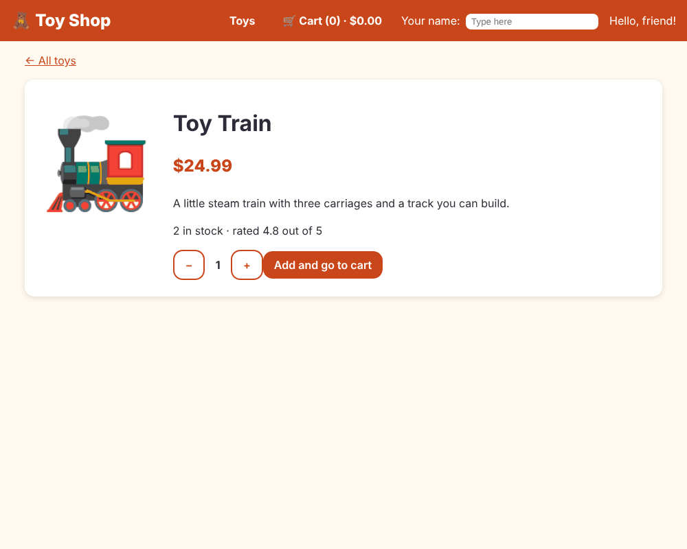
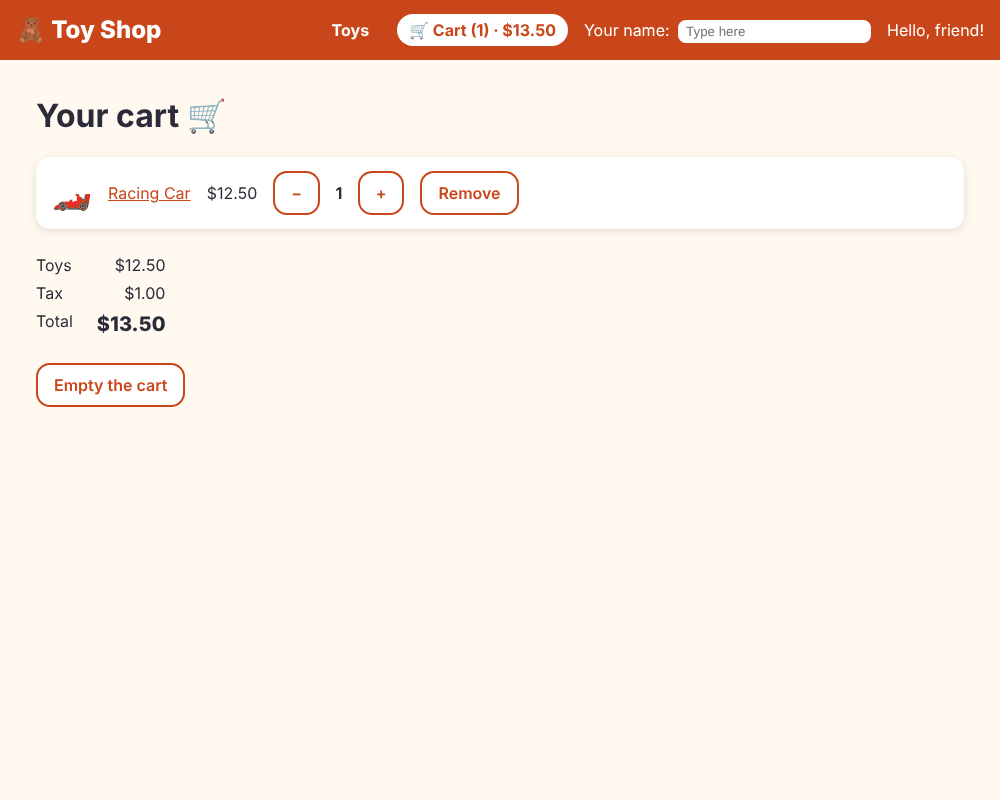

# Chapter 11: Routing

> **Like I'm 5:** A shop has rooms: the toy room, the cart room, the "ask about one toy" room. The address on the door says which room you are in. The router is the doorman who reads the address and opens the right room, without ever making you walk out of the shop.

Concept reference: [12. Routing](../concepts/12-routing.md)

[Back: Chapter 10](10-signals.md) · Next: [Chapter 12: RxJS](12-rxjs.md)

## What we build today

The shop becomes a real **multi-page app**:

| Address | Page |
|---------|------|
| `/` | all the toys (and `/?category=cars` filters them) |
| `/product/3` | the details of toy number 3 |
| `/cart` | your cart |
| anything else | a friendly "Oops, no such page" |

The header gets **links**, the toy names become links, and the group buttons become links that change the address. Everything works with the browser's **Back** button and can be bookmarked or shared.





## The big idea

So far the whole shop is one big component. A real website has many pages with different addresses (URLs). But we do not want the browser to reload everything each time we click a link. That is slow and forgets our state (our cart!).

The **router** solves both. It watches the address bar and swaps *which component is shown in the page*, without reloading. This is called a **single-page application** (SPA).

You tell the router three things:

1. **A routes list**: "address X shows component Y".
2. **A hole in the page**, `<router-outlet />`: "show the chosen component here".
3. **Links**, `routerLink`: "when clicked, go to address X". (Never use plain `href` for in-app links; it reloads the whole page.)

**Grown-up words:**

- **Route**: one line in the list: `{ path, component, title }`.
- **Route parameter**: a blank in the address, `product/:id`. `/product/3` fills `:id` with `3`.
- **Query parameter**: the `?category=cars` part. Good for optional things like filters.
- **Wildcard route** `**`: matches everything else. It must be last.
- **`routerLinkActive`**: adds a CSS class to the link that points to the current page.
- **Component input binding**: the router puts route and query parameters straight into `input()` boxes (we switch it on below).

## Step 1: Make the pages

We have a home page. We need three more: a toy page, a cart page, and the "not found" page.

```bash
ng generate component pages/product-detail
ng generate component pages/cart
ng generate component pages/not-found
```

### The "not found" page

**`src/app/pages/not-found/not-found.ts`**

```ts
import { Component } from '@angular/core';
import { RouterLink } from '@angular/router';

@Component({
  imports: [RouterLink],
  selector: 'app-not-found',
  styleUrl: './not-found.css',
  templateUrl: './not-found.html',
})
export class NotFound {}
```

**`src/app/pages/not-found/not-found.html`**

```html
<h1>Oops! 🙈</h1>
<p>We could not find that page.</p>
<a class="btn" routerLink="/">Back to the toys</a>
```

### The toy page

**`src/app/pages/product-detail/product-detail.ts`**

```ts
import { CurrencyPipe } from '@angular/common';
import { Component, computed, inject, input, signal } from '@angular/core';
import { Router, RouterLink } from '@angular/router';
import { QuantityStepper } from '../../components/quantity-stepper/quantity-stepper';
import { CartService } from '../../services/cart-service';
import { ProductService } from '../../services/product-service';

@Component({
  imports: [CurrencyPipe, QuantityStepper, RouterLink],
  selector: 'app-product-detail',
  styleUrl: './product-detail.css',
  templateUrl: './product-detail.html',
})
export class ProductDetail {
  private productService = inject(ProductService);
  private cart = inject(CartService);
  private router = inject(Router);

  // The router fills this box from the address blank: /product/:id
  id = input.required<string>();

  product = computed(() => this.productService.getById(Number(this.id())));
  quantity = signal(1);

  addAndGoToCart() {
    const toy = this.product();
    if (!toy) return;
    this.cart.add(toy, this.quantity());
    // Move to another page from code (instead of from a link).
    this.router.navigate(['/cart']);
  }
}
```

- `id = input.required<string>()`: the router will drop the `:id` from the address into this box. (Address pieces are always text, so we convert with `Number(...)`.)
- `product = computed(...)` looks the toy up through the `ProductService` (Chapter 9). It re-runs automatically when `id` changes, for example when you go from `/product/3` to `/product/4`.
- `this.router.navigate(['/cart'])` moves to another page **from code**. Use `routerLink` for links and `router.navigate` after an action, like "add and go to the cart".

**`src/app/pages/product-detail/product-detail.html`**

```html
<a routerLink="/">← All toys</a>

@if (product(); as p) {
  <article class="detail">
    <div class="big-emoji" aria-hidden="true">{{ p.emoji }}</div>
    <div>
      <h1>{{ p.name }}</h1>
      <p class="price">{{ p.price | currency }}</p>
      <p>{{ p.description }}</p>
      <p>{{ p.stock }} in stock · rated {{ p.rating }} out of 5</p>

      <app-quantity-stepper [(value)]="quantity" [max]="p.stock" />
      <button class="btn" type="button" [disabled]="p.stock === 0" (click)="addAndGoToCart()">
        Add and go to cart
      </button>
    </div>
  </article>
} @else {
  <h1>Oh no!</h1>
  <p>We could not find that toy.</p>
}
```

`@if (product(); as p) { ... } @else { ... }` shows the toy, or a friendly message for an unknown toy like `/product/999`. The `as p` keeps the answer under a short name.

**`src/app/pages/product-detail/product-detail.css`**

```css
.detail {
  display: flex;
  flex-wrap: wrap;
  gap: 2rem;
  margin-top: 1rem;
  padding: 1.5rem;
  background: var(--color-surface);
  border-radius: var(--radius);
  box-shadow: var(--shadow);
}

.big-emoji {
  font-size: 8rem;
}

.price {
  font-size: 1.5rem;
  font-weight: 800;
  color: var(--color-brand);
}
```

### The cart page

**`src/app/pages/cart/cart.ts`**

```ts
import { CurrencyPipe } from '@angular/common';
import { Component, inject } from '@angular/core';
import { RouterLink } from '@angular/router';
import { QuantityStepper } from '../../components/quantity-stepper/quantity-stepper';
import { CartService } from '../../services/cart-service';

@Component({
  imports: [CurrencyPipe, QuantityStepper, RouterLink],
  selector: 'app-cart',
  styleUrl: './cart.css',
  templateUrl: './cart.html',
})
export class Cart {
  cart = inject(CartService);
}
```

**`src/app/pages/cart/cart.html`**

```html
<h1>Your cart 🛒</h1>

@if (cart.items().length === 0) {
  <p>Your cart is empty. <a routerLink="/">Go find a toy!</a></p>
} @else {
  <ul class="lines">
    @for (item of cart.items(); track item.product.id) {
      <li class="line">
        <span class="emoji" aria-hidden="true">{{ item.product.emoji }}</span>
        <a [routerLink]="['/product', item.product.id]">{{ item.product.name }}</a>
        <span>{{ item.product.price | currency }}</span>

        <!-- One-way in, and an event out: the cart service does the changing. -->
        <app-quantity-stepper
          [value]="item.quantity"
          [max]="item.product.stock"
          (valueChange)="cart.setQuantity(item.product.id, $event)"
        />

        <button
          class="btn secondary"
          type="button"
          [attr.aria-label]="'Remove ' + item.product.name"
          (click)="cart.remove(item.product.id)"
        >
          Remove
        </button>
      </li>
    }
  </ul>

  <dl class="totals">
    <dt>Toys</dt>
    <dd>{{ cart.subtotal() | currency }}</dd>
    <dt>Tax</dt>
    <dd>{{ cart.tax() | currency }}</dd>
    <dt>Total</dt>
    <dd class="grand">{{ cart.total() | currency }}</dd>
  </dl>

  <button class="btn secondary" type="button" (click)="cart.clear()">Empty the cart</button>
}
```

Here the stepper is used *one way*: `[value]="item.quantity"` sends the quantity in, and `(valueChange)="cart.setQuantity(...)"` listens for changes. The cart service does the changing, so the numbers cannot go out of step. (This is `[(value)]` split into its two halves.)

**`src/app/pages/cart/cart.css`**

```css
.lines {
  display: grid;
  gap: 0.75rem;
  padding: 0;
  list-style: none;
}

.line {
  display: flex;
  flex-wrap: wrap;
  align-items: center;
  gap: 1rem;
  padding: 0.75rem 1rem;
  background: var(--color-surface);
  border-radius: var(--radius);
  box-shadow: var(--shadow);
}

.emoji {
  font-size: 2rem;
}

.totals {
  display: grid;
  grid-template-columns: max-content max-content;
  gap: 0.25rem 1.5rem;
  margin: 1.5rem 0;
}

.totals dd {
  margin: 0;
  text-align: right;
}

.grand {
  font-size: 1.25rem;
  font-weight: 800;
}
```

## Step 2: The list of routes

Open `src/app/app.routes.ts`. It is empty. Fill it:

**`src/app/app.routes.ts`**

```ts
import { Routes } from '@angular/router';
import { Cart } from './pages/cart/cart';
import { Home } from './pages/home/home';
import { NotFound } from './pages/not-found/not-found';
import { ProductDetail } from './pages/product-detail/product-detail';

export const routes: Routes = [
  { path: '', component: Home, title: 'Toy Shop' },
  // ":id" is a blank in the address. /product/3 fills it with "3".
  { path: 'product/:id', component: ProductDetail, title: 'Toy details' },
  { path: 'cart', component: Cart, title: 'Your cart' },
  // "**" means "anything else". It must be the LAST route.
  { path: '**', component: NotFound, title: 'Page not found' },
];
```

- Each route needs a `path` and a `component`. `title` sets the browser tab's title when you arrive.
- `product/:id` has a blank (`:id`).
- `'**'` is the "everything else" route and **must be last**, because the router stops at the first match.

## Step 3: Turn on parameter binding, and tell the root where pages go

Two settings go into `app.config.ts`:

**`src/app/app.config.ts`** (what changed)

```diff
@@ -1,13 +1,18 @@
 import { ApplicationConfig, provideBrowserGlobalErrorListeners } from '@angular/core';
-import { provideRouter } from '@angular/router';
+import { provideRouter, withComponentInputBinding, withInMemoryScrolling } from '@angular/router';
 import { routes } from './app.routes';
 import { SHOP_NAME, TAX_RATE } from './tokens';
 
 export const appConfig: ApplicationConfig = {
   providers: [
     provideBrowserGlobalErrorListeners(),
-    provideRouter(routes),
-    // Give the name tags their real values.
+    provideRouter(
+      routes,
+      // Hand the address blanks (:id and ?category=) straight to input() boxes.
+      withComponentInputBinding(),
+      // Go back to the top of the page when we move to a new page.
+      withInMemoryScrolling({ scrollPositionRestoration: 'enabled' }),
+    ),
     { provide: SHOP_NAME, useValue: 'Toy Shop' },
     { provide: TAX_RATE, useValue: 0.08 },
   ],
```

- `withComponentInputBinding()` is the switch that makes the router fill `input()` boxes with route and query parameters. Without it, `id` would stay empty.
- `withInMemoryScrolling({ scrollPositionRestoration: 'enabled' })` returns the page to the top when you go to a new page (and back to where you were when you use Back).

The root component becomes very small. It shows the header and the hole where the router puts pages:

**`src/app/app.html`**

```html
<app-site-header />

<main class="page">
  <!-- The router puts the page that matches the address right here. -->
  <router-outlet />
</main>
```

**`src/app/app.ts`**

```ts
import { Component } from '@angular/core';
import { RouterOutlet } from '@angular/router';
import { SiteHeader } from './components/site-header/site-header';

@Component({
  imports: [RouterOutlet, SiteHeader],
  selector: 'app-root',
  styleUrl: './app.css',
  templateUrl: './app.html',
})
export class App {}
```

The `h1` and `<app-home />` that were here before are gone: the router now places `Home` for us.

## Step 4: Links

In the header, two navigation links. `routerLinkActive="active"` adds the class `active` to the link of the page you are on:

**`src/app/components/site-header/site-header.html`** (what changed)

```diff
@@ -1,14 +1,17 @@
 <header class="site-header">
   <span class="logo">🧸 {{ shopName }}</span>
 
+  <nav class="nav" aria-label="Main">
+    <a routerLink="/" routerLinkActive="active" [routerLinkActiveOptions]="{ exact: true }">Toys</a>
+    <a routerLink="/cart" routerLinkActive="active">
+      🛒 Cart ({{ cart.count() }}) · {{ cart.total() | currency }}
+    </a>
+  </nav>
+
   <label class="name-box">
     Your name:
     <input [(ngModel)]="shopperName" placeholder="Type here" />
   </label>
 
   <span>Hello, {{ shopperName() || 'friend' }}!</span>
-  <span class="cart-summary" aria-live="polite">
-    🛒 {{ cart.count() }} items · {{ cart.total() | currency }}
-  </span>
-  <span class="today">{{ today | date: 'fullDate' }}</span>
 </header>
```

**`src/app/components/site-header/site-header.ts`** (what changed)

```diff
@@ -1,11 +1,12 @@
-import { CurrencyPipe, DatePipe } from '@angular/common';
+import { CurrencyPipe } from '@angular/common';
 import { Component, inject, signal } from '@angular/core';
 import { FormsModule } from '@angular/forms';
+import { RouterLink, RouterLinkActive } from '@angular/router';
 import { CartService } from '../../services/cart-service';
 import { SHOP_NAME } from '../../tokens';
 
 @Component({
-  imports: [FormsModule, DatePipe, CurrencyPipe],
+  imports: [FormsModule, CurrencyPipe, RouterLink, RouterLinkActive],
   selector: 'app-site-header',
   styleUrl: './site-header.css',
   templateUrl: './site-header.html',
@@ -14,5 +15,4 @@ export class SiteHeader {
   shopName = inject(SHOP_NAME);
   cart = inject(CartService);
   shopperName = signal('');
-  today = new Date();
 }
```

**`src/app/components/site-header/site-header.css`** (what changed)

```diff
@@ -13,14 +13,28 @@
   font-weight: 800;
 }
 
+.nav {
+  display: flex;
+  gap: 1rem;
+  margin-left: auto;
+}
+
+.nav a {
+  padding: 0.25rem 0.75rem;
+  border-radius: 999px;
+  color: #fff;
+  font-weight: 700;
+  text-decoration: none;
+}
+
+.nav a.active {
+  background: #fff;
+  color: var(--color-brand);
+}
+
 .name-box input {
   margin-left: 0.25rem;
   padding: 0.25rem 0.5rem;
   border-radius: 8px;
   border: 0;
 }
-
-.cart-summary {
-  margin-left: auto;
-  font-weight: 700;
-}
```

`[routerLinkActiveOptions]="{ exact: true }"` is important for the home link. Without it, `/` would count as "active" on every page, because every address starts with `/`.

(We moved the cart summary into the cart link and dropped the date, to keep the header tidy.)

The toy name on each card becomes a link to its page. `[routerLink]="['/product', p.id]"` builds `/product/3`:

**`src/app/components/product-card/product-card.html`** (what changed)

```diff
@@ -2,7 +2,9 @@
 
 <article class="card" [ngClass]="cardClasses()">
   <div class="emoji" aria-hidden="true">{{ p.emoji }}</div>
-  <h3>{{ p.name }}</h3>
+  <h3>
+    <a [routerLink]="['/product', p.id]">{{ p.name }}</a>
+  </h3>
   <p class="category">{{ p.category | titlecase }}</p>
   <p class="price" appHighlight="#ffe08a">{{ p.price | currency }}</p>
   <p class="description">{{ p.description | truncate: 50 }}</p>
```

**`src/app/components/product-card/product-card.ts`** (what changed)

```diff
@@ -1,5 +1,6 @@
 import { CurrencyPipe, NgClass, NgStyle, TitleCasePipe } from '@angular/common';
 import { Component, computed, input, output, signal } from '@angular/core';
+import { RouterLink } from '@angular/router';
 import { Highlight } from '../../directives/highlight';
 import { Product } from '../../models/product';
 import { TruncatePipe } from '../../pipes/truncate-pipe';
@@ -19,6 +20,7 @@ export interface AddedEvent {
     CurrencyPipe,
     TitleCasePipe,
     TruncatePipe,
+    RouterLink,
   ],
   selector: 'app-product-card',
   styleUrl: './product-card.css',
```

## Step 5: Filters in the address

The group buttons were a signal. Now they become **links with a query parameter**: `/?category=cars`. The state lives in the address, so you can bookmark, share, and use Back. The page just reads it:

**`src/app/pages/home/home.html`** (what changed)

```diff
@@ -1,4 +1,4 @@
-<h2>All toys</h2>
+<h1>All toys</h1>
 
 <div class="sale">
   @if (showSale()) {
@@ -14,19 +14,19 @@
   <button class="btn secondary" type="button" (click)="focusSearch()">Find the search box</button>
 </div>
 
-<div class="chips" role="group" aria-label="Toy groups">
+<nav class="chips" aria-label="Toy groups">
   @for (c of categories; track c.id) {
-    <button
-      type="button"
+    <a
       class="chip"
-      [class.active]="category() === c.id"
-      [attr.aria-pressed]="category() === c.id"
-      (click)="category.set(c.id)"
+      routerLink="/"
+      [queryParams]="{ category: c.id === 'all' ? null : c.id }"
+      [class.active]="selected() === c.id"
+      [attr.aria-current]="selected() === c.id ? 'true' : null"
     >
       {{ c.label }}
-    </button>
+    </a>
   }
-</div>
+</nav>
 
 <p class="added" aria-live="polite">
   @if (lastAdded()) {
```

**`src/app/pages/home/home.ts`** (what changed)

```diff
@@ -3,10 +3,12 @@ import {
   computed,
   ElementRef,
   inject,
+  input,
   linkedSignal,
   signal,
   viewChild,
 } from '@angular/core';
+import { RouterLink } from '@angular/router';
 import { AddedEvent, ProductCard } from '../../components/product-card/product-card';
 import { RecommendedToys } from '../../components/recommended-toys/recommended-toys';
 import { SaleCountdown } from '../../components/sale-countdown/sale-countdown';
@@ -17,20 +19,18 @@ import { ProductService } from '../../services/product-service';
 type CategoryChoice = 'all' | Category;
 
 @Component({
-  imports: [ProductCard, RecommendedToys, SaleCountdown],
+  imports: [ProductCard, RecommendedToys, SaleCountdown, RouterLink],
   selector: 'app-home',
   styleUrl: './home.css',
   templateUrl: './home.html',
 })
 export class Home {
-  // inject() asks Angular for the helper we need.
   private productService = inject(ProductService);
   private cart = inject(CartService);
 
   products = this.productService.getAll();
   lastAdded = signal('');
 
-  // The sale ends ten minutes from now.
   saleEnds = new Date(Date.now() + 10 * 60 * 1000);
   showSale = signal(true);
 
@@ -41,18 +41,23 @@ export class Home {
     { id: 'puzzles', label: 'Puzzles' },
     { id: 'games', label: 'Games' },
   ];
-  category = signal<CategoryChoice>('all');
 
-  // Only the toys that match the chosen category.
+  // The router fills this box from the address: /?category=cars
+  category = input<string>();
+
+  // If the address has no category (or a silly one), we show everything.
+  selected = computed<CategoryChoice>(() => {
+    const found = this.categories.find((c) => c.id === this.category());
+    return found ? found.id : 'all';
+  });
+
   visible = computed(() => {
-    const chosen = this.category();
+    const chosen = this.selected();
     return chosen === 'all' ? this.products : this.products.filter((p) => p.category === chosen);
   });
 
-  // Pages of six toys. linkedSignal is a box that goes back to page 1
-  // by itself whenever the chosen category changes.
   readonly pageSize = 6;
-  page = linkedSignal({ source: this.category, computation: () => 1 });
+  page = linkedSignal({ source: this.selected, computation: () => 1 });
   pageCount = computed(() => Math.max(1, Math.ceil(this.visible().length / this.pageSize)));
   pageNumbers = computed(() => Array.from({ length: this.pageCount() }, (_, i) => i + 1));
   pageItems = computed(() => {
@@ -60,7 +65,6 @@ export class Home {
     return this.visible().slice(start, start + this.pageSize);
   });
 
-  // The three toys with the best stars.
   topRated = computed(() => [...this.products].sort((a, b) => b.rating - a.rating).slice(0, 3));
 
   searchBox = viewChild.required<ElementRef<HTMLInputElement>>('searchBox');
```

- `category = input<string>()` is filled from `?category=...` (thanks to `withComponentInputBinding`).
- `selected = computed(...)` turns that text into one of our known groups, and falls back to `'all'` for a missing or silly value like `?category=banana`.
- `[queryParams]="{ category: c.id === 'all' ? null : c.id }"` writes the query. A `null` removes the parameter, so "All" goes back to a clean `/`.

## Step 6: Tests that need a router

Components with links need *some* router, even an empty one. Each affected test gets one line:

```ts
providers: [provideRouter([])]
```

Here are the changed tests. `RouterTestingHarness` lets us "go to an address" in a test:

**`src/app/pages/product-detail/product-detail.spec.ts`**

```ts
import { TestBed } from '@angular/core/testing';
import { provideRouter, withComponentInputBinding } from '@angular/router';
import { RouterTestingHarness } from '@angular/router/testing';
import { routes } from '../../app.routes';
import { ProductDetail } from './product-detail';

describe('ProductDetail', () => {
  beforeEach(() => {
    TestBed.configureTestingModule({
      providers: [provideRouter(routes, withComponentInputBinding())],
    });
  });

  it('shows the toy that is in the address', async () => {
    const harness = await RouterTestingHarness.create();
    await harness.navigateByUrl('/product/3', ProductDetail);
    expect(harness.routeNativeElement?.textContent).toContain('Toy Train');
  });

  it('says sorry for a toy that does not exist', async () => {
    const harness = await RouterTestingHarness.create();
    await harness.navigateByUrl('/product/999', ProductDetail);
    expect(harness.routeNativeElement?.textContent).toContain('could not find');
  });
});
```

**`src/app/app.spec.ts`** (what changed)

```diff
@@ -1,23 +1,25 @@
 import { TestBed } from '@angular/core/testing';
+import { provideRouter } from '@angular/router';
 import { App } from './app';
+import { routes } from './app.routes';
 
 describe('App', () => {
   beforeEach(async () => {
     await TestBed.configureTestingModule({
       imports: [App],
+      providers: [provideRouter(routes)],
     }).compileComponents();
   });
 
   it('should create the app', () => {
     const fixture = TestBed.createComponent(App);
-    const app = fixture.componentInstance;
-    expect(app).toBeTruthy();
+    expect(fixture.componentInstance).toBeTruthy();
   });
 
-  it('should render the shop title', async () => {
+  it('should show the shop name in the header', async () => {
     const fixture = TestBed.createComponent(App);
     await fixture.whenStable();
     const compiled = fixture.nativeElement as HTMLElement;
-    expect(compiled.querySelector('h1')?.textContent).toContain('Toy Shop');
+    expect(compiled.querySelector('.logo')?.textContent).toContain('Toy Shop');
   });
 });
```

**`src/app/pages/cart/cart.spec.ts`**

```ts
import { TestBed } from '@angular/core/testing';
import { provideRouter } from '@angular/router';
import { sampleProducts } from '../../data/sample-products';
import { CartService } from '../../services/cart-service';
import { Cart } from './cart';

describe('Cart page', () => {
  beforeEach(() => {
    localStorage.clear();
    TestBed.configureTestingModule({ providers: [provideRouter([])] });
  });

  it('says the cart is empty when there is nothing in it', async () => {
    const fixture = TestBed.createComponent(Cart);
    await fixture.whenStable();
    expect(fixture.nativeElement.textContent).toContain('Your cart is empty');
  });

  it('lists the toys that were added', async () => {
    TestBed.inject(CartService).add(sampleProducts[0], 2);
    const fixture = TestBed.createComponent(Cart);
    await fixture.whenStable();
    expect(fixture.nativeElement.textContent).toContain('Racing Car');
    expect(fixture.nativeElement.textContent).toContain('$27.00');
  });
});
```

## Check it works

```bash
npx ng test --watch=false
```

```
 Test Files  16 passed (16)
      Tests  34 passed (34)
```

In the browser (`npm start`):

- [ ] Click a toy's name: the address becomes `/product/3` and you see its page. The tab title says "Toy details".
- [ ] Press the browser's **Back** button: you return to the shelf.
- [ ] Click **Cars**: the address becomes `/?category=cars`, and only cars show. Reload the page: still cars.
- [ ] Type `/product/999` in the address bar: "We could not find that toy."
- [ ] Type `/nonsense`: "Oops! We could not find that page."
- [ ] Add toys, click **Cart** in the header: the cart page lists them, and the stepper changes the totals.

## What you learned

- A route maps an address to a component; `<router-outlet />` is where it appears.
- `routerLink` navigates without reloading; `routerLinkActive` styles the current link; `router.navigate([...])` navigates from code.
- Route parameters (`:id`) and query parameters (`?category=`) can be received as `input()`s with `withComponentInputBinding()`.
- Keep the state that matters (filters, selected item) **in the address**, so Back, bookmarks, and sharing work.
- The `**` route goes last and catches unknown addresses.

## Try it yourself

1. Add a route `{ path: 'toys', redirectTo: '', pathMatch: 'full' }`. Visit `/toys`. What happens to the address bar?
2. Add a link on the product page to the *next* toy: `/product/{{ p.id + 1 }}`. What happens at the last toy?
3. Add the page number to the address (`?page=2`) so that reloading keeps the page. (Hint: another `input<string>()` and `queryParams`.)
4. Add a route `{ path: 'about', component: ..., title: 'About us' }` with a new component, and a link in the header.

## If something goes wrong

**Clicking a link reloads the whole page (and the cart count flickers):** you used `href="/cart"` instead of `routerLink="/cart"`.

**`Can't bind to 'routerLink' since it isn't a known property of 'a'`:** add `RouterLink` to the component's `imports`.

**The `id` input is always empty:** you did not add `withComponentInputBinding()` to `provideRouter(...)`.

**Every link looks active:** the home link needs `[routerLinkActiveOptions]="{ exact: true }"`.

**The wildcard route hides your other pages:** the router uses the **first** matching route. Put `'**'` at the very end.

**An unknown address with no `**` route:** the console shows an error that starts with `NG04002` and says it cannot match any routes. Add the wildcard route.

**A test says ``NG0201: No provider found for `ActivatedRoute` ``:** the component uses `routerLink`, but the test has no router. Add `provideRouter([])`. We hit exactly this error while building this chapter.

Next: [Chapter 12: RxJS](12-rxjs.md)
