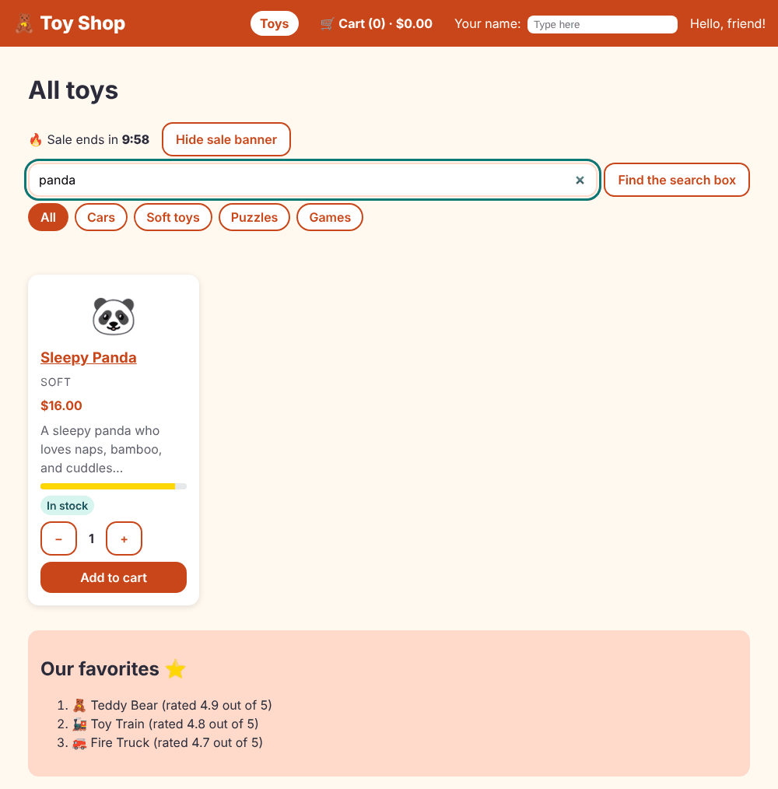

# Chapter 12: RxJS

> **Like I'm 5:** An Observable is a water pipe. Water (data) can arrive now, or later, or many times. You put little machines on the pipe: a filter that stops dirt, a funnel that waits until the water stops splashing. Nothing flows until someone opens the tap (subscribes).

Concept reference: [10. RxJS](../concepts/10-rxjs.md)

[Back: Chapter 11](11-routing.md) · Next: [Chapter 13: The HTTP client](13-http-client.md)

## What we build today

Two things that need *time*:

1. **Live search.** As you type in the search box, the shelf filters, but only after you pause for a moment, so we do not search on every single keystroke.
2. **A pretend slow server.** The toys now arrive after a short delay (300 ms), so the shop must show "Looking for toys… 🔍" while it waits.



## The big idea

Signals (Chapter 10) are perfect for *a value that is here now*. But some things are **streams over time**: the letters you type, a server answer that arrives later, a click that happens again and again. For those we use **RxJS** (Reactive Extensions for JavaScript). Angular's router, HTTP client, and forms all use it.

An **Observable** is a *description* of a stream: "water will flow through this pipe". Nothing happens until somebody **subscribes**.

You change the stream with **operators**, little machines you attach with `.pipe(...)`:

| Operator | What it does | Picture |
|----------|--------------|---------|
| `map(x => ...)` | change each value | a machine that paints every toy |
| `filter(x => ...)` | keep only some values | a gate that lets only red toys through |
| `debounceTime(300)` | wait until values stop coming for 300 ms | a funnel that waits for the splashing to stop |
| `distinctUntilChanged()` | ignore a value equal to the one before | "you said that already" |
| `switchMap(x => other$)` | start a new inner stream and **cancel the old one** | a new question cancels the old question |
| `combineLatest([a$, b$])` | join streams; fires when any changes | two sensors feeding one display |
| `catchError(...)` | recover from an error | a bucket under a leaky pipe |
| `tap(...)` | peek without changing | a window in the pipe |

A **Subject** is a pipe you can pour into yourself (`.next(value)`). A **BehaviorSubject** also remembers its latest value, so late listeners get it straight away.

**Grown-up words:**

- **Cold observable**: starts fresh for each subscriber (HTTP requests are cold).
- **`$` suffix**: a naming habit for observables (`topRated$`).
- **Memory leak**: a subscription nobody ever cancels. The cure in Angular: use the `async` pipe, `toSignal`, or `takeUntilDestroyed()`, which clean up for you.
- **Higher-order mapping**: operators like `switchMap` that turn each value into a new inner stream.

### When to use signals, and when RxJS?

| Use a signal for... | Use an Observable for... |
|---------------------|--------------------------|
| state the page shows | events over time (typing, timers, sockets) |
| derived values (`computed`) | combining, delaying, retrying, cancelling |
| simple local data | server calls |

They work together: `toSignal(obs$)` turns a stream into a signal, and `toObservable(sig)` turns a signal into a stream. We will use both today.

## Step 1: A service that answers later

Our `ProductService` now returns Observables instead of plain arrays, as a real server call would:

**`src/app/services/product-service.ts`**

```ts
import { Service } from '@angular/core';
import { delay, map, Observable, of } from 'rxjs';
import { sampleProducts } from '../data/sample-products';
import { Product } from '../models/product';

// How long our pretend "server" takes to answer.
export const FAKE_DELAY_MS = 300;

@Service()
export class ProductService {
  private readonly products = sampleProducts;

  // Every method now returns an Observable: a pipe the answer will flow through.
  getAll(): Observable<Product[]> {
    return of(this.products).pipe(delay(FAKE_DELAY_MS));
  }

  // null means "no toy with that id".
  getById(id: number): Observable<Product | null> {
    return this.getAll().pipe(map((list) => list.find((p) => p.id === id) ?? null));
  }

  search(term: string, category: string): Observable<Product[]> {
    const words = term.trim().toLowerCase();
    return this.getAll().pipe(
      map((list) =>
        list.filter(
          (p) =>
            (category === 'all' || p.category === category) &&
            (words === '' || p.name.toLowerCase().includes(words)),
        ),
      ),
    );
  }
}
```

- `of(this.products)` makes an Observable that sends the list once.
- `.pipe(delay(300))` waits 300 ms first, our pretend server time.
- `getById` and `search` reuse `getAll()` and shape the answer with `map`. (We return `null`, not `undefined`, for "no such toy", because an Observable's `undefined` is easy to confuse with "no value yet".)

Update the service test. The answers arrive later, so tests turn an Observable into a promise with `firstValueFrom`:

**`src/app/services/product-service.spec.ts`**

```ts
import { TestBed } from '@angular/core/testing';
import { firstValueFrom } from 'rxjs';
import { ProductService } from './product-service';

describe('ProductService', () => {
  let service: ProductService;

  beforeEach(() => {
    service = TestBed.inject(ProductService);
  });

  it('knows all twelve toys', async () => {
    const all = await firstValueFrom(service.getAll());
    expect(all.length).toBe(12);
  });

  it('finds a toy by its id', async () => {
    expect((await firstValueFrom(service.getById(3)))?.name).toBe('Toy Train');
  });

  it('returns null for an unknown id', async () => {
    expect(await firstValueFrom(service.getById(999))).toBeNull();
  });

  it('searches by name and category', async () => {
    const cars = await firstValueFrom(service.search('', 'cars'));
    expect(cars.map((p) => p.name)).toEqual(['Racing Car', 'Fire Truck', 'Toy Train']);

    const bears = await firstValueFrom(service.search('BEAR', 'all'));
    expect(bears.map((p) => p.name)).toEqual(['Teddy Bear']);
  });
});
```

## Step 2: Live search on the home page

Here is the big change in `home.ts`:

**`src/app/pages/home/home.ts`**

```ts
import { AsyncPipe } from '@angular/common';
import { toObservable, toSignal } from '@angular/core/rxjs-interop';
import {
  Component,
  computed,
  ElementRef,
  inject,
  input,
  linkedSignal,
  signal,
  viewChild,
} from '@angular/core';
import { FormControl, ReactiveFormsModule } from '@angular/forms';
import { RouterLink } from '@angular/router';
import {
  catchError,
  combineLatest,
  debounceTime,
  distinctUntilChanged,
  map,
  of,
  startWith,
  switchMap,
  tap,
} from 'rxjs';
import { AddedEvent, ProductCard } from '../../components/product-card/product-card';
import { RecommendedToys } from '../../components/recommended-toys/recommended-toys';
import { SaleCountdown } from '../../components/sale-countdown/sale-countdown';
import { Category, Product } from '../../models/product';
import { CartService } from '../../services/cart-service';
import { ProductService } from '../../services/product-service';

type CategoryChoice = 'all' | Category;

@Component({
  imports: [
    ProductCard,
    RecommendedToys,
    SaleCountdown,
    RouterLink,
    ReactiveFormsModule,
    AsyncPipe,
  ],
  selector: 'app-home',
  styleUrl: './home.css',
  templateUrl: './home.html',
})
export class Home {
  private productService = inject(ProductService);
  private cart = inject(CartService);

  lastAdded = signal('');
  loading = signal(true);

  saleEnds = new Date(Date.now() + 10 * 60 * 1000);
  showSale = signal(true);

  categories: { id: CategoryChoice; label: string }[] = [
    { id: 'all', label: 'All' },
    { id: 'cars', label: 'Cars' },
    { id: 'soft', label: 'Soft toys' },
    { id: 'puzzles', label: 'Puzzles' },
    { id: 'games', label: 'Games' },
  ];

  category = input<string>();

  selected = computed<CategoryChoice>(() => {
    const found = this.categories.find((c) => c.id === this.category());
    return found ? found.id : 'all';
  });

  // A FormControl is a little box that holds what the person typed.
  searchTerm = new FormControl('', { nonNullable: true });

  // Water pipes! The search words flow in, and we wait until typing pauses.
  private term$ = this.searchTerm.valueChanges.pipe(
    debounceTime(300), // wait 300ms of quiet
    distinctUntilChanged(), // ignore if nothing really changed
    startWith(''), // and begin with an empty search
  );

  // Two streams (search words + chosen group) are joined into one.
  // switchMap throws away an old request when a new one starts.
  visible = toSignal(
    combineLatest([this.term$, toObservable(this.selected)]).pipe(
      tap(() => this.loading.set(true)),
      switchMap(([term, category]) =>
        this.productService.search(term, category).pipe(catchError(() => of([] as Product[]))),
      ),
      tap(() => this.loading.set(false)),
    ),
    { initialValue: [] as Product[] },
  );

  // The favorites: we hand the pipe straight to the template's "async" pipe.
  topRated$ = this.productService
    .getAll()
    .pipe(map((list) => [...list].sort((a, b) => b.rating - a.rating).slice(0, 3)));

  readonly pageSize = 6;
  page = linkedSignal({ source: this.selected, computation: () => 1 });
  pageCount = computed(() => Math.max(1, Math.ceil(this.visible().length / this.pageSize)));
  pageNumbers = computed(() => Array.from({ length: this.pageCount() }, (_, i) => i + 1));
  pageItems = computed(() => {
    const start = (this.page() - 1) * this.pageSize;
    return this.visible().slice(start, start + this.pageSize);
  });

  searchBox = viewChild.required<ElementRef<HTMLInputElement>>('searchBox');

  focusSearch() {
    this.searchBox().nativeElement.focus();
  }

  onAdded(event: AddedEvent) {
    this.cart.add(event.product, event.quantity);
    this.lastAdded.set(`${event.quantity} × ${event.product.name}`);
  }
}
```

Let's follow the water through the pipes:

```ts
searchTerm = new FormControl('', { nonNullable: true });

private term$ = this.searchTerm.valueChanges.pipe(
  debounceTime(300),
  distinctUntilChanged(),
  startWith(''),
);
```

- A `FormControl` is a box holding what is typed. Its `valueChanges` is an Observable that sends a value on every keystroke. (Forms get a whole chapter, Chapter 15.)
- `debounceTime(300)` waits for 300 ms of quiet. Typing "panda" quickly sends one search, not five.
- `distinctUntilChanged()` ignores a repeat.
- `startWith('')` makes the stream begin with an empty search, so the shelf is full when the page opens.

```ts
visible = toSignal(
  combineLatest([this.term$, toObservable(this.selected)]).pipe(
    tap(() => this.loading.set(true)),
    switchMap(([term, category]) =>
      this.productService.search(term, category).pipe(catchError(() => of([] as Product[]))),
    ),
    tap(() => this.loading.set(false)),
  ),
  { initialValue: [] as Product[] },
);
```

- `toObservable(this.selected)` turns the category signal (from the address, Chapter 11) into a stream.
- `combineLatest([...])` re-fires when **either** the search words or the category change.
- `switchMap` calls the service. If you type again before the answer arrives, the old request is **cancelled** and only the newest one counts. This stops old answers from arriving late and overwriting new ones, a classic bug.
- `catchError(() => of([]))` shows an empty shelf instead of crashing if the call fails.
- `toSignal(...)` turns the final stream into a signal, `visible`. Angular subscribes for us and **unsubscribes when the component dies**. The rest of the page (`pageItems`, etc.) keeps using `visible()` as before.

The favorites list gets its toys with the `async` pipe, which subscribes and unsubscribes itself:

```ts
topRated$ = this.productService.getAll().pipe(
  map((list) => [...list].sort((a, b) => b.rating - a.rating).slice(0, 3)),
);
```

Now the template:

**`src/app/pages/home/home.html`** (what changed)

```diff
@@ -10,7 +10,13 @@
 </div>
 
 <div class="toolbar">
-  <input #searchBox type="search" aria-label="Search toys" placeholder="Search toys…" />
+  <input
+    #searchBox
+    type="search"
+    [formControl]="searchTerm"
+    aria-label="Search toys"
+    placeholder="Search toys…"
+  />
   <button class="btn secondary" type="button" (click)="focusSearch()">Find the search box</button>
 </div>
 
@@ -34,11 +40,17 @@
   }
 </p>
 
+@if (loading()) {
+  <p class="loading" role="status">Looking for toys… 🔍</p>
+}
+
 <div class="grid">
   @for (p of pageItems(); track p.id) {
     <app-product-card [product]="p" (added)="onAdded($event)" />
   } @empty {
-    <p>No toys here yet. 🧸</p>
+    @if (!loading()) {
+      <p>No toys found. 🧸</p>
+    }
   }
 </div>
 
@@ -59,7 +71,9 @@
 }
 
 @defer (on viewport) {
-  <app-recommended-toys [toys]="topRated()" />
+  @if (topRated$ | async; as top) {
+    <app-recommended-toys [toys]="top" />
+  }
 } @placeholder {
   <p class="placeholder">Scroll down to see our favorites…</p>
 } @loading (minimum 300ms) {
```

- `[formControl]="searchTerm"` connects the input to the FormControl. This needs `ReactiveFormsModule` in `imports` (see the top of `home.ts`).
- `@if (loading())` shows the "Looking for toys…" line while we wait. It is a `role="status"` so screen readers announce it.
- `@if (topRated$ | async; as top)` waits for the answer and names it `top`.

**`src/app/pages/home/home.css`** (what changed)

```diff
@@ -66,3 +66,8 @@
   gap: 0.5rem;
   margin-top: 1rem;
 }
+
+.loading {
+  color: var(--color-muted);
+  font-weight: 600;
+}
```

## Step 3: The toy page waits, too

The toy page also asks the (slow) service. We keep the same idea: when `id` changes, `switchMap` to a new request.

**`src/app/pages/product-detail/product-detail.ts`** (what changed)

```diff
@@ -1,6 +1,8 @@
 import { CurrencyPipe } from '@angular/common';
-import { Component, computed, inject, input, signal } from '@angular/core';
+import { toObservable, toSignal } from '@angular/core/rxjs-interop';
+import { Component, inject, input, signal } from '@angular/core';
 import { Router, RouterLink } from '@angular/router';
+import { switchMap } from 'rxjs';
 import { QuantityStepper } from '../../components/quantity-stepper/quantity-stepper';
 import { CartService } from '../../services/cart-service';
 import { ProductService } from '../../services/product-service';
@@ -16,17 +18,20 @@ export class ProductDetail {
   private cart = inject(CartService);
   private router = inject(Router);
 
-  // The router fills this box from the address blank: /product/:id
   id = input.required<string>();
 
-  product = computed(() => this.productService.getById(Number(this.id())));
+  // Whenever the id changes, ask for the new toy. (switchMap forgets the old question.)
+  // undefined = still loading, null = no such toy, otherwise the toy itself.
+  product = toSignal(
+    toObservable(this.id).pipe(switchMap((id) => this.productService.getById(Number(id)))),
+  );
+
   quantity = signal(1);
 
   addAndGoToCart() {
     const toy = this.product();
     if (!toy) return;
     this.cart.add(toy, this.quantity());
-    // Move to another page from code (instead of from a link).
     this.router.navigate(['/cart']);
   }
 }
```

`product` can now be three things: `undefined` (still loading), `null` (no such toy), or a toy. The template handles each:

**`src/app/pages/product-detail/product-detail.html`** (what changed)

```diff
@@ -1,6 +1,8 @@
 <a routerLink="/">← All toys</a>
 
-@if (product(); as p) {
+@if (product() === undefined) {
+  <p role="status">Looking for the toy… 🔍</p>
+} @else if (product(); as p) {
   <article class="detail">
     <div class="big-emoji" aria-hidden="true">{{ p.emoji }}</div>
     <div>
```

Tests must now *wait* for the pretend server. `vi.waitFor` keeps retrying until the check passes (or a timeout):

**`src/app/pages/product-detail/product-detail.spec.ts`** (what changed)

```diff
@@ -14,12 +14,15 @@ describe('ProductDetail', () => {
   it('shows the toy that is in the address', async () => {
     const harness = await RouterTestingHarness.create();
     await harness.navigateByUrl('/product/3', ProductDetail);
+    await vi.waitFor(() => expect(harness.routeNativeElement?.textContent).toContain('Toy Train'));
     expect(harness.routeNativeElement?.textContent).toContain('Toy Train');
   });
 
   it('says sorry for a toy that does not exist', async () => {
     const harness = await RouterTestingHarness.create();
     await harness.navigateByUrl('/product/999', ProductDetail);
-    expect(harness.routeNativeElement?.textContent).toContain('could not find');
+    await vi.waitFor(() =>
+      expect(harness.routeNativeElement?.textContent).toContain('could not find'),
+    );
   });
 });
```

**`src/app/pages/home/home.spec.ts`**

```ts
import { TestBed } from '@angular/core/testing';
import { provideRouter } from '@angular/router';
import { Home } from './home';

describe('Home', () => {
  beforeEach(async () => {
    localStorage.clear();
    await TestBed.configureTestingModule({
      imports: [Home],
      providers: [provideRouter([])],
    }).compileComponents();
  });

  function names(root: HTMLElement) {
    return Array.from(root.querySelectorAll('app-product-card h3')).map((h) =>
      h.textContent?.trim(),
    );
  }

  it('shows the first page of toys once they have "arrived"', async () => {
    const fixture = TestBed.createComponent(Home);
    await vi.waitFor(async () => {
      await fixture.whenStable();
      expect(names(fixture.nativeElement).length).toBe(6);
    });
  });

  it('filters the toys while you type', async () => {
    const fixture = TestBed.createComponent(Home);
    await vi.waitFor(async () => {
      await fixture.whenStable();
      expect(names(fixture.nativeElement).length).toBe(6);
    });

    fixture.componentInstance.searchTerm.setValue('panda');

    await vi.waitFor(async () => {
      await fixture.whenStable();
      expect(names(fixture.nativeElement)).toEqual(['Sleepy Panda']);
    });
  });
});
```

## Check it works

```bash
npx ng test --watch=false
```

```
 Test Files  16 passed (16)
      Tests  36 passed (36)
```

In the browser:

- [ ] Reload: for a moment you see "Looking for toys… 🔍", then the toys.
- [ ] Type "panda" quickly. The shelf waits a moment, then shows only the Sleepy Panda.
- [ ] Clear the box. All toys return.
- [ ] Type "zzz": "No toys found. 🧸".
- [ ] Open `/product/3` directly: a short "Looking for the toy…" and then the Toy Train.

Open DevTools, **Network** tab: there are no requests, because our "server" is still in memory. In the next chapter it becomes a real server call.

## Bonus lab: play with pipes in the terminal

[`extras/ch12/rxjs-playground.mjs`](extras/ch12/rxjs-playground.mjs) is a small Node script with six experiments. Copy it into your project folder and run it with `node rxjs-playground.mjs` (it uses the `rxjs` package you already have):

**`rxjs-playground.mjs`**

```js
import { of, interval, Subject, BehaviorSubject, take, map, filter, switchMap, debounceTime, forkJoin, timer } from 'rxjs';

// 1. A tiny pipe: numbers flow in, we change them on the way
of(1, 2, 3, 4).pipe(filter((n) => n % 2 === 0), map((n) => n * 10)).subscribe((n) => console.log('even x10:', n));

// 2. Cold: nothing happens until you subscribe
const lazy = of('hello').pipe(map((s) => s.toUpperCase()));
console.log('(before subscribe: nothing yet)');
lazy.subscribe((v) => console.log('got', v));

// 3. Subject: a shout that everyone listening hears
const shout = new Subject();
shout.subscribe((m) => console.log('A heard', m));
shout.next('hi');
shout.subscribe((m) => console.log('B heard', m));
shout.next('bye');

// 4. BehaviorSubject: remembers the latest value
const score = new BehaviorSubject(0);
score.next(5);
score.subscribe((v) => console.log('late listener sees score', v));

// 5. switchMap: the new question cancels the old one
const slow = (x) => timer(100).pipe(map(() => `answer for ${x}`));
const q = new Subject();
q.pipe(switchMap(slow)).subscribe((v) => console.log(v));
q.next('a'); setTimeout(() => q.next('b'), 30);

// 6. forkJoin: wait for all, then give the last of each
forkJoin([timer(50).pipe(map(() => 'toys')), timer(80).pipe(map(() => 'prices'))]).subscribe((r) => console.log('both ready:', r));
```

The real output:

```
even x10: 20
even x10: 40
(before subscribe: nothing yet)
got HELLO
A heard hi
A heard bye
B heard bye
late listener sees score 5
both ready: [ 'toys', 'prices' ]
answer for b
```

Read the output against the code:

- Only even numbers get through, multiplied by ten.
- `(before subscribe: nothing yet)` prints **before** `got HELLO`. The pipe did nothing until it was subscribed. That is "lazy".
- `B heard bye` only: a late listener of a plain `Subject` misses what was said before. The `BehaviorSubject` listener gets the stored `5` immediately.
- The `switchMap` experiment never prints "answer for a": it was cancelled by `b`.
- `forkJoin` waits for *all* streams and gives their last values together.

## What you learned

- An Observable describes values over time and does nothing until you subscribe.
- Operators in `.pipe(...)` shape the stream: `map`, `filter`, `debounceTime`, `distinctUntilChanged`, `switchMap`, `combineLatest`, `catchError`, `tap`.
- `switchMap` cancels the old inner request when a new value arrives; use it for search and for "show the item with this id".
- `toSignal` and `toObservable` connect signals and RxJS; the `async` pipe and `toSignal` unsubscribe for you.
- Tests use `firstValueFrom` to await an Observable and `vi.waitFor` to wait for the page.

## Try it yourself

1. Change `debounceTime(300)` to `1000`. Type quickly. What do you notice?
2. Add a `tap(term => console.log('searching for', term))` before `switchMap` and watch the console while typing.
3. Replace `switchMap` with `mergeMap` and set `FAKE_DELAY_MS` to `1500`. Type "p", "pa", "pan" quickly. Why can the order of answers get mixed up?
4. Make the service fail on purpose for the term "boom" (`throwError(() => new Error('boom'))`). What does the shelf show? Where does `catchError` help?

## If something goes wrong

**Nothing happens when you call the service:** you forgot to subscribe. An Observable alone does nothing. Use `toSignal`, the `async` pipe, or `.subscribe(...)`.

**`toSignal()` outside the right place:**

```
NG0203: toSignal() can only be used within an injection context such as a constructor, a factory function, a field initializer, or a function used with `runInInjectionContext`.
```

Call `toSignal` in a field or the constructor, not inside a method.

**A test fails because the data has not arrived:** the pretend server takes 300 ms. Use `await vi.waitFor(...)` or `firstValueFrom(...)`.

**The page shows old results after typing fast:** you used `mergeMap` or a nested `subscribe` instead of `switchMap`.

**Memory leak warning signs:** a `.subscribe()` in a component with no cleanup. Prefer `async`, `toSignal`, or `.pipe(takeUntilDestroyed())`.

Next: [Chapter 13: The HTTP client](13-http-client.md)
