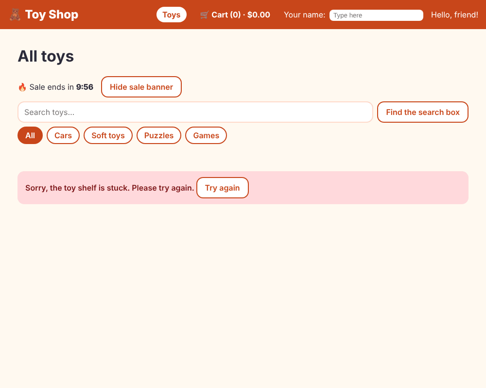

# Chapter 13: The HTTP client

> **Like I'm 5:** The shop's storeroom is far away, in another building. HttpClient is a mailman. You hand him a letter ("please send me the list of toys"), he walks to the other building, and brings back an answer. Sometimes the road is closed, so you teach him what to do: wait, try again, or tell you politely.

Concept reference: [14. HTTP client and interceptors](../concepts/14-http-client-and-interceptors.md) (the first half; interceptors are in the next chapter)

[Back: Chapter 12](12-rxjs.md) · Next: [Chapter 14: Interceptors](14-interceptors.md)

## What we build today

The toys stop being a list inside our code. They live in a **real file on the server** (`products.json`), and the shop fetches them over HTTP. We also deal with the bad days: slow, failing, or missing answers.



## The big idea

A web app talks to a server using HTTP: it sends a **request** ("GET me /products.json") and gets a **response** (a status number and some data). The most common status numbers:

| Status | Meaning |
|--------|---------|
| `200` | OK, here is your data |
| `201` | Created |
| `301`, `302` | Moved to another address |
| `400` | Your letter was wrong |
| `401` | Who are you? (not logged in) |
| `403` | I know who you are, but you may not |
| `404` | Not found |
| `500` | The server broke |
| `0` (Angular's word) | The request never got an answer (no internet, blocked) |

Angular's tool is **`HttpClient`**. Its methods (`get`, `post`, `put`, `patch`, `delete`) return **Observables** (Chapter 12). Nothing is sent until someone subscribes (the `async` pipe or `toSignal` do that).

A good client thinks about three bad days:

1. **Slow**: stop waiting after a while (`timeout`).
2. **Flaky**: try again (`retry`).
3. **Broken**: show a friendly message and a "Try again" button (`catchError`).

And one good trick: **ask only once** and share the answer (`shareReplay`).

**Grown-up words:**

- **`provideHttpClient(withFetch())`**: sets up HttpClient to use the browser's modern `fetch` instead of the old `XMLHttpRequest`. (HttpClient is available to inject without this call in Angular 21 and later, but you need it to choose `fetch` and to add interceptors.)
- **Typed request**: `http.get<Product[]>(url)` tells TypeScript what shape to expect. (It is a promise by *you*, not a check by Angular.)
- **`HttpErrorResponse`**: the error object, with `status`, `statusText`, `message`.
- **`HttpTestingController`**: a fake server for tests. You see which requests were made and answer them yourself.

## Step 1: A real file to fetch

Anything in the `public/` folder is copied to the website as it is. Create `public/products.json` with the same twelve toys we had in `sample-products.ts`:

**`public/products.json`**

```json
[
  {
    "id": 1,
    "name": "Racing Car",
    "emoji": "🏎️",
    "price": 12.5,
    "category": "cars",
    "stock": 3,
    "rating": 4.5,
    "description": "A fast red racing car with shiny wheels. It zooms around every corner!"
  },
  {
    "id": 2,
    "name": "Fire Truck",
    "emoji": "🚒",
    "price": 18,
    "category": "cars",
    "stock": 5,
    "rating": 4.7,
    "description": "A big red fire truck with a ladder that goes up and down. Wee-oo wee-oo!"
  },
  {
    "id": 3,
    "name": "Toy Train",
    "emoji": "🚂",
    "price": 24.99,
    "category": "cars",
    "stock": 2,
    "rating": 4.8,
    "description": "A little steam train with three carriages and a track you can build."
  },
  {
    "id": 4,
    "name": "Teddy Bear",
    "emoji": "🧸",
    "price": 14,
    "category": "soft",
    "stock": 0,
    "rating": 4.9,
    "description": "The softest teddy bear in the world. Perfect for hugs and bedtime."
  },
  {
    "id": 5,
    "name": "Fluffy Bunny",
    "emoji": "🐰",
    "price": 11.5,
    "category": "soft",
    "stock": 9,
    "rating": 4.4,
    "description": "A fluffy bunny with long floppy ears and a tiny pink nose."
  },
  {
    "id": 6,
    "name": "Sleepy Panda",
    "emoji": "🐼",
    "price": 16,
    "category": "soft",
    "stock": 4,
    "rating": 4.6,
    "description": "A sleepy panda who loves naps, bamboo, and cuddles."
  },
  {
    "id": 7,
    "name": "Jigsaw Castle",
    "emoji": "🏰",
    "price": 15,
    "category": "puzzles",
    "stock": 6,
    "rating": 4.3,
    "description": "A 100-piece jigsaw puzzle of a castle with towers and a moat."
  },
  {
    "id": 8,
    "name": "Rainbow Blocks",
    "emoji": "🧩",
    "price": 9.5,
    "category": "puzzles",
    "stock": 12,
    "rating": 4.1,
    "description": "Colorful wooden blocks to stack, sort, and build into anything."
  },
  {
    "id": 9,
    "name": "Space Puzzle",
    "emoji": "🚀",
    "price": 13.75,
    "category": "puzzles",
    "stock": 1,
    "rating": 4.7,
    "description": "A glow-in-the-dark puzzle of rockets, planets, and stars."
  },
  {
    "id": 10,
    "name": "Chess Set",
    "emoji": "♟️",
    "price": 21,
    "category": "games",
    "stock": 7,
    "rating": 4.5,
    "description": "A wooden chess set with a folding board. Think like a king or queen!"
  },
  {
    "id": 11,
    "name": "Dice Party",
    "emoji": "🎲",
    "price": 7.25,
    "category": "games",
    "stock": 15,
    "rating": 4,
    "description": "Six dice and a cup. Roll high, roll low, and play five fun games."
  },
  {
    "id": 12,
    "name": "Memory Match",
    "emoji": "🃏",
    "price": 8.9,
    "category": "games",
    "stock": 10,
    "rating": 4.2,
    "description": "Flip the cards and find the pairs. Can you remember where they are?"
  }
]
```

That file will be at `http://localhost:4200/products.json` when the app runs. (Open it in a browser tab to see.) In a real shop this would be an API address such as `/api/products`.

## Step 2: Switch HttpClient on

**`src/app/app.config.ts`** (what changed)

```diff
@@ -1,3 +1,4 @@
+import { provideHttpClient, withFetch } from '@angular/common/http';
 import { ApplicationConfig, provideBrowserGlobalErrorListeners } from '@angular/core';
 import { provideRouter, withComponentInputBinding, withInMemoryScrolling } from '@angular/router';
 import { routes } from './app.routes';
@@ -6,6 +7,8 @@ import { SHOP_NAME, TAX_RATE } from './tokens';
 export const appConfig: ApplicationConfig = {
   providers: [
     provideBrowserGlobalErrorListeners(),
+    // The mailman: HttpClient. withFetch() uses the browser's modern fetch.
+    provideHttpClient(withFetch()),
     provideRouter(
       routes,
       // Hand the address blanks (:id and ?category=) straight to input() boxes.
```

## Step 3: Ask the server

Replace the insides of `ProductService`. The outside (`getAll`, `getById`, `search`) stays the same, so no page needs to change. That is the reward for using a service!

**`src/app/services/product-service.ts`**

```ts
import { HttpClient } from '@angular/common/http';
import { inject, Service } from '@angular/core';
import { map, Observable, retry, shareReplay, timeout } from 'rxjs';
import { Product } from '../models/product';

@Service()
export class ProductService {
  // HttpClient is our mailman. He carries our questions to the server.
  private http = inject(HttpClient);

  // Ask the server only ONE time. shareReplay gives the same answer to everybody
  // who asks later, so we do not keep bothering the server.
  private readonly all$ = this.http.get<Product[]>('products.json').pipe(
    timeout(5000), // give up if the server is silent for 5 seconds
    retry({ count: 2, delay: 500 }), // if it fails, try again (twice)
    shareReplay({ bufferSize: 1, refCount: false }),
  );

  getAll(): Observable<Product[]> {
    return this.all$;
  }

  getById(id: number): Observable<Product | null> {
    return this.getAll().pipe(map((list) => list.find((p) => p.id === id) ?? null));
  }

  search(term: string, category: string): Observable<Product[]> {
    const words = term.trim().toLowerCase();
    return this.getAll().pipe(
      map((list) =>
        list.filter(
          (p) =>
            (category === 'all' || p.category === category) &&
            (words === '' || p.name.toLowerCase().includes(words)),
        ),
      ),
    );
  }
}
```

Read the pipe that asks the question:

```ts
private readonly all$ = this.http.get<Product[]>('products.json').pipe(
  timeout(5000),
  retry({ count: 2, delay: 500 }),
  shareReplay({ bufferSize: 1, refCount: false }),
);
```

- `http.get<Product[]>('products.json')`: the letter. A relative address means "from the same website".
- `timeout(5000)`: if there is no answer for 5 seconds, that is an error.
- `retry({ count: 2, delay: 500 })`: on an error, wait half a second and try again, up to two more times.
- `shareReplay({ bufferSize: 1, refCount: false })`: remember the last answer and give it to everybody who asks later. Without it, every `getAll()` call (and every `search`!) would send a new letter. The home page, the toy page, and the favorites list all share this one request.

The order matters: `shareReplay` goes **last**, so everyone shares the result *after* the retries.

## Step 4: Show failures kindly

The home page needs a place for the error message and a way to try again:

**`src/app/pages/home/home.ts`** (what changed)

```diff
@@ -13,6 +13,7 @@ import {
 import { FormControl, ReactiveFormsModule } from '@angular/forms';
 import { RouterLink } from '@angular/router';
 import {
+  BehaviorSubject,
   catchError,
   combineLatest,
   debounceTime,
@@ -51,6 +52,7 @@ export class Home {
 
   lastAdded = signal('');
   loading = signal(true);
+  error = signal('');
 
   saleEnds = new Date(Date.now() + 10 * 60 * 1000);
   showSale = signal(true);
@@ -80,19 +82,34 @@ export class Home {
     startWith(''), // and begin with an empty search
   );
 
-  // Two streams (search words + chosen group) are joined into one.
+  // A BehaviorSubject remembers its latest value. Pressing "Try again" gives it a new one.
+  private refresh$ = new BehaviorSubject<void>(undefined);
+
+  // Three streams (search words + chosen group + refresh) are joined into one.
   // switchMap throws away an old request when a new one starts.
   visible = toSignal(
-    combineLatest([this.term$, toObservable(this.selected)]).pipe(
-      tap(() => this.loading.set(true)),
+    combineLatest([this.term$, toObservable(this.selected), this.refresh$]).pipe(
+      tap(() => {
+        this.loading.set(true);
+        this.error.set('');
+      }),
       switchMap(([term, category]) =>
-        this.productService.search(term, category).pipe(catchError(() => of([] as Product[]))),
+        this.productService.search(term, category).pipe(
+          catchError(() => {
+            this.error.set('Sorry, the toy shelf is stuck. Please try again.');
+            return of([] as Product[]);
+          }),
+        ),
       ),
       tap(() => this.loading.set(false)),
     ),
     { initialValue: [] as Product[] },
   );
 
+  retry() {
+    this.refresh$.next();
+  }
+
   // The favorites: we hand the pipe straight to the template's "async" pipe.
   topRated$ = this.productService
     .getAll()
```

- `error = signal('')` holds the message.
- `refresh$ = new BehaviorSubject<void>(undefined)` is a button-press stream. It starts with one value, so the first load happens. `retry()` pushes another value, which makes the pipe ask again. It is the third input of `combineLatest`.
- Inside `catchError` we set the message and return an empty list, so the stream survives and the next search still works.

**`src/app/pages/home/home.html`** (what changed)

```diff
@@ -40,6 +40,13 @@
   }
 </p>
 
+@if (error()) {
+  <p class="error" role="alert">
+    {{ error() }}
+    <button class="btn secondary" type="button" (click)="retry()">Try again</button>
+  </p>
+}
+
 @if (loading()) {
   <p class="loading" role="status">Looking for toys… 🔍</p>
 }
@@ -48,7 +55,7 @@
   @for (p of pageItems(); track p.id) {
     <app-product-card [product]="p" (added)="onAdded($event)" />
   } @empty {
-    @if (!loading()) {
+    @if (!loading() && !error()) {
       <p>No toys found. 🧸</p>
     }
   }
```

**`src/app/pages/home/home.css`** (what changed)

```diff
@@ -71,3 +71,11 @@
   color: var(--color-muted);
   font-weight: 600;
 }
+
+.error {
+  padding: 0.75rem 1rem;
+  background: #ffd9dc;
+  border-radius: var(--radius);
+  color: #7a121b;
+  font-weight: 600;
+}
```

`role="alert"` makes screen readers announce the problem right away.

## Step 5: Test with a fake server

Real servers are slow and unpredictable. In tests we use `HttpTestingController`, which acts as the server:

**`src/app/services/product-service.spec.ts`**

```ts
import { provideHttpClient } from '@angular/common/http';
import { HttpTestingController, provideHttpClientTesting } from '@angular/common/http/testing';
import { TestBed } from '@angular/core/testing';
import { sampleProducts } from '../data/sample-products';
import { Product } from '../models/product';
import { ProductService } from './product-service';

describe('ProductService', () => {
  let service: ProductService;
  let server: HttpTestingController;

  beforeEach(() => {
    TestBed.configureTestingModule({
      providers: [provideHttpClient(), provideHttpClientTesting()],
    });
    service = TestBed.inject(ProductService);
    server = TestBed.inject(HttpTestingController);
  });

  afterEach(() => server.verify()); // no surprise requests left over

  it('asks the server for products.json and gets all twelve toys', () => {
    let toys: Product[] = [];
    service.getAll().subscribe((list) => (toys = list));

    server.expectOne('products.json').flush(sampleProducts); // the pretend server answers

    expect(toys.length).toBe(12);
  });

  it('asks the server only once, even when many people ask', () => {
    service.getAll().subscribe();
    service.getAll().subscribe();
    service.getById(1).subscribe();

    server.expectOne('products.json').flush(sampleProducts);
  });

  it('finds a toy by id, or null', () => {
    const found: (Product | null)[] = [];
    service.getById(3).subscribe((p) => found.push(p));
    service.getById(999).subscribe((p) => found.push(p));

    server.expectOne('products.json').flush(sampleProducts);

    expect(found[0]?.name).toBe('Toy Train');
    expect(found[1]).toBeNull();
  });

  it('searches by name and category', () => {
    let names: string[] = [];
    service.search('BEAR', 'all').subscribe((list) => (names = list.map((p) => p.name)));
    server.expectOne('products.json').flush(sampleProducts);
    expect(names).toEqual(['Teddy Bear']);
  });
});
```

- `provideHttpClientTesting()` swaps the real network for the controller.
- `server.expectOne('products.json').flush(sampleProducts)` says "there must be exactly one request for this address; answer it with these toys".
- The second test proves `shareReplay` works: three calls, **one** request. If we had two, `expectOne` would fail.
- `afterEach(() => server.verify())` fails the test if a request was made that nobody expected.

The page tests answer the request the same way:

**`src/app/pages/home/home.spec.ts`** (what changed)

```diff
@@ -1,14 +1,20 @@
+import { provideHttpClient } from '@angular/common/http';
+import { HttpTestingController, provideHttpClientTesting } from '@angular/common/http/testing';
 import { TestBed } from '@angular/core/testing';
 import { provideRouter } from '@angular/router';
+import { sampleProducts } from '../../data/sample-products';
 import { Home } from './home';
 
 describe('Home', () => {
+  let server: HttpTestingController;
+
   beforeEach(async () => {
     localStorage.clear();
     await TestBed.configureTestingModule({
       imports: [Home],
-      providers: [provideRouter([])],
+      providers: [provideRouter([]), provideHttpClient(), provideHttpClientTesting()],
     }).compileComponents();
+    server = TestBed.inject(HttpTestingController);
   });
 
   function names(root: HTMLElement) {
@@ -17,20 +23,23 @@ describe('Home', () => {
     );
   }
 
-  it('shows the first page of toys once they have "arrived"', async () => {
+  async function openHome() {
     const fixture = TestBed.createComponent(Home);
-    await vi.waitFor(async () => {
-      await fixture.whenStable();
-      expect(names(fixture.nativeElement).length).toBe(6);
-    });
+    await fixture.whenStable();
+    // The pretend server answers the "products.json" question.
+    server.expectOne('products.json').flush(sampleProducts);
+    await fixture.whenStable();
+    return fixture;
+  }
+
+  it('shows the first page of toys once the server answers', async () => {
+    const fixture = await openHome();
+    await vi.waitFor(() => expect(names(fixture.nativeElement).length).toBe(6));
   });
 
   it('filters the toys while you type', async () => {
-    const fixture = TestBed.createComponent(Home);
-    await vi.waitFor(async () => {
-      await fixture.whenStable();
-      expect(names(fixture.nativeElement).length).toBe(6);
-    });
+    const fixture = await openHome();
+    await vi.waitFor(() => expect(names(fixture.nativeElement).length).toBe(6));
 
     fixture.componentInstance.searchTerm.setValue('panda');
 
```

**`src/app/pages/product-detail/product-detail.spec.ts`** (what changed)

```diff
@@ -1,28 +1,41 @@
+import { provideHttpClient } from '@angular/common/http';
+import { HttpTestingController, provideHttpClientTesting } from '@angular/common/http/testing';
 import { TestBed } from '@angular/core/testing';
 import { provideRouter, withComponentInputBinding } from '@angular/router';
 import { RouterTestingHarness } from '@angular/router/testing';
 import { routes } from '../../app.routes';
+import { sampleProducts } from '../../data/sample-products';
 import { ProductDetail } from './product-detail';
 
 describe('ProductDetail', () => {
+  let server: HttpTestingController;
+
   beforeEach(() => {
     TestBed.configureTestingModule({
-      providers: [provideRouter(routes, withComponentInputBinding())],
+      providers: [
+        provideRouter(routes, withComponentInputBinding()),
+        provideHttpClient(),
+        provideHttpClientTesting(),
+      ],
     });
+    server = TestBed.inject(HttpTestingController);
   });
 
-  it('shows the toy that is in the address', async () => {
+  async function openToy(id: number) {
     const harness = await RouterTestingHarness.create();
-    await harness.navigateByUrl('/product/3', ProductDetail);
-    await vi.waitFor(() => expect(harness.routeNativeElement?.textContent).toContain('Toy Train'));
+    await harness.navigateByUrl(`/product/${id}`, ProductDetail);
+    server.expectOne('products.json').flush(sampleProducts);
+    await harness.fixture.whenStable();
+    return harness;
+  }
+
+  it('shows the toy that is in the address', async () => {
+    const harness = await openToy(3);
     expect(harness.routeNativeElement?.textContent).toContain('Toy Train');
   });
 
   it('says sorry for a toy that does not exist', async () => {
-    const harness = await RouterTestingHarness.create();
-    await harness.navigateByUrl('/product/999', ProductDetail);
-    await vi.waitFor(() =>
-      expect(harness.routeNativeElement?.textContent).toContain('could not find'),
-    );
+    const harness = await openToy(999);
+    expect(harness.routeNativeElement?.textContent).toContain('could not find');
   });
 });
```

## Check it works

```bash
npx ng test --watch=false
```

```
 Test Files  16 passed (16)
      Tests  36 passed (36)
```

In the browser:

- [ ] Open DevTools, **Network** tab, reload. You see **one** request for `products.json` (status 200), no matter how many pages and lists use it.
- [ ] Type a search: no new request. The data is already here.
- [ ] Now break it on purpose. In DevTools, **Network**, right-click `products.json`, **Block request URL** (or rename `public/products.json` for a minute). Reload. You see "Looking for toys…" for about a second (the first try plus two retries, with half a second of waiting between them), then "Sorry, the toy shelf is stuck. Please try again." with a button.
- [ ] Unblock the file (or rename it back) and press **Try again**. The toys appear.

## Bonus: `httpResource`, a request as a signal

Angular also has `httpResource`, which turns "get this URL" into **signals**: `value()`, `isLoading()`, `error()`. When a signal inside the URL function changes, it asks again by itself. It is a great fit for read-only data in signal-based components.

[`extras/ch13/http-resource.spec.ts`](extras/ch13/http-resource.spec.ts) shows it with a fake server. Copy it to `src/app/extras/` and run the tests.

**`src/app/extras/http-resource.spec.ts`**

```ts
import { httpResource, provideHttpClient } from '@angular/common/http';
import { HttpTestingController, provideHttpClientTesting } from '@angular/common/http/testing';
import { Component, signal } from '@angular/core';
import { TestBed } from '@angular/core/testing';
import { sampleProducts } from '../data/sample-products';
import { Product } from '../models/product';

// httpResource: "give me this URL as a signal". It also tells you if it is loading or failed,
// and it asks again by itself when the signals inside the URL function change.
@Component({
  selector: 'app-toy-list',
  template: `
    @if (toys.isLoading()) {
      <p>Loading…</p>
    } @else if (toys.error()) {
      <p>Oh no!</p>
    } @else {
      <p>{{ toys.value()?.length }} toys</p>
    }
  `,
})
class ToyList {
  category = signal<string | null>(null);
  toys = httpResource<Product[]>(() => {
    const c = this.category();
    return c ? `products.json?category=${c}` : 'products.json';
  });
}

// The resource sends its request when Angular runs its scheduled work, so we say "run it now"
// (TestBed.tick) and then play the part of the server.
function answer(
  server: HttpTestingController,
  url: string,
  body: unknown,
  options?: { status: number; statusText: string },
) {
  TestBed.tick();
  server.expectOne(url).flush(body as never, options);
}

describe('httpResource', () => {
  let server: HttpTestingController;

  beforeEach(() => {
    TestBed.configureTestingModule({
      providers: [provideHttpClient(), provideHttpClientTesting()],
    });
    server = TestBed.inject(HttpTestingController);
  });

  it('loads, then shows the answer', async () => {
    const fixture = TestBed.createComponent(ToyList);
    fixture.detectChanges(); // not whenStable(): a waiting request would make it wait forever
    expect(fixture.nativeElement.textContent).toContain('Loading');

    answer(server, 'products.json', sampleProducts);
    await fixture.whenStable();
    expect(fixture.nativeElement.textContent).toContain('12 toys');
  });

  it('asks again by itself when a signal in the URL changes', async () => {
    const fixture = TestBed.createComponent(ToyList);
    fixture.detectChanges();
    answer(server, 'products.json', sampleProducts);
    await fixture.whenStable();

    fixture.componentInstance.category.set('cars');
    fixture.detectChanges();
    answer(server, 'products.json?category=cars', sampleProducts.slice(0, 3));
    await fixture.whenStable();
    expect(fixture.nativeElement.textContent).toContain('3 toys');
  });

  it('shows the error state when the server fails', async () => {
    const fixture = TestBed.createComponent(ToyList);
    fixture.detectChanges();
    answer(server, 'products.json', 'nope', { status: 500, statusText: 'Server Error' });
    await fixture.whenStable();
    expect(fixture.nativeElement.textContent).toContain('Oh no!');
  });
});
```

Notice the comment at the top of the test: `fixture.detectChanges()` instead of `whenStable()`. A resource with a request on the way makes the app "unstable", so waiting for stability before answering would wait forever.

We keep `HttpClient` plus RxJS in the shop because Observables give us `retry`, `timeout`, `switchMap`, and sharing, which we need. Use `httpResource` when you only need "show this data, with loading and error states".

## Other things `HttpClient` can do

| Need | How |
|------|-----|
| Send data | `http.post<Order>('/api/orders', order)` |
| Query string | `http.get(url, { params: { q: 'panda' } })` |
| Headers | `http.get(url, { headers: { 'X-Id': '7' } })` |
| See the status and headers | `http.get(url, { observe: 'response' })` |
| Download a file | `{ responseType: 'blob' }` |
| Show upload progress | `{ reportProgress: true, observe: 'events' }` |
| Add something to **every** request | an interceptor (next chapter) |

## What you learned

- `HttpClient` returns Observables; nothing is sent until you subscribe; `provideHttpClient(withFetch())` configures it.
- Put server calls in a **service**, so pages do not care where data comes from.
- `timeout`, `retry`, and `catchError` handle slow and broken days; `shareReplay` stops repeated requests.
- `HttpTestingController` lets tests play the server: `expectOne`, `flush`, `verify`.

## Try it yourself

1. Add `console.log('asking the server')` inside a `tap` before `shareReplay`. How many times does it print as you click around?
2. Change `retry` to `count: 0`. How long does the error take to show now?
3. Make a new file `public/news.json` and show the headline on the home page with `http.get<{ headline: string }>('news.json')` and the `async` pipe.
4. Use `observe: 'response'` on the products request and log the `status` and one header.

## If something goes wrong

**A failed request:** DevTools shows the status in red. In code you get an `HttpErrorResponse`. The message looks like this:

```
Http failure response for http://localhost:4200/products.json: 404 Not Found
```

**A test says "Expected one matching request for criteria ... found none":** the code did not send the request yet. Make sure something subscribed (render the component, call `subscribe`) before `expectOne`.

**A test says "Expected no open requests, found 1":** `server.verify()` found a request you did not answer. Answer it with `flush`, or fix the code that sends an extra one.

**The page always shows the old data:** `shareReplay` remembers forever. For data that changes, add a refresh path (like our `refresh$`) or use a different strategy.

**CORS errors** (`blocked by CORS policy`): the browser refuses to read an answer from a *different* website that did not say "come in". That is fixed on the server, not in Angular. During development, a dev-server proxy avoids it.

Next: [Chapter 14: Interceptors](14-interceptors.md)
