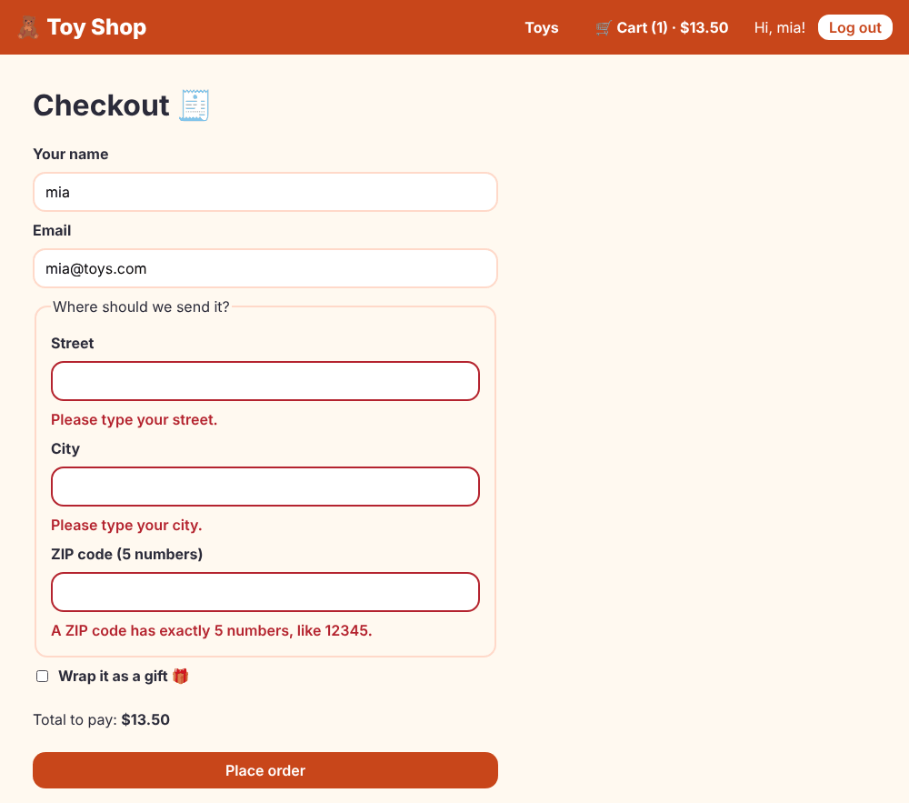

# Chapter 15: Forms

> **Like I'm 5:** A form is a paper with boxes to fill in: name, address, gift message. A good form checks each box politely ("you forgot your street!"), refuses to be sent while it has mistakes, and asks "are you sure?" if you try to leave with half the boxes filled.

Concept reference: [15. Forms](../concepts/15-forms.md)

[Back: Chapter 14](14-interceptors.md) · Next: [Chapter 16: Change detection](16-change-detection.md)

## What we build today

Three things that need a form or a bouncer:

1. A **login page** (email and password, with friendly checks).
2. A **checkout page**: name, email, a nested address, a gift option with a message and a growing list of gift tags, and our own rules (a ZIP code must be five digits; a gift needs a message).
3. Two **guards**: one that sends not-logged-in visitors to the login page (and brings them back afterwards), and one that asks "leave without ordering?".



## The big idea

Angular has two ways to build forms:

| | Template-driven | **Reactive** |
|---|---|---|
| Where the form lives | in the HTML (`ngModel`) | in the **TypeScript class** |
| Good for | tiny forms | real forms with rules, groups, lists |
| Testable without a browser | hard | easy |

We use **reactive forms**, the standard for real applications. You build a tree of objects:

- **`FormControl`**: one box (its value, whether it was touched, whether it is valid).
- **`FormGroup`**: a set of named controls (the whole form, or the address part).
- **`FormArray`**: a list of controls that can grow and shrink (the gift tags).
- **Validators**: rules (`required`, `email`, `minLength`, or your own).

Each control tracks a few simple states:

| State | Meaning |
|-------|---------|
| `valid` / `invalid` | do the rules pass? |
| `touched` / `untouched` | has the person visited the box (left it) yet? |
| `dirty` / `pristine` | has the person changed the value? |
| `pending` | an async check is still running |

**The golden rule of friendly forms:** show an error only after the box was **touched** (or after pressing submit), not while the person is still typing their first letter.

**Grown-up words:**

- **`FormBuilder`**: a shortcut for creating controls and groups.
- **`nonNullable`**: controls that are never `null`, only their start value after a reset. The types become simpler (`string`, not `string | null`).
- **Typed forms**: `form.getRawValue()` knows each field's type.
- **Cross-field validator**: a rule on a *group* that looks at several boxes.
- **Route guard**: a function that decides whether you may enter (`canActivate`) or leave (`canDeactivate`) a route.
- **`UrlTree`**: a description of an address that a guard can return to mean "go there instead".

## Step 1: The guards

A guard is a function. Make the "bouncer" first:

**`src/app/guards/auth-guard.ts`**

```ts
import { inject } from '@angular/core';
import { CanActivateFn, Router } from '@angular/router';
import { AuthService } from '../services/auth-service';

// A bouncer at the door: only logged-in shoppers may enter.
export const authGuard: CanActivateFn = (_route, state) => {
  const auth = inject(AuthService);
  if (auth.isLoggedIn()) return true;

  // Otherwise send them to the login page, and remember where they wanted to go.
  return inject(Router).createUrlTree(['/login'], { queryParams: { returnUrl: state.url } });
};
```

- It runs when the router tries to enter a route that lists it in `canActivate`.
- Returning `true` lets the person in.
- Returning `router.createUrlTree([...])` says "no, go *here* instead". We send them to `/login?returnUrl=/checkout`, so after logging in we can bring them back.

The second guard asks before leaving:

**`src/app/guards/unsaved-changes-guard.ts`**

```ts
import { CanDeactivateFn } from '@angular/router';

// Any page that wants to be asked "are you sure?" must have this method.
export interface HasUnsavedChanges {
  hasUnsavedChanges(): boolean;
}

// Asks before leaving a page where the person has typed something that is not saved.
export const unsavedChangesGuard: CanDeactivateFn<HasUnsavedChanges> = (page) =>
  !page.hasUnsavedChanges() || confirm('You have not placed your order yet. Leave anyway?');
```

A page that wants to be asked simply provides a `hasUnsavedChanges()` method (the `HasUnsavedChanges` interface is the promise). `confirm(...)` is the browser's yes/no box.

Plug both into the routes, and add the login route:

**`src/app/app.routes.ts`** (what changed)

```diff
@@ -1,6 +1,10 @@
 import { Routes } from '@angular/router';
+import { authGuard } from './guards/auth-guard';
+import { unsavedChangesGuard } from './guards/unsaved-changes-guard';
 import { Cart } from './pages/cart/cart';
+import { Checkout } from './pages/checkout/checkout';
 import { Home } from './pages/home/home';
+import { Login } from './pages/login/login';
 import { NotFound } from './pages/not-found/not-found';
 import { ProductDetail } from './pages/product-detail/product-detail';
 
@@ -9,6 +13,14 @@ export const routes: Routes = [
   // ":id" is a blank in the address. /product/3 fills it with "3".
   { path: 'product/:id', component: ProductDetail, title: 'Toy details' },
   { path: 'cart', component: Cart, title: 'Your cart' },
+  { path: 'login', component: Login, title: 'Log in' },
+  {
+    path: 'checkout',
+    component: Checkout,
+    title: 'Checkout',
+    canActivate: [authGuard], // only logged-in shoppers may come in
+    canDeactivate: [unsavedChangesGuard], // ask before leaving a half-filled form
+  },
   // "**" means "anything else". It must be the LAST route.
   { path: '**', component: NotFound, title: 'Page not found' },
 ];
```

Test them by calling them in an injection context, as the router would:

**`src/app/guards/guards.spec.ts`**

```ts
import { TestBed } from '@angular/core/testing';
import {
  ActivatedRouteSnapshot,
  provideRouter,
  Router,
  RouterStateSnapshot,
  UrlTree,
} from '@angular/router';
import { AuthService } from '../services/auth-service';
import { authGuard } from './auth-guard';
import { unsavedChangesGuard } from './unsaved-changes-guard';

describe('guards', () => {
  beforeEach(() => {
    sessionStorage.clear();
    TestBed.configureTestingModule({ providers: [provideRouter([])] });
  });

  describe('authGuard', () => {
    const run = () =>
      TestBed.runInInjectionContext(() =>
        authGuard({} as ActivatedRouteSnapshot, { url: '/checkout' } as RouterStateSnapshot),
      );

    it('sends people who are not logged in to the login page', () => {
      const result = run() as UrlTree;
      expect(TestBed.inject(Router).serializeUrl(result)).toBe('/login?returnUrl=%2Fcheckout');
    });

    it('lets logged-in shoppers through', () => {
      const auth = TestBed.inject(AuthService) as unknown as { _user: { set(u: unknown): void } };
      auth._user.set({ email: 'a@b.c', name: 'a', role: 'shopper', token: 't' });
      expect(run()).toBe(true);
    });
  });

  describe('unsavedChangesGuard', () => {
    const run = (unsaved: boolean) =>
      TestBed.runInInjectionContext(() =>
        unsavedChangesGuard(
          { hasUnsavedChanges: () => unsaved },
          {} as ActivatedRouteSnapshot,
          {} as RouterStateSnapshot,
          {} as RouterStateSnapshot,
        ),
      );

    it('lets you leave when nothing is unsaved', () => {
      expect(run(false)).toBe(true);
    });

    it('asks first when something is unsaved', () => {
      const ask = vi.spyOn(globalThis, 'confirm').mockReturnValue(false);
      expect(run(true)).toBe(false);
      expect(ask).toHaveBeenCalled();
      ask.mockRestore();
    });
  });
});
```

(The test fakes `confirm` with `vi.spyOn(globalThis, 'confirm')`, so no pop-up appears.)

## Step 2: The login page

```bash
ng generate component pages/login
```

**`src/app/pages/login/login.ts`**

```ts
import { Component, inject, input, signal } from '@angular/core';
import { FormBuilder, ReactiveFormsModule, Validators } from '@angular/forms';
import { Router } from '@angular/router';
import { AuthService } from '../../services/auth-service';

@Component({
  imports: [ReactiveFormsModule],
  selector: 'app-login',
  styleUrl: './login.css',
  templateUrl: './login.html',
})
export class Login {
  private auth = inject(AuthService);
  private router = inject(Router);

  // The guard adds ?returnUrl=... to the address, and the router gives it to us.
  returnUrl = input<string>();

  message = signal('');

  // A form is a group of little boxes (controls). nonNullable means "never null".
  form = inject(FormBuilder).nonNullable.group({
    email: ['', [Validators.required, Validators.email]],
    password: ['', [Validators.required, Validators.minLength(4)]],
  });

  submit() {
    if (this.form.invalid) {
      this.form.markAllAsTouched(); // show every error at once
      return;
    }
    const { email, password } = this.form.getRawValue();
    this.message.set('');
    this.auth.login(email, password).subscribe({
      next: () => this.router.navigateByUrl(this.returnUrl() || '/'),
      error: (e) => this.message.set(e.error?.message ?? 'Something went wrong'),
    });
  }
}
```

- `returnUrl = input<string>()` receives `?returnUrl=...` from the address (Chapter 11's input binding).
- `inject(FormBuilder).nonNullable.group({...})` builds the form: two controls, each with `[startValue, [validators]]`.
- `submit()` first checks `form.invalid`. If so, `markAllAsTouched()` makes **all** error messages appear at once, then stops. Otherwise it logs in; on success it goes to `returnUrl` (or `/`), on failure it shows the server's message.

The template connects boxes to controls with `formGroup` and `formControlName`:

**`src/app/pages/login/login.html`**

```html
<h1>Log in</h1>
<p class="hint">
  Pretend shop! Use any email and the password <strong>toys123</strong>. An email that starts with
  <strong>admin</strong> gets the admin powers.
</p>

<form class="form" [formGroup]="form" (ngSubmit)="submit()" novalidate>
  <label for="email">Email</label>
  <input id="email" type="email" formControlName="email" autocomplete="email" />
  @if (form.controls.email.touched && form.controls.email.invalid) {
    <p class="error" role="alert">
      @if (form.controls.email.hasError('required')) {
        Please type your email.
      } @else {
        That does not look like an email.
      }
    </p>
  }

  <label for="password">Password</label>
  <input id="password" type="password" formControlName="password" autocomplete="current-password" />
  @if (form.controls.password.touched && form.controls.password.invalid) {
    <p class="error" role="alert">The password needs at least 4 letters.</p>
  }

  @if (message()) {
    <p class="error" role="alert">{{ message() }}</p>
  }

  <button class="btn" type="submit">Log in</button>
</form>
```

- `[formGroup]="form"` connects the `<form>` to the group. `formControlName="email"` connects an input to the control of that name. The name must match, or you get `Cannot find control with name: 'emial'`.
- `(ngSubmit)="submit()"` runs when the form is submitted (button click or Enter key).
- `novalidate` switches off the browser's own pop-up messages, because we show better ones.
- `@if (form.controls.email.touched && form.controls.email.invalid)`: the golden rule.
- Each error has `role="alert"`, so screen readers announce it.
- The `label for="email"` matches the input's `id`, so clicking the label focuses the box, and screen readers know what the box is for.

**`src/app/pages/login/login.css`**

```css
.hint {
  color: var(--color-muted);
}

.form {
  display: grid;
  gap: 0.5rem;
  max-width: 28rem;
}

.form label {
  font-weight: 700;
}

.form input {
  padding: 0.5rem 0.75rem;
  border: 2px solid var(--color-brand-light);
  border-radius: var(--radius);
  font: inherit;
}

.form input.ng-touched.ng-invalid {
  border-color: var(--color-danger);
}

.error {
  margin: 0;
  color: var(--color-danger);
  font-weight: 600;
}
```

**`src/app/pages/login/login.spec.ts`**

```ts
import { provideHttpClient } from '@angular/common/http';
import { HttpTestingController, provideHttpClientTesting } from '@angular/common/http/testing';
import { TestBed } from '@angular/core/testing';
import { provideRouter, Router } from '@angular/router';
import { Login } from './login';

describe('Login', () => {
  beforeEach(async () => {
    sessionStorage.clear();
    await TestBed.configureTestingModule({
      imports: [Login],
      providers: [provideRouter([]), provideHttpClient(), provideHttpClientTesting()],
    }).compileComponents();
  });

  it('does not send anything while the form is empty', async () => {
    const fixture = TestBed.createComponent(Login);
    await fixture.whenStable();
    const server = TestBed.inject(HttpTestingController);

    fixture.componentInstance.submit();
    await fixture.whenStable();

    server.expectNone('/api/login');
    expect(fixture.nativeElement.textContent).toContain('Please type your email');
  });

  it('logs in and goes home when the form is filled in', async () => {
    const fixture = TestBed.createComponent(Login);
    await fixture.whenStable();
    const server = TestBed.inject(HttpTestingController);
    const go = vi.spyOn(TestBed.inject(Router), 'navigateByUrl').mockResolvedValue(true);

    fixture.componentInstance.form.setValue({ email: 'mia@toys.com', password: 'toys123' });
    fixture.componentInstance.submit();
    server.expectOne('/api/login').flush({
      email: 'mia@toys.com',
      name: 'mia',
      role: 'shopper',
      token: 't',
    });

    expect(go).toHaveBeenCalledWith('/');
  });
});
```

## Step 3: Teach the header about login

Replace the "Your name" box (it was just for practice) with real login/logout:

**`src/app/components/site-header/site-header.ts`** (what changed)

```diff
@@ -1,7 +1,8 @@
 import { CurrencyPipe } from '@angular/common';
 import { Component, inject, signal } from '@angular/core';
 import { FormsModule } from '@angular/forms';
-import { RouterLink, RouterLinkActive } from '@angular/router';
+import { Router, RouterLink, RouterLinkActive } from '@angular/router';
+import { AuthService } from '../../services/auth-service';
 import { CartService } from '../../services/cart-service';
 import { SHOP_NAME } from '../../tokens';
 
@@ -14,5 +15,13 @@ import { SHOP_NAME } from '../../tokens';
 export class SiteHeader {
   shopName = inject(SHOP_NAME);
   cart = inject(CartService);
+  auth = inject(AuthService);
+  private router = inject(Router);
+
   shopperName = signal('');
+
+  logout() {
+    this.auth.logout();
+    this.router.navigateByUrl('/');
+  }
 }
```

**`src/app/components/site-header/site-header.html`** (what changed)

```diff
@@ -8,10 +8,17 @@
     </a>
   </nav>
 
-  <label class="name-box">
-    Your name:
-    <input [(ngModel)]="shopperName" placeholder="Type here" />
-  </label>
-
-  <span>Hello, {{ shopperName() || 'friend' }}!</span>
+  <div class="who">
+    @if (auth.user(); as user) {
+      <span>Hi, {{ user.name }}!</span>
+      <button class="btn secondary small" type="button" (click)="logout()">Log out</button>
+    } @else {
+      <label class="name-box">
+        Your name:
+        <input [(ngModel)]="shopperName" placeholder="Type here" />
+      </label>
+      <span>Hello, {{ shopperName() || 'friend' }}!</span>
+      <a class="login-link" routerLink="/login">Log in</a>
+    }
+  </div>
 </header>
```

**`src/app/components/site-header/site-header.css`** (what changed)

```diff
@@ -38,3 +38,19 @@
   border-radius: 8px;
   border: 0;
 }
+
+.who {
+  display: flex;
+  flex-wrap: wrap;
+  align-items: center;
+  gap: 0.75rem;
+}
+
+.login-link {
+  color: #fff;
+  font-weight: 700;
+}
+
+.btn.small {
+  padding: 0.125rem 0.75rem;
+}
```

`@if (auth.user(); as user)` shows "Hi, Mia!" and a **Log out** button when someone is logged in, and the login link otherwise.

## Step 4: The order service

**`src/app/services/order-service.ts`**

```ts
import { HttpClient } from '@angular/common/http';
import { inject, Service } from '@angular/core';
import { NewOrder, Order } from '../models/order';

@Service()
export class OrderService {
  private http = inject(HttpClient);

  place(order: NewOrder) {
    return this.http.post<Order>('/api/orders', order);
  }

  mine() {
    return this.http.get<Order[]>('/api/orders');
  }
}
```

The order model gets a field for the gift tags:

**`src/app/models/order.ts`** (what changed)

```diff
@@ -12,6 +12,7 @@ export interface NewOrder {
   address: string;
   giftWrap: boolean;
   notes: string;
+  giftTags: string[];
   lines: OrderLine[];
   total: number;
 }
```

## Step 5: The checkout form

```bash
ng generate component pages/checkout
```

This is the biggest piece of the chapter. Read the brain first:

**`src/app/pages/checkout/checkout.ts`**

```ts
import { CurrencyPipe } from '@angular/common';
import { Component, inject, signal } from '@angular/core';
import { toSignal } from '@angular/core/rxjs-interop';
import {
  FormBuilder,
  ReactiveFormsModule,
  ValidationErrors,
  ValidatorFn,
  Validators,
} from '@angular/forms';
import { RouterLink } from '@angular/router';
import { HasUnsavedChanges } from '../../guards/unsaved-changes-guard';
import { NewOrder, Order } from '../../models/order';
import { AuthService } from '../../services/auth-service';
import { CartService } from '../../services/cart-service';
import { OrderService } from '../../services/order-service';

// A rule of our own: a ZIP code is exactly five digits.
export const zipCode: ValidatorFn = (control): ValidationErrors | null =>
  /^\d{5}$/.test(control.value) ? null : { zip: true };

// A rule that looks at TWO boxes at once: gift wrap needs a gift message.
export const giftNeedsMessage: ValidatorFn = (group): ValidationErrors | null => {
  const giftWrap = group.get('giftWrap')?.value;
  const notes = String(group.get('notes')?.value ?? '').trim();
  return giftWrap && !notes ? { giftMessage: true } : null;
};

@Component({
  imports: [ReactiveFormsModule, CurrencyPipe, RouterLink],
  selector: 'app-checkout',
  styleUrl: './checkout.css',
  templateUrl: './checkout.html',
})
export class Checkout implements HasUnsavedChanges {
  cart = inject(CartService);
  private auth = inject(AuthService);
  private orders = inject(OrderService);
  private fb = inject(FormBuilder).nonNullable;

  placed = signal<Order | null>(null);
  sending = signal(false);
  problem = signal('');

  form = this.fb.group(
    {
      name: [this.auth.user()?.name ?? '', [Validators.required, Validators.minLength(2)]],
      email: [this.auth.user()?.email ?? '', [Validators.required, Validators.email]],
      address: this.fb.group({
        street: ['', Validators.required],
        city: ['', Validators.required],
        zip: ['', [Validators.required, zipCode]],
      }),
      giftWrap: false,
      notes: '',
      // A FormArray is a list of boxes that can grow and shrink.
      giftTags: this.fb.array<string>([]),
    },
    { validators: giftNeedsMessage },
  );

  // Forms speak in streams (Observables). toSignal turns the stream into a signal box.
  giftWrap = toSignal(this.form.controls.giftWrap.valueChanges, { initialValue: false });

  addTag() {
    this.form.controls.giftTags.push(this.fb.control('', Validators.required));
  }

  removeTag(index: number) {
    this.form.controls.giftTags.removeAt(index);
  }

  submit() {
    if (this.form.invalid) {
      this.form.markAllAsTouched();
      return;
    }
    const v = this.form.getRawValue();
    const order: NewOrder = {
      name: v.name,
      email: v.email,
      address: `${v.address.street}, ${v.address.city} ${v.address.zip}`,
      giftWrap: v.giftWrap,
      notes: v.notes,
      giftTags: v.giftTags,
      lines: this.cart.items().map((i) => ({
        productId: i.product.id,
        name: i.product.name,
        price: i.product.price,
        quantity: i.quantity,
      })),
      total: this.cart.total(),
    };

    this.sending.set(true);
    this.problem.set('');
    this.orders.place(order).subscribe({
      next: (saved) => {
        this.placed.set(saved);
        this.cart.clear();
        this.form.markAsPristine(); // nothing left unsaved
        this.sending.set(false);
      },
      error: (e) => {
        this.problem.set(e.error?.message ?? 'The order did not go through. Please try again.');
        this.sending.set(false);
      },
    });
  }

  // The "are you sure?" guard asks this question before we leave the page.
  hasUnsavedChanges() {
    return this.form.dirty && !this.placed();
  }
}
```

The form is a *tree*:

```
form (FormGroup)
├─ name            (FormControl)
├─ email           (FormControl)
├─ address         (FormGroup)
│   ├─ street
│   ├─ city
│   └─ zip
├─ giftWrap        (FormControl<boolean>)
├─ notes           (FormControl)
└─ giftTags        (FormArray of FormControl)
```

Things to notice:

- **Start values from the logged-in user**: `this.auth.user()?.name ?? ''`.
- **A custom validator**, `zipCode`: a function that gets a control and returns `null` (fine) or an error object (`{ zip: true }`). It is five digits or nothing.
- **A cross-field validator**, `giftNeedsMessage`: attached to the *whole group* (`{ validators: giftNeedsMessage }`). It looks at both `giftWrap` and `notes`. Rules that need two boxes belong to the group, not to one control.
- **A `FormArray`** of gift tags: `push(control)` adds a box, `removeAt(i)` removes one.
- **`toSignal(...valueChanges)`**: forms announce changes as Observables (Chapter 12). `toSignal` turns "is gift wrap ticked?" into a signal that the template can read as `giftWrap()`.
- **`submit()`**: bail out if invalid (and reveal the errors). Otherwise build the order, send it, clear the cart on success, and mark the form pristine so the "leave?" guard stays quiet. The `error` path shows the server's message.
- **`hasUnsavedChanges()`**: `dirty && !placed()`. Typed something and did not order yet? Ask.

Now the template:

**`src/app/pages/checkout/checkout.html`**

```html
<h1>Checkout 🧾</h1>

@if (placed(); as order) {
  <section class="thanks" role="status">
    <h2>Thank you, {{ order.name }}! 🎉</h2>
    <p>
      Your order <strong>{{ order.id }}</strong> is on its way. Total: {{ order.total | currency }}.
    </p>
    <a class="btn" routerLink="/">Keep shopping</a>
  </section>
} @else if (cart.items().length === 0) {
  <p>Your cart is empty. <a routerLink="/">Go find a toy!</a></p>
} @else {
  <form class="form" [formGroup]="form" (ngSubmit)="submit()" novalidate>
    <label for="name">Your name</label>
    <input id="name" formControlName="name" autocomplete="name" />
    @if (form.controls.name.touched && form.controls.name.invalid) {
      <p class="error" role="alert">Please type your name (at least 2 letters).</p>
    }

    <label for="email">Email</label>
    <input id="email" type="email" formControlName="email" autocomplete="email" />
    @if (form.controls.email.touched && form.controls.email.invalid) {
      <p class="error" role="alert">Please type a real email.</p>
    }

    <fieldset formGroupName="address">
      <legend>Where should we send it?</legend>

      <label for="street">Street</label>
      <input id="street" formControlName="street" autocomplete="street-address" />
      @if (
        form.controls.address.controls.street.touched &&
        form.controls.address.controls.street.invalid
      ) {
        <p class="error" role="alert">Please type your street.</p>
      }

      <label for="city">City</label>
      <input id="city" formControlName="city" autocomplete="address-level2" />
      @if (
        form.controls.address.controls.city.touched && form.controls.address.controls.city.invalid
      ) {
        <p class="error" role="alert">Please type your city.</p>
      }

      <label for="zip">ZIP code (5 numbers)</label>
      <input id="zip" formControlName="zip" inputmode="numeric" autocomplete="postal-code" />
      @if (
        form.controls.address.controls.zip.touched && form.controls.address.controls.zip.invalid
      ) {
        <p class="error" role="alert">A ZIP code has exactly 5 numbers, like 12345.</p>
      }
    </fieldset>

    <label class="check">
      <input type="checkbox" formControlName="giftWrap" />
      Wrap it as a gift 🎁
    </label>

    @if (giftWrap()) {
      <label for="notes">Gift message</label>
      <textarea id="notes" rows="3" formControlName="notes"></textarea>
      @if (form.hasError('giftMessage') && form.controls.notes.touched) {
        <p class="error" role="alert">Please write a message for the gift.</p>
      }

      <div formArrayName="giftTags">
        <p><strong>Gift tags</strong> (names to write on little tags)</p>
        @for (tag of form.controls.giftTags.controls; track tag; let i = $index) {
          <div class="tag-row">
            <input [formControlName]="i" [attr.aria-label]="'Gift tag ' + (i + 1)" />
            <button class="btn secondary" type="button" (click)="removeTag(i)">Remove</button>
          </div>
        }
        <button class="btn secondary" type="button" (click)="addTag()">Add a gift tag</button>
      </div>
    }

    <p class="total">
      Total to pay: <strong>{{ cart.total() | currency }}</strong>
    </p>

    @if (problem()) {
      <p class="error" role="alert">{{ problem() }}</p>
    }

    <button class="btn" type="submit" [disabled]="sending()">
      {{ sending() ? 'Sending…' : 'Place order' }}
    </button>
  </form>
}
```

New directives here:

- `formGroupName="address"` and `<fieldset>`: connects a sub-group.
- `formArrayName="giftTags"` plus `[formControlName]="i"`: each tag input is bound to the array item at index `i`.
- `track tag` in the `@for`: the control object itself identifies each row, so removing the middle one keeps the others as they are.
- `@if (giftWrap())` shows the gift section only when the box is ticked.
- `[disabled]="sending()"` stops double-submits while waiting.

Finally paint, and a link from the cart page:

**`src/app/pages/checkout/checkout.css`**

```css
.form {
  display: grid;
  gap: 0.5rem;
  max-width: 32rem;
}

.form label {
  font-weight: 700;
}

.form input:not([type='checkbox']),
.form textarea {
  padding: 0.5rem 0.75rem;
  border: 2px solid var(--color-brand-light);
  border-radius: var(--radius);
  font: inherit;
}

.form .ng-touched.ng-invalid:not(form):not(fieldset):not(div) {
  border-color: var(--color-danger);
}

fieldset {
  display: grid;
  gap: 0.5rem;
  padding: 1rem;
  border: 2px solid var(--color-brand-light);
  border-radius: var(--radius);
}

.check {
  display: flex;
  gap: 0.5rem;
  align-items: center;
}

.tag-row {
  display: flex;
  gap: 0.5rem;
  margin-bottom: 0.5rem;
}

.tag-row input {
  flex: 1;
}

.error {
  margin: 0;
  color: var(--color-danger);
  font-weight: 600;
}

.thanks {
  padding: 1.5rem;
  background: #d6f5ef;
  border-radius: var(--radius);
}
```

**`src/app/pages/cart/cart.html`** (what changed)

```diff
@@ -38,5 +38,8 @@
     <dd class="grand">{{ cart.total() | currency }}</dd>
   </dl>
 
-  <button class="btn secondary" type="button" (click)="cart.clear()">Empty the cart</button>
+  <div class="actions">
+    <a class="btn" routerLink="/checkout">Go to checkout</a>
+    <button class="btn secondary" type="button" (click)="cart.clear()">Empty the cart</button>
+  </div>
 }
```

**`src/app/pages/cart/cart.css`** (what changed)

```diff
@@ -36,3 +36,13 @@
   font-size: 1.25rem;
   font-weight: 800;
 }
+
+.actions {
+  display: flex;
+  flex-wrap: wrap;
+  gap: 0.75rem;
+}
+
+.btn {
+  text-decoration: none;
+}
```

## Step 6: The rest of the tests

**`src/app/pages/checkout/checkout.spec.ts`**

```ts
import { provideHttpClient } from '@angular/common/http';
import { HttpTestingController, provideHttpClientTesting } from '@angular/common/http/testing';
import { ComponentFixture, TestBed } from '@angular/core/testing';
import { FormControl } from '@angular/forms';
import { provideRouter } from '@angular/router';
import { sampleProducts } from '../../data/sample-products';
import { CartService } from '../../services/cart-service';
import { Checkout, giftNeedsMessage, zipCode } from './checkout';

describe('Checkout', () => {
  let fixture: ComponentFixture<Checkout>;
  let page: Checkout;
  let server: HttpTestingController;

  const goodAnswers = {
    name: 'Mia',
    email: 'mia@toys.com',
    address: { street: '1 Toy Lane', city: 'Toyville', zip: '12345' },
    giftWrap: false,
    notes: '',
  };

  beforeEach(async () => {
    localStorage.clear();
    sessionStorage.clear();
    await TestBed.configureTestingModule({
      imports: [Checkout],
      providers: [provideRouter([]), provideHttpClient(), provideHttpClientTesting()],
    }).compileComponents();

    TestBed.inject(CartService).add(sampleProducts[0], 2); // 2 racing cars
    server = TestBed.inject(HttpTestingController);
    fixture = TestBed.createComponent(Checkout);
    page = fixture.componentInstance;
    await fixture.whenStable();
  });

  it('is not valid until everything is filled in', () => {
    expect(page.form.valid).toBe(false);
    page.form.patchValue(goodAnswers);
    expect(page.form.valid).toBe(true);
  });

  it('shows the errors after pressing "Place order" on an empty form', async () => {
    page.submit();
    await fixture.whenStable();
    server.expectNone('/api/orders');
    expect(fixture.nativeElement.textContent).toContain('Please type your street');
  });

  it('asks for a gift message when gift wrap is on', () => {
    page.form.patchValue({ ...goodAnswers, giftWrap: true, notes: '' });
    expect(page.form.hasError('giftMessage')).toBe(true);
    page.form.patchValue({ notes: 'Happy birthday!' });
    expect(page.form.valid).toBe(true);
  });

  it('sends the order, empties the cart, and says thank you', async () => {
    page.form.patchValue(goodAnswers);
    page.submit();

    const request = server.expectOne('/api/orders');
    expect(request.request.body.lines[0]).toMatchObject({ name: 'Racing Car', quantity: 2 });
    request.flush({ ...request.request.body, id: 'T-1001', createdAt: 'now', userEmail: 'x' });
    await fixture.whenStable();

    expect(TestBed.inject(CartService).count()).toBe(0);
    expect(fixture.nativeElement.textContent).toContain('Thank you, Mia');
    expect(page.hasUnsavedChanges()).toBe(false);
  });

  it('knows when the person has typed something that is not saved', () => {
    expect(page.hasUnsavedChanges()).toBe(false);
    page.form.controls.name.markAsDirty();
    expect(page.hasUnsavedChanges()).toBe(true);
  });

  describe('our own rules', () => {
    it('zipCode wants exactly five digits', () => {
      expect(zipCode(new FormControl('12345'))).toBeNull();
      expect(zipCode(new FormControl('1234'))).toEqual({ zip: true });
      expect(zipCode(new FormControl('12a45'))).toEqual({ zip: true });
    });

    it('giftNeedsMessage only complains when gift wrap is on and the message is empty', () => {
      const group = (giftWrap: boolean, notes: string) =>
        ({ get: (k: string) => ({ value: { giftWrap, notes }[k] }) }) as never;
      expect(giftNeedsMessage(group(true, ''))).toEqual({ giftMessage: true });
      expect(giftNeedsMessage(group(false, ''))).toBeNull();
      expect(giftNeedsMessage(group(true, 'Hi'))).toBeNull();
    });
  });
});
```

**`src/app/services/auth-service.spec.ts`**

```ts
import { provideHttpClient } from '@angular/common/http';
import { HttpTestingController, provideHttpClientTesting } from '@angular/common/http/testing';
import { TestBed } from '@angular/core/testing';
import { AuthService } from './auth-service';

describe('AuthService', () => {
  beforeEach(() => {
    sessionStorage.clear();
    TestBed.configureTestingModule({
      providers: [provideHttpClient(), provideHttpClientTesting()],
    });
  });

  it('starts logged out', () => {
    const auth = TestBed.inject(AuthService);
    expect(auth.isLoggedIn()).toBe(false);
    expect(auth.token()).toBeNull();
  });

  it('remembers the user after a good login, and forgets on logout', () => {
    const auth = TestBed.inject(AuthService);
    const server = TestBed.inject(HttpTestingController);

    auth.login('admin@toys.com', 'toys123').subscribe();
    server.expectOne('/api/login').flush({
      email: 'admin@toys.com',
      name: 'admin',
      role: 'admin',
      token: 'fake-token-admin@toys.com',
    });

    expect(auth.isLoggedIn()).toBe(true);
    expect(auth.isAdmin()).toBe(true);

    auth.logout();
    expect(auth.isLoggedIn()).toBe(false);
  });
});
```

**`src/app/services/order-service.spec.ts`**

```ts
import { TestBed } from '@angular/core/testing';
import { OrderService } from './order-service';

describe('OrderService', () => {
  let service: OrderService;

  beforeEach(() => {
    TestBed.configureTestingModule({});
    service = TestBed.inject(OrderService);
  });

  it('should be created', () => {
    expect(service).toBeTruthy();
  });
});
```

Look at how the checkout tests work without any typing: they fill the form with `form.patchValue(goodAnswers)` and call `submit()`. A reactive form is plain objects, so it is easy to test.

## Check it works

```bash
npx ng test --watch=false
```

```
 Test Files  23 passed (23)
      Tests  59 passed (59)
```

In the browser:

- [ ] Add a toy, open the cart, click **Go to checkout**. You land on `/login?returnUrl=%2Fcheckout`, not on checkout.
- [ ] Press **Log in** with empty boxes: both errors appear. Type `mia@toys.com` and the wrong password `abcd`: "Wrong email or password". Use `toys123`: you land on checkout.
- [ ] Press **Place order** with empty boxes: errors appear under street, city, and ZIP.
- [ ] Type `1234` as the ZIP: "A ZIP code has exactly 5 numbers". Type `12345`.
- [ ] Tick **Wrap it as a gift**: a message box and **Add a gift tag** appear. Leave the message empty and press **Place order**: "Please write a message for the gift."
- [ ] Fill the rest and send: "Thank you, mia!" with an order number like `T-1001`. The cart is empty.
- [ ] Start typing in the checkout form, then click **Toys** in the header: the browser asks "Leave anyway?".
- [ ] Log in as `admin@toys.com`: the fake backend gives the role `admin` (it is used in Chapter 17).

## Bonus lab: forms you will meet at work

The Toy Shop uses a nested group, a `FormArray`, and two custom validators. Real projects also need these three. Files are in [`extras/ch15`](extras/ch15/). Copy them to `src/app/extras/` and run the tests.

**1. An async validator, `updateOn: 'blur'`, and a custom control.**

**`src/app/extras/forms-lab.spec.ts`**

```ts
import { Component, forwardRef, signal } from '@angular/core';
import { TestBed } from '@angular/core/testing';
import {
  AbstractControl,
  AsyncValidatorFn,
  ControlValueAccessor,
  FormControl,
  FormGroup,
  NG_VALUE_ACCESSOR,
  ReactiveFormsModule,
} from '@angular/forms';
import { map, timer } from 'rxjs';

// 1. An ASYNC validator: it needs to ask "the server", so the answer comes later.
const emailTaken: AsyncValidatorFn = (control: AbstractControl) =>
  timer(300).pipe(map(() => (control.value === 'taken@toys.com' ? { taken: true } : null)));

// 2. A CUSTOM CONTROL: a row of stars that works with formControlName like a normal input.
//    ControlValueAccessor is the "plug adapter" between a form control and our own component.
@Component({
  selector: 'app-star-input',
  providers: [
    { provide: NG_VALUE_ACCESSOR, useExisting: forwardRef(() => StarInput), multi: true },
  ],
  template: `
    @for (n of [1, 2, 3, 4, 5]; track n) {
      <button
        type="button"
        [attr.aria-label]="n + ' stars'"
        [disabled]="disabled()"
        (click)="pick(n)"
      >
        {{ n <= value() ? '★' : '☆' }}
      </button>
    }
  `,
})
class StarInput implements ControlValueAccessor {
  value = signal(0);
  disabled = signal(false);
  private onChange: (v: number) => void = () => undefined;
  private onTouched: () => void = () => undefined;

  writeValue(v: number | null) {
    this.value.set(v ?? 0); // the form wrote a new value: show it
  }
  registerOnChange(fn: (v: number) => void) {
    this.onChange = fn;
  }
  registerOnTouched(fn: () => void) {
    this.onTouched = fn;
  }
  setDisabledState(isDisabled: boolean) {
    this.disabled.set(isDisabled);
  }
  pick(n: number) {
    this.value.set(n);
    this.onChange(n); // tell the form
    this.onTouched();
  }
}

@Component({
  imports: [ReactiveFormsModule, StarInput],
  template: `<form [formGroup]="form"><app-star-input formControlName="stars" /></form>`,
})
class Host {
  form = new FormGroup({ stars: new FormControl(2, { nonNullable: true }) });
}

@Component({
  imports: [ReactiveFormsModule],
  template: `<input [formControl]="name" />`,
})
class BlurHost {
  name = new FormControl('', { nonNullable: true, updateOn: 'blur' });
}

describe('forms lab', () => {
  afterEach(() => vi.useRealTimers());

  it('an async validator is "pending" until the answer comes back', async () => {
    vi.useFakeTimers();
    const email = new FormControl('taken@toys.com', { asyncValidators: [emailTaken] });
    expect(email.pending).toBe(true);

    await vi.advanceTimersByTimeAsync(300);
    expect(email.pending).toBe(false);
    expect(email.errors).toEqual({ taken: true });

    email.setValue('free@toys.com');
    await vi.advanceTimersByTimeAsync(300);
    expect(email.valid).toBe(true);
  });

  it('updateOn: "blur" waits until you leave the box before the control gets the value', async () => {
    const fixture = TestBed.createComponent(BlurHost);
    await fixture.whenStable();
    const input: HTMLInputElement = fixture.nativeElement.querySelector('input');

    input.value = 'Mia';
    input.dispatchEvent(new Event('input')); // typing...
    expect(fixture.componentInstance.name.value).toBe(''); // ...the control has not heard yet

    input.dispatchEvent(new Event('blur')); // leaving the box
    expect(fixture.componentInstance.name.value).toBe('Mia');
  });

  it('a custom control works with formControlName in both directions', async () => {
    const fixture = TestBed.createComponent(Host);
    await fixture.whenStable();
    const host = fixture.componentInstance;
    const buttons = fixture.nativeElement.querySelectorAll('button');

    // form -> control: the form already says 2 stars
    expect(fixture.nativeElement.textContent.match(/★/g)?.length).toBe(2);

    // control -> form: click the 4th star
    buttons[3].click();
    await fixture.whenStable();
    expect(host.form.controls.stars.value).toBe(4);
    expect(host.form.controls.stars.touched).toBe(true);

    // form -> control again: the program sets 1
    host.form.controls.stars.setValue(1);
    await fixture.whenStable();
    expect(fixture.nativeElement.textContent.match(/★/g)?.length).toBe(1);

    // disabled flows down as well
    host.form.controls.stars.disable();
    await fixture.whenStable();
    expect(buttons[0].disabled).toBe(true);
  });
});
```

- The async validator returns an Observable, so the control is `pending` until the "server" answers. This is how you would check "is this email already taken?".
- `updateOn: 'blur'` makes a control update only when the person leaves the box (less noise for expensive validators).
- `StarInput` implements **`ControlValueAccessor`**, the "plug adapter" that lets your own component behave like a native input inside a form: `writeValue` (form to component), `registerOnChange` (component to form), `registerOnTouched`, and `setDisabledState`.

**2. A taste of signal forms.** Angular 22 also has a newer, signal-based way to build forms (`@angular/forms/signals`). The data lives in one signal, and rules are written per field. This is the same login form:

**`src/app/extras/signal-login.ts`**

```ts
import { Component, signal } from '@angular/core';
import { email, form, FormField, minLength, required, submit } from '@angular/forms/signals';

// The same login form as Chapter 15, but built with "signal forms".
// The data lives in ONE signal (the model). The form is a thin layer around it.
@Component({
  selector: 'app-signal-login',
  imports: [FormField],
  template: `
    <form (submit)="onSubmit($event)" novalidate>
      <label for="email">Email</label>
      <input id="email" type="email" [formField]="loginForm.email" />
      @if (loginForm.email().touched() && loginForm.email().invalid()) {
        @for (error of loginForm.email().errors(); track error.kind) {
          <p class="error" role="alert">{{ error.message }}</p>
        }
      }

      <label for="password">Password</label>
      <input id="password" type="password" [formField]="loginForm.password" />
      @if (loginForm.password().touched() && loginForm.password().invalid()) {
        @for (error of loginForm.password().errors(); track error.kind) {
          <p class="error" role="alert">{{ error.message }}</p>
        }
      }

      <button type="submit">Log in</button>
    </form>
    @if (sentTo()) {
      <p class="ok">Sent: {{ sentTo() }}</p>
    }
  `,
})
export class SignalLogin {
  // 1. The model: plain data in a signal.
  model = signal({ email: '', password: '' });

  // 2. The form: rules written per field.
  loginForm = form(this.model, (path) => {
    required(path.email, { message: 'Please type your email.' });
    email(path.email, { message: 'That does not look like an email.' });
    required(path.password, { message: 'Please type a password.' });
    minLength(path.password, 4, { message: 'The password needs at least 4 letters.' });
  });

  sentTo = signal('');

  onSubmit(event: Event) {
    event.preventDefault();
    // submit() marks everything touched, and only runs our function when the form is valid.
    submit(this.loginForm, async () => {
      this.sentTo.set(this.model().email);
    });
  }
}
```

**`src/app/extras/signal-login.spec.ts`**

```ts
import { TestBed } from '@angular/core/testing';
import { SignalLogin } from './signal-login';

describe('SignalLogin (signal forms)', () => {
  function type(input: HTMLInputElement, text: string) {
    input.value = text;
    input.dispatchEvent(new Event('input'));
  }

  it('writes what you type into the model signal', async () => {
    const fixture = TestBed.createComponent(SignalLogin);
    await fixture.whenStable();
    const email = fixture.nativeElement.querySelector('#email');

    type(email, 'mia@toys.com');
    await fixture.whenStable();

    expect(fixture.componentInstance.model().email).toBe('mia@toys.com');
  });

  it('shows messages for an empty form after pressing submit, and does not send', async () => {
    const fixture = TestBed.createComponent(SignalLogin);
    await fixture.whenStable();

    fixture.nativeElement.querySelector('button').click();
    await fixture.whenStable();

    const text = fixture.nativeElement.textContent;
    expect(text).toContain('Please type your email.');
    expect(text).toContain('Please type a password.');
    expect(fixture.componentInstance.sentTo()).toBe('');
  });

  it('sends when everything is fine', async () => {
    const fixture = TestBed.createComponent(SignalLogin);
    await fixture.whenStable();
    type(fixture.nativeElement.querySelector('#email'), 'mia@toys.com');
    type(fixture.nativeElement.querySelector('#password'), 'toys123');
    await fixture.whenStable();

    fixture.nativeElement.querySelector('button').click();
    await fixture.whenStable();

    expect(fixture.componentInstance.sentTo()).toBe('mia@toys.com');
  });
});
```

Compare: no `FormBuilder`, no `valueChanges`; the model is a plain signal (`model()`), validation messages are part of the rule, and `submit()` runs your function only when the form is valid. Both styles are supported. Reactive forms are what you will find in almost every existing project, so it is the one we use in the shop.

## What you learned

- Reactive forms are objects in the class: `FormControl`, `FormGroup`, `FormArray`, built with `FormBuilder`.
- Validators are functions; you can write your own; a rule that needs several boxes belongs on the group.
- Show errors only for touched boxes (or after submit); `markAllAsTouched()` reveals everything.
- `canActivate` and `canDeactivate` guards decide whether a route may be entered or left; return a `UrlTree` to redirect.
- A form is plain data in TypeScript, so it is easy to test.

## Try it yourself

1. Add a `phone` control to the checkout form that is optional, but if present must match `/^\d{10}$/` (use `Validators.pattern`). Show an error message.
2. In the login form, show the **Log in** button as disabled while the form is invalid. What is the downside of doing this? (Hint: why do we show errors on submit instead?)
3. Write a cross-field validator that makes sure the gift message does not contain the word "secret" when `giftWrap` is on.
4. Make the unsaved-changes guard use a nicer dialog than `confirm`. (Chapter 20 gives you Angular Material dialogs.)

## If something goes wrong

**`Cannot find control with name: 'emial'`:** the name in `formControlName` does not exist in the group. Fix the typo.

**`Can't bind to 'formGroup' since it isn't a known property of 'form'`:** add `ReactiveFormsModule` to the component's `imports`.

**`No value accessor for form control with name: ...`:** you used `formControlName` on something that is not a form control (a custom component with no `ControlValueAccessor`). See the star input in the bonus lab.

**The error appears while the person is still typing their first letter:** you forgot the `touched` check.

**The page stays on `/login` after logging in:** `returnUrl` was empty. Check that the guard added `?returnUrl=` and that the page has `withComponentInputBinding()` (Chapter 11).

**A test for a component with a form says `No provider found for HttpClient`/`ActivatedRoute`:** the test needs `provideHttpClient()` + `provideHttpClientTesting()` and `provideRouter([])`.

Next: [Chapter 16: Change detection](16-change-detection.md)
