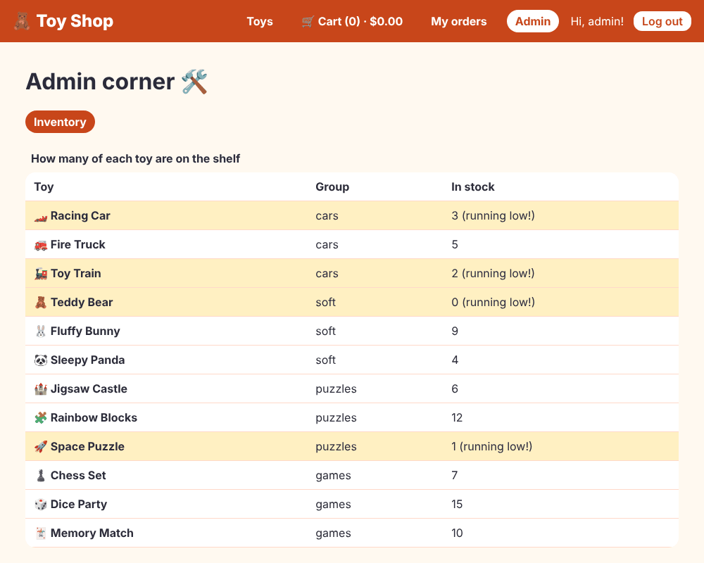

# Chapter 17: Lazy loading

> **Like I'm 5:** When you go to the park you do not carry every toy you own. You take what you need and fetch the rest from home when you really want it. A lazy-loading website does the same: it downloads a page's code only when somebody walks into that page.

Concept reference: [13. Lazy loading and preloading](../concepts/13-lazy-loading-and-preloading.md)

[Back: Chapter 16](16-change-detection.md) · Next: [Chapter 18: State management](18-state-management.md)

## What we build today

Two pages that are **not** part of the first download:

1. **My orders**: the list of orders you placed (lazy `loadComponent`, quietly pre-loaded in the background).
2. **Admin corner**: a small area with a shell page and an inventory table, for admins only (lazy `loadChildren`, behind a `canMatch` guard, so shoppers never even download it).



## The big idea

When someone opens your shop, the browser downloads JavaScript. If it downloads **all** pages (admin, orders, everything) up front, the first visit is slow, especially on a phone. But most visitors never see the admin page!

**Lazy loading** splits the code into pieces called **chunks**. The first download holds only what the first page needs. Other chunks are fetched when the router needs them.

| Tool | What it loads lazily |
|------|----------------------|
| `loadComponent: () => import('./orders')` | one page (one component) |
| `loadChildren: () => import('./admin.routes')` | a whole group of pages and their own routes |
| `@defer { ... }` (Chapter 5) | a piece inside a template |

`import('...')` with brackets is a *dynamic import*, a JavaScript promise of "I will fetch this file when asked". The build tool sees it and cuts the code there.

Lazy loading has a cost: a click may wait for a download. **Preloading** fixes that by downloading likely-needed chunks quietly in the background, after the first page is ready. You choose a strategy:

| Strategy | Meaning |
|----------|---------|
| none (default) | download only when visited |
| `PreloadAllModules` | download everything in the background |
| **your own** | download only what you mark |

Our strategy: download routes marked `data: { preload: true }`.

**Grown-up words:**

- **Chunk**: one JavaScript file in the build.
- **Code splitting**: cutting the app into chunks.
- **`canMatch` guard**: runs before the router decides a route matches. If it says no, the route behaves as if it did not exist (and its code is never downloaded). Compare with `canActivate`, which runs *after* a match and would need the code first.
- **Shell route**: a parent route whose component has its own `<router-outlet />` for its child pages.

## Step 1: The orders page (lazy component)

```bash
ng generate component pages/orders
```

**`src/app/pages/orders/orders.ts`**

```ts
import { CurrencyPipe, DatePipe } from '@angular/common';
import { takeUntilDestroyed } from '@angular/core/rxjs-interop';
import { Component, inject, signal } from '@angular/core';
import { RouterLink } from '@angular/router';
import { Order } from '../../models/order';
import { OrderService } from '../../services/order-service';

@Component({
  imports: [CurrencyPipe, DatePipe, RouterLink],
  selector: 'app-orders',
  styleUrl: './orders.css',
  templateUrl: './orders.html',
})
export class Orders {
  // null = still waiting for the server.
  orders = signal<Order[] | null>(null);
  problem = signal('');

  constructor() {
    inject(OrderService)
      .mine()
      .pipe(takeUntilDestroyed()) // stop listening if we leave the page
      .subscribe({
        next: (list) => this.orders.set(list),
        error: () => this.problem.set('We could not load your orders.'),
      });
  }
}
```

- `orders = signal<Order[] | null>(null)`: `null` means "still waiting".
- The constructor asks the service for this user's orders. `takeUntilDestroyed()` stops listening if the user leaves the page early (Chapter 12's cleanup).

**`src/app/pages/orders/orders.html`**

```html
<h1>My orders 📦</h1>

@if (problem()) {
  <p class="error" role="alert">{{ problem() }}</p>
} @else if (orders() === null) {
  <p role="status">Looking for your orders… 🔍</p>
} @else if (orders()!.length === 0) {
  <p>You have not ordered anything yet. <a routerLink="/">Go find a toy!</a></p>
} @else {
  <ul class="orders">
    @for (order of orders(); track order.id) {
      <li class="order">
        <h2>{{ order.id }}</h2>
        <p>{{ order.createdAt | date: 'medium' }} · {{ order.total | currency }}</p>
        <ul>
          @for (line of order.lines; track line.productId) {
            <li>{{ line.quantity }} × {{ line.name }}</li>
          }
        </ul>
        @if (order.giftWrap) {
          <p>🎁 Gift wrapped: “{{ order.notes }}”</p>
        }
      </li>
    }
  </ul>
}
```

**`src/app/pages/orders/orders.css`**

```css
.orders {
  display: grid;
  gap: 1rem;
  padding: 0;
  list-style: none;
}

.order {
  padding: 1rem 1.25rem;
  background: var(--color-surface);
  border-radius: var(--radius);
  box-shadow: var(--shadow);
}

.order h2 {
  margin: 0;
}

.error {
  color: var(--color-danger);
  font-weight: 600;
}
```

**`src/app/pages/orders/orders.spec.ts`**

```ts
import { provideHttpClient } from '@angular/common/http';
import { HttpTestingController, provideHttpClientTesting } from '@angular/common/http/testing';
import { TestBed } from '@angular/core/testing';
import { provideRouter } from '@angular/router';
import { Orders } from './orders';

describe('Orders', () => {
  beforeEach(() => {
    TestBed.configureTestingModule({
      providers: [provideRouter([]), provideHttpClient(), provideHttpClientTesting()],
    });
  });

  it('says there is nothing yet when the list is empty', async () => {
    const fixture = TestBed.createComponent(Orders);
    TestBed.inject(HttpTestingController).expectOne('/api/orders').flush([]);
    await fixture.whenStable();
    expect(fixture.nativeElement.textContent).toContain('not ordered anything yet');
  });

  it('lists the orders it receives', async () => {
    const fixture = TestBed.createComponent(Orders);
    TestBed.inject(HttpTestingController)
      .expectOne('/api/orders')
      .flush([
        {
          id: 'T-1001',
          createdAt: '2026-10-10T10:00:00Z',
          total: 27,
          giftWrap: false,
          notes: '',
          giftTags: [],
          lines: [{ productId: 1, name: 'Racing Car', price: 12.5, quantity: 2 }],
        },
      ]);
    await fixture.whenStable();
    expect(fixture.nativeElement.textContent).toContain('T-1001');
    expect(fixture.nativeElement.textContent).toContain('2 × Racing Car');
  });

  it('shows a friendly message when the server says no', async () => {
    const fixture = TestBed.createComponent(Orders);
    TestBed.inject(HttpTestingController)
      .expectOne('/api/orders')
      .flush({ message: 'nope' }, { status: 500, statusText: 'Server Error' });
    await fixture.whenStable();
    expect(fixture.nativeElement.textContent).toContain('could not load your orders');
  });
});
```

## Step 2: The admin corner (lazy children)

Make a folder `src/app/admin/` with a shell and an inventory page:

```bash
ng generate component admin/admin-shell
ng generate component admin/inventory
```

The shell has a menu and a hole for the admin pages:

**`src/app/admin/admin-shell/admin-shell.ts`**

```ts
import { Component } from '@angular/core';
import { RouterLink, RouterLinkActive, RouterOutlet } from '@angular/router';

@Component({
  imports: [RouterOutlet, RouterLink, RouterLinkActive],
  selector: 'app-admin-shell',
  styleUrl: './admin-shell.css',
  templateUrl: './admin-shell.html',
})
export class AdminShell {}
```

**`src/app/admin/admin-shell/admin-shell.html`**

```html
<h1>Admin corner 🛠️</h1>

<nav class="admin-nav" aria-label="Admin">
  <a routerLink="inventory" routerLinkActive="active">Inventory</a>
</nav>

<!-- Pages inside the admin corner appear here. -->
<router-outlet />
```

Note `routerLink="inventory"` has no slash at the start: it is **relative** to where we are (`/admin`), so it leads to `/admin/inventory`.

**`src/app/admin/admin-shell/admin-shell.css`**

```css
.admin-nav {
  display: flex;
  gap: 1rem;
  margin-bottom: 1rem;
}

.admin-nav a {
  padding: 0.25rem 0.75rem;
  border-radius: 999px;
  font-weight: 700;
  text-decoration: none;
}

.admin-nav a.active {
  background: var(--color-brand);
  color: #fff;
}
```

**`src/app/admin/admin-shell/admin-shell.spec.ts`**

```ts
import { TestBed } from '@angular/core/testing';
import { provideRouter } from '@angular/router';
import { AdminShell } from './admin-shell';

describe('AdminShell', () => {
  it('shows the admin heading and menu', async () => {
    TestBed.configureTestingModule({ providers: [provideRouter([])] });
    const fixture = TestBed.createComponent(AdminShell);
    await fixture.whenStable();
    expect(fixture.nativeElement.textContent).toContain('Admin corner');
    expect(fixture.nativeElement.textContent).toContain('Inventory');
  });
});
```

The inventory page lists all toys, marks the low ones, and uses a proper `<table>` with `caption` and `scope` for accessibility:

**`src/app/admin/inventory/inventory.ts`**

```ts
import { toSignal } from '@angular/core/rxjs-interop';
import { Component, inject } from '@angular/core';
import { ProductService } from '../../services/product-service';

@Component({
  imports: [],
  selector: 'app-inventory',
  styleUrl: './inventory.css',
  templateUrl: './inventory.html',
})
export class Inventory {
  toys = toSignal(inject(ProductService).getAll(), { initialValue: [] });
}
```

**`src/app/admin/inventory/inventory.html`**

```html
<table class="inventory">
  <caption>
    How many of each toy are on the shelf
  </caption>
  <thead>
    <tr>
      <th scope="col">Toy</th>
      <th scope="col">Group</th>
      <th scope="col">In stock</th>
    </tr>
  </thead>
  <tbody>
    @for (toy of toys(); track toy.id) {
      <tr [class.low]="toy.stock <= 3">
        <th scope="row">{{ toy.emoji }} {{ toy.name }}</th>
        <td>{{ toy.category }}</td>
        <td>{{ toy.stock }}{{ toy.stock <= 3 ? ' (running low!)' : '' }}</td>
      </tr>
    }
  </tbody>
</table>
```

**`src/app/admin/inventory/inventory.css`**

```css
.inventory {
  width: 100%;
  border-collapse: collapse;
  background: var(--color-surface);
  border-radius: var(--radius);
  overflow: hidden;
}

caption {
  padding: 0.5rem;
  text-align: left;
  font-weight: 700;
}

th,
td {
  padding: 0.5rem 0.75rem;
  text-align: left;
  border-bottom: 1px solid var(--color-brand-light);
}

tr.low td,
tr.low th {
  background: #fff0c2;
}
```

**`src/app/admin/inventory/inventory.spec.ts`**

```ts
import { provideHttpClient } from '@angular/common/http';
import { HttpTestingController, provideHttpClientTesting } from '@angular/common/http/testing';
import { TestBed } from '@angular/core/testing';
import { sampleProducts } from '../../data/sample-products';
import { Inventory } from './inventory';

describe('Inventory', () => {
  it('lists every toy and marks the ones running low', async () => {
    TestBed.configureTestingModule({
      providers: [provideHttpClient(), provideHttpClientTesting()],
    });
    const fixture = TestBed.createComponent(Inventory);
    await fixture.whenStable();
    TestBed.inject(HttpTestingController).expectOne('products.json').flush(sampleProducts);
    await fixture.whenStable();

    const rows = fixture.nativeElement.querySelectorAll('tbody tr');
    expect(rows.length).toBe(12);
    expect(fixture.nativeElement.querySelectorAll('tr.low').length).toBe(4); // Racing Car, Toy Train, Teddy Bear, Space Puzzle
    expect(fixture.nativeElement.textContent).toContain('running low');
  });
});
```

The admin area has **its own routes file**. This is what gets loaded lazily:

**`src/app/admin/admin.routes.ts`**

```ts
import { Routes } from '@angular/router';
import { AdminShell } from './admin-shell/admin-shell';
import { Inventory } from './inventory/inventory';

export const ADMIN_ROUTES: Routes = [
  {
    path: '',
    component: AdminShell,
    children: [
      { path: '', pathMatch: 'full', redirectTo: 'inventory' },
      { path: 'inventory', component: Inventory, title: 'Inventory' },
    ],
  },
];
```

- The first route has `path: ''` and the shell as `component`, with `children`. The shell shows the child in its own outlet.
- `redirectTo: 'inventory'` with `pathMatch: 'full'` sends plain `/admin` to `/admin/inventory`. (`pathMatch: 'full'` means the *whole* remaining address must be empty; without it every address would match.)

## Step 3: The `canMatch` guard

**`src/app/guards/admin-guard.ts`**

```ts
import { inject } from '@angular/core';
import { CanMatchFn } from '@angular/router';
import { AuthService } from '../services/auth-service';

// canMatch runs BEFORE the route is even picked. If we say "false", the router acts
// as if this route does not exist, and the code for it is never downloaded.
export const adminGuard: CanMatchFn = () => inject(AuthService).isAdmin();
```

It returns `true` only for admins. Add a test:

**`src/app/guards/guards.spec.ts`** (what changed)

```diff
@@ -7,6 +7,7 @@ import {
   UrlTree,
 } from '@angular/router';
 import { AuthService } from '../services/auth-service';
+import { adminGuard } from './admin-guard';
 import { authGuard } from './auth-guard';
 import { unsavedChangesGuard } from './unsaved-changes-guard';
 
@@ -34,6 +35,22 @@ describe('guards', () => {
     });
   });
 
+  describe('adminGuard', () => {
+    const run = () => TestBed.runInInjectionContext(() => adminGuard({} as never, [], {} as never));
+    const logInAs = (role: 'admin' | 'shopper') => {
+      const auth = TestBed.inject(AuthService) as unknown as { _user: { set(u: unknown): void } };
+      auth._user.set({ email: 'a@b.c', name: 'a', role, token: 't' });
+    };
+
+    it('lets only admins match the admin route', () => {
+      expect(run()).toBe(false);
+      logInAs('shopper');
+      expect(run()).toBe(false);
+      logInAs('admin');
+      expect(run()).toBe(true);
+    });
+  });
+
   describe('unsavedChangesGuard', () => {
     const run = (unsaved: boolean) =>
       TestBed.runInInjectionContext(() =>
```

Note the three parameters of a `CanMatchFn`: `(route, segments, currentSnapshot)`, not two like `canActivate`. That is why the test passes `{} as never, [], {} as never`.

## Step 4: Wire the lazy routes

**`src/app/app.routes.ts`** (what changed)

```diff
@@ -1,4 +1,5 @@
 import { Routes } from '@angular/router';
+import { adminGuard } from './guards/admin-guard';
 import { authGuard } from './guards/auth-guard';
 import { unsavedChangesGuard } from './guards/unsaved-changes-guard';
 import { Cart } from './pages/cart/cart';
@@ -10,7 +11,6 @@ import { ProductDetail } from './pages/product-detail/product-detail';
 
 export const routes: Routes = [
   { path: '', component: Home, title: 'Toy Shop' },
-  // ":id" is a blank in the address. /product/3 fills it with "3".
   { path: 'product/:id', component: ProductDetail, title: 'Toy details' },
   { path: 'cart', component: Cart, title: 'Your cart' },
   { path: 'login', component: Login, title: 'Log in' },
@@ -18,9 +18,22 @@ export const routes: Routes = [
     path: 'checkout',
     component: Checkout,
     title: 'Checkout',
-    canActivate: [authGuard], // only logged-in shoppers may come in
-    canDeactivate: [unsavedChangesGuard], // ask before leaving a half-filled form
+    canActivate: [authGuard],
+    canDeactivate: [unsavedChangesGuard],
+  },
+  {
+    path: 'orders',
+    title: 'My orders',
+    canActivate: [authGuard],
+    data: { preload: true }, // download quietly in the background
+    // loadComponent: "go and get this page only when somebody visits it".
+    loadComponent: () => import('./pages/orders/orders').then((m) => m.Orders),
+  },
+  {
+    path: 'admin',
+    canMatch: [adminGuard], // not an admin? Then this route does not exist for you.
+    // loadChildren: a whole group of pages in one separate download.
+    loadChildren: () => import('./admin/admin.routes').then((m) => m.ADMIN_ROUTES),
   },
-  // "**" means "anything else". It must be the LAST route.
   { path: '**', component: NotFound, title: 'Page not found' },
 ];
```

Read the three new ideas:

1. **`loadComponent: () => import('./pages/orders/orders').then((m) => m.Orders)`**: "when somebody visits `/orders`, download the file and use its `Orders` class".
2. **`canActivate: [authGuard]`**: you must be logged in (Chapter 15).
3. **`canMatch: [adminGuard]` + `loadChildren`**: for a non-admin, the route `admin` simply does not match; the router continues to the `**` route and shows "Not found". The admin code is never downloaded. (Remember that hiding code in the browser is **not** security. The real server must check the role too.)

## Step 5: Preload what is likely next

**`src/app/preload-strategy.ts`**

```ts
import { PreloadingStrategy, Route } from '@angular/router';
import { Service } from '@angular/core';
import { Observable, of } from 'rxjs';

// After the first page is ready, quietly download the routes that say
// data: { preload: true }, so they open fast later. Everything else waits.
@Service()
export class SelectivePreload implements PreloadingStrategy {
  preload(route: Route, load: () => Observable<unknown>): Observable<unknown> {
    return route.data?.['preload'] ? load() : of(null);
  }
}
```

A strategy is a service with a `preload(route, load)` method. If the route has `data.preload`, call `load()` (download now); otherwise return `of(null)` (do nothing). Switch it on in the router settings:

**`src/app/app.config.ts`** (what changed)

```diff
@@ -1,10 +1,16 @@
 import { provideHttpClient, withFetch, withInterceptors } from '@angular/common/http';
 import { ApplicationConfig, provideBrowserGlobalErrorListeners } from '@angular/core';
-import { provideRouter, withComponentInputBinding, withInMemoryScrolling } from '@angular/router';
+import {
+  provideRouter,
+  withComponentInputBinding,
+  withInMemoryScrolling,
+  withPreloading,
+} from '@angular/router';
 import { routes } from './app.routes';
 import { authInterceptor } from './interceptors/auth-interceptor';
 import { fakeBackendInterceptor } from './interceptors/fake-backend-interceptor';
 import { loadingInterceptor } from './interceptors/loading-interceptor';
+import { SelectivePreload } from './preload-strategy';
 import { SHOP_NAME, TAX_RATE } from './tokens';
 
 export const appConfig: ApplicationConfig = {
@@ -14,6 +20,8 @@ export const appConfig: ApplicationConfig = {
       routes,
       withComponentInputBinding(),
       withInMemoryScrolling({ scrollPositionRestoration: 'enabled' }),
+      // Quietly download the pages marked data: { preload: true } in the background.
+      withPreloading(SelectivePreload),
     ),
     provideHttpClient(
       withFetch(),
```

## Step 6: Links in the header

Show **My orders** only for logged-in people, and **Admin** only for admins:

**`src/app/components/site-header/site-header.html`** (what changed)

```diff
@@ -6,6 +6,12 @@
     <a routerLink="/cart" routerLinkActive="active">
       🛒 Cart ({{ cart.count() }}) · {{ cart.total() | currency }}
     </a>
+    @if (auth.isLoggedIn()) {
+      <a routerLink="/orders" routerLinkActive="active">My orders</a>
+    }
+    @if (auth.isAdmin()) {
+      <a routerLink="/admin" routerLinkActive="active">Admin</a>
+    }
   </nav>
 
   <div class="who">
```

## Check it works

```bash
npx ng test --watch=false
```

```
 Test Files  26 passed (26)
      Tests  65 passed (65)
```

Run a production build and look at the end of the output:

```bash
npm run build
```

```
Lazy chunk files    | Names            |  Raw size | Estimated transfer size
chunk-DnCcp9Mj.js   | admin-routes     |   2.44 kB |                 1.03 kB
chunk-DW19OMhW.js   | orders           |   2.29 kB |                 1.06 kB
chunk-DJ12V0np.js   | recommended-toys | 803 bytes |               803 bytes
```

(Your file names will differ.) `admin-routes` and `orders` are separate files now; they are not in `main`. They are small because these pages are small. A real admin area with charts and tables easily weighs hundreds of kilobytes, and then the saving is large.

Watch the chunks arrive in the browser. Open DevTools, **Network**, filter by **JS**, and click around. This is what a real run showed (counting JavaScript files that arrived at each step):

| Step | New JavaScript files |
|------|----------------------|
| Open the shop | 5 (the main program, a few shared chunks, and the quietly pre-loaded "My orders") |
| A visitor types `/admin` | no admin file (the 5 above are just the full page loading again); the page says "Not found" |
| Log in as `admin@toys.com`, click **Admin** | **1 new file**: the admin pages |
| Then click **My orders** | **0 new files**: it was already pre-loaded, so it opens instantly |

Also check:

- [ ] As a visitor, `/admin` shows "Oops!" (the Not Found page).
- [ ] As `mia@toys.com`, there is no **Admin** link; typing `/admin` still shows Not found.
- [ ] As `admin@toys.com`, **Admin** shows the inventory. Four toys are highlighted "running low!" (stock 3 or less).
- [ ] Place an order (Chapter 15), then **My orders** lists it.

## What you learned

- `loadComponent` and `loadChildren` cut your app into chunks that are downloaded on demand; `import()` marks the cut.
- A **shell route** with `children` and its own `<router-outlet />` groups a feature's pages.
- `canMatch` hides a route (and its code) from people who may not use it; `canActivate` checks after a match.
- A **preloading strategy** downloads likely-needed chunks quietly after the first page.
- Use the build output, and the Network tab, to verify that the split really happened.

## Try it yourself

1. Add `data: { preload: true }` to the `admin` route and open the shop as a *visitor* with the Network tab open. Count the JavaScript files, then remove the line and count again. (We did: with the line, a visitor downloaded **one more file**, the admin chunk, even though `canMatch` says they cannot open it. Preloading does not ask the guard. So only preload pages that everyone may use, and remember that the code in the browser is never a secret.)
2. Add a second admin page, `admin/orders`, with its own component. Does the build create another chunk or put it into `admin-routes`?
3. Use `PreloadAllModules` (from `@angular/router`) instead of `SelectivePreload`. What changes in the Network tab?
4. Make `/orders` show a friendly message instead of the login page for visitors. (Hint: write another guard that returns a `UrlTree` to `/login` with a message.)

## If something goes wrong

**The route works but nothing is split:** you used a normal `import { Orders } from ...` at the top of `app.routes.ts` as well. Static imports pull the code into `main`. Remove it.

**`/admin` shows Not found even for the admin:** the `canMatch` guard returned `false`. Check that you are logged in as an email that starts with `admin`, and that the user is stored in the signal.

**Everything redirects to the inventory:** `pathMatch: 'full'` is missing on the redirect route.

**A `CanMatchFn` complains about its parameters:** it has three: `(route, segments, currentSnapshot)`. A guard written as `canActivate` with two parameters is not the same shape.

**A chunk fails to load after you deploy a new version:** old pages still ask for old file names that no longer exist. Chapters 29 and 35 show how to handle that.

Next: [Chapter 18: State management](18-state-management.md)
