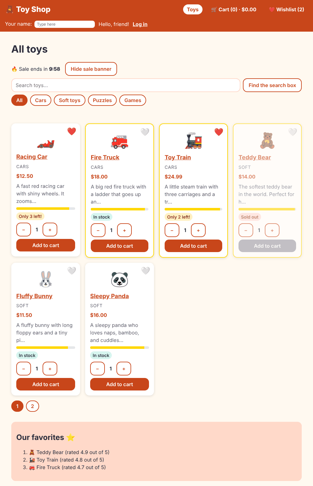

# Chapter 18: State management

> **Like I'm 5:** State is "what the shop remembers right now": what is in the cart, which toys you love, who is logged in. When many rooms need the same memory, you do not tape little notes in every room. You keep one notebook at the front desk, and everyone reads from it and writes in it using clear rules.

Concept reference: [16. State management](../concepts/16-state-management.md)

[Back: Chapter 17](17-lazy-loading.md) · Next: [Chapter 19: Animations](19-animations.md)

## What we build today

A **wishlist**:

- a 🤍 button on every toy card (it turns ❤️ when saved),
- a **Wishlist (n)** link in the header, always up to date,
- a **Wishlist page** listing the saved toys,
- everything is **remembered** after a reload.

We build it twice, on purpose: first as a plain **signal service** (what we did for the cart), then we **upgrade it to an NgRx SignalStore** without changing a single line outside the store. The same tests pass both times.



## The big idea

"State" is any data that changes and that the screen depends on. Where should it live? Ask these questions:

| If the state is... | Keep it in... | Chapter |
|--------------------|---------------|---------|
| used by **one** component (an open/closed flag, the typed text) | a `signal` in that component | 3, 10 |
| used by a **few** components close together | a signal in the parent, passed with `input()` / `output()` | 4 |
| used by **many** unrelated components | a **service** with signals (a "store") | 9, 10 |
| used by many components and **needs structure** (clear ways to change it, hooks, plugins) | an **NgRx SignalStore** | today |
| a huge app with many developers, who want every change recorded and time-travel debugging | the classic **NgRx Store** (actions, reducers, effects) | reading only |
| in the **address** (filters, the page) | the URL | 11 |
| the **server's data** (the toy list) | `HttpClient` + a cache (`shareReplay`), or a resource | 13 |

The most common mistake is reaching for the heaviest tool first. Start small.

A good store has three properties:

1. **One owner.** Only the store changes its state.
2. **Read-only outside.** Everyone else gets signals they can read but not write.
3. **Named changes.** The only ways to change the state are clear methods (`toggle`, `add`, `move`), so the rules are in one place and are easy to test.

**Grown-up words:**

- **Store**: a place that holds state and the rules for changing it.
- **Single source of truth**: one copy of each fact, so screens cannot disagree.
- **Derived state**: values worked out from state (`count`, `total`); use `computed`.
- **NgRx SignalStore**: a small library (`@ngrx/signals`) with building blocks for stores: `withState`, `withComputed`, `withMethods`, `withHooks`.
- **`patchState`**: the one door through which a SignalStore's state is changed.

## Step 1: A wishlist as a signal service

The wishlist remembers only the toy **ids**. Notice how similar this is to the cart service in Chapter 10:

**`src/app/services/wishlist-store.ts`**

```ts
import { computed, effect, Service, signal } from '@angular/core';

const STORAGE_KEY = 'toyshop-wishlist';

// The wishlist remembers only the toy ids (numbers), not the whole toys.
@Service()
export class WishlistStore {
  private readonly _ids = signal<number[]>(this.load());
  readonly ids = this._ids.asReadonly();
  readonly count = computed(() => this._ids().length);

  constructor() {
    effect(() => localStorage.setItem(STORAGE_KEY, JSON.stringify(this._ids())));
  }

  has(id: number) {
    return this._ids().includes(id);
  }

  toggle(id: number) {
    this._ids.update((list) => (list.includes(id) ? list.filter((i) => i !== id) : [...list, id]));
  }

  // Move one toy from one place in the list to another (used for drag and drop later).
  move(from: number, to: number) {
    this._ids.update((list) => {
      const next = [...list];
      const [item] = next.splice(from, 1);
      next.splice(to, 0, item);
      return next;
    });
  }

  private load(): number[] {
    try {
      return JSON.parse(localStorage.getItem(STORAGE_KEY) ?? '[]');
    } catch {
      return [];
    }
  }
}
```

- `_ids` is private and writable; `ids` is the read-only view. `count` is `computed`.
- `toggle(id)` adds the toy, or removes it if it is already there. It builds a **new** array every time.
- `move(from, to)` re-orders the list. We use it in Chapter 20 for drag and drop.
- The `effect` saves to `localStorage` after every change.

Its test checks the four promises:

**`src/app/services/wishlist-store.spec.ts`**

```ts
import { TestBed } from '@angular/core/testing';
import { WishlistStore } from './wishlist-store';

describe('WishlistStore', () => {
  let wishlist: WishlistStore;

  beforeEach(() => {
    localStorage.clear();
    wishlist = TestBed.inject(WishlistStore);
  });

  it('starts empty', () => {
    expect(wishlist.count()).toBe(0);
    expect(wishlist.has(1)).toBe(false);
  });

  it('adds a toy the first time and removes it the second time', () => {
    wishlist.toggle(3);
    expect(wishlist.has(3)).toBe(true);
    expect(wishlist.count()).toBe(1);

    wishlist.toggle(3);
    expect(wishlist.has(3)).toBe(false);
    expect(wishlist.count()).toBe(0);
  });

  it('can move a toy to a new place in the list', () => {
    [1, 2, 3].forEach((id) => wishlist.toggle(id));
    wishlist.move(0, 2);
    expect(wishlist.ids()).toEqual([2, 3, 1]);
  });

  it('remembers the list in localStorage', () => {
    wishlist.toggle(5);
    TestBed.tick();
    expect(JSON.parse(localStorage.getItem('toyshop-wishlist') ?? '[]')).toEqual([5]);
  });
});
```

**Remember these tests.** We will change the store's insides completely, and they must still pass.

## Step 2: The heart on the card

The card shows the heart and tells its parent when it is pressed. It does not know about the store; it just has an `input` and an `output`, as in Chapter 4:

**`src/app/components/product-card/product-card.ts`** (what changed)

```diff
@@ -29,6 +29,10 @@ export interface AddedEvent {
 export class ProductCard {
   product = input.required<Product>();
   added = output<AddedEvent>();
+
+  // The parent tells us if this toy is on the wishlist, and we tell it when the heart is pressed.
+  liked = input(false);
+  likeToggled = output<Product>();
   quantity = signal(1);
 
   stockLevel = computed(() => {
```

**`src/app/components/product-card/product-card.html`** (what changed)

```diff
@@ -1,6 +1,15 @@
 @let p = product();
 
 <article class="card" [ngClass]="cardClasses()">
+  <button
+    class="heart"
+    type="button"
+    [attr.aria-pressed]="liked()"
+    [attr.aria-label]="(liked() ? 'Remove ' : 'Add ') + p.name + ' to wishlist'"
+    (click)="likeToggled.emit(p)"
+  >
+    {{ liked() ? '❤️' : '🤍' }}
+  </button>
   <div class="emoji" aria-hidden="true">{{ p.emoji }}</div>
   <h3>
     <a [routerLink]="['/product', p.id]">{{ p.name }}</a>
```

**`src/app/components/product-card/product-card.css`** (what changed)

```diff
@@ -1,4 +1,5 @@
 .card {
+  position: relative;
   display: flex;
   flex-direction: column;
   gap: 0.5rem;
@@ -77,3 +78,14 @@
 .description {
   color: var(--color-muted);
 }
+
+.heart {
+  position: absolute;
+  top: 0.5rem;
+  right: 0.5rem;
+  padding: 0.25rem;
+  border: 0;
+  background: none;
+  font-size: 1.5rem;
+  cursor: pointer;
+}
```

`aria-pressed` tells screen readers it is a toggle button; the `aria-label` says exactly what pressing will do.

The home page connects the card to the store:

**`src/app/pages/home/home.ts`** (what changed)

```diff
@@ -30,6 +30,7 @@ import { SaleCountdown } from '../../components/sale-countdown/sale-countdown';
 import { Category, Product } from '../../models/product';
 import { CartService } from '../../services/cart-service';
 import { ProductService } from '../../services/product-service';
+import { WishlistStore } from '../../services/wishlist-store';
 
 type CategoryChoice = 'all' | Category;
 
@@ -49,6 +50,7 @@ type CategoryChoice = 'all' | Category;
 export class Home {
   private productService = inject(ProductService);
   private cart = inject(CartService);
+  wishlist = inject(WishlistStore);
 
   lastAdded = signal('');
   loading = signal(true);
```

**`src/app/pages/home/home.html`** (what changed)

```diff
@@ -53,7 +53,12 @@
 
 <div class="grid">
   @for (p of pageItems(); track p.id) {
-    <app-product-card [product]="p" (added)="onAdded($event)" />
+    <app-product-card
+      [product]="p"
+      [liked]="wishlist.has(p.id)"
+      (likeToggled)="wishlist.toggle($event.id)"
+      (added)="onAdded($event)"
+    />
   } @empty {
     @if (!loading() && !error()) {
       <p>No toys found. 🧸</p>
```

Why does the *page* talk to the store, and not the card? Because the card stays reusable and easy to test: it works with any data source.

Test the new card behaviour:

**`src/app/components/product-card/product-card.spec.ts`** (what changed)

```diff
@@ -35,6 +35,19 @@ describe('ProductCard', () => {
     expect(fixture.nativeElement.textContent).toContain('Sold out');
   });
 
+  it('tells the parent when the heart is pressed', () => {
+    let received: unknown;
+    fixture.componentInstance.likeToggled.subscribe((p) => (received = p));
+    fixture.nativeElement.querySelector('button.heart').click();
+    expect(received).toEqual(sampleProducts[0]);
+  });
+
+  it('shows a red heart for a toy on the wishlist', async () => {
+    fixture.componentRef.setInput('liked', true);
+    await fixture.whenStable();
+    expect(fixture.nativeElement.querySelector('button.heart').textContent).toContain('❤️');
+  });
+
   it('tells the parent when "Add to cart" is pressed', () => {
     let received: unknown;
     fixture.componentInstance.added.subscribe((e) => (received = e));
```

## Step 3: The wishlist page and the header link

```bash
ng generate component pages/wishlist
```

**`src/app/pages/wishlist/wishlist.ts`**

```ts
import { CurrencyPipe } from '@angular/common';
import { toSignal } from '@angular/core/rxjs-interop';
import { Component, computed, inject } from '@angular/core';
import { RouterLink } from '@angular/router';
import { ProductService } from '../../services/product-service';
import { WishlistStore } from '../../services/wishlist-store';

@Component({
  imports: [CurrencyPipe, RouterLink],
  selector: 'app-wishlist',
  styleUrl: './wishlist.css',
  templateUrl: './wishlist.html',
})
export class Wishlist {
  wishlist = inject(WishlistStore);
  private all = toSignal(inject(ProductService).getAll(), { initialValue: [] });

  // The wishlist stores only ids. Here we turn the ids back into whole toys.
  toys = computed(() =>
    this.wishlist
      .ids()
      .map((id) => this.all().find((p) => p.id === id))
      .filter((p) => p !== undefined),
  );
}
```

The store holds ids; the page needs whole toys. `toys` is a `computed` that combines two signals: the saved ids, and the full toy list (from the `ProductService`).

**`src/app/pages/wishlist/wishlist.html`**

```html
<h1>My wishlist ❤️</h1>

@if (toys().length === 0) {
  <p>Nothing here yet. Press the 🤍 on a toy to save it. <a routerLink="/">Go find a toy!</a></p>
} @else {
  <ul class="wishes">
    @for (toy of toys(); track toy.id) {
      <li class="wish">
        <span class="emoji" aria-hidden="true">{{ toy.emoji }}</span>
        <a [routerLink]="['/product', toy.id]">{{ toy.name }}</a>
        <span>{{ toy.price | currency }}</span>
        <button
          class="btn secondary"
          type="button"
          [attr.aria-label]="'Remove ' + toy.name + ' from wishlist'"
          (click)="wishlist.toggle(toy.id)"
        >
          Remove
        </button>
      </li>
    }
  </ul>
}
```

**`src/app/pages/wishlist/wishlist.css`**

```css
.wishes {
  display: grid;
  gap: 0.75rem;
  padding: 0;
  list-style: none;
}

.wish {
  display: flex;
  flex-wrap: wrap;
  align-items: center;
  gap: 1rem;
  padding: 0.75rem 1rem;
  background: var(--color-surface);
  border-radius: var(--radius);
  box-shadow: var(--shadow);
}

.emoji {
  font-size: 2rem;
}
```

**`src/app/pages/wishlist/wishlist.spec.ts`**

```ts
import { provideHttpClient } from '@angular/common/http';
import { HttpTestingController, provideHttpClientTesting } from '@angular/common/http/testing';
import { TestBed } from '@angular/core/testing';
import { provideRouter } from '@angular/router';
import { sampleProducts } from '../../data/sample-products';
import { WishlistStore } from '../../services/wishlist-store';
import { Wishlist } from './wishlist';

describe('Wishlist page', () => {
  beforeEach(() => {
    localStorage.clear();
    TestBed.configureTestingModule({
      providers: [provideRouter([]), provideHttpClient(), provideHttpClientTesting()],
    });
  });

  it('says it is empty when nothing was saved', async () => {
    const fixture = TestBed.createComponent(Wishlist);
    await fixture.whenStable();
    TestBed.inject(HttpTestingController).expectOne('products.json').flush(sampleProducts);
    await fixture.whenStable();
    expect(fixture.nativeElement.textContent).toContain('Nothing here yet');
  });

  it('shows the saved toys by name', async () => {
    TestBed.inject(WishlistStore).toggle(3);
    const fixture = TestBed.createComponent(Wishlist);
    await fixture.whenStable();
    TestBed.inject(HttpTestingController).expectOne('products.json').flush(sampleProducts);
    await fixture.whenStable();
    expect(fixture.nativeElement.textContent).toContain('Toy Train');
  });
});
```

Add the route and the header link:

**`src/app/app.routes.ts`** (what changed)

```diff
@@ -8,11 +8,13 @@ import { Home } from './pages/home/home';
 import { Login } from './pages/login/login';
 import { NotFound } from './pages/not-found/not-found';
 import { ProductDetail } from './pages/product-detail/product-detail';
+import { Wishlist } from './pages/wishlist/wishlist';
 
 export const routes: Routes = [
   { path: '', component: Home, title: 'Toy Shop' },
   { path: 'product/:id', component: ProductDetail, title: 'Toy details' },
   { path: 'cart', component: Cart, title: 'Your cart' },
+  { path: 'wishlist', component: Wishlist, title: 'My wishlist' },
   { path: 'login', component: Login, title: 'Log in' },
   {
     path: 'checkout',
```

**`src/app/components/site-header/site-header.ts`** (what changed)

```diff
@@ -4,6 +4,7 @@ import { FormsModule } from '@angular/forms';
 import { Router, RouterLink, RouterLinkActive } from '@angular/router';
 import { AuthService } from '../../services/auth-service';
 import { CartService } from '../../services/cart-service';
+import { WishlistStore } from '../../services/wishlist-store';
 import { SHOP_NAME } from '../../tokens';
 
 @Component({
@@ -16,6 +17,7 @@ export class SiteHeader {
   shopName = inject(SHOP_NAME);
   cart = inject(CartService);
   auth = inject(AuthService);
+  wishlist = inject(WishlistStore);
   private router = inject(Router);
 
   shopperName = signal('');
```

**`src/app/components/site-header/site-header.html`** (what changed)

```diff
@@ -6,6 +6,7 @@
     <a routerLink="/cart" routerLinkActive="active">
       🛒 Cart ({{ cart.count() }}) · {{ cart.total() | currency }}
     </a>
+    <a routerLink="/wishlist" routerLinkActive="active">❤️ Wishlist ({{ wishlist.count() }})</a>
     @if (auth.isLoggedIn()) {
       <a routerLink="/orders" routerLinkActive="active">My orders</a>
     }
```

Try it: press a few hearts. The header count changes; the **Wishlist** page lists them; reload, and they are still there.

## Step 4: Upgrade to an NgRx SignalStore

Imagine the wishlist grows: more methods, loading from a server, undo, logging. A SignalStore gives every store the same shape, with plug-in pieces. Install the package:

```bash
npm install @ngrx/signals
```

Now rewrite **only** `wishlist-store.ts`:

**`src/app/services/wishlist-store.ts`**

```ts
import { computed, effect } from '@angular/core';
import {
  patchState,
  signalStore,
  withComputed,
  withHooks,
  withMethods,
  withState,
} from '@ngrx/signals';

const STORAGE_KEY = 'toyshop-wishlist';

function load(): number[] {
  try {
    return JSON.parse(localStorage.getItem(STORAGE_KEY) ?? '[]');
  } catch {
    return [];
  }
}

// A signalStore is a ready-made kit for state. You pick the pieces you need:
// withState = what we remember, withComputed = answers worked out from it,
// withMethods = the buttons that change it, withHooks = things to do at start-up.
export const WishlistStore = signalStore(
  { providedIn: 'root' },

  withState({ ids: load() }),

  withComputed(({ ids }) => ({
    count: computed(() => ids().length),
  })),

  withMethods((store) => ({
    has: (id: number) => store.ids().includes(id),

    // patchState is the ONLY way to change the state: one clear door.
    toggle(id: number) {
      patchState(store, ({ ids }) => ({
        ids: ids.includes(id) ? ids.filter((i) => i !== id) : [...ids, id],
      }));
    },

    move(from: number, to: number) {
      patchState(store, ({ ids }) => {
        const next = [...ids];
        const [item] = next.splice(from, 1);
        next.splice(to, 0, item);
        return { ids: next };
      });
    },
  })),

  withHooks({
    // onInit runs once when the store is created: keep the list saved.
    onInit(store) {
      effect(() => localStorage.setItem(STORAGE_KEY, JSON.stringify(store.ids())));
    },
  }),
);

// signalStore() gives us a value. This line also makes "WishlistStore" usable as a type.
export type WishlistStore = InstanceType<typeof WishlistStore>;
```

Compare it to the version before:

**`src/app/services/wishlist-store.ts`** (what changed)

```diff
@@ -1,41 +1,62 @@
-import { computed, effect, Service, signal } from '@angular/core';
+import { computed, effect } from '@angular/core';
+import {
+  patchState,
+  signalStore,
+  withComputed,
+  withHooks,
+  withMethods,
+  withState,
+} from '@ngrx/signals';
 
 const STORAGE_KEY = 'toyshop-wishlist';
 
-// The wishlist remembers only the toy ids (numbers), not the whole toys.
-@Service()
-export class WishlistStore {
-  private readonly _ids = signal<number[]>(this.load());
-  readonly ids = this._ids.asReadonly();
-  readonly count = computed(() => this._ids().length);
-
-  constructor() {
-    effect(() => localStorage.setItem(STORAGE_KEY, JSON.stringify(this._ids())));
+function load(): number[] {
+  try {
+    return JSON.parse(localStorage.getItem(STORAGE_KEY) ?? '[]');
+  } catch {
+    return [];
   }
+}
 
-  has(id: number) {
-    return this._ids().includes(id);
-  }
+// A signalStore is a ready-made kit for state. You pick the pieces you need:
+// withState = what we remember, withComputed = answers worked out from it,
+// withMethods = the buttons that change it, withHooks = things to do at start-up.
+export const WishlistStore = signalStore(
+  { providedIn: 'root' },
 
-  toggle(id: number) {
-    this._ids.update((list) => (list.includes(id) ? list.filter((i) => i !== id) : [...list, id]));
-  }
+  withState({ ids: load() }),
 
-  // Move one toy from one place in the list to another (used for drag and drop later).
-  move(from: number, to: number) {
-    this._ids.update((list) => {
-      const next = [...list];
-      const [item] = next.splice(from, 1);
-      next.splice(to, 0, item);
-      return next;
-    });
-  }
+  withComputed(({ ids }) => ({
+    count: computed(() => ids().length),
+  })),
 
-  private load(): number[] {
-    try {
-      return JSON.parse(localStorage.getItem(STORAGE_KEY) ?? '[]');
-    } catch {
-      return [];
-    }
-  }
-}
+  withMethods((store) => ({
+    has: (id: number) => store.ids().includes(id),
+
+    // patchState is the ONLY way to change the state: one clear door.
+    toggle(id: number) {
+      patchState(store, ({ ids }) => ({
+        ids: ids.includes(id) ? ids.filter((i) => i !== id) : [...ids, id],
+      }));
+    },
+
+    move(from: number, to: number) {
+      patchState(store, ({ ids }) => {
+        const next = [...ids];
+        const [item] = next.splice(from, 1);
+        next.splice(to, 0, item);
+        return { ids: next };
+      });
+    },
+  })),
+
+  withHooks({
+    // onInit runs once when the store is created: keep the list saved.
+    onInit(store) {
+      effect(() => localStorage.setItem(STORAGE_KEY, JSON.stringify(store.ids())));
+    },
+  }),
+);
+
+// signalStore() gives us a value. This line also makes "WishlistStore" usable as a type.
+export type WishlistStore = InstanceType<typeof WishlistStore>;
```

Read the pieces:

| Piece | Meaning |
|-------|---------|
| `signalStore({ providedIn: 'root' }, ...)` | make a store; one shared copy (like `@Service()`) |
| `withState({ ids: load() })` | the data. `store.ids()` is now a signal. |
| `withComputed(({ ids }) => ({ count: ... }))` | derived values |
| `withMethods((store) => ({ ... }))` | the allowed changes |
| `patchState(store, ...)` | the **only** way to change state. Outside code cannot call it, so it cannot change the state by accident. |
| `withHooks({ onInit })` | run once when the store is created (here: keep `localStorage` in sync) |

The last line:

```ts
export type WishlistStore = InstanceType<typeof WishlistStore>;
```

`signalStore(...)` creates a *value*. This line also makes the same name usable as a *type*, so `wishlist = inject(WishlistStore)` and test types keep working.

**Now the important result: nothing else in the app changed.** The header, the home page, and the wishlist page still call `wishlist.count()`, `wishlist.has(id)`, `wishlist.toggle(id)`, and `wishlist.ids()`. And the **same spec file** from Step 1 passes against the new store. That is the reward for putting state behind a small, clear interface.

## Check it works

```bash
npx ng test --watch=false
```

```
 Test Files  28 passed (28)
      Tests  73 passed (73)
```

(The same numbers after Step 3 and after Step 4.) In the browser:

- [ ] A 🤍 appears on each card. Press it: it becomes ❤️ and the header says **Wishlist (1)**.
- [ ] Open **Wishlist**: the toy is listed. **Remove** takes it away, and the heart on the home page is white again.
- [ ] Reload the page: the wishlist is still there. (DevTools, **Application**, **Local Storage**, key `toyshop-wishlist`.)
- [ ] Open the wishlist in two browser tabs. Notice that they do **not** sync live with each other. (Making them do so is a good exercise with the `storage` event.)

The production bundle grew by about 2.6 kB (445.79 kB to 448.40 kB) for the SignalStore library. A small price for structure; but not free, so use it where the structure pays off.

## About the classic NgRx Store

The big NgRx Store (`@ngrx/store`, `@ngrx/effects`) uses **actions** (events that describe what happened), **reducers** (pure functions that compute the new state), **selectors** (read functions), and **effects** (side effects such as HTTP). Everything that happens is a visible action, which is wonderful for debugging in big teams, but it needs more code for each feature. The [concepts page](../concepts/16-state-management.md#ngrx-actions-reducer-selectors) shows a full example. We do not build it in the Toy Shop because a wishlist does not need it; it is the right tool when many teams change shared state, and you need a record of every change.

## What you learned

- Ask "who needs this state?" and choose the smallest tool that fits.
- A store has one owner, read-only access outside, and named ways to change it.
- Signal services (`@Service()` + `signal` + `computed`) are the simple store; **NgRx SignalStore** adds structure (`withState`, `withComputed`, `withMethods`, `withHooks`, `patchState`).
- Components stay reusable by taking data with `input()` and reporting with `output()`; pages connect them to stores.
- Keeping the interface the same lets you swap a store's insides while the tests keep passing.

## Try it yourself

1. Add a `clear()` method to the store (both versions) and a **Clear wishlist** button on the wishlist page. Add a test.
2. Add a computed `isEmpty` to the SignalStore and use it in the wishlist page instead of `toys().length === 0`.
3. Add a `withHooks` `onDestroy` that logs "wishlist store closed". (When does it run? Think about the root injector.)
4. Make the wishlist sync across browser tabs by listening to the window's `storage` event in the `onInit` hook and reloading the ids.

## If something goes wrong

**`WishlistStore` is used as a type and the compiler says it "refers to a value, but is being used as a type":** you forgot the `export type WishlistStore = InstanceType<typeof WishlistStore>;` line.

**`patchState` complains it cannot change `ids`:** you tried to patch from outside the store. State changes belong in `withMethods`.

**The header does not update when the list changes in another place:** make sure every component injects the **same** store (`providedIn: 'root'`), and that you replaced the array instead of mutating it.

**The wishlist survives in your test but not in the next:** `localStorage` is shared between tests. Call `localStorage.clear()` in `beforeEach`.

Next: [Chapter 19: Animations](19-animations.md)
