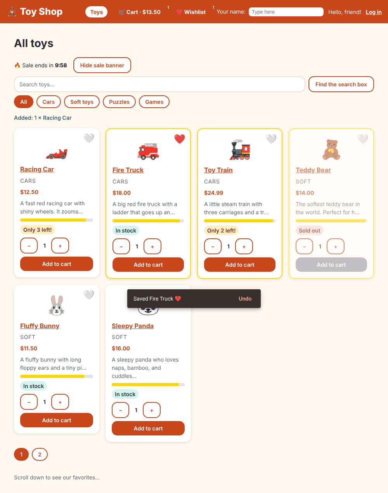
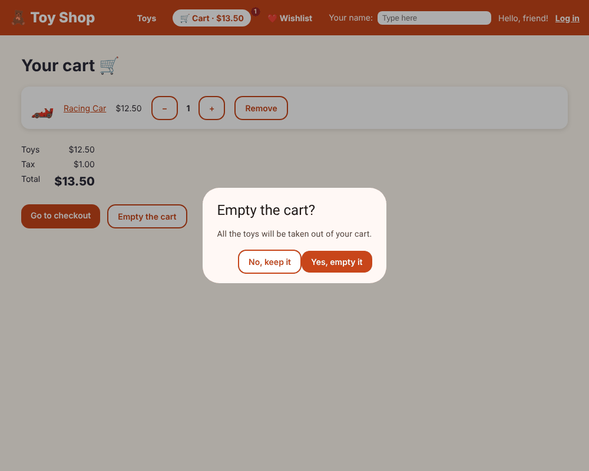

# Chapter 20: Angular Material and the CDK

> **Like I'm 5:** You could cut every toy-shop sign, door, and shelf from wood yourself. Or you could buy a box of ready-made, well-tested parts: badges, pop-up windows, drag handles, and a magic scrolling list that only draws what you can see. Angular Material is the ready-made parts. The CDK is the box of tools those parts are made with.

Concept reference: [20. Angular Material and the CDK](../concepts/20-material-and-cdk.md)

[Back: Chapter 19](19-animations.md) · Next: [Chapter 21: Accessibility](21-accessibility.md)

## What we build today

Five upgrades, each using a ready-made part:

1. **Badges** in the header (the cart and wishlist counts) from Material.
2. A **snackbar** ("Saved Teddy Bear ❤️ · Undo") when you press a heart.
3. A **confirmation dialog** before emptying the cart.
4. **Drag and drop** to re-order the wishlist (CDK), with arrow buttons for keyboard users.
5. A **virtual-scroll** warehouse list with **5000** boxes that stays fast (CDK).

And one more: on a phone the shelf shows 4 toys per page instead of 6, using the CDK's **layout** tools.





## The big idea

Two libraries from the Angular team:

| Library | What it is |
|---------|------------|
| **Angular CDK** (Component Dev Kit) | *Behaviour* without style: overlays, drag and drop, virtual scroll, accessibility helpers, layout observers. Use it when you build your own look. |
| **Angular Material** | Ready-made *styled* components (buttons, dialogs, tables, form fields, snackbars, badges...) following Google's Material Design, built on the CDK. |

You can use only the parts you want; each is a small import, and unused parts are not downloaded.

Why not write everything ourselves? Because a dialog is not just a box on top of the page. A good dialog also dims the page behind it, traps the keyboard focus inside, closes with **Escape**, tells screen readers it is a dialog, and gives focus back when it closes. That is hundreds of lines of hard, easy-to-get-wrong code. Material did all of it, and thousands of people tested it.

**Grown-up words:**

- **Theme**: the colours, fonts, and density used by all Material parts. Material 3 uses CSS variables (`--mat-sys-primary`, ...).
- **Overlay**: a layer floating above the page (dialogs, menus, snackbars).
- **Virtual scrolling**: drawing only the rows that are visible and recycling them as you scroll.
- **Breakpoint**: a screen width where the layout changes (phone, tablet, desktop).

## Step 1: Add Material

```bash
ng add @angular/material
```

`ng add` is smarter than `npm install`: it also **sets the package up**. Say yes to the prompts. It does three things (you will see this output):

```
UPDATE package.json
CREATE src/material-theme.scss
UPDATE angular.json
UPDATE src/index.html
```

- `package.json` gets `@angular/material` and `@angular/cdk`.
- `src/material-theme.scss` is the theme file. Open it. The default palette is blue. Our shop is orange, so change these two lines:

```scss
color: (
  primary: mat.$orange-palette,
  tertiary: mat.$cyan-palette,
),
```

- `angular.json` lists the theme file under `styles`, so it is loaded before our `styles.css`.
- `src/index.html` gets the Roboto font and the Material Symbols icons from Google Fonts.

Here is our finished theme file:

**`src/material-theme.scss`**

```scss
// Include theming for Angular Material with `mat.theme()`.
// This Sass mixin will define CSS variables that are used for styling Angular Material
// components according to the Material 3 design spec.
// Learn more about theming and how to use it for your application's
// custom components at https://material.angular.dev/guide/theming
@use '@angular/material' as mat;

html {
  height: 100%;
  @include mat.theme(
    (
      color: (
        primary: mat.$orange-palette,
        tertiary: mat.$cyan-palette,
      ),
      typography: Roboto,
      density: 0,
    )
  );
}

body {
  // Default the application to a light color theme. This can be changed to
  // `dark` to enable the dark color theme, or to `light dark` to defer to the
  // user's system settings.
  color-scheme: light;

  // Set a default background, font and text colors for the application using
  // Angular Material's system-level CSS variables. Learn more about these
  // variables at https://material.angular.dev/guide/system-variables
  background-color: var(--mat-sys-surface);
  color: var(--mat-sys-on-surface);
  font: var(--mat-sys-body-medium);

  // Reset the user agent margin.
  margin: 0;
  height: 100%;
}
```

**`src/index.html`** (what changed)

```diff
@@ -6,6 +6,16 @@
     <base href="/" />
     <meta name="viewport" content="width=device-width, initial-scale=1" />
     <link rel="icon" type="image/x-icon" href="favicon.ico" />
+    <link rel="preconnect" href="https://fonts.googleapis.com" />
+    <link rel="preconnect" href="https://fonts.gstatic.com" crossorigin />
+    <link
+      href="https://fonts.googleapis.com/css2?family=Roboto:wght@300;400;500&display=swap"
+      rel="stylesheet"
+    />
+    <link
+      href="https://fonts.googleapis.com/icon?family=Material+Symbols+Outlined"
+      rel="stylesheet"
+    />
   </head>
   <body>
     <app-root></app-root>
```

**`angular.json`** (what changed)

```diff
@@ -24,7 +24,7 @@
                 "input": "public"
               }
             ],
-            "styles": ["src/styles.css"]
+            "styles": ["src/material-theme.scss", "src/styles.css"]
           },
           "configurations": {
             "production": {
```

> **Important to know:** the production bundle grows a lot in this chapter, from about 459 kB to 712 kB (raw size). Material and CDK are big libraries and our theme styles come with them. Chapter 27 trims the bundle again. Measuring this jump (Chapter 33) is how you learn what a library really costs.

## Step 2: Badges

A badge is a small circle with a number. Material's `matBadge` is a directive (Chapter 6), so we put it on the links:

**`src/app/components/site-header/site-header.ts`** (what changed)

```diff
@@ -1,6 +1,7 @@
 import { CurrencyPipe } from '@angular/common';
 import { Component, inject, signal } from '@angular/core';
 import { FormsModule } from '@angular/forms';
+import { MatBadge } from '@angular/material/badge';
 import { Router, RouterLink, RouterLinkActive } from '@angular/router';
 import { AuthService } from '../../services/auth-service';
 import { CartService } from '../../services/cart-service';
@@ -8,7 +9,7 @@ import { WishlistStore } from '../../services/wishlist-store';
 import { SHOP_NAME } from '../../tokens';
 
 @Component({
-  imports: [FormsModule, CurrencyPipe, RouterLink, RouterLinkActive],
+  imports: [FormsModule, CurrencyPipe, RouterLink, RouterLinkActive, MatBadge],
   selector: 'app-site-header',
   styleUrl: './site-header.css',
   templateUrl: './site-header.html',
```

**`src/app/components/site-header/site-header.html`** (what changed)

```diff
@@ -3,10 +3,26 @@
 
   <nav class="nav" aria-label="Main">
     <a routerLink="/" routerLinkActive="active" [routerLinkActiveOptions]="{ exact: true }">Toys</a>
-    <a routerLink="/cart" routerLinkActive="active">
-      🛒 Cart ({{ cart.count() }}) · {{ cart.total() | currency }}
+    <a
+      routerLink="/cart"
+      routerLinkActive="active"
+      [matBadge]="cart.count()"
+      [matBadgeHidden]="cart.count() === 0"
+      matBadgeOverlap="false"
+      matBadgeDescription="toys in your cart"
+    >
+      🛒 Cart · {{ cart.total() | currency }}
+    </a>
+    <a
+      routerLink="/wishlist"
+      routerLinkActive="active"
+      [matBadge]="wishlist.count()"
+      [matBadgeHidden]="wishlist.count() === 0"
+      matBadgeOverlap="false"
+      matBadgeDescription="toys on your wishlist"
+    >
+      ❤️ Wishlist
     </a>
-    <a routerLink="/wishlist" routerLinkActive="active">❤️ Wishlist ({{ wishlist.count() }})</a>
     @if (auth.isLoggedIn()) {
       <a routerLink="/orders" routerLinkActive="active">My orders</a>
     }
```

- `[matBadge]="cart.count()"` is the number.
- `[matBadgeHidden]="cart.count() === 0"` hides the badge when there is nothing to count.
- `matBadgeDescription` gives screen readers the meaning: "3 toys in your cart", not just "3".

## Step 3: A snackbar with "Undo"

A snackbar is a small message at the bottom of the screen that goes away by itself. `MatSnackBar` makes it:

**`src/app/pages/home/home.ts`** (what changed)

```diff
@@ -1,3 +1,4 @@
+import { BreakpointObserver, Breakpoints } from '@angular/cdk/layout';
 import { AsyncPipe } from '@angular/common';
 import { toObservable, toSignal } from '@angular/core/rxjs-interop';
 import {
@@ -11,6 +12,7 @@ import {
   viewChild,
 } from '@angular/core';
 import { FormControl, ReactiveFormsModule } from '@angular/forms';
+import { MatSnackBar } from '@angular/material/snack-bar';
 import { RouterLink } from '@angular/router';
 import {
   BehaviorSubject,
@@ -51,6 +53,7 @@ export class Home {
   private productService = inject(ProductService);
   private cart = inject(CartService);
   wishlist = inject(WishlistStore);
+  private snackBar = inject(MatSnackBar);
 
   lastAdded = signal('');
   loading = signal(true);
@@ -117,13 +120,20 @@ export class Home {
     .getAll()
     .pipe(map((list) => [...list].sort((a, b) => b.rating - a.rating).slice(0, 3)));
 
-  readonly pageSize = 6;
+  // CDK's BreakpointObserver tells us when the screen is phone-sized: show fewer toys per page.
+  private onPhone = toSignal(
+    inject(BreakpointObserver)
+      .observe(Breakpoints.Handset)
+      .pipe(map((state) => state.matches)),
+    { initialValue: false },
+  );
+  pageSize = computed(() => (this.onPhone() ? 4 : 6));
   page = linkedSignal({ source: this.selected, computation: () => 1 });
-  pageCount = computed(() => Math.max(1, Math.ceil(this.visible().length / this.pageSize)));
+  pageCount = computed(() => Math.max(1, Math.ceil(this.visible().length / this.pageSize())));
   pageNumbers = computed(() => Array.from({ length: this.pageCount() }, (_, i) => i + 1));
   pageItems = computed(() => {
-    const start = (this.page() - 1) * this.pageSize;
-    return this.visible().slice(start, start + this.pageSize);
+    const start = (this.page() - 1) * this.pageSize();
+    return this.visible().slice(start, start + this.pageSize());
   });
 
   searchBox = viewChild.required<ElementRef<HTMLInputElement>>('searchBox');
@@ -132,6 +142,16 @@ export class Home {
     this.searchBox().nativeElement.focus();
   }
 
+  toggleWishlist(toy: Product) {
+    const wasLiked = this.wishlist.has(toy.id);
+    this.wishlist.toggle(toy.id);
+    // A snackbar is a small message at the bottom. "Undo" flips it back.
+    this.snackBar
+      .open(wasLiked ? `Removed ${toy.name}` : `Saved ${toy.name} ❤️`, 'Undo', { duration: 4000 })
+      .onAction()
+      .subscribe(() => this.wishlist.toggle(toy.id));
+  }
+
   onAdded(event: AddedEvent) {
     this.cart.add(event.product, event.quantity);
     this.lastAdded.set(`${event.quantity} × ${event.product.name}`);
```

Look at `toggleWishlist`:

```ts
this.snackBar
  .open(wasLiked ? `Removed ${toy.name}` : `Saved ${toy.name} ❤️`, 'Undo', { duration: 4000 })
  .onAction()
  .subscribe(() => this.wishlist.toggle(toy.id));
```

- `open(message, actionLabel, { duration })` shows it for 4 seconds.
- `.onAction()` is an Observable that fires if the person presses **Undo**. We then flip the wishlist back.

The page's template calls the new method:

**`src/app/pages/home/home.html`** (what changed)

```diff
@@ -57,7 +57,7 @@
       animate.enter="fade-in"
       [product]="p"
       [liked]="wishlist.has(p.id)"
-      (likeToggled)="wishlist.toggle($event.id)"
+      (likeToggled)="toggleWishlist($event)"
       (added)="onAdded($event)"
     />
   } @empty {
```

## Step 4: A dialog that asks "are you sure?"

In Chapter 15 we used the browser's plain `confirm(...)`. Material's dialog is nicer and accessible. Make a tiny component for the dialog's content:

**`src/app/components/confirm-dialog/confirm-dialog.ts`**

```ts
import { Component, inject } from '@angular/core';
import {
  MAT_DIALOG_DATA,
  MatDialogActions,
  MatDialogClose,
  MatDialogContent,
  MatDialogTitle,
} from '@angular/material/dialog';

export interface ConfirmData {
  title: string;
  message: string;
  confirmLabel: string;
}

// A little pop-up window that asks "are you sure?". Material does the hard parts:
// it dims the page, keeps the keyboard inside the window, and closes with Escape.
@Component({
  imports: [MatDialogTitle, MatDialogContent, MatDialogActions, MatDialogClose],
  selector: 'app-confirm-dialog',
  templateUrl: './confirm-dialog.html',
})
export class ConfirmDialog {
  data = inject<ConfirmData>(MAT_DIALOG_DATA);
}
```

**`src/app/components/confirm-dialog/confirm-dialog.html`**

```html
<h2 mat-dialog-title>{{ data.title }}</h2>
<mat-dialog-content>{{ data.message }}</mat-dialog-content>
<mat-dialog-actions align="end">
  <button class="btn secondary" type="button" [mat-dialog-close]="false">No, keep it</button>
  <button class="btn" type="button" [mat-dialog-close]="true" cdkFocusInitial>
    {{ data.confirmLabel }}
  </button>
</mat-dialog-actions>
```

- `MAT_DIALOG_DATA` is how a dialog receives the data the opener gave it (title, message). Because it is an injection token (Chapter 9), `inject(MAT_DIALOG_DATA)` works.
- `mat-dialog-title`, `mat-dialog-content`, `mat-dialog-actions` are Material directives that style and arrange the parts.
- `[mat-dialog-close]="true"` closes the dialog and hands back `true`.
- `cdkFocusInitial` says which button gets the keyboard focus first.

The cart page opens it:

**`src/app/pages/cart/cart.ts`** (what changed)

```diff
@@ -1,6 +1,8 @@
 import { CurrencyPipe } from '@angular/common';
 import { Component, inject } from '@angular/core';
+import { MatDialog } from '@angular/material/dialog';
 import { RouterLink } from '@angular/router';
+import { ConfirmDialog } from '../../components/confirm-dialog/confirm-dialog';
 import { QuantityStepper } from '../../components/quantity-stepper/quantity-stepper';
 import { CartService } from '../../services/cart-service';
 
@@ -12,4 +14,20 @@ import { CartService } from '../../services/cart-service';
 })
 export class Cart {
   cart = inject(CartService);
+  private dialog = inject(MatDialog);
+
+  confirmEmpty() {
+    this.dialog
+      .open(ConfirmDialog, {
+        data: {
+          title: 'Empty the cart?',
+          message: 'All the toys will be taken out of your cart.',
+          confirmLabel: 'Yes, empty it',
+        },
+      })
+      .afterClosed()
+      .subscribe((yes) => {
+        if (yes) this.cart.clear();
+      });
+  }
 }
```

**`src/app/pages/cart/cart.html`** (what changed)

```diff
@@ -40,6 +40,6 @@
 
   <div class="actions">
     <a class="btn" routerLink="/checkout">Go to checkout</a>
-    <button class="btn secondary" type="button" (click)="cart.clear()">Empty the cart</button>
+    <button class="btn secondary" type="button" (click)="confirmEmpty()">Empty the cart</button>
   </div>
 }
```

`.afterClosed()` is an Observable that emits whatever the dialog closed with (`true`, `false`, or `undefined` for Escape). We empty the cart only for `true`.

Tests for the dialog and for the flow:

**`src/app/components/confirm-dialog/confirm-dialog.spec.ts`**

```ts
import { TestBed } from '@angular/core/testing';
import { MAT_DIALOG_DATA } from '@angular/material/dialog';
import { ConfirmDialog } from './confirm-dialog';

describe('ConfirmDialog', () => {
  it('shows the question we gave it', async () => {
    TestBed.configureTestingModule({
      providers: [
        {
          provide: MAT_DIALOG_DATA,
          useValue: { title: 'Sure?', message: 'Really empty it?', confirmLabel: 'Yes' },
        },
      ],
    });
    const fixture = TestBed.createComponent(ConfirmDialog);
    await fixture.whenStable();
    expect(fixture.nativeElement.textContent).toContain('Really empty it?');
  });
});
```

**`src/app/pages/cart/cart.spec.ts`** (what changed)

```diff
@@ -24,3 +24,35 @@ describe('Cart page', () => {
     expect(fixture.nativeElement.textContent).toContain('$27.00');
   });
 });
+
+describe('Cart page: emptying', () => {
+  beforeEach(() => {
+    localStorage.clear();
+    TestBed.configureTestingModule({ providers: [provideRouter([])] });
+  });
+
+  it('asks first, and empties the cart only after "Yes"', async () => {
+    const cart = TestBed.inject(CartService);
+    cart.add(sampleProducts[0]);
+    const fixture = TestBed.createComponent(Cart);
+    await fixture.whenStable();
+
+    const emptyButton = Array.from<HTMLButtonElement>(
+      fixture.nativeElement.querySelectorAll('button'),
+    ).find((b) => b.textContent?.includes('Empty the cart'));
+    emptyButton?.click();
+    await fixture.whenStable();
+
+    // The pop-up lives outside our component, at the end of <body>.
+    expect(document.body.textContent).toContain('Empty the cart?');
+    expect(cart.count()).toBe(1); // still there
+
+    const yes = Array.from<HTMLButtonElement>(
+      document.querySelectorAll('mat-dialog-actions button'),
+    ).find((b) => b.textContent?.includes('Yes, empty it'));
+    yes?.click();
+
+    // Closing the pop-up takes a moment, so we wait until the cart is empty.
+    await vi.waitFor(() => expect(cart.count()).toBe(0));
+  });
+});
```

Dialogs are drawn at the end of `<body>`, outside the component. That is why the test looks in `document`, not in `fixture.nativeElement`, and why it waits with `vi.waitFor` (closing takes a moment).

## Step 5: Drag and drop (CDK)

The wishlist should be sortable. CDK's drag-and-drop needs three directives: `cdkDropList` (the container), `cdkDrag` (each item), and `cdkDragHandle` (the part you grab):

**`src/app/pages/wishlist/wishlist.ts`** (what changed)

```diff
@@ -1,3 +1,4 @@
+import { CdkDrag, CdkDragDrop, CdkDragHandle, CdkDropList } from '@angular/cdk/drag-drop';
 import { CurrencyPipe } from '@angular/common';
 import { toSignal } from '@angular/core/rxjs-interop';
 import { Component, computed, inject } from '@angular/core';
@@ -6,7 +7,7 @@ import { ProductService } from '../../services/product-service';
 import { WishlistStore } from '../../services/wishlist-store';
 
 @Component({
-  imports: [CurrencyPipe, RouterLink],
+  imports: [CurrencyPipe, RouterLink, CdkDropList, CdkDrag, CdkDragHandle],
   selector: 'app-wishlist',
   styleUrl: './wishlist.css',
   templateUrl: './wishlist.html',
@@ -22,4 +23,15 @@ export class Wishlist {
       .map((id) => this.all().find((p) => p.id === id))
       .filter((p) => p !== undefined),
   );
+
+  // Called when a toy is dropped in a new place by the mouse or a finger.
+  drop(event: CdkDragDrop<unknown>) {
+    this.wishlist.move(event.previousIndex, event.currentIndex);
+  }
+
+  // The same thing, for people who use a keyboard instead of a mouse.
+  moveBy(index: number, step: -1 | 1) {
+    const target = index + step;
+    if (target >= 0 && target < this.toys().length) this.wishlist.move(index, target);
+  }
 }
```

**`src/app/pages/wishlist/wishlist.html`** (what changed)

```diff
@@ -3,12 +3,32 @@
 @if (toys().length === 0) {
   <p>Nothing here yet. Press the 🤍 on a toy to save it. <a routerLink="/">Go find a toy!</a></p>
 } @else {
-  <ul class="wishes">
-    @for (toy of toys(); track toy.id) {
-      <li class="wish">
+  <p class="hint">Drag a toy to put your favorites first, or use the arrow buttons.</p>
+  <ul class="wishes" cdkDropList (cdkDropListDropped)="drop($event)">
+    @for (toy of toys(); track toy.id; let i = $index) {
+      <li class="wish" cdkDrag>
+        <span class="handle" cdkDragHandle aria-hidden="true">⠿</span>
         <span class="emoji" aria-hidden="true">{{ toy.emoji }}</span>
         <a [routerLink]="['/product', toy.id]">{{ toy.name }}</a>
         <span>{{ toy.price | currency }}</span>
+        <button
+          class="btn secondary"
+          type="button"
+          [attr.aria-label]="'Move ' + toy.name + ' up'"
+          [disabled]="i === 0"
+          (click)="moveBy(i, -1)"
+        >
+          ↑
+        </button>
+        <button
+          class="btn secondary"
+          type="button"
+          [attr.aria-label]="'Move ' + toy.name + ' down'"
+          [disabled]="i === toys().length - 1"
+          (click)="moveBy(i, 1)"
+        >
+          ↓
+        </button>
         <button
           class="btn secondary"
           type="button"
```

**`src/app/pages/wishlist/wishlist.css`** (what changed)

```diff
@@ -19,3 +19,23 @@
 .emoji {
   font-size: 2rem;
 }
+
+.hint {
+  color: var(--color-muted);
+}
+
+.handle {
+  cursor: grab;
+  font-size: 1.5rem;
+}
+
+/* While a toy is being dragged, and where it will land. */
+.cdk-drag-preview {
+  background: var(--color-surface);
+  border-radius: var(--radius);
+  box-shadow: 0 8px 24px rgb(0 0 0 / 0.25);
+}
+
+.cdk-drag-placeholder {
+  opacity: 0.3;
+}
```

- `(cdkDropListDropped)="drop($event)"` fires when you drop an item. The event tells us `previousIndex` and `currentIndex`; we call `wishlist.move(from, to)` (the method we wrote in Chapter 18!).
- The **↑ and ↓ buttons** do the same job with `moveBy`. This matters: drag and drop alone **excludes keyboard users**. Always offer a button alternative.
- The `.cdk-drag-preview` and `.cdk-drag-placeholder` classes style the item while it is being dragged.

## Step 6: Virtual scrolling (CDK)

Suppose the warehouse lists **5000 boxes**. Drawing 5000 rows makes the page slow and heavy. Virtual scrolling draws only the rows that fit in the window and reuses them as you scroll.

```bash
ng generate component admin/warehouse
```

**`src/app/admin/warehouse/warehouse.ts`**

```ts
import {
  CdkFixedSizeVirtualScroll,
  CdkVirtualForOf,
  CdkVirtualScrollViewport,
} from '@angular/cdk/scrolling';
import { Component } from '@angular/core';

interface Box {
  id: number;
  label: string;
  toys: number;
}

@Component({
  // CdkFixedSizeVirtualScroll is the part that understands itemSize. Do not forget it!
  imports: [CdkVirtualScrollViewport, CdkFixedSizeVirtualScroll, CdkVirtualForOf],
  selector: 'app-warehouse',
  styleUrl: './warehouse.css',
  templateUrl: './warehouse.html',
})
export class Warehouse {
  // Five thousand boxes! Drawing all of them would make the page slow.
  boxes: Box[] = Array.from({ length: 5000 }, (_, i) => ({
    id: i + 1,
    label: `Box #${i + 1}`,
    toys: (i * 7) % 40,
  }));

  trackById(_index: number, box: Box) {
    return box.id;
  }
}
```

**`src/app/admin/warehouse/warehouse.html`**

```html
<p>
  The warehouse has <strong>{{ boxes.length }}</strong> boxes. We only draw the ones you can see.
</p>

<!-- itemSize is how tall one row is, so the viewport can work out which rows are visible. -->
<cdk-virtual-scroll-viewport itemSize="40" class="viewport" aria-label="Warehouse boxes">
  <div *cdkVirtualFor="let box of boxes; trackBy: trackById" class="box-row">
    <span>{{ box.label }}</span>
    <span>{{ box.toys }} toys</span>
  </div>
</cdk-virtual-scroll-viewport>
```

**`src/app/admin/warehouse/warehouse.css`**

```css
.viewport {
  height: 400px;
  background: var(--color-surface);
  border-radius: var(--radius);
  box-shadow: var(--shadow);
}

.box-row {
  display: flex;
  justify-content: space-between;
  align-items: center;
  height: 40px;
  padding: 0 1rem;
  border-bottom: 1px solid var(--color-brand-light);
}
```

- `cdk-virtual-scroll-viewport` is the window. It needs a fixed height (our CSS: 400 px) and `itemSize="40"` (every row is 40 px tall).
- `*cdkVirtualFor="let box of boxes"` is like `@for`, but it only creates the visible rows.
- The `CdkFixedSizeVirtualScroll` import is easy to forget (see "If something goes wrong").

Add the page to the admin menu and the admin routes:

**`src/app/admin/admin-shell/admin-shell.html`** (what changed)

```diff
@@ -2,6 +2,7 @@
 
 <nav class="admin-nav" aria-label="Admin">
   <a routerLink="inventory" routerLinkActive="active">Inventory</a>
+  <a routerLink="warehouse" routerLinkActive="active">Warehouse</a>
 </nav>
 
 <!-- Pages inside the admin corner appear here. -->
```

**`src/app/admin/admin.routes.ts`** (what changed)

```diff
@@ -1,6 +1,7 @@
 import { Routes } from '@angular/router';
 import { AdminShell } from './admin-shell/admin-shell';
 import { Inventory } from './inventory/inventory';
+import { Warehouse } from './warehouse/warehouse';
 
 export const ADMIN_ROUTES: Routes = [
   {
@@ -9,6 +10,7 @@ export const ADMIN_ROUTES: Routes = [
     children: [
       { path: '', pathMatch: 'full', redirectTo: 'inventory' },
       { path: 'inventory', component: Inventory, title: 'Inventory' },
+      { path: 'warehouse', component: Warehouse, title: 'Warehouse' },
     ],
   },
 ];
```

**`src/app/admin/warehouse/warehouse.spec.ts`**

```ts
import { TestBed } from '@angular/core/testing';
import { Warehouse } from './warehouse';

describe('Warehouse', () => {
  it('has thousands of boxes but draws only a few rows', async () => {
    const fixture = TestBed.createComponent(Warehouse);
    await fixture.whenStable();

    expect(fixture.componentInstance.boxes.length).toBe(5000);
    const drawn = fixture.nativeElement.querySelectorAll('.box-row').length;
    expect(drawn).toBeLessThan(100);
  });
});
```

The test proves it: 5000 boxes exist, but fewer than 100 rows are in the page.

## Step 7: Responsive layout (CDK)

`BreakpointObserver` tells us when the screen matches a size, as an Observable. We turn it into a signal and show fewer toys on a phone:

```ts
private onPhone = toSignal(
  inject(BreakpointObserver).observe(Breakpoints.Handset).pipe(map((state) => state.matches)),
  { initialValue: false },
);
pageSize = computed(() => (this.onPhone() ? 4 : 6));
```

This is in the `home.ts` change shown above. In DevTools, switch to a phone size (`Ctrl+Shift+M`) and the page bar shows three pages of four instead of two pages of six.

## Check it works

```bash
npx ng test --watch=false
```

```
 Test Files  30 passed (30)
      Tests  76 passed (76)
```

In the browser:

- [ ] The header shows a small number badge on **Cart** and **Wishlist** once there is something in them.
- [ ] Press a heart: a snackbar says "Saved ... ❤️" with **Undo**. Press **Undo**: the heart goes back to white.
- [ ] In the cart, press **Empty the cart**: a dialog appears; **Escape** and **No, keep it** keep the cart; **Yes, empty it** empties it.
- [ ] On the wishlist page, drag a toy by its ⠿ handle to a new place, and use the ↑ ↓ buttons. Reload: the new order stays.
- [ ] As `admin@toys.com`, open **Admin**, **Warehouse**: scroll fast through 5000 boxes. In DevTools **Elements**, count the `.box-row` elements: only a few dozen.
- [ ] Make the browser window phone-sized: the shelf shows 4 toys per page.

## What you learned

- The **CDK** gives behaviour (overlays, drag and drop, virtual scroll, breakpoints); **Material** gives styled components built on it.
- `ng add` installs *and* configures a package.
- Material components are imported one by one, like any other brick; unused ones are not downloaded.
- Overlays (dialogs, snackbars) are rendered outside your component; tests must look in `document`.
- Drag and drop needs a keyboard alternative. Virtual scrolling makes huge lists fast.
- A library has a price: this chapter added about 250 kB of raw JavaScript and CSS.

## Try it yourself

1. Replace a button with Material's `matButton` (`<button matButton="filled">`). Import `MatButton` first.
2. Make the snackbar last 8 seconds, then use `panelClass` to give it a custom CSS class.
3. Add `MatTooltip` (`matTooltip="Save for later"`) to the heart button.
4. Add a Material table (`mat-table`) with sorting to the inventory page. The [concepts page](../concepts/20-material-and-cdk.md) has the pattern.
5. Change `itemSize` to `80` without changing the CSS height of `.box-row`. What goes wrong on screen? Why must the two agree?

## If something goes wrong

**The virtual-scroll viewport throws:**

```
Error: cdk-virtual-scroll-viewport requires the "itemSize" property to be set.
```

It is misleading: `itemSize` *is* set. The real problem: `CdkFixedSizeVirtualScroll` (the part that reads `itemSize`) is missing from the component's `imports`. Add it.

**`Can't bind to 'matBadge' since it isn't a known property of 'a'`:** import `MatBadge`.

**A Material component looks unstyled:** the theme file is not listed in `angular.json` `styles`, or the Material font link is missing in `index.html`.

**A dialog test cannot find the dialog:** dialogs live in `document.body`. Search `document`, not the fixture.

Next: [Chapter 21: Accessibility](21-accessibility.md)
