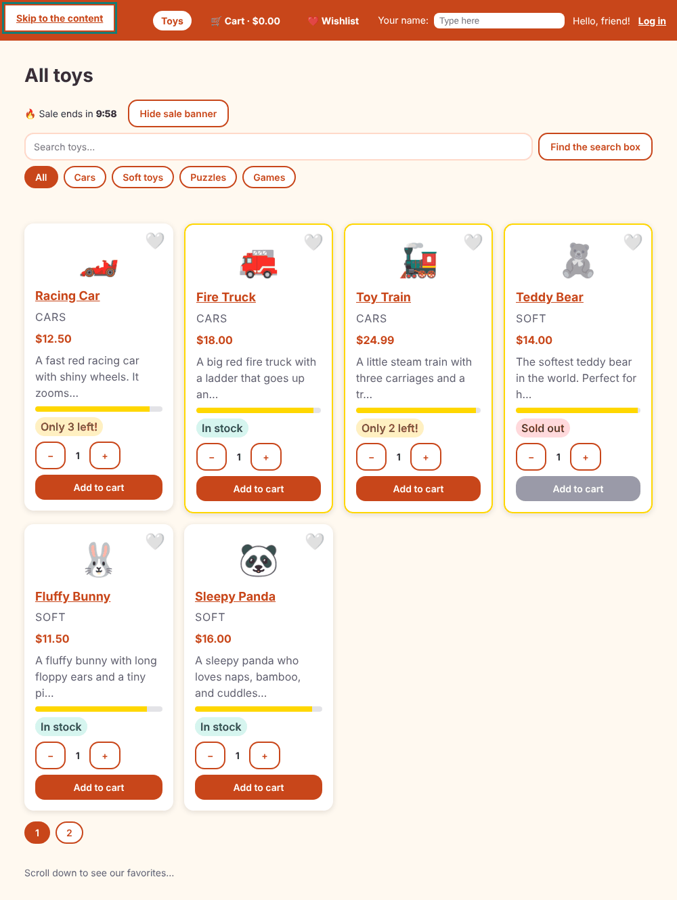

# Chapter 21: Accessibility

> **Like I'm 5:** A toy shop should be for everybody. Some visitors cannot see the shelf, so they listen. Some cannot use a mouse, so they walk the aisles with the Tab key. A friendly shop has clear signs, a wide door, a helper who says out loud "you are now in the cart room", and colours that everybody can read.

Concept reference: [19. Accessibility](../concepts/19-accessibility.md)

[Back: Chapter 20](20-material-and-cdk.md) · Next: [Chapter 22: Internationalization](22-internationalization.md)

## What we build today

We make the shop usable with a keyboard and a screen reader, and we let a robot (the **axe** checker) find the mistakes first:

1. Run **axe** and watch it find real problems in our own shop (low contrast and a wrong heading order).
2. Fix them.
3. Add a **"Skip to the content"** link, move **focus** to the new page after every navigation, and **announce** the new page and cart changes out loud.
4. Tell screen readers when a form box is **wrong** (`aria-invalid`) with a tiny directive.

## The big idea

**Accessibility** (a11y: "a", eleven letters, "y") means that people with different abilities can use your app: people who are blind or have low vision, who cannot use a mouse, who are deaf, who get dizzy from motion, who have a slow connection or a small screen. It is also the law in many places, and good a11y helps everybody (try using your phone in bright sun!).

The big rules, in order of how much they matter:

1. **Use the right HTML element.** A `<button>` is focusable, works with Enter and Space, and a screen reader says "button". A `<div (click)>` does none of these. This single rule fixes most problems. Use `<nav>`, `<main>`, `<header>`, `<h1>`... `<h6>` in order, `<ul>`, `<table>`, `<label>`.
2. **Every control needs a name.** A `<label for>` for inputs; `aria-label` for icon buttons (`aria-label="Remove Racing Car"`).
3. **Everything must work with the keyboard**, and you must always see where the focus is (`:focus-visible`, from Chapter 2).
4. **Colours must have enough contrast** (at least 4.5 to 1 for normal text) and must never be the *only* way to say something.
5. **Tell the screen reader when things change** without a page reload: new page, error messages, "item removed".
6. **Respect motion preferences** (Chapter 19).

**ARIA** is a set of extra attributes (`role`, `aria-label`, `aria-live`, `aria-pressed`, `aria-invalid`...) that describe things HTML cannot. The first rule of ARIA: *do not use ARIA if a native HTML element can do the job.*

**Grown-up words:**

- **WCAG**: the Web Content Accessibility Guidelines (levels A, AA, AAA). Most teams aim for **AA**.
- **Screen reader**: software that reads the page aloud (NVDA, JAWS, VoiceOver, TalkBack).
- **Live region** (`aria-live`): an element whose changes are read out. Angular CDK's `LiveAnnouncer` is a ready-made one.
- **Focus management**: deciding which element has the keyboard focus after something changes.
- **Landmark**: an element like `<main>` or `<nav>` that lets screen-reader users jump around.
- **Skip link**: the first link on the page, "Skip to the content", so keyboard users can avoid tabbing through the header every time.

## Step 1: Let a robot find the mistakes

**axe** is an open-source checker that finds many common problems (not all: it cannot tell if your page is *understandable*, only if it breaks rules). You can use it in a browser extension ("axe DevTools"), in Chrome's **Lighthouse** tab, or in code.

[`extras/ch21/axe-check.mjs`](extras/ch21/axe-check.mjs) is a small script that opens each page in a real browser and runs axe. To use it:

```bash
npm install --save-dev playwright-core axe-core
node axe-check.mjs "/,/cart,/login,/product/1,/wishlist" http://localhost:4200
```

(`playwright-core` drives the browser. You need Chrome or Chromium on your machine. In Chapter 24 we use `@axe-core/playwright` inside real end-to-end tests, which is the neater way to run it in a project.)

**`axe-check.mjs`**

```js
// Usage:  node axe-check.mjs [/,/cart,/login] [http://localhost:4200]
// Needs:  npm install --save-dev playwright-core axe-core   (and a Chrome/Chromium browser)
import { chromium } from 'playwright-core';
import { readFileSync } from 'node:fs';
const base = process.argv[3] || 'http://localhost:4200';
const axeSrc = readFileSync('node_modules/axe-core/axe.min.js', 'utf8');
const pages = (process.argv[2] || '/,/cart,/login,/product/1,/wishlist').split(',');
const browser = await chromium.launch({ executablePath: '/opt/pw-browsers/chromium-1194/chrome-linux/chrome', args: ['--no-sandbox'] });
const page = await browser.newPage({ viewport: { width: 1000, height: 800 } });
let total = 0;
for (const path of pages) {
  await page.goto(base + path, { waitUntil: 'networkidle' });
  await page.waitForTimeout(500);
  await page.evaluate(axeSrc);
  const res = await page.evaluate(() => axe.run(document, { runOnly: ['wcag2a', 'wcag2aa', 'wcag21aa', 'best-practice'] }));
  console.log(`\n${path}: ${res.violations.length} problem(s)`);
  for (const v of res.violations) {
    total += v.nodes.length;
    console.log(`  - [${v.impact}] ${v.id}: ${v.help} (${v.nodes.length} place(s))`);
    for (const n of v.nodes.slice(0, 2)) console.log(`      ${n.target.join(' ')}  ${(n.failureSummary || '').split('\n')[1] || ''}`);
  }
}
console.log('\nTOTAL places:', total);
await browser.close();
```

Here is the real result on the shop **as it was at the end of Chapter 20**:

```
/: 2 problem(s)
  - [serious] color-contrast: Elements must meet minimum color contrast ratio thresholds (5 place(s))
      a[href$="product/4"]    Element has insufficient color contrast of 2.51 (foreground color: #de8e70, background color: #fffdf9, ...). Expected contrast ratio of 4.5:1
      .sold-out > .category   Element has insufficient color contrast of 2.63 (foreground color: #9f9da5, ...). Expected contrast ratio of 4.5:1
  - [moderate] heading-order: Heading levels should only increase by one (1 place(s))
      app-product-card:nth-child(1) > article > h3    Heading order invalid

/cart: 0 problem(s)
/login: 0 problem(s)
/product/1: 0 problem(s)
/wishlist: 0 problem(s)

TOTAL places: 6
```

Two real mistakes, both ours:

1. **Low contrast.** In Chapter 2 we faded the whole sold-out card with `opacity: 0.6`. Faded text on a light background is hard to read (2.5 to 1, needs 4.5 to 1).
2. **Heading order.** The page has an `h1` ("All toys"), and every card had an `h3`. A screen-reader user who jumps from heading to heading hears "level 1, level 3", as if a level 2 had been skipped.

## Step 2: Fix the contrast and the headings

A sold-out card should still be readable. Instead of fading everything, give it a dashed border and grey out only the picture:

**`src/app/components/product-card/product-card.css`** (what changed)

```diff
@@ -9,12 +9,23 @@
   box-shadow: var(--shadow);
 }
 
-.card h3,
+.card h2,
 .card p {
   margin: 0;
+  font-size: 1.125rem;
+}
+
+.card p {
+  font-size: 1rem;
 }
 
 .card.sold-out {
+  /* A dashed border. (Making the whole card faint would make the words too hard to read.) */
+  border: 2px dashed #8d8d9b;
+}
+
+.card.sold-out .emoji {
+  filter: grayscale(1);
   opacity: 0.6;
 }
 
```

The card's title becomes an `h2` (the page's `h1`, then `h2` for each toy):

**`src/app/components/product-card/product-card.html`** (what changed)

```diff
@@ -11,9 +11,9 @@
     {{ liked() ? '❤️' : '🤍' }}
   </button>
   <div class="emoji" aria-hidden="true">{{ p.emoji }}</div>
-  <h3>
+  <h2>
     <a [routerLink]="['/product', p.id]">{{ p.name }}</a>
-  </h3>
+  </h2>
   <p class="category">{{ p.category | titlecase }}</p>
   <p class="price" appHighlight="#ffe08a">{{ p.price | currency }}</p>
   <p class="description">{{ p.description | truncate: 50 }}</p>
```

(We keep the visual size the same with CSS, because heading *level* is about structure, and size is about looks.)

## Step 3: Skip link, focus, and the `<main>` landmark

A keyboard user must tab through the whole header before reaching the toys, on every page. The **skip link** is a link at the very top that is invisible until focused:

**`src/app/app.html`** (what changed)

```diff
@@ -3,8 +3,11 @@
   <div class="loading-bar" role="progressbar" aria-label="Loading"></div>
 }
 
+<!-- The first thing a keyboard user can press: jump straight to the toys. -->
+<a class="skip-link" href="#main" (click)="skipToMain($event)">Skip to the content</a>
+
 <app-site-header />
 
-<main class="page">
+<main id="main" #main class="page" tabindex="-1">
   <router-outlet />
 </main>
```

**`src/app/app.css`** (what changed)

```diff
@@ -15,3 +15,23 @@
     background-position: -200% 0;
   }
 }
+
+/* Hidden until the keyboard lands on it. */
+.skip-link {
+  position: absolute;
+  top: -4rem;
+  left: 0.5rem;
+  padding: 0.5rem 1rem;
+  background: #fff;
+  color: var(--color-brand);
+  font-weight: 700;
+  z-index: 20;
+}
+
+.skip-link:focus {
+  top: 0.5rem;
+}
+
+main:focus {
+  outline: none;
+}
```

- `href="#main"` and `(click)="skipToMain($event)"`: we move the focus to `<main>` ourselves, because in an Angular app a plain `#anchor` link would be confused with a router link.
- `<main id="main" #main tabindex="-1">`: `tabindex="-1"` makes `main` focusable **by code** (not by the Tab key). `#main` gives the code a handle (`viewChild`).
- `main:focus { outline: none }` hides the ugly outline on the main area only, because the focus there is for the screen reader, not a control.



**After every navigation**, a sighted person sees the new page, but a keyboard or screen-reader user's focus is still on the link they clicked in the old page. We move it to the top of the new content:

**`src/app/app.ts`** (what changed)

```diff
@@ -1,5 +1,7 @@
-import { Component, inject } from '@angular/core';
-import { RouterOutlet } from '@angular/router';
+import { Component, ElementRef, inject, viewChild } from '@angular/core';
+import { takeUntilDestroyed } from '@angular/core/rxjs-interop';
+import { NavigationEnd, Router, RouterOutlet } from '@angular/router';
+import { filter, skip } from 'rxjs';
 import { SiteHeader } from './components/site-header/site-header';
 import { LoadingService } from './services/loading-service';
 
@@ -11,4 +13,23 @@ import { LoadingService } from './services/loading-service';
 })
 export class App {
   loading = inject(LoadingService);
+  private main = viewChild.required<ElementRef<HTMLElement>>('main');
+
+  constructor() {
+    // A web page that "changes" without reloading is silent for people who cannot see it.
+    // So after every move to a new page we move the keyboard focus to the top of the new page.
+    // (The new title is announced by AnnouncingTitleStrategy, see title-strategy.ts.)
+    inject(Router)
+      .events.pipe(
+        filter((e) => e instanceof NavigationEnd),
+        skip(1), // not for the very first page
+        takeUntilDestroyed(),
+      )
+      .subscribe(() => this.main().nativeElement.focus());
+  }
+
+  skipToMain(event: Event) {
+    event.preventDefault(); // do not change the address, just move the focus
+    this.main().nativeElement.focus();
+  }
 }
```

`skip(1)` ignores the first navigation (page load): we do not steal focus when the site opens.

## Step 4: Say the new page out loud

When the address changes without a reload, a screen reader says nothing. We say the page title ourselves. The tool is the CDK's `LiveAnnouncer`, which writes into a hidden `aria-live` region. **Where** to call it is the tricky bit. At the moment the router fires its `NavigationEnd` event, the browser tab still has the old title (it is written a moment later), so announcing there would read the **previous** page's title. (We first wrote it that way and the real-browser check caught it: it said "Toy Shop" when we arrived at the cart.)

The correct place is a custom **`TitleStrategy`**: the router calls it at the exact moment the new title is known.

**`src/app/title-strategy.ts`**

```ts
import { LiveAnnouncer } from '@angular/cdk/a11y';
import { inject, Service } from '@angular/core';
import { Title } from '@angular/platform-browser';
import { RouterStateSnapshot, TitleStrategy } from '@angular/router';

// The router already writes each route's `title` into the browser tab.
// This version also says the new title OUT LOUD, so people who cannot see the page know
// they arrived somewhere new. (The router calls us at exactly the right moment,
// when the new title is known.)
@Service()
export class AnnouncingTitleStrategy extends TitleStrategy {
  private title = inject(Title);
  private announcer = inject(LiveAnnouncer);
  private first = true;

  override updateTitle(snapshot: RouterStateSnapshot) {
    const title = this.buildTitle(snapshot);
    if (title === undefined) return;

    this.title.setTitle(title);
    if (!this.first) this.announcer.announce(title); // not for the very first page
    this.first = false;
  }
}
```

- It extends Angular's `TitleStrategy` and overrides `updateTitle`.
- `this.buildTitle(snapshot)` is the router's own way to work out the title from the `title` of the matched routes.
- It sets the tab title as before, and announces it, but not on the first page.

Switch it on in the app settings:

**`src/app/app.config.ts`** (what changed)

```diff
@@ -6,12 +6,14 @@ import {
   withInMemoryScrolling,
   withPreloading,
   withViewTransitions,
+  TitleStrategy,
 } from '@angular/router';
 import { routes } from './app.routes';
 import { authInterceptor } from './interceptors/auth-interceptor';
 import { fakeBackendInterceptor } from './interceptors/fake-backend-interceptor';
 import { loadingInterceptor } from './interceptors/loading-interceptor';
 import { SelectivePreload } from './preload-strategy';
+import { AnnouncingTitleStrategy } from './title-strategy';
 import { SHOP_NAME, TAX_RATE } from './tokens';
 
 export const appConfig: ApplicationConfig = {
@@ -32,6 +34,8 @@ export const appConfig: ApplicationConfig = {
       // The pretend server goes LAST, so it can see the token the others added.
       withInterceptors([loadingInterceptor, authInterceptor, fakeBackendInterceptor]),
     ),
+    // Say the new page title out loud after every navigation.
+    { provide: TitleStrategy, useExisting: AnnouncingTitleStrategy },
     { provide: SHOP_NAME, useValue: 'Toy Shop' },
     { provide: TAX_RATE, useValue: 0.08 },
   ],
```

Test it, with two routes that have titles and a spy on `announce`:

**`src/app/title-strategy.spec.ts`**

```ts
import { LiveAnnouncer } from '@angular/cdk/a11y';
import { Component } from '@angular/core';
import { TestBed } from '@angular/core/testing';
import { provideRouter, Router, TitleStrategy } from '@angular/router';
import { AnnouncingTitleStrategy } from './title-strategy';

@Component({ template: '' })
class Page {}

describe('AnnouncingTitleStrategy', () => {
  it('sets the tab title and says it out loud, but not for the very first page', async () => {
    TestBed.configureTestingModule({
      providers: [
        provideRouter([
          { path: '', component: Page, title: 'Home page' },
          { path: 'cart', component: Page, title: 'Your cart' },
        ]),
        { provide: TitleStrategy, useExisting: AnnouncingTitleStrategy },
      ],
    });
    const announce = vi.spyOn(TestBed.inject(LiveAnnouncer), 'announce');
    const router = TestBed.inject(Router);

    await router.navigateByUrl('/');
    expect(document.title).toBe('Home page');
    expect(announce).not.toHaveBeenCalled();

    await router.navigateByUrl('/cart');
    expect(document.title).toBe('Your cart');
    expect(announce).toHaveBeenCalledWith('Your cart');
  });
});
```

Also announce changes that no one can see. When someone removes a toy from the cart, the line just vanishes. A screen-reader user would not know anything happened:

**`src/app/pages/cart/cart.ts`** (what changed)

```diff
@@ -1,4 +1,5 @@
 import { CurrencyPipe } from '@angular/common';
+import { LiveAnnouncer } from '@angular/cdk/a11y';
 import { Component, inject } from '@angular/core';
 import { MatDialog } from '@angular/material/dialog';
 import { RouterLink } from '@angular/router';
@@ -15,6 +16,13 @@ import { CartService } from '../../services/cart-service';
 export class Cart {
   cart = inject(CartService);
   private dialog = inject(MatDialog);
+  private announcer = inject(LiveAnnouncer);
+
+  remove(id: number, name: string) {
+    this.cart.remove(id);
+    // Without this, a person using a screen reader would not know anything happened.
+    this.announcer.announce(`${name} removed from your cart`);
+  }
 
   confirmEmpty() {
     this.dialog
```

**`src/app/pages/cart/cart.html`** (what changed)

```diff
@@ -21,7 +21,7 @@
           class="btn secondary"
           type="button"
           [attr.aria-label]="'Remove ' + item.product.name"
-          (click)="cart.remove(item.product.id)"
+          (click)="remove(item.product.id, item.product.name)"
         >
           Remove
         </button>
```

## Step 5: Tell screen readers when a box is wrong

In Chapter 15 we showed error messages with `role="alert"`. The input itself should also say it is invalid (`aria-invalid="true"`), so a screen reader says "invalid entry" when you land on it. We do not want to write that on every input, so we make a directive that attaches to **all** form inputs by itself (selector `input[formControlName]` and friends, Chapter 6):

**`src/app/directives/aria-invalid.ts`**

```ts
import { Directive, inject } from '@angular/core';
import { NgControl } from '@angular/forms';

// Tells screen readers "this box has a mistake in it" (aria-invalid).
// It only says so after the person has touched the box, so it does not scold too early.
@Directive({
  selector:
    'input[formControlName], input[formControl], textarea[formControlName], textarea[formControl]',
  host: { '[attr.aria-invalid]': 'showInvalid() ? "true" : null' },
})
export class AriaInvalid {
  private control = inject(NgControl);

  showInvalid() {
    return !!this.control.touched && !!this.control.invalid;
  }
}
```

- `inject(NgControl)` gives the directive the form control of the input it sits on.
- `host: { '[attr.aria-invalid]': ... }` writes the attribute: `"true"` only after the box was touched **and** is invalid, otherwise no attribute (so no early scolding).

Import it where forms are used. Nothing changes in the templates: the selector finds the inputs on its own.

**`src/app/pages/login/login.ts`** (what changed)

```diff
@@ -2,9 +2,10 @@ import { Component, inject, input, signal } from '@angular/core';
 import { FormBuilder, ReactiveFormsModule, Validators } from '@angular/forms';
 import { Router } from '@angular/router';
 import { AuthService } from '../../services/auth-service';
+import { AriaInvalid } from '../../directives/aria-invalid';
 
 @Component({
-  imports: [ReactiveFormsModule],
+  imports: [AriaInvalid, ReactiveFormsModule],
   selector: 'app-login',
   styleUrl: './login.css',
   templateUrl: './login.html',
```

**`src/app/pages/checkout/checkout.ts`** (what changed)

```diff
@@ -14,6 +14,7 @@ import { NewOrder, Order } from '../../models/order';
 import { AuthService } from '../../services/auth-service';
 import { CartService } from '../../services/cart-service';
 import { OrderService } from '../../services/order-service';
+import { AriaInvalid } from '../../directives/aria-invalid';
 
 // A rule of our own: a ZIP code is exactly five digits.
 export const zipCode: ValidatorFn = (control): ValidationErrors | null =>
@@ -27,7 +28,7 @@ export const giftNeedsMessage: ValidatorFn = (group): ValidationErrors | null =>
 };
 
 @Component({
-  imports: [ReactiveFormsModule, CurrencyPipe, RouterLink],
+  imports: [AriaInvalid, ReactiveFormsModule, CurrencyPipe, RouterLink],
   selector: 'app-checkout',
   styleUrl: './checkout.css',
   templateUrl: './checkout.html',
```

**`src/app/directives/aria-invalid.spec.ts`**

```ts
import { Component } from '@angular/core';
import { TestBed } from '@angular/core/testing';
import { FormControl, ReactiveFormsModule, Validators } from '@angular/forms';
import { AriaInvalid } from './aria-invalid';

@Component({
  imports: [ReactiveFormsModule, AriaInvalid],
  template: `<input [formControl]="name" />`,
})
class TestHost {
  name = new FormControl('', Validators.required);
}

describe('AriaInvalid', () => {
  it('says "invalid" only after the box was touched and is wrong', async () => {
    const fixture = TestBed.createComponent(TestHost);
    await fixture.whenStable();
    const input: HTMLInputElement = fixture.nativeElement.querySelector('input');

    expect(input.getAttribute('aria-invalid')).toBeNull(); // not touched yet

    input.dispatchEvent(new Event('blur')); // the person left the box, still empty
    await fixture.whenStable();
    expect(input.getAttribute('aria-invalid')).toBe('true');

    input.value = 'Mia';
    input.dispatchEvent(new Event('input'));
    await fixture.whenStable();
    expect(input.getAttribute('aria-invalid')).toBeNull();
  });
});
```

**`src/app/app.spec.ts`** (what changed)

```diff
@@ -22,4 +22,12 @@ describe('App', () => {
     const compiled = fixture.nativeElement as HTMLElement;
     expect(compiled.querySelector('.logo')?.textContent).toContain('Toy Shop');
   });
+
+  it('has a "skip to the content" link that points at the main area', async () => {
+    const fixture = TestBed.createComponent(App);
+    await fixture.whenStable();
+    const link = fixture.nativeElement.querySelector('a.skip-link') as HTMLAnchorElement;
+    expect(link.getAttribute('href')).toBe('#main');
+    expect(fixture.nativeElement.querySelector('main#main')).not.toBeNull();
+  });
 });
```

## Check it works

```bash
npx ng test --watch=false
```

```
 Test Files  32 passed (32)
      Tests  79 passed (79)
```

Run axe again:

```
/: 0 problem(s)
/cart: 0 problem(s)
/login: 0 problem(s)
/product/1: 0 problem(s)
/wishlist: 0 problem(s)

TOTAL places: 0
```

Then do what no robot can: **use the shop with the keyboard only.** Put your mouse aside.

- [ ] Press **Tab** once on a fresh page: a "Skip to the content" link appears. Press **Enter**: the focus jumps into the main area.
- [ ] Keep pressing Tab: you can reach every button, link, and input, and you always see the focus ring.
- [ ] Use Space or Enter to add a toy, then go to the cart with the keyboard.
- [ ] Re-order the wishlist with the ↑ and ↓ buttons (no mouse needed).
- [ ] Open the **Empty the cart** dialog: Tab stays inside it, Escape closes it.

We scripted the same checks in a real browser, and this is what it saw:

```
1. first Tab focuses      : a "Skip to the content"
2. Enter on skip link     : main#main "All toys🔥 Sale ends in 9:59 H"
3. after going to the cart: focus = main#main "Your cart 🛒..."  | announced = "Your cart"
4. after Remove           : announced = "Racing Car removed from your cart"
5. login email aria-invalid before touching: null
   after leaving the empty box              : true
```

If you own a screen reader (VoiceOver on a Mac: `Cmd+F5`; NVDA on Windows is free), turn it on and listen to your own page. Nothing teaches like hearing it.

## What you learned

- Accessibility starts with **semantic HTML**, labels, keyboard support, contrast, and focus. ARIA fills the gaps.
- axe finds many common problems automatically; manual keyboard and screen-reader testing finds the rest.
- A skip link, a focusable `<main>`, and focus moves after navigation make single-page apps usable by keyboard.
- `LiveAnnouncer` speaks changes that are not visible; a `TitleStrategy` is the right place to announce page changes.
- Never rely on faded colours; check contrast.
- A tiny directive can add an ARIA attribute to every input.

## Try it yourself

1. Add an empty `<button type="button"></button>` to the home page and run axe again. It reports `[critical] button-name: Buttons must have discernible text`. Fix it with an `aria-label`, then remove the button.
2. Make a button from a `<div (click)="...">`. Try to reach it with the Tab key. Now replace it with a `<button>` and compare.
3. Find the contrast ratio of your brand colour on white using the Chrome DevTools colour picker. Does `--color-muted` pass 4.5 to 1?
4. Add `aria-describedby` to the ZIP input so the error text is read with the input. (Hint: give the error `<p>` an `id` and point to it.)

## If something goes wrong

**axe says `color-contrast`:** the foreground/background pair is too faint. Darken the text or lighten the background. Faded `opacity` on text is a common culprit.

**axe says `button-name` or `label`:** a control has no accessible name. Add a visible `<label>` or an `aria-label`.

**axe says `heading-order`:** do not skip levels. Choose the heading by structure, then style it with CSS.

**The focus ring is invisible after you click an element:** `:focus-visible` shows the ring only for keyboard users, which is what we want. Check with the Tab key.

**The announcer says the old page title:** you called `announce` at the wrong moment (for example in a `NavigationEnd` handler). Use a `TitleStrategy`.

**`aria-hidden` on something focusable:** axe reports `aria-hidden-focus`. Never hide an element that can receive the keyboard focus. (We met this one with a snackbar in Chapter 35.)

Next: [Chapter 22: Internationalization](22-internationalization.md)
