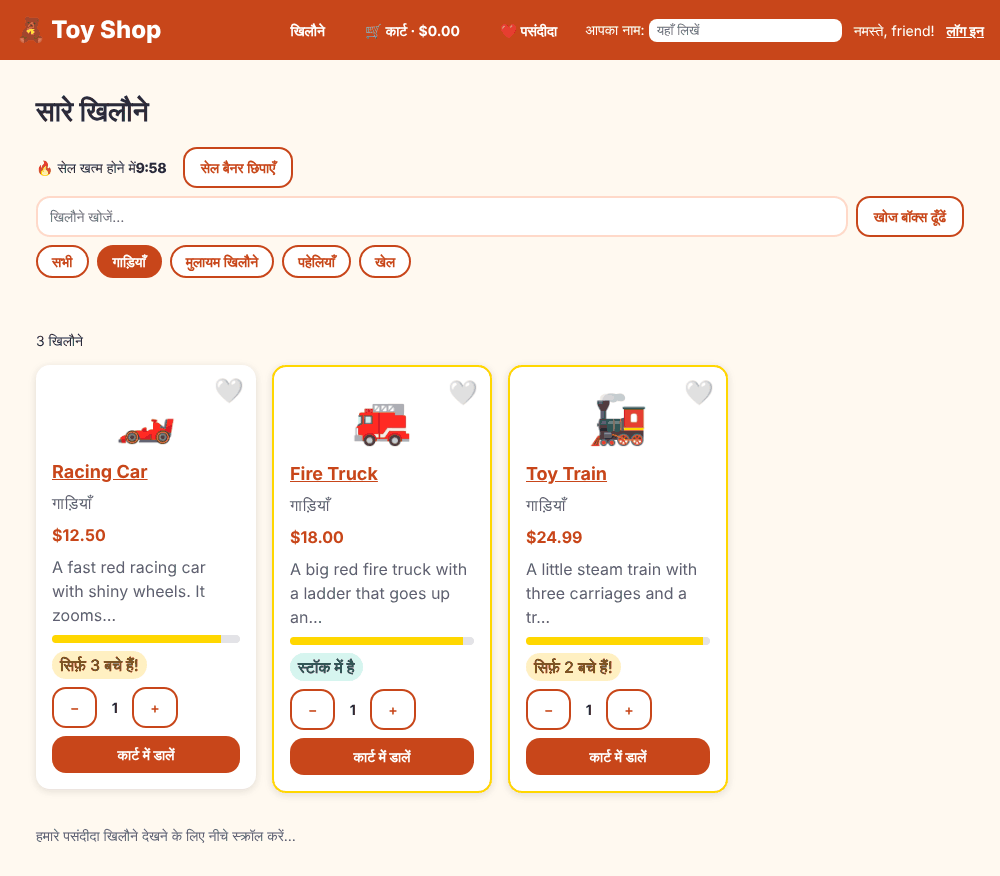

# Chapter 22: Internationalization (i18n)

> **Like I'm 5:** Our toy shop has a friend in India who speaks Hindi. We do not build a second shop. We put name tags on every word on the signs ("this word is called `card.add`") and give the friend a dictionary that says what each name tag means in Hindi. When she walks in, the shop reads her dictionary instead of ours.

Concept reference: [18. Internationalization (i18n)](../concepts/18-internationalization-i18n.md)

[Back: Chapter 21](21-accessibility.md) · Next: [Chapter 23: Error handling](23-error-handling.md)

## What we build today

The **whole shop in Hindi**, built from the same code:

- Every sign, button, label and message is marked for translation.
- An extracted translation file (`messages.xlf`) lists every message once.
- A Hindi file (`messages.hi.xlf`) fills in the Hindi words.
- One command builds (or serves) the Hindi version.



## The big idea

**i18n** (internationalization: "i", eighteen letters, "n") means building an app so it **can** speak many languages. **l10n** (localization) means actually adding one language.

Angular has built-in, compile-time i18n. The steps:

1. **Mark** every piece of text with `i18n` in templates or `$localize` in TypeScript.
2. **Extract** all the marked text into a file (`ng extract-i18n`).
3. **Translate**: copy the file for each language and fill in `<target>` words (translators use tools for this).
4. **Build** one app per language (`localize: ["hi"]`). The words are put into the code at build time, so there is no run-time cost, and the app is as fast as the English one.

Besides words, languages differ in **formats**: dates (`10/10/2026` vs `10.10.2026`), numbers (`1,234.5` vs `1.234,5`), currency, and even the direction of writing (Arabic and Hebrew go right to left). Angular's pipes (`date`, `currency`, `number`) use the **locale** of the build.

Marking text in a template:

| You write | What it means |
|-----------|---------------|
| `<h1 i18n="@@home.title">All toys</h1>` | This text is a message with the permanent id `home.title`. |
| `<input i18n-placeholder="@@search" placeholder="Search" />` | Translate the `placeholder` **attribute**. |
| `<ng-container i18n="@@nav.cart">Cart</ng-container>` | Mark a piece of text without adding an element. |
| `{count, plural, =0 {No toys} =1 {One toy} other {{{count}} toys}}` | An **ICU message**: the words depend on a number. |
| `{flag, select, true {Hide} other {Show}}` | An ICU `select`: the words depend on a value. |
| `$localize\`:@@id:Hello ${name}:name:\`` | A message in TypeScript, with a named placeholder. |

**Always give messages an id** with `@@your.id`. Without it, Angular makes an id from a hash of the text, and any tiny change to the English wording breaks all its translations.

**Grown-up words:**

- **Locale**: a language plus region (`en-US`, `hi`, `pt-BR`).
- **Source locale**: the language you write the code in (`en-US`).
- **XLIFF / XLF**: the standard file format for translations.
- **ICU message format**: a notation for plurals and selections.
- **Placeholder**: a hole in a message (`{COUNT}`) for a value that is not translated.
- **RTL**: right-to-left writing.

## Step 1: Add the localize package

```bash
ng add @angular/localize
```

It installs the package and does the wiring (the output lists what it changed):

```
UPDATE src/main.ts
UPDATE tsconfig.app.json
UPDATE tsconfig.spec.json
UPDATE angular.json
```

- `main.ts` gets a line `/// <reference types="@angular/localize" />` so TypeScript knows `$localize`.
- the two `tsconfig` files list `@angular/localize` in `types`.
- `angular.json` adds `@angular/localize/init` to `polyfills`, so `$localize` exists at run time.

**`src/main.ts`** (what changed)

```diff
@@ -1,3 +1,5 @@
+/// <reference types="@angular/localize" />
+
 import { bootstrapApplication } from '@angular/platform-browser';
 import { appConfig } from './app/app.config';
 import { App } from './app/app';
```

**`tsconfig.app.json`** (what changed)

```diff
@@ -3,7 +3,7 @@
 {
   "extends": "./tsconfig.json",
   "compilerOptions": {
-    "types": []
+    "types": ["@angular/localize"]
   },
   "include": ["src/**/*.ts"],
   "exclude": ["src/**/*.spec.ts"]
```

## Step 2: Tell Angular about the languages

In `angular.json` there are three changes: a block that lists the languages, a build configuration `hi`, and a serve configuration `hi`.

**`angular.json`** (what changed)

```diff
@@ -24,7 +24,8 @@
                 "input": "public"
               }
             ],
-            "styles": ["src/material-theme.scss", "src/styles.css"]
+            "styles": ["src/material-theme.scss", "src/styles.css"],
+            "polyfills": ["@angular/localize/init"]
           },
           "configurations": {
             "production": {
@@ -46,6 +47,9 @@
               "optimization": false,
               "extractLicenses": false,
               "sourceMap": true
+            },
+            "hi": {
+              "localize": ["hi"]
             }
           },
           "defaultConfiguration": "production"
@@ -58,6 +62,9 @@
             },
             "development": {
               "buildTarget": "toy-shop:build:development"
+            },
+            "hi": {
+              "buildTarget": "toy-shop:build:development,hi"
             }
           },
           "defaultConfiguration": "development"
@@ -65,6 +72,12 @@
         "test": {
           "builder": "@angular/build:unit-test"
         }
+      },
+      "i18n": {
+        "sourceLocale": "en-US",
+        "locales": {
+          "hi": "src/locale/messages.hi.xlf"
+        }
       }
     }
   }
```

- `sourceLocale: "en-US"` is the language of our code.
- `locales.hi` points to the Hindi translation file we create below.
- `ng build --configuration hi` (or `ng serve --configuration hi`) builds the Hindi version.

## Step 3: Mark the text in templates

Go through every template and mark every piece of user-visible text. Here is the product card (see the full list of changes below):

**`src/app/components/product-card/product-card.html`**

```html
@let p = product();

<article class="card" [ngClass]="cardClasses()">
  <button
    class="heart"
    type="button"
    [attr.aria-pressed]="liked()"
    [attr.aria-label]="heartLabel()"
    (click)="likeToggled.emit(p)"
  >
    {{ liked() ? '❤️' : '🤍' }}
  </button>
  <div class="emoji" aria-hidden="true">{{ p.emoji }}</div>
  <h2>
    <a [routerLink]="['/product', p.id]">{{ p.name }}</a>
  </h2>
  <p class="category">{{ categoryLabel() }}</p>
  <p class="price" appHighlight="#ffe08a">{{ p.price | currency }}</p>
  <p class="description">{{ p.description | truncate: 50 }}</p>

  <div class="stars" role="img" [attr.aria-label]="ratingLabel()" [title]="ratingLabel()">
    <div class="stars-fill" [ngStyle]="{ width: ratingPercent() + '%' }"></div>
  </div>

  @switch (stockLevel()) {
    @case ('out') {
      <p class="badge out" i18n="@@card.soldOut">Sold out</p>
    }
    @case ('low') {
      <p class="badge low" i18n="@@card.low">
        Only
        {{
          p.stock // i18n(ph="count")
        }}
        left!
      </p>
    }
    @default {
      <p class="badge ok" i18n="@@card.inStock">In stock</p>
    }
  }

  <app-quantity-stepper [(value)]="quantity" [max]="p.stock" />

  <button class="btn" type="button" [disabled]="p.stock === 0" (click)="add()" i18n="@@card.add">
    Add to cart
  </button>
</article>
```

Read the interesting parts:

- `i18n="@@card.soldOut"` marks the badge text.
- The "Only 3 left!" message has a **number inside**. The expression gets a readable placeholder name with a comment: `{{ p.stock // i18n(ph="count") }}`. The translator sees `{COUNT}` and can move it anywhere in the Hindi sentence.
- `[attr.aria-label]="heartLabel()"`: texts built in TypeScript use `$localize`, shown next.

The category name ("Cars") used to come from the `titlecase` pipe. We now look the translated name up:

**`src/app/models/category-labels.ts`**

```ts
import { Category } from './product';

// $localize marks a piece of text in TypeScript for translation.
// The part between colons, like :@@cat.cars:, is the message's permanent name (its id).
export const CATEGORY_LABELS: Record<'all' | Category, string> = {
  all: $localize`:@@cat.all:All`,
  cars: $localize`:@@cat.cars:Cars`,
  soft: $localize`:@@cat.soft:Soft toys`,
  puzzles: $localize`:@@cat.puzzles:Puzzles`,
  games: $localize`:@@cat.games:Games`,
};
```

And the card's TypeScript builds its sentences with `$localize`:

**`src/app/components/product-card/product-card.ts`** (what changed)

```diff
@@ -1,7 +1,8 @@
-import { CurrencyPipe, NgClass, NgStyle, TitleCasePipe } from '@angular/common';
+import { CurrencyPipe, NgClass, NgStyle } from '@angular/common';
 import { Component, computed, input, output, signal } from '@angular/core';
 import { RouterLink } from '@angular/router';
 import { Highlight } from '../../directives/highlight';
+import { CATEGORY_LABELS } from '../../models/category-labels';
 import { Product } from '../../models/product';
 import { TruncatePipe } from '../../pipes/truncate-pipe';
 import { QuantityStepper } from '../quantity-stepper/quantity-stepper';
@@ -12,16 +13,7 @@ export interface AddedEvent {
 }
 
 @Component({
-  imports: [
-    QuantityStepper,
-    NgClass,
-    NgStyle,
-    Highlight,
-    CurrencyPipe,
-    TitleCasePipe,
-    TruncatePipe,
-    RouterLink,
-  ],
+  imports: [QuantityStepper, NgClass, NgStyle, Highlight, CurrencyPipe, TruncatePipe, RouterLink],
   selector: 'app-product-card',
   styleUrl: './product-card.css',
   templateUrl: './product-card.html',
@@ -47,6 +39,20 @@ export class ProductCard {
     popular: this.product().rating >= 4.7,
   }));
 
+  categoryLabel = computed(() => CATEGORY_LABELS[this.product().category]);
+
+  // Sentences that are built in TypeScript use $localize, so they can be translated too.
+  heartLabel = computed(() => {
+    const name = this.product().name;
+    return this.liked()
+      ? $localize`:@@card.heart.remove:Remove ${name}:name: from wishlist`
+      : $localize`:@@card.heart.add:Add ${name}:name: to wishlist`;
+  });
+
+  ratingLabel = computed(
+    () => $localize`:@@card.rating:Rated ${this.product().rating}:rating: out of 5`,
+  );
+
   // ngStyle takes an object of CSS values. Here: how wide the star bar is.
   ratingPercent = computed(() => (this.product().rating / 5) * 100);
 
```

Look at `` $localize`:@@card.heart.add:Add ${name}:name: to wishlist` ``:

- `:@@card.heart.add:` is the id.
- `${name}:name:` is a placeholder named `name`.

The same treatment goes into the other templates. Here are the changes, so you can follow along:

**`src/app/components/site-header/site-header.html`** (what changed)

```diff
@@ -1,17 +1,24 @@
 <header class="site-header">
   <span class="logo">🧸 {{ shopName }}</span>
 
-  <nav class="nav" aria-label="Main">
-    <a routerLink="/" routerLinkActive="active" [routerLinkActiveOptions]="{ exact: true }">Toys</a>
+  <nav class="nav" i18n-aria-label="@@nav.label" aria-label="Main">
+    <a
+      routerLink="/"
+      routerLinkActive="active"
+      [routerLinkActiveOptions]="{ exact: true }"
+      i18n="@@nav.toys"
+      >Toys</a
+    >
     <a
       routerLink="/cart"
       routerLinkActive="active"
       [matBadge]="cart.count()"
       [matBadgeHidden]="cart.count() === 0"
       matBadgeOverlap="false"
+      i18n-matBadgeDescription="@@nav.cart.badge"
       matBadgeDescription="toys in your cart"
     >
-      🛒 Cart · {{ cart.total() | currency }}
+      🛒 <ng-container i18n="@@nav.cart">Cart</ng-container> · {{ cart.total() | currency }}
     </a>
     <a
       routerLink="/wishlist"
@@ -19,29 +26,46 @@
       [matBadge]="wishlist.count()"
       [matBadgeHidden]="wishlist.count() === 0"
       matBadgeOverlap="false"
+      i18n-matBadgeDescription="@@nav.wishlist.badge"
       matBadgeDescription="toys on your wishlist"
     >
-      ❤️ Wishlist
+      ❤️ <ng-container i18n="@@nav.wishlist">Wishlist</ng-container>
     </a>
     @if (auth.isLoggedIn()) {
-      <a routerLink="/orders" routerLinkActive="active">My orders</a>
+      <a routerLink="/orders" routerLinkActive="active" i18n="@@nav.orders">My orders</a>
     }
     @if (auth.isAdmin()) {
-      <a routerLink="/admin" routerLinkActive="active">Admin</a>
+      <a routerLink="/admin" routerLinkActive="active" i18n="@@nav.admin">Admin</a>
     }
   </nav>
 
   <div class="who">
     @if (auth.user(); as user) {
-      <span>Hi, {{ user.name }}!</span>
-      <button class="btn secondary small" type="button" (click)="logout()">Log out</button>
+      <span i18n="@@header.hi"
+        >Hi,
+        {{
+          user.name  // i18n(ph="userName")
+        }}!</span
+      >
+      <button class="btn secondary small" type="button" (click)="logout()" i18n="@@header.logout">
+        Log out
+      </button>
     } @else {
       <label class="name-box">
-        Your name:
-        <input [(ngModel)]="shopperName" placeholder="Type here" />
+        <ng-container i18n="@@header.yourName">Your name:</ng-container>
+        <input
+          [(ngModel)]="shopperName"
+          i18n-placeholder="@@header.typeHere"
+          placeholder="Type here"
+        />
       </label>
-      <span>Hello, {{ shopperName() || 'friend' }}!</span>
-      <a class="login-link" routerLink="/login">Log in</a>
+      <span i18n="@@header.hello">
+        Hello,
+        {{
+          shopperName() || 'friend'  // i18n(ph="shopperName")
+        }}!
+      </span>
+      <a class="login-link" routerLink="/login" i18n="@@header.login">Log in</a>
     }
   </div>
 </header>
```

**`src/app/pages/cart/cart.html`** (what changed)

```diff
@@ -1,7 +1,7 @@
-<h1>Your cart 🛒</h1>
+<h1 i18n="@@cart.title">Your cart 🛒</h1>
 
 @if (cart.items().length === 0) {
-  <p>Your cart is empty. <a routerLink="/">Go find a toy!</a></p>
+  <p i18n="@@cart.empty">Your cart is empty. <a routerLink="/">Go find a toy!</a></p>
 } @else {
   <ul class="lines">
     @for (item of cart.items(); track item.product.id) {
@@ -20,8 +20,10 @@
         <button
           class="btn secondary"
           type="button"
-          [attr.aria-label]="'Remove ' + item.product.name"
+          i18n-aria-label="@@cart.remove.label"
+          aria-label="Remove {{ item.product.name }}"
           (click)="remove(item.product.id, item.product.name)"
+          i18n="@@cart.remove"
         >
           Remove
         </button>
@@ -30,16 +32,18 @@
   </ul>
 
   <dl class="totals">
-    <dt>Toys</dt>
+    <dt i18n="@@cart.toys">Toys</dt>
     <dd>{{ cart.subtotal() | currency }}</dd>
-    <dt>Tax</dt>
+    <dt i18n="@@cart.tax">Tax</dt>
     <dd>{{ cart.tax() | currency }}</dd>
-    <dt>Total</dt>
+    <dt i18n="@@cart.total">Total</dt>
     <dd class="grand">{{ cart.total() | currency }}</dd>
   </dl>
 
   <div class="actions">
-    <a class="btn" routerLink="/checkout">Go to checkout</a>
-    <button class="btn secondary" type="button" (click)="confirmEmpty()">Empty the cart</button>
+    <a class="btn" routerLink="/checkout" i18n="@@cart.checkout">Go to checkout</a>
+    <button class="btn secondary" type="button" (click)="confirmEmpty()" i18n="@@cart.empty.button">
+      Empty the cart
+    </button>
   </div>
 }
```

**`src/app/pages/cart/cart.ts`** (what changed)

```diff
@@ -21,16 +21,18 @@ export class Cart {
   remove(id: number, name: string) {
     this.cart.remove(id);
     // Without this, a person using a screen reader would not know anything happened.
-    this.announcer.announce(`${name} removed from your cart`);
+    this.announcer.announce(
+      $localize`:@@cart.removedAnnounce:${name}:name: removed from your cart`,
+    );
   }
 
   confirmEmpty() {
     this.dialog
       .open(ConfirmDialog, {
         data: {
-          title: 'Empty the cart?',
-          message: 'All the toys will be taken out of your cart.',
-          confirmLabel: 'Yes, empty it',
+          title: $localize`:@@cart.confirm.title:Empty the cart?`,
+          message: $localize`:@@cart.confirm.message:All the toys will be taken out of your cart.`,
+          confirmLabel: $localize`:@@cart.confirm.yes:Yes, empty it`,
         },
       })
       .afterClosed()
```

**`src/app/components/confirm-dialog/confirm-dialog.html`** (what changed)

```diff
@@ -1,7 +1,9 @@
 <h2 mat-dialog-title>{{ data.title }}</h2>
 <mat-dialog-content>{{ data.message }}</mat-dialog-content>
 <mat-dialog-actions align="end">
-  <button class="btn secondary" type="button" [mat-dialog-close]="false">No, keep it</button>
+  <button class="btn secondary" type="button" [mat-dialog-close]="false" i18n="@@confirm.no">
+    No, keep it
+  </button>
   <button class="btn" type="button" [mat-dialog-close]="true" cdkFocusInitial>
     {{ data.confirmLabel }}
   </button>
```

The home page uses two ICU messages, a **plural** and a **select**:

**`src/app/pages/home/home.html`** (what changed)

```diff
@@ -1,11 +1,17 @@
-<h1>All toys</h1>
+<h1 i18n="@@home.title">All toys</h1>
 
 <div class="sale">
   @if (showSale()) {
-    <p>🔥 Sale ends in <app-sale-countdown [endsAt]="saleEnds" /></p>
+    <p>
+      🔥 <ng-container i18n="@@home.saleEnds">Sale ends in</ng-container>
+      <app-sale-countdown [endsAt]="saleEnds" />
+    </p>
   }
   <button class="btn secondary" type="button" (click)="showSale.set(!showSale())">
-    {{ showSale() ? 'Hide' : 'Show' }} sale banner
+    <ng-container i18n="@@home.saleToggle">{showSale(), select,
+      true {Hide sale banner}
+      other {Show sale banner}
+    }</ng-container>
   </button>
 </div>
 
@@ -14,13 +20,17 @@
     #searchBox
     type="search"
     [formControl]="searchTerm"
+    i18n-aria-label="@@home.search.label"
     aria-label="Search toys"
+    i18n-placeholder="@@home.search.placeholder"
     placeholder="Search toys…"
   />
-  <button class="btn secondary" type="button" (click)="focusSearch()">Find the search box</button>
+  <button class="btn secondary" type="button" (click)="focusSearch()" i18n="@@home.findSearch">
+    Find the search box
+  </button>
 </div>
 
-<nav class="chips" aria-label="Toy groups">
+<nav class="chips" i18n-aria-label="@@home.groups" aria-label="Toy groups">
   @for (c of categories; track c.id) {
     <a
       class="chip"
@@ -36,19 +46,32 @@
 
 <p class="added" aria-live="polite">
   @if (lastAdded()) {
-    <span animate.enter="pop">Added: {{ lastAdded() }}</span>
+    <span animate.enter="pop"
+      ><ng-container i18n="@@home.added">Added:</ng-container> {{ lastAdded() }}</span
+    >
   }
 </p>
 
 @if (error()) {
   <p class="error" role="alert">
     {{ error() }}
-    <button class="btn secondary" type="button" (click)="retry()">Try again</button>
+    <button class="btn secondary" type="button" (click)="retry()" i18n="@@home.retry">
+      Try again
+    </button>
   </p>
 }
 
 @if (loading()) {
-  <p class="loading" role="status">Looking for toys… 🔍</p>
+  <p class="loading" role="status" i18n="@@home.loading">Looking for toys… 🔍</p>
+} @else {
+  <!-- An ICU message: the words change with the number (0, 1, or many). -->
+  <p class="count" i18n="@@home.count">
+    {visible().length, plural,
+      =0 {No toys}
+      =1 {One toy}
+      other {{{ visible().length // i18n(ph="count") }} toys}
+    }
+  </p>
 }
 
 <div class="grid">
@@ -62,13 +85,13 @@
     />
   } @empty {
     @if (!loading() && !error()) {
-      <p>No toys found. 🧸</p>
+      <p i18n="@@home.empty">No toys found. 🧸</p>
     }
   }
 </div>
 
 @if (pageCount() > 1) {
-  <nav class="pages" aria-label="Pages">
+  <nav class="pages" i18n-aria-label="@@home.pages" aria-label="Pages">
     @for (n of pageNumbers(); track n) {
       <button
         type="button"
@@ -88,9 +111,9 @@
     <app-recommended-toys [toys]="top" />
   }
 } @placeholder {
-  <p class="placeholder">Scroll down to see our favorites…</p>
+  <p class="placeholder" i18n="@@home.favs.placeholder">Scroll down to see our favorites…</p>
 } @loading (minimum 300ms) {
-  <p>Loading favorites…</p>
+  <p i18n="@@home.favs.loading">Loading favorites…</p>
 } @error {
-  <p>Sorry, we could not load the favorites.</p>
+  <p i18n="@@home.favs.error">Sorry, we could not load the favorites.</p>
 }
```

**`src/app/pages/home/home.ts`** (what changed)

```diff
@@ -29,6 +29,7 @@ import {
 import { AddedEvent, ProductCard } from '../../components/product-card/product-card';
 import { RecommendedToys } from '../../components/recommended-toys/recommended-toys';
 import { SaleCountdown } from '../../components/sale-countdown/sale-countdown';
+import { CATEGORY_LABELS } from '../../models/category-labels';
 import { Category, Product } from '../../models/product';
 import { CartService } from '../../services/cart-service';
 import { ProductService } from '../../services/product-service';
@@ -62,13 +63,10 @@ export class Home {
   saleEnds = new Date(Date.now() + 10 * 60 * 1000);
   showSale = signal(true);
 
-  categories: { id: CategoryChoice; label: string }[] = [
-    { id: 'all', label: 'All' },
-    { id: 'cars', label: 'Cars' },
-    { id: 'soft', label: 'Soft toys' },
-    { id: 'puzzles', label: 'Puzzles' },
-    { id: 'games', label: 'Games' },
-  ];
+  categories = (['all', 'cars', 'soft', 'puzzles', 'games'] as CategoryChoice[]).map((id) => ({
+    id,
+    label: CATEGORY_LABELS[id],
+  }));
 
   category = input<string>();
 
@@ -101,7 +99,9 @@ export class Home {
       switchMap(([term, category]) =>
         this.productService.search(term, category).pipe(
           catchError(() => {
-            this.error.set('Sorry, the toy shelf is stuck. Please try again.');
+            this.error.set(
+              $localize`:@@home.shelfStuck:Sorry, the toy shelf is stuck. Please try again.`,
+            );
             return of([] as Product[]);
           }),
         ),
@@ -147,7 +147,13 @@ export class Home {
     this.wishlist.toggle(toy.id);
     // A snackbar is a small message at the bottom. "Undo" flips it back.
     this.snackBar
-      .open(wasLiked ? `Removed ${toy.name}` : `Saved ${toy.name} ❤️`, 'Undo', { duration: 4000 })
+      .open(
+        wasLiked
+          ? $localize`:@@home.removed:Removed ${toy.name}:name:`
+          : $localize`:@@home.saved:Saved ${toy.name}:name: ❤️`,
+        $localize`:@@home.undo:Undo`,
+        { duration: 4000 },
+      )
       .onAction()
       .subscribe(() => this.wishlist.toggle(toy.id));
   }
```

- **Plural**: `{visible().length, plural, =0 {No toys} =1 {One toy} other {...}}`. Hindi has its own plural rules, and translators can adapt each branch.
- **Select**: the "Hide sale banner" / "Show sale banner" button.
- The snackbar texts in `home.ts` use `$localize`.

## Step 4: Extract the messages

```bash
ng extract-i18n --output-path src/locale
```

```
Extraction Complete. (Messages: 61)
```

(The count is the number of messages in the shop at the end of this chapter. Chapter 23 adds a few more.) This writes `src/locale/messages.xlf`, which lists every message once:

```xml
<trans-unit id="card.soldOut" datatype="html">
  <source>Sold out</source>
  <context-group purpose="location">
    <context context-type="sourcefile">src/app/components/product-card/product-card.html</context>
    <context context-type="linenumber">27,29</context>
  </context-group>
</trans-unit>
```

Each `trans-unit` has an `id` (our `@@name`), the `source` text, and *where* it comes from, which helps translators.

## Step 5: Translate

Copy `messages.xlf` to `src/locale/messages.hi.xlf`. In the copy, add `target-language="hi"` to the `<file>` element, and under each `<source>` add a `<target>` with the Hindi text:

**`src/locale/messages.hi.xlf`** (lines 1-45)

```xml
<?xml version="1.0" encoding="UTF-8" ?>
<xliff version="1.2" xmlns="urn:oasis:names:tc:xliff:document:1.2">
  <file source-language="en-US" target-language="hi" datatype="plaintext" original="ng2.template">
    <body>
      <trans-unit id="confirm.no" datatype="html">
        <source> No, keep it </source>
        <target>नहीं, रहने दें</target>
        <context-group purpose="location">
          <context context-type="sourcefile">src/app/components/confirm-dialog/confirm-dialog.html</context>
          <context context-type="linenumber">5,7</context>
        </context-group>
      </trans-unit>
      <trans-unit id="card.soldOut" datatype="html">
        <source>Sold out</source>
        <target>स्टॉक खत्म</target>
        <context-group purpose="location">
          <context context-type="sourcefile">src/app/components/product-card/product-card.html</context>
          <context context-type="linenumber">27,29</context>
        </context-group>
      </trans-unit>
      <trans-unit id="card.low" datatype="html">
        <source> Only <x id="COUNT" equiv-text="{{
          p.stock // i18n(ph=&quot;count&quot;)
        }}"/> left! </source>
        <target>सिर्फ़ <x id="COUNT" equiv-text="{{
          p.stock // i18n(ph=&quot;count&quot;)
        }}"/> बचे हैं!</target>
        <context-group purpose="location">
          <context context-type="sourcefile">src/app/components/product-card/product-card.html</context>
          <context context-type="linenumber">31,36</context>
        </context-group>
      </trans-unit>
      <trans-unit id="card.inStock" datatype="html">
        <source>In stock</source>
        <target>स्टॉक में है</target>
        <context-group purpose="location">
          <context context-type="sourcefile">src/app/components/product-card/product-card.html</context>
          <context context-type="linenumber">39,43</context>
        </context-group>
      </trans-unit>
      <trans-unit id="card.add" datatype="html">
        <source> Add to cart </source>
        <target>कार्ट में डालें</target>
        <context-group purpose="location">
          <context context-type="sourcefile">src/app/components/product-card/product-card.html</context>
```

(The complete Hindi file is in [`toy-shop-final/src/locale/messages.hi.xlf`](toy-shop-final/src/locale/messages.hi.xlf). Copy it if you do not want to type every message.)

Some notes on translating:

- **Placeholders stay.** `<x id="COUNT" .../>` is the number; keep it in the sentence, anywhere you like.
- The ICU messages are translated *inside* the branches (`other {सेल बैनर दिखाएँ}`).
- **These Hindi translations were written by the author for teaching.** For a real shop, always get a native speaker or a translation service to review them.
- Translators usually do not edit XML by hand. Tools like Phrase, Crowdin, Lokalise, or Poedit open XLF files and show source and target side by side.
- If a message has **no** `<target>`, the English text is used (we tested this: removing one target left "Add to cart" in the Hindi build). You can make that an error with `"i18nMissingTranslation": "error"` in the build options.

## Step 6: Run it in Hindi

```bash
ng serve --configuration hi
```

Open <http://localhost:4200/>. Everything we marked is in Hindi: the menu, the buttons, the sold-out badges, "3 खिलौने" (the plural), the snackbar, the dialog.

Look at what is **not** translated, in the screenshot at the top of this chapter: the toy names and descriptions, and the "Our favorites" box. The names and descriptions are *data* from `products.json`. In a real shop the server sends them in the right language. The favorites box is a component we forgot to mark. Marking it is one of the exercises below.

To produce files you can host, build the localized version:

```bash
ng build --configuration hi
```

The result is in a folder per language (`dist/toy-shop/browser/hi/`). In production you serve each folder under its own address (`/hi/`, `/en/`) and let a menu or the server pick the language.

## Check it works

```bash
npx ng test --watch=false
```

```
 Test Files  32 passed (32)
      Tests  79 passed (79)
```

(Unit tests run in English, the source language. The i18n markings do not change them.)

- [ ] `ng serve` (English): the shop looks as before. The "No toys" and "N toys" line appears under the group buttons.
- [ ] `ng serve --configuration hi`: the shop is in Hindi.
- [ ] Add a toy to the cart, press **कार्ट खाली करें** (Empty the cart): the dialog is in Hindi, too.
- [ ] Search for "zzz": the plural message shows the Hindi version of "No toys".

## Bonus: the other way, runtime translation

Angular's own i18n produces one build per language. That is fast, but you cannot switch language without loading another build. If you need an in-app language switcher (without a reload), libraries like **ngx-translate** or **Transloco** load a JSON dictionary at run time and look words up with a pipe (`{{ 'cart.title' | translate }}`). They cost a little speed and bundle size, but they allow switching on the fly. Pick one approach per app; the [concept page](../concepts/18-internationalization-i18n.md) compares them.

## What you learned

- i18n = mark, extract, translate, build. Angular puts the words in at build time.
- `i18n="@@id"` marks template text; `i18n-attr` marks attributes; `$localize` marks text in TypeScript.
- Always give messages an id (`@@...`) so edits to English do not break translations.
- ICU `plural` and `select` handle numbers and options; placeholders carry values.
- Pipes like `currency` and `date` follow the locale; right-to-left languages need CSS care.
- Data (like toy names) must be translated by whoever owns the data.

## Try it yourself

1. Translate the **Our favorites** box: mark the title (`i18n="@@fav.title"`), re-run `ng extract-i18n --output-path src/locale`, and add the new `trans-unit` (with a Hindi `<target>`) to `messages.hi.xlf`.
2. Add a new language, French (`fr`): create `messages.fr.xlf`, add `fr` to `angular.json` (`locales`, a `fr` build configuration, and a `fr` serve configuration), and translate five messages. The rest stays English.
3. Open the Hindi page and look at the prices. They still say `$12.50`: the `currency` pipe defaults to US dollars. Give the pipe a currency: `{{ p.price | currency: 'INR' }}`. How does it look?
4. Add the right-to-left language Arabic and switch the layout with `dir="rtl"` on `<html>`. Which of our CSS rules (`margin-left`, `text-align: left`) need to become *logical* properties (`margin-inline-start`)?

## If something goes wrong

**`$localize is not defined`:** the polyfill `@angular/localize/init` is missing from `polyfills` in `angular.json` (and in the test setup). `ng add @angular/localize` does it for you.

**`ng extract-i18n` reports an error about a message without an id, or two messages with the same id but different text:** ids must be unique per *text*. If two places use `@@save` with different words, give them different ids.

**A sentence reads wrong in the translation:** the translator moved a placeholder. That is fine, as long as the `<x id=.../>` stays in the sentence.

**English words in the Hindi build:** a message has no `<target>`, or the text is not marked. Search for the text in `messages.xlf`; if it is missing, you forgot to mark it.

**A translation stops working after you reword the English:** you did not use `@@id`. Add stable ids.

Next: [Chapter 23: Error handling](23-error-handling.md)
