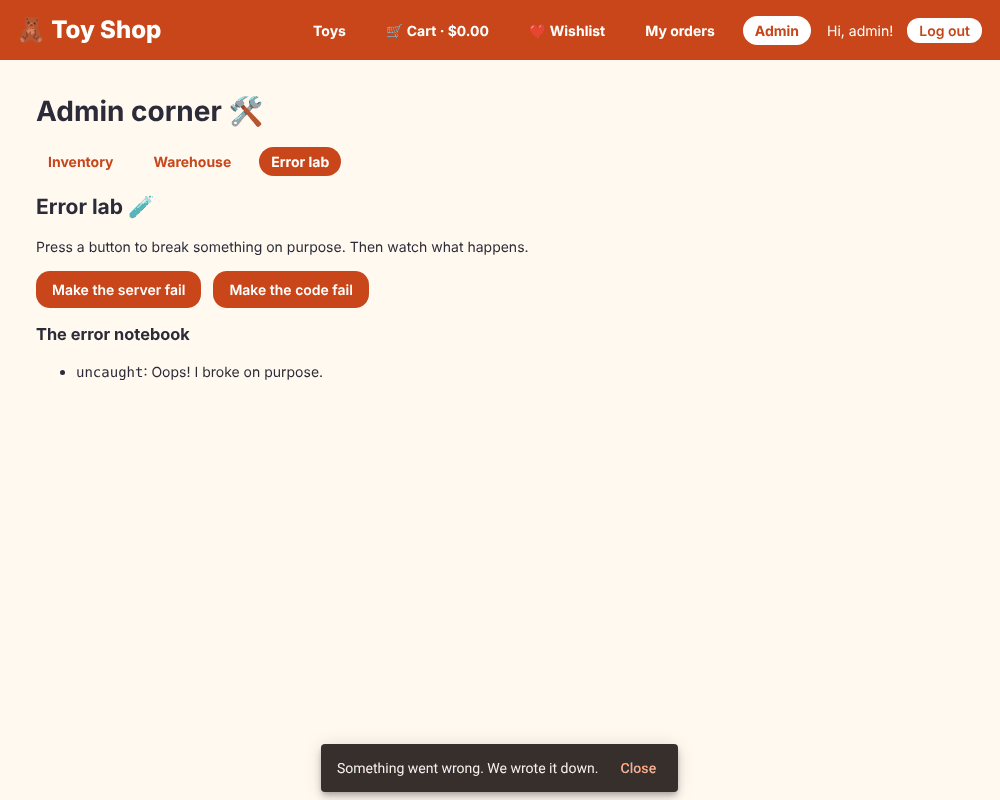

# Chapter 23: Error handling and logging

> **Like I'm 5:** Things will go wrong in the shop: the lights flicker, a toy falls, the phone line is dead. A good shop has a plan for each: a helper who tidies small messes, a bell that calls the manager for big ones, and a notebook where every accident is written down so it can be fixed tomorrow. And nobody should have to see a scary "SYSTEM FAILURE" sign.

Concept reference: [29. Error handling and logging](../concepts/29-error-handling-and-logging.md)

[Back: Chapter 22](22-internationalization.md) · Next: [Chapter 24: Testing](24-testing.md)

## What we build today

Safety nets at four levels, and a practice corner to try them:

1. **Expected errors** in the page itself (we already did this for the shelf in Chapter 13).
2. An **HTTP error interceptor**: one place that decides what the shop says when a server call fails, and that sends people to the login page when their visit has timed out (401).
3. A **global error handler** for mistakes that nobody caught.
4. A **navigation error handler** for pages that cannot be opened.
5. A **logger** that keeps a notebook of problems, and an **Error lab** in the admin corner with two buttons: *Make the server fail* and *Make the code fail*.



## The big idea

Errors come in kinds, and each kind deserves its own treatment:

| Kind | Example | Who handles it |
|------|---------|----------------|
| **Expected, local** | The toy list cannot load; the person typed a wrong password | The page, with a friendly message and a retry (Chapters 13, 15) |
| **HTTP, shared policy** | 500 server broke, 401 session expired, no internet | One **interceptor** (so no page forgets) |
| **Unexpected code mistake** | `undefined.name`, a bug | The global **`ErrorHandler`**: log it, show a calm message |
| **Navigation** | A lazy page's code could not be downloaded | **`withNavigationErrorHandler`** |
| **A part of the template** | A deferred block fails to load | `@error { ... }` (Chapter 5) |

Good error handling follows four rules:

1. **Tell the person what happened and what to do**, in plain words. Never show stack traces or "Error 0".
2. **Write it down** (log it) with context, so developers can fix it. Never swallow an error silently.
3. **Handle it at the right level.** The page that knows the context handles expected errors. Shared rules go in one central place.
4. **Do not make it worse.** Do not show three pop-ups for one problem, and do not log secrets (passwords, tokens).

**Grown-up words:**

- **`ErrorHandler`**: Angular's class that receives every uncaught error. You can replace it.
- **`HttpContextToken`**: a little note you attach to a single request, readable by interceptors.
- **Logging service**: one class every part of the app uses to report problems. In real life it forwards them to a monitoring service (Sentry, Datadog, ...).
- **Rethrow**: after handling an error, pass it on (`throwError`) so the code that asked can still react.

## Step 1: A logger and a notifier

Two tiny services, because many places need them.

**`src/app/services/logger-service.ts`**

```ts
import { Service, signal } from '@angular/core';

export interface LoggedError {
  when: string;
  message: string;
  context?: string;
}

// Writes problems down. Here we write on the console and in a list we can look at.
// In a real shop you would also send them to a service like Sentry or Datadog,
// so the grown-ups are told when something breaks for a customer.
@Service()
export class LoggerService {
  private readonly _errors = signal<LoggedError[]>([]);
  readonly errors = this._errors.asReadonly();

  error(problem: unknown, context?: string) {
    const message = problem instanceof Error ? problem.message : String(problem);
    console.error(context ? `[${context}]` : '[error]', problem);
    this._errors.update((list) => [
      { when: new Date().toISOString(), message, context },
      ...list.slice(0, 19), // keep only the latest 20
    ]);
  }
}
```

- `error(problem, context)` writes to the console **and** into a signal list (the latest 20), so we can show it in the Error lab.
- Look at the comment: in a real shop this is where you would also send the problem to a monitoring service.

**`src/app/services/notification-service.ts`**

```ts
import { inject, Service } from '@angular/core';
import { MatSnackBar } from '@angular/material/snack-bar';

// One place to show small messages at the bottom of the screen.
@Service()
export class NotificationService {
  private snackBar = inject(MatSnackBar);

  show(message: string, duration = 5000) {
    return this.snackBar.open(message, $localize`:@@notify.close:Close`, { duration });
  }
}
```

`NotificationService` is the one place that shows a small message (a snackbar from Chapter 20). Everyone uses it, so all messages look the same, and tests can swap it for a fake.

## Step 2: The global error handler

**`src/app/error-handler.ts`**

```ts
import { ErrorHandler, inject, Service } from '@angular/core';
import { LoggerService } from './services/logger-service';
import { NotificationService } from './services/notification-service';

// The safety net under the whole app. Any mistake that nobody caught ends up here.
// (provideBrowserGlobalErrorListeners() in app.config.ts makes sure of that.)
@Service({ autoProvided: false })
export class GlobalErrorHandler implements ErrorHandler {
  private logger = inject(LoggerService);
  private notify = inject(NotificationService);

  handleError(error: unknown): void {
    this.logger.error(error, 'uncaught');
    this.notify.show($localize`:@@err.generic:Something went wrong. We wrote it down.`);
  }
}
```

- `implements ErrorHandler` with one method: `handleError(error)`. Angular calls it for **every** error nobody caught.
- We write the error down and show one calm message: "Something went wrong. We wrote it down."
- `@Service({ autoProvided: false })`: this class must not register itself as an app-wide service by its own name. We register it **under the `ErrorHandler` token** instead (next step).

In Angular 22, the line `provideBrowserGlobalErrorListeners()` (already in our `app.config.ts` since Chapter 1) makes sure that errors thrown outside Angular, such as in timers and promises, also reach the handler.

## Step 3: The HTTP error interceptor

**`src/app/interceptors/error-interceptor.ts`**

```ts
import { HttpContextToken, HttpErrorResponse, HttpInterceptorFn } from '@angular/common/http';
import { inject } from '@angular/core';
import { Router } from '@angular/router';
import { catchError, throwError } from 'rxjs';
import { AuthService } from '../services/auth-service';
import { NotificationService } from '../services/notification-service';

// A request can carry a little note. This note says: "I will explain a problem
// to the person myself, so please do not show a pop-up."
export const SKIP_ERROR_TOAST = new HttpContextToken<boolean>(() => false);

export const errorInterceptor: HttpInterceptorFn = (req, next) => {
  const notify = inject(NotificationService);
  const auth = inject(AuthService);
  const router = inject(Router);

  return next(req).pipe(
    catchError((error: HttpErrorResponse) => {
      const skip = req.context.get(SKIP_ERROR_TOAST);

      if (error.status === 0 && !skip) {
        notify.show($localize`:@@err.offline:We cannot reach the server. Is the internet on?`);
      } else if (error.status === 401 && req.url !== '/api/login') {
        // The login has run out. Log out and go back to the login page.
        auth.logout();
        router.navigate(['/login'], { queryParams: { returnUrl: router.url } });
        notify.show($localize`:@@err.session:Your visit timed out. Please log in again.`);
      } else if (error.status >= 500 && !skip) {
        notify.show($localize`:@@err.server:The server is having trouble. Please try again soon.`);
      }

      // Pass the problem on, so the page that asked can still react to it.
      return throwError(() => error);
    }),
  );
};
```

Read the shape of it:

- `next(req).pipe(catchError(...))` watches the answer. A failed request arrives as an `HttpErrorResponse` with a `status`.
- **`status === 0`**: the request never got an answer (no internet, a blocked request). Message: "We cannot reach the server."
- **`401`**: the login has expired. Log out, go to the login page, and remember where the person was (`returnUrl`). *Except* for `/api/login` itself, where a 401 simply means "wrong password", and the login page explains that.
- **`500` and above**: "The server is having trouble."
- `return throwError(() => error)`: **rethrow.** The interceptor shows its pop-up, but the page that made the request still hears about the error and can react.

**Opting out with `SKIP_ERROR_TOAST`.** Some pages already show their own message (the shelf says "Sorry, the toy shelf is stuck", the login says "Wrong email or password"). A second pop-up would be noise. So a request can carry a note:

```ts
export const SKIP_ERROR_TOAST = new HttpContextToken<boolean>(() => false);
// ...and in a service:
this.http.get(url, { context: new HttpContext().set(SKIP_ERROR_TOAST, true) });
```

Services that belong to pages with their own messages add the note:

**`src/app/services/product-service.ts`** (what changed)

```diff
@@ -1,6 +1,7 @@
-import { HttpClient } from '@angular/common/http';
+import { HttpClient, HttpContext } from '@angular/common/http';
 import { inject, Service } from '@angular/core';
 import { map, Observable, retry, shareReplay, timeout } from 'rxjs';
+import { SKIP_ERROR_TOAST } from '../interceptors/error-interceptor';
 import { Product } from '../models/product';
 
 @Service()
@@ -10,11 +11,13 @@ export class ProductService {
 
   // Ask the server only ONE time. shareReplay gives the same answer to everybody
   // who asks later, so we do not keep bothering the server.
-  private readonly all$ = this.http.get<Product[]>('products.json').pipe(
-    timeout(5000), // give up if the server is silent for 5 seconds
-    retry({ count: 2, delay: 500 }), // if it fails, try again (twice)
-    shareReplay({ bufferSize: 1, refCount: false }),
-  );
+  private readonly all$ = this.http
+    .get<Product[]>('products.json', { context: new HttpContext().set(SKIP_ERROR_TOAST, true) })
+    .pipe(
+      timeout(5000), // give up if the server is silent for 5 seconds
+      retry({ count: 2, delay: 500 }), // if it fails, try again (twice)
+      shareReplay({ bufferSize: 1, refCount: false }),
+    );
 
   getAll(): Observable<Product[]> {
     return this.all$;
```

**`src/app/services/order-service.ts`** (what changed)

```diff
@@ -1,5 +1,6 @@
-import { HttpClient } from '@angular/common/http';
+import { HttpClient, HttpContext } from '@angular/common/http';
 import { inject, Service } from '@angular/core';
+import { SKIP_ERROR_TOAST } from '../interceptors/error-interceptor';
 import { NewOrder, Order } from '../models/order';
 
 @Service()
@@ -7,10 +8,13 @@ export class OrderService {
   private http = inject(HttpClient);
 
   place(order: NewOrder) {
-    return this.http.post<Order>('/api/orders', order);
+    return this.http.post<Order>('/api/orders', order, { context: quiet() });
   }
 
   mine() {
-    return this.http.get<Order[]>('/api/orders');
+    return this.http.get<Order[]>('/api/orders', { context: quiet() });
   }
 }
+
+// The checkout and orders pages show their own friendly messages.
+const quiet = () => new HttpContext().set(SKIP_ERROR_TOAST, true);
```

**`src/app/services/auth-service.ts`** (what changed)

```diff
@@ -1,6 +1,7 @@
-import { HttpClient } from '@angular/common/http';
+import { HttpClient, HttpContext } from '@angular/common/http';
 import { computed, effect, inject, Service, signal } from '@angular/core';
 import { tap } from 'rxjs';
+import { SKIP_ERROR_TOAST } from '../interceptors/error-interceptor';
 import { User } from '../models/user';
 
 const SESSION_KEY = 'toyshop-user';
@@ -26,7 +27,11 @@ export class AuthService {
 
   login(email: string, password: string) {
     return this.http
-      .post<User>('/api/login', { email, password })
+      .post<User>(
+        '/api/login',
+        { email, password },
+        { context: new HttpContext().set(SKIP_ERROR_TOAST, true) }, // the login page explains it
+      )
       .pipe(tap((user) => this._user.set(user)));
   }
 
```

## Step 4: Plug it all in

**`src/app/app.config.ts`** (what changed)

```diff
@@ -1,19 +1,29 @@
 import { provideHttpClient, withFetch, withInterceptors } from '@angular/common/http';
-import { ApplicationConfig, provideBrowserGlobalErrorListeners } from '@angular/core';
+import {
+  ApplicationConfig,
+  ErrorHandler,
+  inject,
+  provideBrowserGlobalErrorListeners,
+} from '@angular/core';
 import {
   provideRouter,
   withComponentInputBinding,
   withInMemoryScrolling,
+  withNavigationErrorHandler,
   withPreloading,
   withViewTransitions,
   TitleStrategy,
 } from '@angular/router';
+import { GlobalErrorHandler } from './error-handler';
 import { routes } from './app.routes';
 import { authInterceptor } from './interceptors/auth-interceptor';
+import { errorInterceptor } from './interceptors/error-interceptor';
 import { fakeBackendInterceptor } from './interceptors/fake-backend-interceptor';
 import { loadingInterceptor } from './interceptors/loading-interceptor';
 import { SelectivePreload } from './preload-strategy';
 import { AnnouncingTitleStrategy } from './title-strategy';
+import { LoggerService } from './services/logger-service';
+import { NotificationService } from './services/notification-service';
 import { SHOP_NAME, TAX_RATE } from './tokens';
 
 export const appConfig: ApplicationConfig = {
@@ -27,15 +37,29 @@ export const appConfig: ApplicationConfig = {
       withPreloading(SelectivePreload),
       // Let the browser fade smoothly from one page to the next.
       withViewTransitions(),
+      // If a page cannot even be opened (for example its code did not download), tell the person.
+      withNavigationErrorHandler((failure) => {
+        inject(LoggerService).error(failure.error, 'navigation');
+        inject(NotificationService).show(
+          $localize`:@@err.navigation:We could not open that page. Please try again.`,
+        );
+      }),
     ),
     provideHttpClient(
       withFetch(),
       // Every letter passes through these guards, in this order.
       // The pretend server goes LAST, so it can see the token the others added.
-      withInterceptors([loadingInterceptor, authInterceptor, fakeBackendInterceptor]),
+      withInterceptors([
+        loadingInterceptor,
+        authInterceptor,
+        errorInterceptor,
+        fakeBackendInterceptor,
+      ]),
     ),
     // Say the new page title out loud after every navigation.
     { provide: TitleStrategy, useExisting: AnnouncingTitleStrategy },
+    // Our own safety net replaces Angular's plain one.
+    { provide: ErrorHandler, useClass: GlobalErrorHandler },
     { provide: SHOP_NAME, useValue: 'Toy Shop' },
     { provide: TAX_RATE, useValue: 0.08 },
   ],
```

Four things happened:

1. `{ provide: ErrorHandler, useClass: GlobalErrorHandler }` replaces Angular's plain handler (which only prints to the console).
2. `errorInterceptor` joins the interceptor list, **before** the fake backend so it can see the failures the pretend server produces.
3. `withNavigationErrorHandler(...)` catches failures while *navigating*. Imagine that a new version was deployed, and a visitor's old page asks for a lazy chunk that no longer exists. Without this, nothing visible happens. With it, they get "We could not open that page. Please try again."
4. The messages use `$localize` (Chapter 22), so they can be translated; `ng extract-i18n` finds them.

## Step 5: A practice corner

Testing safety nets means *causing* errors. The Error lab does it safely:

**`src/app/admin/error-lab/error-lab.ts`**

```ts
import { HttpClient } from '@angular/common/http';
import { Component, inject, signal } from '@angular/core';
import { LoggerService } from '../../services/logger-service';

// A practice corner: break things on purpose and watch the safety nets catch them.
@Component({
  imports: [],
  selector: 'app-error-lab',
  styleUrl: './error-lab.css',
  templateUrl: './error-lab.html',
})
export class ErrorLab {
  private http = inject(HttpClient);
  logger = inject(LoggerService);
  result = signal('');

  // 1. A broken server. The error interceptor shows a pop-up.
  breakServer() {
    this.http.get('/api/boom').subscribe({
      error: (e) => this.result.set(`The page heard: HTTP ${e.status}`),
    });
  }

  // 2. A mistake in our own code. Nobody catches it, so the global handler does.
  breakCode() {
    throw new Error('Oops! I broke on purpose.');
  }
}
```

**`src/app/admin/error-lab/error-lab.html`**

```html
<h2>Error lab 🧪</h2>
<p>Press a button to break something on purpose. Then watch what happens.</p>

<div class="buttons">
  <button class="btn" type="button" (click)="breakServer()">Make the server fail</button>
  <button class="btn" type="button" (click)="breakCode()">Make the code fail</button>
</div>

<p role="status">{{ result() }}</p>

<h3>The error notebook</h3>
@if (logger.errors().length === 0) {
  <p>Nothing has gone wrong yet.</p>
} @else {
  <ul>
    @for (e of logger.errors(); track e.when) {
      <li>
        <code>{{ e.context ?? 'error' }}</code
        >: {{ e.message }}
      </li>
    }
  </ul>
}
```

**`src/app/admin/error-lab/error-lab.css`**

```css
.buttons {
  display: flex;
  flex-wrap: wrap;
  gap: 0.75rem;
}
```

The fake backend gets an address that always fails:

**`src/app/interceptors/fake-backend-interceptor.ts`** (what changed)

```diff
@@ -22,6 +22,9 @@ export const fakeBackendInterceptor: HttpInterceptorFn = (req, next) => {
       ),
     );
 
+  // GET /api/boom always fails with a 500, so we can practice handling errors.
+  if (req.url === '/api/boom') return reply(500, { message: 'Boom! The server broke on purpose.' });
+
   // POST /api/login  (the password is always "toys123")
   if (req.method === 'POST' && req.url === '/api/login') {
     const { email, password } = req.body as { email: string; password: string };
```

And the lab joins the admin pages:

**`src/app/admin/admin.routes.ts`** (what changed)

```diff
@@ -1,5 +1,6 @@
 import { Routes } from '@angular/router';
 import { AdminShell } from './admin-shell/admin-shell';
+import { ErrorLab } from './error-lab/error-lab';
 import { Inventory } from './inventory/inventory';
 import { Warehouse } from './warehouse/warehouse';
 
@@ -10,6 +11,7 @@ export const ADMIN_ROUTES: Routes = [
     children: [
       { path: '', pathMatch: 'full', redirectTo: 'inventory' },
       { path: 'inventory', component: Inventory, title: 'Inventory' },
+      { path: 'error-lab', component: ErrorLab, title: 'Error lab' },
       { path: 'warehouse', component: Warehouse, title: 'Warehouse' },
     ],
   },
```

**`src/app/admin/admin-shell/admin-shell.html`** (what changed)

```diff
@@ -3,6 +3,7 @@
 <nav class="admin-nav" aria-label="Admin">
   <a routerLink="inventory" routerLinkActive="active">Inventory</a>
   <a routerLink="warehouse" routerLinkActive="active">Warehouse</a>
+  <a routerLink="error-lab" routerLinkActive="active">Error lab</a>
 </nav>
 
 <!-- Pages inside the admin corner appear here. -->
```

## Step 6: Tests

**`src/app/error-handling.spec.ts`**

```ts
import { provideHttpClient, withInterceptors, HttpClient, HttpContext } from '@angular/common/http';
import { HttpTestingController, provideHttpClientTesting } from '@angular/common/http/testing';
import { TestBed } from '@angular/core/testing';
import { provideRouter, Router } from '@angular/router';
import { GlobalErrorHandler } from './error-handler';
import { errorInterceptor, SKIP_ERROR_TOAST } from './interceptors/error-interceptor';
import { LoggerService } from './services/logger-service';
import { NotificationService } from './services/notification-service';

describe('error handling', () => {
  let notify: { show: ReturnType<typeof vi.fn> };

  beforeEach(() => {
    sessionStorage.clear();
    notify = { show: vi.fn() };
    TestBed.configureTestingModule({
      providers: [
        provideRouter([]),
        provideHttpClient(withInterceptors([errorInterceptor])),
        provideHttpClientTesting(),
        { provide: NotificationService, useValue: notify },
      ],
    });
  });

  describe('GlobalErrorHandler', () => {
    it('writes the mistake in the notebook and tells the person', () => {
      TestBed.configureTestingModule({ providers: [GlobalErrorHandler] });
      vi.spyOn(console, 'error').mockImplementation(() => {});

      TestBed.inject(GlobalErrorHandler).handleError(new Error('kaboom'));

      expect(TestBed.inject(LoggerService).errors()[0].message).toBe('kaboom');
      expect(notify.show).toHaveBeenCalled();
    });
  });

  describe('errorInterceptor', () => {
    const fail = (status: number, url = '/api/anything', context?: HttpContext) => {
      let heard: unknown;
      TestBed.inject(HttpClient)
        .get(url, { context })
        .subscribe({ error: (e) => (heard = e) });
      TestBed.inject(HttpTestingController).expectOne(url).flush({}, { status, statusText: 'x' });
      return heard as { status: number };
    };

    it('shows a pop-up when the server is broken, and still passes the error on', () => {
      expect(fail(500).status).toBe(500);
      expect(notify.show).toHaveBeenCalledTimes(1);
    });

    it('stays quiet when the page said "I will explain it myself"', () => {
      fail(500, '/api/anything', new HttpContext().set(SKIP_ERROR_TOAST, true));
      expect(notify.show).not.toHaveBeenCalled();
    });

    it('sends people to the login page when their visit has timed out (401)', () => {
      const go = vi.spyOn(TestBed.inject(Router), 'navigate').mockResolvedValue(true);
      fail(401);
      expect(go).toHaveBeenCalledWith(['/login'], expect.anything());
      expect(notify.show).toHaveBeenCalled();
    });

    it('does not do that for a wrong password at the login (that page explains itself)', () => {
      const go = vi.spyOn(TestBed.inject(Router), 'navigate').mockResolvedValue(true);
      fail(401, '/api/login');
      expect(go).not.toHaveBeenCalled();
    });
  });
});
```

**`src/app/admin/error-lab/error-lab.spec.ts`**

```ts
import { provideHttpClient } from '@angular/common/http';
import { HttpTestingController, provideHttpClientTesting } from '@angular/common/http/testing';
import { TestBed } from '@angular/core/testing';
import { ErrorLab } from './error-lab';

describe('ErrorLab', () => {
  it('tells the page when the server fails', async () => {
    TestBed.configureTestingModule({
      providers: [provideHttpClient(), provideHttpClientTesting()],
    });
    const fixture = TestBed.createComponent(ErrorLab);
    await fixture.whenStable();

    fixture.componentInstance.breakServer();
    TestBed.inject(HttpTestingController)
      .expectOne('/api/boom')
      .flush({}, { status: 500, statusText: 'Server Error' });
    await fixture.whenStable();

    expect(fixture.nativeElement.textContent).toContain('HTTP 500');
  });

  it('throws when the code button is pressed', () => {
    TestBed.configureTestingModule({
      providers: [provideHttpClient(), provideHttpClientTesting()],
    });
    const lab = TestBed.createComponent(ErrorLab).componentInstance;
    expect(() => lab.breakCode()).toThrow('broke on purpose');
  });
});
```

The four interceptor tests are the whole policy in one place: it pops up for 500, stays quiet when asked, redirects on 401, and leaves the login's own 401 alone.

## Check it works

```bash
npx ng test --watch=false
```

```
 Test Files  34 passed (34)
      Tests  86 passed (86)
```

Try it in a real browser. Log in as `admin@toys.com`, open **Admin**, then **Error lab**. We scripted exactly this in a real browser, and it said:

```
server failure -> pop-up: The server is having trouble. Please try again soon. Close
page heard: The page heard: HTTP 500
code failure   -> pop-up: Something went wrong. We wrote it down. Close
notebook: [ 'uncaught: Oops! I broke on purpose.' ]
bad token on /orders -> now at /login?returnUrl=%2Forders
```

- [ ] **Make the server fail**: a pop-up says the server is having trouble, *and* the page still hears "HTTP 500". (That is the rethrow.)
- [ ] **Make the code fail**: a calm pop-up appears, and the notebook shows `uncaught: Oops! I broke on purpose.` The details are in the browser console.
- [ ] Open DevTools, **Application**, **Session Storage**, and change the `toyshop-user` token to something wrong, then open **My orders**: the shop sends you to `/login?returnUrl=%2Forders`, with a "Your visit timed out" message.
- [ ] Block `products.json` in DevTools (as in Chapter 13) and reload: the shelf shows its own "stuck" message and there is **no** second pop-up, because the product service asked the interceptor to stay quiet.

## What you learned

- Different errors deserve different handlers: the page for expected ones, an interceptor for HTTP policy, `ErrorHandler` for the unexpected, `withNavigationErrorHandler` for navigation, `@error` for template parts.
- Rethrow after handling so callers can still react; avoid double messages with a context token.
- Log with context to one logging service; in real life, forward to a monitoring tool.
- Never show raw errors to people, and never log secrets.
- Test error paths on purpose; an Error lab makes that fun.

## Try it yourself

1. Add a `404` case to the interceptor with its own message and make `/api/anything-else` trigger it. (The fake backend already returns 404 for unknown addresses.)
2. Make the logger send each error to a `fetch('/api/logs', ...)` call (a pretend monitoring service). Careful: what happens if *logging* fails? (Infinite loop danger!)
3. Add a `retry` for `status === 0` to the interceptor with a short delay, as in Chapter 13. Which requests should never be retried? (Hint: think about `POST` orders.)
4. Add an `@error` block to a `@defer` of your own and test it by making the lazy file fail.

## If something goes wrong

**Two pop-ups for one error:** both the page and the interceptor tried to tell the person. Use `SKIP_ERROR_TOAST` on that request, or let the interceptor do the talking.

**The global handler never runs:** you did not provide it under the `ErrorHandler` token, or the error was caught and swallowed earlier (`catch {}` with nothing inside).

**An infinite loop:** the error handler itself throws (for example `notify.show` fails because the snackbar module is missing). Keep error handlers tiny and defensive.

**`Cannot read properties of undefined (reading 'name')`:** the classic code mistake. In templates, use `@if (product(); as p)`. In code, check for `undefined` or use optional chaining `product?.name`.

**Users see the old page after a deployment and clicks do nothing:** a lazy chunk is gone. Chapter 29 shows how the service worker avoids this, and the navigation error handler above gives a friendly message in the meantime.

Next: [Chapter 24: Testing](24-testing.md)
