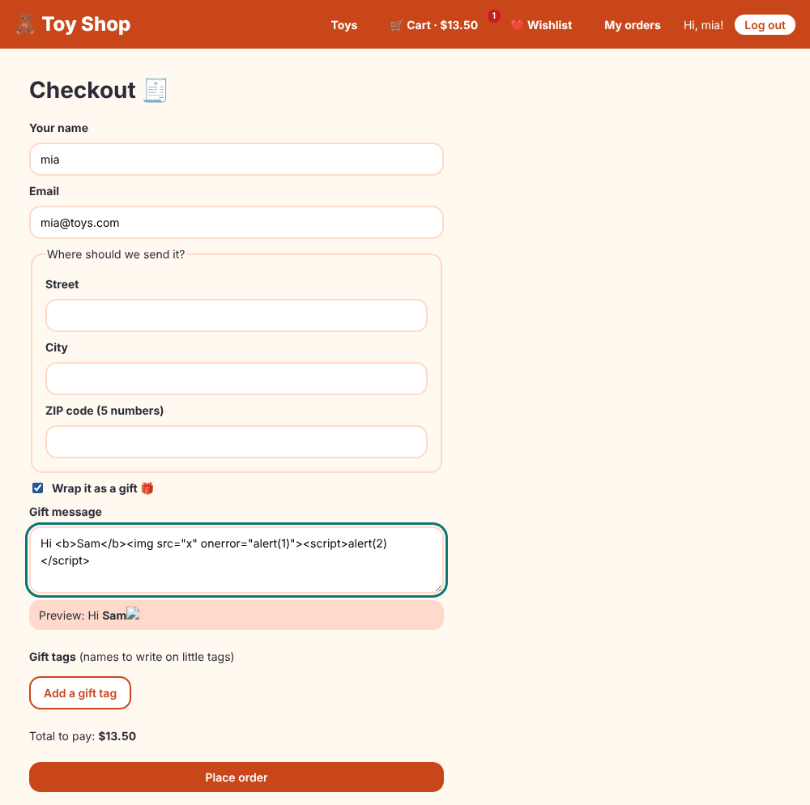

# Chapter 26: Security

> **Like I'm 5:** Our toy shop has a cash box, a back door, and customers' names and addresses. We lock the cash box, we do not let strangers walk behind the counter, we do not believe everything that people write on little notes, and we check every new toy that arrives to make sure it is not a trick. Security is a lot of small, sensible locks, not one giant one.

Concept reference: [30. Security](../concepts/30-security.md)

[Back: Chapter 25](25-debugging.md) · Next: [Chapter 27: Performance](27-performance.md)

## What we build today

Three security features, plus a security tour of everything we built so far:

1. A **gift message preview** that shows `<b>bold</b>` but safely removes attacks (`[innerHTML]` and Angular's sanitizer).
2. A **safe redirect** after login (fixing an *open redirect* hole in our own Chapter 15 code).
3. A **dependency check** with `npm audit`.



## The big idea

A web app lives in a hostile place: anybody can send it anything. The big dangers for a front end:

| Attack | Plain words | Our defence |
|--------|-------------|-------------|
| **XSS** (cross-site scripting) | An attacker gets *their* JavaScript to run on *your* page, and steals logins | Angular **escapes** and **sanitizes** everything by default |
| **Open redirect** | A link like `/login?returnUrl=https://evil.example` sends people to a fake site after they log in | Only accept paths **inside** your own app |
| **CSRF** (cross-site request forgery) | Another website makes your browser send a request with your cookies | Do not rely on cookies alone; use anti-forgery tokens |
| **Stolen tokens** | An XSS attack reads the token from storage | Store tokens carefully; keep XSS out |
| **Vulnerable packages** | A library you installed has a known hole | `npm audit`, update often |
| **Leaked secrets** | A password or key inside the JavaScript bundle | Never put secrets in a front end |
| **Broken access control** | Hiding a button is not the same as forbidding the action | The **server** must check every request |

The most important sentence in this chapter: **everything in the browser can be read and changed by the person using it.** The front end can improve the experience, but only the **server** can enforce rules.

**Grown-up words:**

- **Sanitization**: cleaning HTML so that dangerous parts (scripts, event attributes, `javascript:` links) are removed.
- **Escaping**: turning `<` into `&lt;`, so it is shown as text and never run.
- **CSP** (Content Security Policy): a browser rule, sent by the server, that says which scripts may run. Chapter 35 adds one.
- **Open redirect**: a site that can be tricked into sending visitors to any address.
- **SameSite cookie**, **HttpOnly cookie**: cookie settings that reduce CSRF and token theft.

## Step 1: What Angular does for you

Angular treats **every value in a template as untrusted**:

| Where | What Angular does |
|-------|-------------------|
| `{{ value }}` | **Escapes** it: the text `<script>` is displayed as letters, never run. |
| `[innerHTML]="value"` | **Sanitizes** it: removes `<script>`, `onerror=...`, and other dangerous parts, and logs a warning. Harmless tags like `<b>` stay. |
| `[href]="value"`, `[src]="value"` | **Sanitizes URLs**: a `javascript:` link is rewritten to `unsafe:javascript:...` so it does nothing. |
| `[style]`, `<script>` in templates | Not allowed to inject code. Angular templates are compiled, never `eval`ed. |
| `bypassSecurityTrustHtml(...)` | **Turns the protection off.** You promise the value is safe. |

You rarely need more. The rules of thumb:

1. **Prefer `{{ }}`.** Use `[innerHTML]` only when you really need HTML.
2. **Never call `bypassSecurityTrust...` with anything a user can influence.**
3. **Never build HTML strings** with user text (`el.innerHTML = '<p>' + name + '</p>'`) or use `document.write`.

### Bonus lab: see it with your own eyes

[`extras/ch26/xss-lab.spec.ts`](extras/ch26/xss-lab.spec.ts) shows all four behaviours with one attack string. Copy it to `src/app/extras/` and run it:

**`src/app/extras/xss-lab.spec.ts`**

```ts
import { Component, inject, signal } from '@angular/core';
import { TestBed } from '@angular/core/testing';
import { DomSanitizer } from '@angular/platform-browser';

const attack = 'Hi <b>Sam</b><script>alert(2)</script>';

@Component({
  template: `
    <p id="text">{{ evil() }}</p>
    <p id="html" [innerHTML]="evil()"></p>
    <p id="bypassed" [innerHTML]="trusted"></p>
    <a id="link" [href]="badLink()">click</a>
  `,
})
class Host {
  evil = signal(attack);
  badLink = signal('javascript:alert(1)');
  // DANGER: this tells Angular "I promise this is safe", and turns the protection OFF.
  trusted = inject(DomSanitizer).bypassSecurityTrustHtml(attack);
}

describe('XSS lab: what Angular does with dangerous text', () => {
  async function render() {
    const fixture = TestBed.createComponent(Host);
    await fixture.whenStable();
    return fixture.nativeElement as HTMLElement;
  }

  it('{{ }} turns everything into plain text', async () => {
    const page = await render();
    expect(page.querySelector('#text')!.textContent).toBe(attack); // shown as letters
    expect(page.querySelector('#text')!.innerHTML).toContain('&lt;script&gt;');
  });

  it('[innerHTML] keeps harmless tags and removes dangerous parts', async () => {
    const html = (await render()).querySelector('#html')!.innerHTML;
    expect(html).toContain('<b>Sam</b>');
    expect(html).not.toContain('onerror');
    expect(html).not.toContain('script');
  });

  it('javascript: links are defused', async () => {
    const link = (await render()).querySelector('#link') as HTMLAnchorElement;
    expect(link.getAttribute('href')).toBe('unsafe:javascript:alert(1)');
  });

  it('bypassSecurityTrustHtml turns the protection OFF (never do this with user text)', async () => {
    const html = (await render()).querySelector('#bypassed')!.innerHTML;
    expect(html).toContain('onerror="alert(1)"'); // the attack is still there
  });
});
```

The last test is the scary one: after `bypassSecurityTrustHtml`, the attack (`onerror="alert(1)"`) is still in the page. That is exactly how XSS holes are made.

## Step 2: A gift message preview with `[innerHTML]`

On the checkout page, shoppers may use `<b>` and `<i>` in a gift message, and we show a live preview. This needs `[innerHTML]`, so it needs the sanitizer:

**`src/app/pages/checkout/checkout.ts`** (what changed)

```diff
@@ -63,6 +63,10 @@ export class Checkout implements HasUnsavedChanges {
   // Forms speak in streams (Observables). toSignal turns the stream into a signal box.
   giftWrap = toSignal(this.form.controls.giftWrap.valueChanges, { initialValue: false });
 
+  // What the person is typing in the gift message. We show a preview of it with [innerHTML].
+  // Angular cleans that HTML first (see the gift-preview in the template).
+  giftMessage = toSignal(this.form.controls.notes.valueChanges, { initialValue: '' });
+
   addTag() {
     this.form.controls.giftTags.push(this.fb.control('', Validators.required));
   }
```

**`src/app/pages/checkout/checkout.html`** (what changed)

```diff
@@ -64,6 +64,11 @@
       @if (form.hasError('giftMessage') && form.controls.notes.touched) {
         <p class="error" role="alert">Please write a message for the gift.</p>
       }
+      <!-- You may use <b> and <i> in the message. [innerHTML] shows the HTML, but Angular
+           first removes anything dangerous (scripts, onerror=..., javascript: links). -->
+      <p class="gift-preview" aria-live="polite">
+        Preview: <span [innerHTML]="giftMessage()"></span>
+      </p>
 
       <div formArrayName="giftTags">
         <p><strong>Gift tags</strong> (names to write on little tags)</p>
```

**`src/app/pages/checkout/checkout.css`** (what changed)

```diff
@@ -55,3 +55,10 @@ fieldset {
   background: #d6f5ef;
   border-radius: var(--radius);
 }
+
+.gift-preview {
+  margin: 0;
+  padding: 0.5rem 0.75rem;
+  background: var(--color-brand-light);
+  border-radius: var(--radius);
+}
```

`giftMessage` is a signal that follows what is typed in the notes box (`toSignal`, Chapter 12). The preview shows it through `[innerHTML]`.

Try it. Tick **Wrap it as a gift**, and paste this attack into the message:

```html
Hi <b>Sam</b><script>alert(2)</script>
```

We ran exactly this in a real browser, and it reported:

```
preview HTML: Hi <b>Sam</b>
alerts that popped up: 0
console warnings: [ 'WARNING: sanitizing HTML stripped some content, see https://angular.dev/best-practices/security#preventing-cross-site-scripting-xss' ]
```

- The `<b>Sam</b>` stayed.
- The `onerror` attribute and the `<script>` were removed.
- No `alert` appeared.
- Angular printed a warning in the console, so *you* know something was stripped.

The test makes sure it stays that way:

**`src/app/pages/checkout/checkout.spec.ts`** (what changed)

```diff
@@ -75,6 +75,19 @@ describe('Checkout', () => {
     expect(page.hasUnsavedChanges()).toBe(true);
   });
 
+  it('shows <b> in the gift preview but removes dangerous HTML', async () => {
+    page.form.patchValue({ giftWrap: true });
+    page.form.controls.notes.setValue(
+      'Hi <b>Sam</b><script>alert(2)</script>',
+    );
+    await fixture.whenStable();
+
+    const html = fixture.nativeElement.querySelector('.gift-preview span').innerHTML;
+    expect(html).toContain('<b>Sam</b>'); // harmless formatting stays
+    expect(html).not.toContain('onerror'); // the attack attribute is gone
+    expect(html).not.toContain('<script'); // and so is the script
+  });
+
   describe('our own rules', () => {
     it('zipCode wants exactly five digits', () => {
       expect(zipCode(new FormControl('12345'))).toBeNull();
```

## Step 3: Fix an open redirect (a bug of our own)

In Chapter 15 the login page reads `?returnUrl=...` from the address and, after logging in, goes there. Anyone can type anything into an address. Consider this link, which an attacker emails to a shopper:

```
https://toyshop.example/login?returnUrl=https://evil.example
```

The shopper sees the real toy shop's login page, types their password, and is then sent to a **fake** shop that looks the same and says "please log in again". That is an **open redirect**. The fix is simple: accept only paths **inside our own shop**:

**`src/app/utils/safe-url.ts`**

```ts
// The login page gets "where to go next" from the address bar (?returnUrl=...).
// Anybody can type anything there, so we only accept a path INSIDE our own shop.
// "/cart" is fine. "https://evil.example" and "//evil.example" are not.
export function safeReturnUrl(url: string | null | undefined): string {
  if (!url) return '/';
  const isInsideTheShop = url.startsWith('/') && !url.startsWith('//') && !url.includes('\\');
  return isInsideTheShop ? url : '/';
}
```

- `url.startsWith('/')`: it must be a path in our shop.
- `!url.startsWith('//')`: `//evil.example` looks like a path, but browsers read it as "another site, same protocol".
- `!url.includes('\\')`: some browsers treat `\` like `/`, so `/\evil.example` could become `//evil.example`.
- Anything else goes to `/`.

Use it in the login page:

**`src/app/pages/login/login.ts`** (what changed)

```diff
@@ -2,6 +2,7 @@ import { Component, inject, input, signal } from '@angular/core';
 import { FormBuilder, ReactiveFormsModule, Validators } from '@angular/forms';
 import { Router } from '@angular/router';
 import { AuthService } from '../../services/auth-service';
+import { safeReturnUrl } from '../../utils/safe-url';
 import { AriaInvalid } from '../../directives/aria-invalid';
 
 @Component({
@@ -33,7 +34,7 @@ export class Login {
     const { email, password } = this.form.getRawValue();
     this.message.set('');
     this.auth.login(email, password).subscribe({
-      next: () => this.router.navigateByUrl(this.returnUrl() || '/'),
+      next: () => this.router.navigateByUrl(safeReturnUrl(this.returnUrl())),
       error: (e) => this.message.set(e.error?.message ?? 'Something went wrong'),
     });
   }
```

And test all the sneaky variants:

**`src/app/utils/safe-url.spec.ts`**

```ts
import { safeReturnUrl } from './safe-url';

describe('safeReturnUrl', () => {
  it('keeps paths inside the shop', () => {
    expect(safeReturnUrl('/checkout')).toBe('/checkout');
    expect(safeReturnUrl('/product/3?x=1')).toBe('/product/3?x=1');
  });

  it('sends everything else home', () => {
    expect(safeReturnUrl(undefined)).toBe('/');
    expect(safeReturnUrl('')).toBe('/');
    expect(safeReturnUrl('https://evil.example')).toBe('/');
    expect(safeReturnUrl('//evil.example')).toBe('/');
    expect(safeReturnUrl('/\\evil.example')).toBe('/');
    expect(safeReturnUrl('javascript:alert(1)')).toBe('/');
  });
});
```

**`src/app/pages/login/login.spec.ts`** (what changed)

```diff
@@ -43,3 +43,24 @@ describe('Login', () => {
     expect(go).toHaveBeenCalledWith('/');
   });
 });
+
+describe('Login: safe redirect', () => {
+  it('ignores a returnUrl that points to another website', async () => {
+    TestBed.configureTestingModule({
+      imports: [Login],
+      providers: [provideRouter([]), provideHttpClient(), provideHttpClientTesting()],
+    });
+    const fixture = TestBed.createComponent(Login);
+    fixture.componentRef.setInput('returnUrl', 'https://evil.example');
+    await fixture.whenStable();
+    const go = vi.spyOn(TestBed.inject(Router), 'navigateByUrl').mockResolvedValue(true);
+
+    fixture.componentInstance.form.setValue({ email: 'mia@toys.com', password: 'toys123' });
+    fixture.componentInstance.submit();
+    TestBed.inject(HttpTestingController)
+      .expectOne('/api/login')
+      .flush({ email: 'mia@toys.com', name: 'mia', role: 'shopper', token: 't' });
+
+    expect(go).toHaveBeenCalledWith('/');
+  });
+});
```

In the real browser run, logging in with `returnUrl=https://evil.example` ended on `http://localhost:4393/`, our own home page, not on the evil site.

## Step 4: Tokens, cookies, and CSRF

How does the browser prove who you are? Two common ways:

| | Token in a header (our shop) | Cookie |
|---|---|---|
| Sent how | our interceptor adds `Authorization: Bearer ...` (Chapter 14) | the browser adds it **automatically** |
| CSRF risk | **None** by itself: another site cannot add your header | **Yes**: another site can trigger a request that carries your cookie |
| XSS risk | If the token is in `localStorage`/`sessionStorage`, an XSS attack can read it | An `HttpOnly` cookie cannot be read by JavaScript |

Our fake shop keeps its token in `sessionStorage` (it dies when the tab closes). That is fine for a pretend shop. For a real one, the safest common design is an **`HttpOnly`, `Secure`, `SameSite`** cookie set by the server, plus an anti-CSRF token. Angular helps with that: `HttpClient` has built-in XSRF support. If the server sends a cookie named `XSRF-TOKEN`, Angular copies its value into an `X-XSRF-TOKEN` header on state-changing requests to your own server, and the server compares them. No code needed on your side.

Whatever you choose, remember the order of defence: **first keep XSS out**, because XSS can do almost anything a logged-in user can do.

## Step 5: Authorization belongs to the server

We hid the **Admin** link from shoppers and used a `canMatch` guard (Chapter 17). That is good *manners*, not *security*: a person can open DevTools and call `/api/admin/...` themselves. The real server must check the role on every request. In this tutorial's fake backend there is no real admin API; in a real project, always write:

```
// front end: hide the button, guard the route   -> a good experience
// back end:  check the user's role on every call -> real security
```

## Step 6: Dependencies and secrets

**Your dependencies are your attack surface.** Modern projects pull in hundreds of packages. Check them:

```bash
npm audit
```

For the shop, with only the packages the app ships (`--omit=dev`):

```
found 0 vulnerabilities
```

To see what a bad report looks like, here is a real one for a project that installed two *old* packages on purpose (`lodash@4.17.20` and `minimist@1.2.5`):

```
# npm audit report

lodash  <=4.17.23
Severity: high
Command Injection in lodash - https://github.com/advisories/GHSA-35jh-r3h4-6jhm
Regular Expression Denial of Service (ReDoS) in lodash - https://github.com/advisories/GHSA-29mw-wpgm-hmr9
...
fix available via `npm audit fix`
node_modules/lodash

minimist  1.0.0 - 1.2.5
Severity: critical
Prototype Pollution in minimist - https://github.com/advisories/GHSA-xvch-5gv4-984h
fix available via `npm audit fix`
node_modules/minimist

2 vulnerabilities (1 high, 1 critical)
```

Good habits:

- Run `npm audit` in CI (Chapter 35 does) and fail on **high** problems for packages that ship to users.
- Keep packages up to date (Chapter 36: Dependabot).
- Commit `package-lock.json` and install with `npm ci`, so everyone gets exactly the same versions.
- Be careful with new packages: how popular, how recently updated, who maintains it?

**Secrets.** Everything in your bundle is public. An API key in `environment.ts` is visible to everyone who opens DevTools. So:

- Never put passwords, private keys, or database URLs in front-end code.
- A key that is *meant* to be public (like a maps key restricted to your domain) is fine.
- Real secrets stay on a server. The front end asks the server to use them.

## Step 7: The headers (a preview)

The server can send headers that make browsers stricter: `Content-Security-Policy` (which scripts may run), `X-Content-Type-Options: nosniff`, `Referrer-Policy`, and `Permissions-Policy`. We build and test these in Chapter 35, where we finally have a server. A strict CSP is the best safety net for XSS: even if an attacker sneaks a script into the page, the browser refuses to run it.

## Check it works

```bash
npx ng test --watch=false
```

```
 Test Files  35 passed (35)
      Tests  90 passed (90)
```

- [ ] Tick **Wrap it as a gift** at checkout and type `Hi <b>Sam</b>`: the preview shows **Sam** in bold.
- [ ] Add ``: no pop-up. The console shows the sanitizer warning.
- [ ] Log in via `http://localhost:4200/login?returnUrl=https://evil.example`: you land on `/`, not on the other site.
- [ ] `npm audit --omit=dev` says `found 0 vulnerabilities`.

## What you learned

- Angular escapes `{{ }}` and sanitizes `[innerHTML]` and URLs; `bypassSecurityTrust...` switches that off, so avoid it.
- An address parameter such as `returnUrl` is user input. Accept only paths inside your app.
- Tokens in headers are not CSRF-prone but are exposed to XSS; `HttpOnly` cookies resist XSS but need CSRF defence. `HttpClient` has built-in XSRF support.
- Front-end checks are for experience. The server enforces the rules.
- Audit your packages, commit your lock file, and never ship secrets.

## Try it yourself

1. Change the preview from `[innerHTML]` to `{{ giftMessage() }}`. What does the page show for `<b>Sam</b>`? Why is this safer, and why is it not what we wanted here?
2. Add the case `'/%2F%2Fevil.example'` to `safe-url.spec.ts`. Does it pass? What do you think the browser does with it? (Think about it before you try.)
3. Run `npm audit` on the full project (without `--omit=dev`). Are there findings in development-only tools? Should they block a release?
4. Search your code for `localStorage.setItem(`. What is stored? Is any of it secret? (Our cart and wishlist ids are not.)

## If something goes wrong

**`WARNING: sanitizing HTML stripped some content`:** Angular cleaned an `[innerHTML]` value. This is the protection working. If your own HTML loses a style attribute or tag you need, do not bypass the sanitizer; use classes, or sanitize on the server with a strict allow-list.

**A link does not work and its address starts with `unsafe:`:** you bound a `javascript:` (or other disallowed) URL to `[href]`. Use a real address, or a `(click)` handler.

**`npm audit` shows a problem in a deep dependency and "fix available":** try `npm audit fix`. If that does not help, update the parent package (`ng update`, Chapter 36), or check whether the vulnerable code is even reachable in the browser.

**`ng build` blocked your own HTML:** you cannot put `<script>` inside a template. That is on purpose.

Next: [Chapter 27: Performance](27-performance.md)
