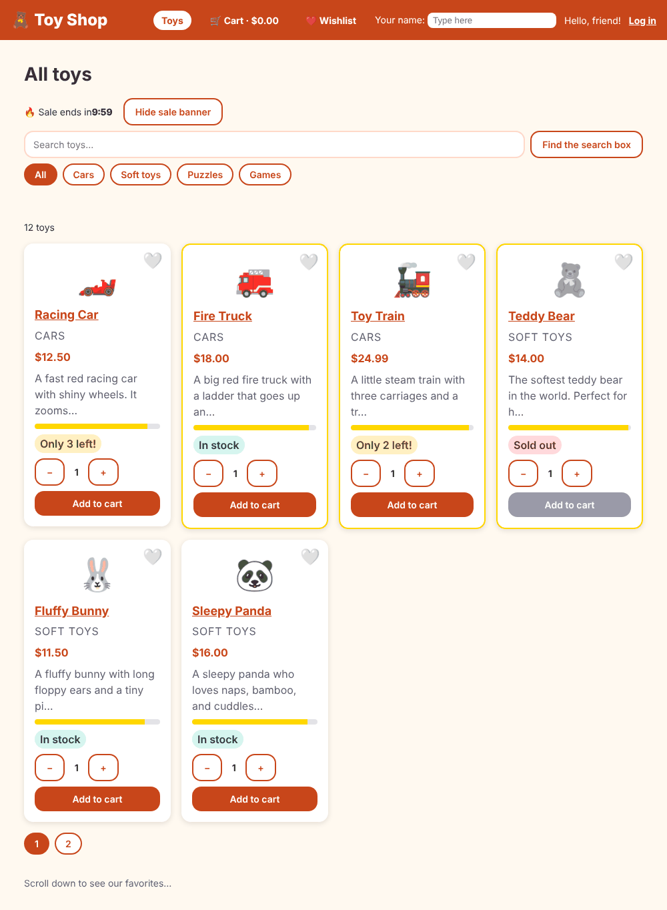

# Chapter 28: Server-side rendering and hydration

> **Like I'm 5:** Normally the shop sends the customer an empty box and a pile of parts, and the customer's own computer builds the toy. That takes a while, and a customer with a very slow computer sees nothing at all. With server-side rendering, the shop builds the toy first and sends it **already built**. The customer sees it at once. Then a little helper comes along and makes the toy's buttons work. That second step is called hydration, like adding water to a dried sponge.

Concept reference: [22. SSR, hydration and prerendering](../concepts/22-ssr-hydration-and-prerendering.md)

[Back: Chapter 27](27-performance.md) · Next: [Chapter 29: Progressive web apps](29-pwa.md)

## What we build today

Our shop learns to render **on a server**:

- The **home page** is drawn once at *build time* (prerendering) and delivered as ready-made HTML.
- A **toy page** (`/product/3`) is drawn by the server for each request.
- **Personal pages** (cart, wishlist, login, orders, admin) are still drawn in the browser, because a server cannot know what is in *your* cart.
- In the browser, Angular **hydrates** the server's page instead of throwing it away, and **replays** any clicks you made before it woke up.



## The big idea

Three ways to produce a page:

| Name | Who builds the HTML? | When? | Good for |
|------|---------------------|-------|----------|
| **CSR** (client-side rendering) | The browser, with JavaScript | after the JS has downloaded | pages for one person (cart, account); apps behind a login |
| **SSR** (server-side rendering) | A Node server | on every request | pages with changing public content (a toy page); good for search engines and social previews |
| **SSG / prerendering** | The build, once | at build time | pages that are the same for everybody (home, "about") |

Why does it help?

- **Speed you can see.** The browser draws the HTML *before* any JavaScript has loaded (better LCP, Chapter 27).
- **Search engines and link previews** read real content, not an empty `<app-root>`.
- **Slow devices** do less work at first.

The trick: after the page is shown, Angular must make it **alive**. **Hydration** re-uses the server's HTML (the elements are *attached* to the app, not rebuilt), so there is no flicker. **Event replay** remembers clicks made before hydration and plays them back.

Angular 22 chooses the mode **per route**:

| `RenderMode` | Meaning |
|--------------|---------|
| `Prerender` | build time (SSG) |
| `Server` | on each request (SSR) |
| `Client` | in the browser only (CSR) |

**Grown-up words:**

- **Hydration**: attaching the running app to the server-rendered HTML.
- **Event replay**: replaying early user events after hydration.
- **TransferState**: the server's HTTP answers are embedded in the page, so the browser does not ask again.
- **Platform-safe code**: code that does not assume a browser. On the server there is no `window`, `document` (the real one), `localStorage`, or `navigator`.

## Step 1: Add SSR

```bash
ng add @angular/ssr
```

It installs the packages (including `express`, a small web server) and changes several files. This is the real output:

```
CREATE src/main.server.ts
CREATE src/app/app.config.server.ts
CREATE src/app/app.routes.server.ts
CREATE src/server.ts
UPDATE angular.json
UPDATE tsconfig.app.json
UPDATE package.json
UPDATE src/app/app.config.ts
```

What each file is for:

| File | Role |
|------|------|
| `src/main.server.ts` | the **server's front door** (like `main.ts` for the browser) |
| `src/app/app.config.server.ts` | extra providers only the server needs (merged with `app.config.ts`) |
| `src/app/app.routes.server.ts` | which render mode each route uses |
| `src/server.ts` | a small **Express** server that serves files and renders pages |
| `app.config.ts` (updated) | adds `provideClientHydration(...)` |
| `angular.json` (updated) | tells the builder about the server entry and `outputMode: "server"` |

**`src/main.server.ts`**

```ts
import { BootstrapContext, bootstrapApplication } from '@angular/platform-browser';
import { App } from './app/app';
import { config } from './app/app.config.server';

const bootstrap = (context: BootstrapContext) => bootstrapApplication(App, config, context);

export default bootstrap;
```

**`src/app/app.config.server.ts`**

```ts
import { mergeApplicationConfig, ApplicationConfig } from '@angular/core';
import { provideServerRendering, withRoutes } from '@angular/ssr';
import { appConfig } from './app.config';
import { serverRoutes } from './app.routes.server';

const serverConfig: ApplicationConfig = {
  providers: [provideServerRendering(withRoutes(serverRoutes))],
};

export const config = mergeApplicationConfig(appConfig, serverConfig);
```

**`src/app/app.config.ts`** (what changed)

```diff
@@ -25,6 +25,7 @@ import { AnnouncingTitleStrategy } from './title-strategy';
 import { LoggerService } from './services/logger-service';
 import { NotificationService } from './services/notification-service';
 import { SHOP_NAME, TAX_RATE } from './tokens';
+import { provideClientHydration, withEventReplay } from '@angular/platform-browser';
 
 export const appConfig: ApplicationConfig = {
   providers: [
@@ -62,5 +63,8 @@ export const appConfig: ApplicationConfig = {
     { provide: ErrorHandler, useClass: GlobalErrorHandler },
     { provide: SHOP_NAME, useValue: 'Toy Shop' },
     { provide: TAX_RATE, useValue: 0.08 },
+    // After the server's page arrives, Angular "wakes it up" (hydration) instead of redrawing it.
+    // withEventReplay remembers clicks that happen BEFORE it wakes up, and plays them back.
+    provideClientHydration(withEventReplay()),
   ],
 };
```

- `provideServerRendering(withRoutes(serverRoutes))` switches rendering on and loads the render-mode table.
- `provideClientHydration(withEventReplay())` makes the browser hydrate and replay early events.

## Step 2: Choose a render mode for each route

`ng add` writes one rule: *prerender everything*. That is wrong for us. Your cart is personal, so a server (or a build) cannot draw it. Write your own table:

**`src/app/app.routes.server.ts`**

```ts
import { RenderMode, ServerRoute } from '@angular/ssr';

// For each address, who draws the page?
export const serverRoutes: ServerRoute[] = [
  // The home page is the same for everybody, so draw it once, when we build.
  { path: '', renderMode: RenderMode.Prerender },

  // A toy page changes with the toy in the address, so the server draws it on request.
  { path: 'product/:id', renderMode: RenderMode.Server },

  // Everything else is about ONE person (cart, wishlist, login, orders, admin),
  // so the browser draws it. A server cannot know what is in your cart.
  { path: '**', renderMode: RenderMode.Client },
];
```

- `''` (home): the same for everyone, so draw it **once at build time**.
- `product/:id`: depends on the toy in the address, so the **server** draws it when asked.
- `'**'` (everything else, in order of the first match): **client**. The server sends the empty "shell" and the browser draws it.

The build settings that `ng add` added to `angular.json`:

**`angular.json`** (what changed)

```diff
@@ -25,7 +25,15 @@
               }
             ],
             "styles": ["src/material-theme.scss", "src/styles.css"],
-            "polyfills": ["@angular/localize/init"]
+            "polyfills": ["@angular/localize/init"],
+            "server": "src/main.server.ts",
+            "outputMode": "server",
+            "security": {
+              "allowedHosts": ["localhost"]
+            },
+            "ssr": {
+              "entry": "src/server.ts"
+            }
           },
           "configurations": {
             "production": {
```

- `server` and `outputMode: "server"`: build a server as well as the browser files.
- `ssr.entry`: the Express file.
- `security.allowedHosts`: a **safety list** of the host names the server will answer to. The server needs it to protect itself from *host header attacks*. We add `"localhost"` so our own testing works. In production you add your real domain (Chapter 35).

**`package.json`** (what changed)

```diff
@@ -8,7 +8,8 @@
     "watch": "ng build --watch --configuration development",
     "test": "ng test",
     "test:coverage": "ng test --watch=false --coverage",
-    "e2e": "playwright test"
+    "e2e": "playwright test",
+    "serve:ssr:toy-shop": "node dist/toy-shop/server/server.mjs"
   },
   "private": true,
   "packageManager": "npm@10.9.4",
@@ -20,8 +21,11 @@
     "@angular/forms": "^22.2.0",
     "@angular/material": "^22.2.2",
     "@angular/platform-browser": "^22.2.0",
+    "@angular/platform-server": "^22.2.0",
     "@angular/router": "^22.2.0",
+    "@angular/ssr": "^22.2.2",
     "@ngrx/signals": "^22.0.1",
+    "express": "^5.1.0",
     "rxjs": "~7.8.0",
     "tslib": "^2.3.0"
   },
@@ -32,6 +36,8 @@
     "@angular/localize": "^22.2.2",
     "@axe-core/playwright": "^4.13.0",
     "@playwright/test": "^1.56.1",
+    "@types/express": "^5.0.1",
+    "@types/node": "^22.12.0",
     "@vitest/coverage-v8": "^5.0.3",
     "jsdom": "^30.0.0",
     "prettier": "^3.8.1",
```

The new script `serve:ssr:toy-shop` starts the built server.

## Step 3: Make the code safe for a server

The server is **Node.js**. It has no browser. If your code touches `localStorage`, `window`, or `document` at the wrong time, it crashes. Here is what happens if we skip this step. We build with the old cart service that calls `localStorage` directly:

```
[uncaught] ReferenceError: localStorage is not defined
    at file:///.../chunk-VZDA7PWA.mjs:2:603
    at Object.fn (...)
```

(The `[uncaught]` prefix is our own global error handler from Chapter 23 at work; the build step runs the app on a server to prerender the home page, and the server has no `localStorage`.) The cure has three rules:

1. **Do not use `window`, `document`, `localStorage`, `navigator` directly.** Ask for them through Angular (`inject(DOCUMENT)`), and check that they exist.
2. **Run browser-only work in `afterNextRender`.** It never runs on the server.
3. **Do not start timers or listeners that nobody will stop.** A server would keep them forever.

Rule 1: a small service wraps the browser's storage and pretends it is empty when there is no browser:

**`src/app/services/storage-service.ts`**

```ts
import { DOCUMENT } from '@angular/common';
import { inject, Service } from '@angular/core';

type Kind = 'local' | 'session';

// A safe way to use the browser's notebooks (localStorage and sessionStorage).
// When the page is built on a SERVER there is no browser and no notebook, so
// this service pretends the notebook is empty instead of crashing.
@Service()
export class StorageService {
  private window = inject(DOCUMENT).defaultView;

  get(key: string, kind: Kind = 'local'): string | null {
    try {
      return this.box(kind)?.getItem(key) ?? null;
    } catch {
      return null; // some browsers block storage
    }
  }

  set(key: string, value: string, kind: Kind = 'local') {
    try {
      this.box(kind)?.setItem(key, value);
    } catch {
      // ignore: storage can be full or blocked
    }
  }

  remove(key: string, kind: Kind = 'local') {
    try {
      this.box(kind)?.removeItem(key);
    } catch {
      // ignore
    }
  }

  private box(kind: Kind): Storage | undefined {
    return kind === 'local' ? this.window?.localStorage : this.window?.sessionStorage;
  }
}
```

- `inject(DOCUMENT).defaultView` is the `window`, or `null` on a server. `this.box(kind)?.getItem(...)` does nothing when there is no browser.
- `try/catch`: some browsers (in private mode) block storage, so even in the browser it can throw.

Now every service that stored something uses it instead of `localStorage`:

**`src/app/services/cart-service.ts`** (what changed)

```diff
@@ -2,12 +2,14 @@ import { computed, effect, inject, Service, signal } from '@angular/core';
 import { CartItem } from '../models/cart-item';
 import { Product } from '../models/product';
 import { TAX_RATE } from '../tokens';
+import { StorageService } from './storage-service';
 
 const STORAGE_KEY = 'toyshop-cart';
 
 @Service()
 export class CartService {
   private taxRate = inject(TAX_RATE);
+  private storage = inject(StorageService);
 
   // A private box we can change, and a read-only view that everyone else uses.
   private readonly _items = signal<CartItem[]>(this.load());
@@ -24,7 +26,7 @@ export class CartService {
   constructor() {
     // effect() runs by itself every time the cart changes: save it for next time.
     effect(() => {
-      localStorage.setItem(STORAGE_KEY, JSON.stringify(this._items()));
+      this.storage.set(STORAGE_KEY, JSON.stringify(this._items()));
     });
   }
 
@@ -62,7 +64,7 @@ export class CartService {
 
   private load(): CartItem[] {
     try {
-      return JSON.parse(localStorage.getItem(STORAGE_KEY) ?? '[]');
+      return JSON.parse(this.storage.get(STORAGE_KEY) ?? '[]');
     } catch {
       return [];
     }
```

**`src/app/services/auth-service.ts`** (what changed)

```diff
@@ -3,12 +3,14 @@ import { computed, effect, inject, Service, signal } from '@angular/core';
 import { tap } from 'rxjs';
 import { SKIP_ERROR_TOAST } from '../interceptors/error-interceptor';
 import { User } from '../models/user';
+import { StorageService } from './storage-service';
 
 const SESSION_KEY = 'toyshop-user';
 
 @Service()
 export class AuthService {
   private http = inject(HttpClient);
+  private storage = inject(StorageService);
 
   private readonly _user = signal<User | null>(this.load());
   readonly user = this._user.asReadonly();
@@ -20,8 +22,8 @@ export class AuthService {
     // Remember who is logged in while this browser tab stays open.
     effect(() => {
       const user = this._user();
-      if (user) sessionStorage.setItem(SESSION_KEY, JSON.stringify(user));
-      else sessionStorage.removeItem(SESSION_KEY);
+      if (user) this.storage.set(SESSION_KEY, JSON.stringify(user), 'session');
+      else this.storage.remove(SESSION_KEY, 'session');
     });
   }
 
@@ -41,7 +43,7 @@ export class AuthService {
 
   private load(): User | null {
     try {
-      return JSON.parse(sessionStorage.getItem(SESSION_KEY) ?? 'null');
+      return JSON.parse(this.storage.get(SESSION_KEY, 'session') ?? 'null');
     } catch {
       return null;
     }
```

**`src/app/services/wishlist-store.ts`** (what changed)

```diff
@@ -1,4 +1,4 @@
-import { computed, effect } from '@angular/core';
+import { computed, effect, inject } from '@angular/core';
 import {
   patchState,
   signalStore,
@@ -8,11 +8,13 @@ import {
   withState,
 } from '@ngrx/signals';
 
+import { StorageService } from './storage-service';
+
 const STORAGE_KEY = 'toyshop-wishlist';
 
-function load(): number[] {
+function load(storage: StorageService): number[] {
   try {
-    return JSON.parse(localStorage.getItem(STORAGE_KEY) ?? '[]');
+    return JSON.parse(storage.get(STORAGE_KEY) ?? '[]');
   } catch {
     return [];
   }
@@ -24,7 +26,8 @@ function load(): number[] {
 export const WishlistStore = signalStore(
   { providedIn: 'root' },
 
-  withState({ ids: load() }),
+  // A function: it runs when the store is created, so it can ask Angular for helpers.
+  withState(() => ({ ids: load(inject(StorageService)) })),
 
   withComputed(({ ids }) => ({
     count: computed(() => ids().length),
@@ -53,7 +56,8 @@ export const WishlistStore = signalStore(
   withHooks({
     // onInit runs once when the store is created: keep the list saved.
     onInit(store) {
-      effect(() => localStorage.setItem(STORAGE_KEY, JSON.stringify(store.ids())));
+      const storage = inject(StorageService);
+      effect(() => storage.set(STORAGE_KEY, JSON.stringify(store.ids())));
     },
   }),
 );
```

**`src/app/interceptors/fake-backend-interceptor.ts`** (what changed)

```diff
@@ -1,7 +1,9 @@
 import { HttpErrorResponse, HttpInterceptorFn, HttpResponse } from '@angular/common/http';
+import { inject } from '@angular/core';
 import { mergeMap, of, throwError, timer } from 'rxjs';
 import { NewOrder, Order } from '../models/order';
 import { User } from '../models/user';
+import { StorageService } from '../services/storage-service';
 
 export const FAKE_BACKEND_DELAY_MS = 300;
 const ORDERS_KEY = 'toyshop-orders';
@@ -11,6 +13,7 @@ const ORDERS_KEY = 'toyshop-orders';
 // and the real server (for example Spring Boot) answers instead.
 export const fakeBackendInterceptor: HttpInterceptorFn = (req, next) => {
   if (!req.url.startsWith('/api/')) return next(req);
+  const storage = inject(StorageService);
 
   // Answer after a short wait, like a real server would.
   const reply = (status: number, body: unknown) =>
@@ -46,28 +49,28 @@ export const fakeBackendInterceptor: HttpInterceptorFn = (req, next) => {
   if (req.method === 'GET' && req.url === '/api/orders') {
     return reply(
       200,
-      loadOrders().filter((o) => o.userEmail === userEmail),
+      loadOrders(storage).filter((o) => o.userEmail === userEmail),
     );
   }
 
   if (req.method === 'POST' && req.url === '/api/orders') {
-    const orders = loadOrders();
+    const orders = loadOrders(storage);
     const order: Order = {
       ...(req.body as NewOrder),
       id: `T-${1001 + orders.length}`,
       createdAt: new Date().toISOString(),
       userEmail,
     };
-    localStorage.setItem(ORDERS_KEY, JSON.stringify([...orders, order]));
+    storage.set(ORDERS_KEY, JSON.stringify([...orders, order]));
     return reply(201, order);
   }
 
   return reply(404, { message: 'The pretend server does not know that address' });
 };
 
-function loadOrders(): Order[] {
+function loadOrders(storage: StorageService): Order[] {
   try {
-    return JSON.parse(localStorage.getItem(ORDERS_KEY) ?? '[]');
+    return JSON.parse(storage.get(ORDERS_KEY) ?? '[]');
   } catch {
     return [];
   }
```

The wishlist store (an NgRx SignalStore) needs `withState(() => ({ ... }))` with a **function**, so that the initial state can call `inject(StorageService)`.

Test the service, including the "no browser" case, by giving it a `document` without a `window`:

**`src/app/services/storage-service.spec.ts`**

```ts
import { DOCUMENT } from '@angular/common';
import { TestBed } from '@angular/core/testing';
import { StorageService } from './storage-service';

describe('StorageService', () => {
  beforeEach(() => {
    localStorage.clear();
    sessionStorage.clear();
  });

  it('saves and reads from the browser notebooks', () => {
    const storage = TestBed.inject(StorageService);
    storage.set('a', '1');
    storage.set('b', '2', 'session');
    expect(storage.get('a')).toBe('1');
    expect(storage.get('b', 'session')).toBe('2');
    expect(localStorage.getItem('a')).toBe('1');

    storage.remove('a');
    expect(storage.get('a')).toBeNull();
  });

  it('pretends the notebook is empty when there is no browser (on a server)', () => {
    TestBed.configureTestingModule({
      // A "document" without a window, like the one on a server.
      providers: [{ provide: DOCUMENT, useValue: { defaultView: null } }],
    });
    const storage = TestBed.inject(StorageService);
    expect(() => storage.set('a', '1')).not.toThrow();
    expect(storage.get('a')).toBeNull();
  });
});
```

Rule 2 and 3: our sale countdown (Chapter 8) started its clock in `ngOnInit`, which also runs on the server. Move the clock into `afterNextRender`:

**`src/app/components/sale-countdown/sale-countdown.ts`** (what changed)

```diff
@@ -17,13 +17,16 @@ export class SaleCountdown implements OnInit, OnDestroy {
     console.debug('1. constructor: I was just born');
 
     // afterNextRender runs once, after the first drawing is really on the screen.
-    afterNextRender(() => console.debug('3. afterNextRender: I am on the screen'));
+    // It never runs on a server, so a server never starts a clock that nobody stops.
+    afterNextRender(() => {
+      console.debug('3. afterNextRender: I am on the screen, start the clock');
+      this.timer = setInterval(() => this.tick(), 1000);
+    });
   }
 
   ngOnInit() {
-    console.debug('2. ngOnInit: my inputs are ready, start the clock');
+    console.debug('2. ngOnInit: my inputs are ready, show the time');
     this.tick();
-    this.timer = setInterval(() => this.tick(), 1000);
   }
 
   ngOnDestroy() {
```

Now `ngOnInit` only shows the time once; the ticking starts in the browser, after the page is on the screen.

Finally, the compiler needs the types for Node (`express`, `process`):

**`tsconfig.app.json`** (what changed)

```diff
@@ -3,7 +3,7 @@
 {
   "extends": "./tsconfig.json",
   "compilerOptions": {
-    "types": ["@angular/localize"]
+    "types": ["@angular/localize", "node"]
   },
   "include": ["src/**/*.ts"],
   "exclude": ["src/**/*.spec.ts"]
```

## Step 4: Build and run

```bash
npm run build
```

```
Initial total   | 655.62 kB |   169.57 kB

server.mjs            | server           | 915.08 kB
main.server.mjs       | main.server      | 316.42 kB
polyfills.server.mjs  | polyfills.server | 236.13 kB

Prerendered 1 static route.
Application bundle generation complete.
```

Two things are new: a **server** bundle (never sent to the browser), and `Prerendered 1 static route` (our home page). The browser's initial bundle grew by 28 kB (from 627.69 to 655.62 kB) for hydration and event replay. Now start the server:

```bash
npm run serve:ssr:toy-shop
```

```
Node Express server listening on http://localhost:4000
```

## Step 5: Look at what the server really sends

Open <http://localhost:4000/> and choose **View page source** (`Ctrl+U`). You see the toys in the HTML, before any JavaScript. Or ask the server from a terminal. This is what each route really returned in our test:

```bash
curl -s http://localhost:4000/product/3 | grep -o "Toy Train" | head -1
```

| Address | Rendered by | HTML size | What is inside the HTML |
|---------|-------------|-----------|-------------------------|
| `/` | prerendered at build | 36.8 KB | six toy cards |
| `/product/3` | the server, per request | 23.8 KB | the Toy Train page |
| `/cart` | the browser | 10.7 KB | just the header and an empty shell |
| `/nope` | the browser | 10.6 KB | an empty shell (the Not Found page appears after JavaScript) |

The cart cannot be rendered by the server, because the cart lives in this person's browser.

**The proof that hydration reuses the page:** open the Network tab and reload the home page, or count it from code. In our run the browser made **0 requests for `products.json`** on both `/` and `/product/3`. The server already fetched it, put the answer into the page (**TransferState**), and the browser's `HttpClient` found it there. Without it, every page would fetch its data twice.

To see the page before JavaScript, turn JavaScript off: DevTools, `Ctrl+Shift+P`, **Disable JavaScript**, reload. The toys are still there (picture at the top of this chapter). Buttons do nothing until JavaScript runs. That is the gap hydration closes.

## Step 6: Hydration problems you may meet

Hydration needs the **browser's first drawing to match the server's HTML**. If your code makes different HTML in the two places, Angular warns (and in some cases throws away the server's page):

- Using `Math.random()`, `Date.now()` or a different `new Date()` in a template.
- Using `window.innerWidth` to choose between two layouts while rendering.
- Invalid HTML (a `<div>` inside a `<p>`), which the browser silently fixes, so the trees differ.
- Direct DOM changes (`el.innerHTML = ...`, jQuery) outside Angular.

Typical error: `NG0500`, `NG0501`, `NG0502` ("During hydration Angular expected ... but found ..."). The fix is to make the first render equal on both sides, and do browser-only changes inside `afterNextRender`.

If one component cannot be made safe, tell Angular to skip hydration for it with `ngSkipHydration` on its host element, as a last resort.

## Step 7: What we did not fix (honest list)

- **Unknown addresses return status 200.** `/nope` shows the Not Found page, but the HTTP status is `200`, not `404`. Search engines call this a "soft 404". A real fix gives the not-found route a server render mode and sets the status to 404.
- **Prerendered pages are frozen at build time.** If the home page showed data that changes (like our shop name from a settings file, Chapter 34), the old value would stay until the next build. We solve exactly this in Chapter 34 by changing the home page to `RenderMode.Server`.
- **A server costs money and needs care.** CSR-only apps can be hosted as plain files. SSR needs Node somewhere (Chapter 35).

## Check it works

```bash
npx ng test --watch=false
```

```
 Test Files  36 passed (36)
      Tests  92 passed (92)
```

- [ ] `npm run build` ends with `Prerendered 1 static route.`
- [ ] `npm run serve:ssr:toy-shop` starts the server; `http://localhost:4000/` works.
- [ ] **View page source** on `/` shows toy names in the HTML.
- [ ] With JavaScript disabled, the home page still shows the toys.
- [ ] `/product/3` source contains "Toy Train".
- [ ] The cart still works as before (add toys, reload).
- [ ] In the Network tab there is no request for `products.json` made by the browser on first load.

## What you learned

- CSR, SSR, and prerendering are three ways to make HTML; Angular chooses per route with `RenderMode`.
- Hydration reuses the server's HTML; event replay keeps early clicks; TransferState avoids duplicate requests.
- Server code has no browser: wrap storage and `window` in a service, and use `afterNextRender` for browser-only work.
- `allowedHosts` protects the server from host header attacks.
- SSR is not free: size, servers, and subtle bugs.

## Try it yourself

1. Change the home route to `RenderMode.Server` and rebuild. What happens to `Prerendered 1 static route.`? What does that mean for the build?
2. Add `console.log('rendering', typeof window)` in the constructor of `Home`. Read the log in the terminal where the server runs, and in the browser console. What do they say?
3. Use `curl -s http://localhost:4000/cart | grep -c "Racing Car"` after adding a toy to the cart in the browser. Why is the answer `0`?
4. Write a unit test for `SaleCountdown` that proves the interval is **not** started when the component is only created on a server. (Hint: spy on `setInterval`.)

## If something goes wrong

**`ReferenceError: localStorage is not defined` (or `window`, `document`, `navigator`):** you used a browser object during server rendering. Use `StorageService`, `inject(DOCUMENT)`, or move the code into `afterNextRender`.

**`Header "host" with value "..." is not allowed`:** the server refuses a host name that is not in `security.allowedHosts`. Add your domain to `allowedHosts` in `angular.json`, or, at run time, set the environment variable `NG_ALLOWED_HOSTS` (Chapter 35).

**The page flashes or doubles after loading:** hydration mismatch. Look at the console for `NG05xx` messages and find what differs between the server and the browser.

**The server never stops starting new work (timers, intervals):** something started a `setInterval` or a listener on the server. Move it to `afterNextRender`.

**`ng serve` works but the production server is blank:** check the terminal where the server runs for errors, and run `npm run build` again. A build error in the server bundle does not always show in the browser.

Next: [Chapter 29: Progressive web apps](29-pwa.md)
