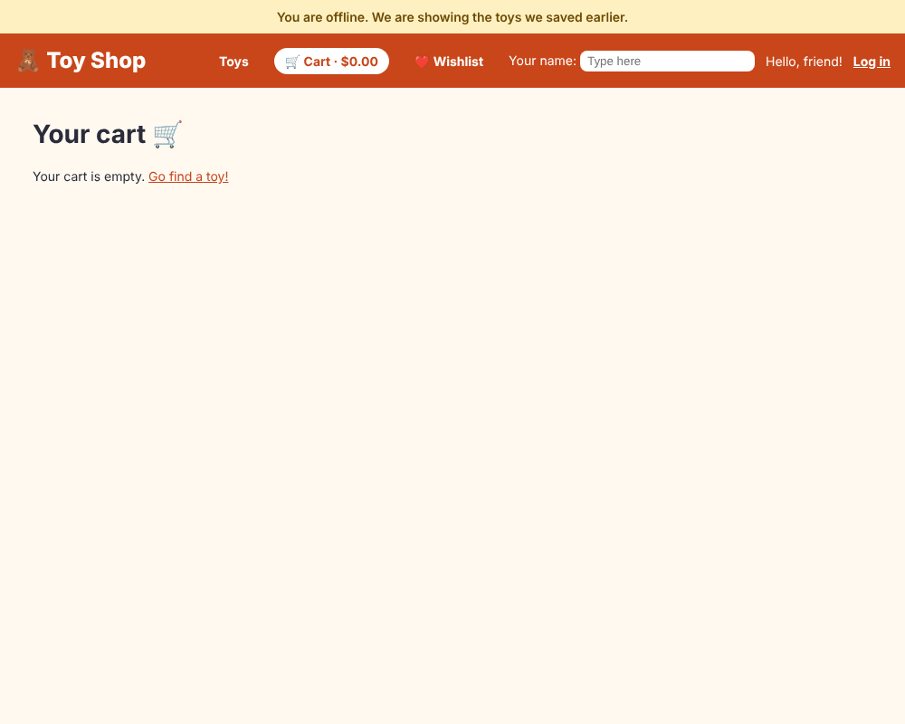

# Chapter 29: Progressive web apps and service workers

> **Like I'm 5:** Imagine the shop gives every customer a small suitcase with the most popular toys and the shop map inside. Even when the road to the shop is closed, the customer can still open the suitcase and look at the toys. When the road opens again, the suitcase quietly swaps in the new toys. A service worker is that suitcase and the helper who keeps it fresh.

Concept reference: [23. Service workers and PWAs](../concepts/23-service-workers-and-pwa.md)

[Back: Chapter 28](28-server-side-rendering.md) · Next: [Chapter 30: Libraries, monorepos and schematics](30-libraries-and-schematics.md)

## What we build today

We turn the shop into a **progressive web app (PWA)**:

1. The shop can be **installed** on a phone or computer, with its own icon and window.
2. After one visit, it **works offline**: the pages and the toy list come from a cache.
3. A small **"You are offline"** banner tells people what is going on.
4. When we publish a **new version**, a snackbar says "A new version of the shop is ready. **Reload**".



## The big idea

A **PWA** is an ordinary website with extra abilities:

| Ability | What makes it possible |
|---------|------------------------|
| **Installable** (an icon on the home screen, its own window) | a **web app manifest** (`manifest.webmanifest`) |
| **Works offline** and loads fast | a **service worker** that caches files |
| **Gets updates** without an app store | the service worker checks for a new version |
| **Push notifications** (optional) | the service worker plus a push service |

A **service worker** is a JavaScript file that the browser runs **in the background, separately from your page**. It sits between your app and the network, like a doorman: every request passes it, and it can answer from its **cache** (the suitcase) or from the network.

Angular's service worker (`@angular/service-worker`) is configured with a file instead of code. You only say *what* to cache and *how*:

| Cache kind | Config | How it behaves |
|------------|--------|----------------|
| **App files** (JS, CSS, HTML) | `assetGroups`, `installMode: "prefetch"` | downloaded **at install**, so the app works offline straight away |
| **Images and fonts** | `assetGroups`, `installMode: "lazy"` | cached the first time they are used |
| **API answers** (the toy list) | `dataGroups` | cached with a **strategy**: `freshness` (try the network first, fall back to the cache) or `performance` (cache first, refresh sometimes) |

Because the service worker is so powerful, browsers only allow it on **HTTPS** (and on `localhost` for testing).

**Grown-up words:**

- **Manifest**: a JSON file that says the app's name, icons, colours, and how it opens.
- **Precache / prefetch**: download files before they are needed.
- **Cache-first / network-first**: which source is tried first.
- **Version**: the set of files from one build. The service worker updates *all of them together* so old HTML never mixes with new JavaScript.
- **`SwUpdate`**: the Angular service that tells your app about new versions.

## Step 1: Add PWA support

```bash
ng add @angular/pwa
```

The real output:

```
CREATE ngsw-config.json
CREATE public/manifest.webmanifest
CREATE public/icons/icon-72x72.png
... (eight icon sizes)
UPDATE angular.json
UPDATE package.json
UPDATE src/app/app.config.ts
UPDATE src/index.html
```

It created the cache configuration, the manifest and icons, and wired the service worker into the build and the app.

### The manifest

**`public/manifest.webmanifest`**

```json
{
  "name": "Toy Shop",
  "short_name": "Toy Shop",
  "display": "standalone",
  "scope": "./",
  "start_url": "./",
  "icons": [
    {
      "src": "icons/icon-72x72.png",
      "sizes": "72x72",
      "type": "image/png",
      "purpose": "maskable any"
    },
    {
      "src": "icons/icon-96x96.png",
      "sizes": "96x96",
      "type": "image/png",
      "purpose": "maskable any"
    },
    {
      "src": "icons/icon-128x128.png",
      "sizes": "128x128",
      "type": "image/png",
      "purpose": "maskable any"
    },
    {
      "src": "icons/icon-144x144.png",
      "sizes": "144x144",
      "type": "image/png",
      "purpose": "maskable any"
    },
    {
      "src": "icons/icon-152x152.png",
      "sizes": "152x152",
      "type": "image/png",
      "purpose": "maskable any"
    },
    {
      "src": "icons/icon-192x192.png",
      "sizes": "192x192",
      "type": "image/png",
      "purpose": "maskable any"
    },
    {
      "src": "icons/icon-384x384.png",
      "sizes": "384x384",
      "type": "image/png",
      "purpose": "maskable any"
    },
    {
      "src": "icons/icon-512x512.png",
      "sizes": "512x512",
      "type": "image/png",
      "purpose": "maskable any"
    }
  ],
  "description": "Toys that make you smile. Browse, save, and order toys.",
  "theme_color": "#c8461a",
  "background_color": "#fff9f0"
}
```

- `display: "standalone"`: when installed, the app opens in its own window without browser buttons.
- `theme_color` colours the title bar; `background_color` is the splash background.
- `icons` in several sizes. `"purpose": "maskable any"` allows the phone to crop them into circles or squares.
- The icons are in `public/icons/` (we use the ones `ng add` made; replace them with your own artwork).

Link the manifest and the theme colour from `index.html`:

**`src/index.html`** (what changed)

```diff
@@ -6,8 +6,11 @@
     <base href="/" />
     <meta name="viewport" content="width=device-width, initial-scale=1" />
     <link rel="icon" type="image/x-icon" href="favicon.ico" />
+    <link rel="manifest" href="manifest.webmanifest" />
+    <meta name="theme-color" content="#c8461a" />
   </head>
   <body>
     <app-root></app-root>
+    <noscript>Please enable JavaScript to continue using this application.</noscript>
   </body>
 </html>
```

### The cache rules

**`ngsw-config.json`**

```json
{
  "$schema": "./node_modules/@angular/service-worker/config/schema.json",
  "index": "/index.csr.html",
  "assetGroups": [
    {
      "name": "app",
      "installMode": "prefetch",
      "resources": {
        "files": [
          "/favicon.ico",
          "/index.csr.html",
          "/index.html",
          "/manifest.webmanifest",
          "/*.css",
          "/*.js"
        ]
      }
    },
    {
      "name": "assets",
      "installMode": "lazy",
      "updateMode": "prefetch",
      "resources": {
        "files": [
          "/**/*.(svg|cur|jpg|jpeg|png|apng|webp|avif|gif|otf|ttf|woff|woff2)"
        ]
      }
    }
  ],
  "dataGroups": [
    {
      "name": "toys",
      "urls": [
        "/products.json"
      ],
      "cacheConfig": {
        "strategy": "freshness",
        "maxSize": 1,
        "maxAge": "1d",
        "timeout": "3s"
      }
    }
  ]
}
```

Two changes from the file `ng add` generated:

1. **`"index": "/index.csr.html"`** (it generated `/index.html`). Because we use server-side rendering (Chapter 28), the empty "shell" page the browser can render without a server is called `index.csr.html`. The service worker must know which file is the app's entry. *This is a real gotcha when you combine SSR and a service worker.*
2. **A `dataGroups` entry named `toys`** for `/products.json`. `strategy: "freshness"` means: try the network first, and if it does not answer within **3 seconds** (`timeout`), use the cached copy (kept at most `1d`, one day). So we show fresh toys when we can and *something* when we cannot.

### Switch it on

**`angular.json`** (what changed)

```diff
@@ -49,7 +49,8 @@
                   "maximumError": "8kB"
                 }
               ],
-              "outputHashing": "all"
+              "outputHashing": "all",
+              "serviceWorker": "ngsw-config.json"
             },
             "development": {
               "optimization": false,
```

`"serviceWorker": "ngsw-config.json"` in the **production** configuration makes the build create the worker (`ngsw-worker.js`) and a file list with fingerprints (`ngsw.json`). The development build has no service worker, which is good: a cache that keeps old files would make development confusing.

**`src/app/app.config.ts`** (what changed)

```diff
@@ -4,6 +4,7 @@ import {
   ErrorHandler,
   inject,
   provideBrowserGlobalErrorListeners,
+  isDevMode,
 } from '@angular/core';
 import {
   provideRouter,
@@ -26,6 +27,7 @@ import { LoggerService } from './services/logger-service';
 import { NotificationService } from './services/notification-service';
 import { SHOP_NAME, TAX_RATE } from './tokens';
 import { provideClientHydration, withEventReplay } from '@angular/platform-browser';
+import { provideServiceWorker } from '@angular/service-worker';
 
 export const appConfig: ApplicationConfig = {
   providers: [
@@ -66,5 +68,9 @@ export const appConfig: ApplicationConfig = {
     // After the server's page arrives, Angular "wakes it up" (hydration) instead of redrawing it.
     // withEventReplay remembers clicks that happen BEFORE it wakes up, and plays them back.
     provideClientHydration(withEventReplay()),
+    provideServiceWorker('ngsw-worker.js', {
+      enabled: !isDevMode(),
+      registrationStrategy: 'registerWhenStable:30000',
+    }),
   ],
 };
```

- `provideServiceWorker('ngsw-worker.js', {...})` registers the worker in the browser.
- `enabled: !isDevMode()`: only in production builds.
- `registrationStrategy: 'registerWhenStable:30000'`: wait until the app is stable (or 30 seconds), then register. The worker's first big download must not compete with the first page.

## Step 2: Tell people when they are offline

A small service watches the browser's `online` and `offline` events and exposes a signal. (On a server there is no browser, so it says "online".)

**`src/app/services/connection-service.ts`**

```ts
import { DOCUMENT } from '@angular/common';
import { DestroyRef, inject, Service, signal } from '@angular/core';

// Knows whether the internet is on. (On a server there is no browser, so we say "yes".)
@Service()
export class ConnectionService {
  private window = inject(DOCUMENT).defaultView;
  readonly online = signal(this.window?.navigator.onLine ?? true);

  constructor() {
    const win = this.window;
    if (!win) return;

    const goOnline = () => this.online.set(true);
    const goOffline = () => this.online.set(false);
    win.addEventListener('online', goOnline);
    win.addEventListener('offline', goOffline);

    // When the service is destroyed, stop listening (no leaks!).
    inject(DestroyRef).onDestroy(() => {
      win.removeEventListener('online', goOnline);
      win.removeEventListener('offline', goOffline);
    });
  }
}
```

**`src/app/services/connection-service.spec.ts`**

```ts
import { TestBed } from '@angular/core/testing';
import { ConnectionService } from './connection-service';

describe('ConnectionService', () => {
  it('notices when the internet goes away and comes back', () => {
    const connection = TestBed.inject(ConnectionService);
    expect(connection.online()).toBe(true);

    window.dispatchEvent(new Event('offline'));
    expect(connection.online()).toBe(false);

    window.dispatchEvent(new Event('online'));
    expect(connection.online()).toBe(true);
  });
});
```

Show a banner when it is false:

**`src/app/app.html`** (what changed)

```diff
@@ -6,6 +6,12 @@
 <!-- The first thing a keyboard user can press: jump straight to the toys. -->
 <a class="skip-link" href="#main" (click)="skipToMain($event)">Skip to the content</a>
 
+@if (!connection.online()) {
+  <p class="offline" role="status" i18n="@@app.offline">
+    You are offline. We are showing the toys we saved earlier.
+  </p>
+}
+
 <app-site-header />
 
 <main id="main" #main class="page" tabindex="-1">
```

**`src/app/app.css`** (what changed)

```diff
@@ -35,3 +35,12 @@
 main:focus {
   outline: none;
 }
+
+.offline {
+  margin: 0;
+  padding: 0.5rem 1rem;
+  background: #fff0c2;
+  color: #6b4a00;
+  font-weight: 600;
+  text-align: center;
+}
```

(`role="status"` makes screen readers announce it politely. The text has an `i18n` id, so it is in the Hindi file, too.)

## Step 3: Offer the new version

When we publish a new version, the service worker downloads it **in the background**, but the page still runs the old one until reloaded. `SwUpdate` tells us when the new one is ready:

**`src/app/services/update-service.ts`**

```ts
import { DOCUMENT } from '@angular/common';
import { inject, Service } from '@angular/core';
import { takeUntilDestroyed } from '@angular/core/rxjs-interop';
import { SwUpdate, VersionReadyEvent } from '@angular/service-worker';
import { filter } from 'rxjs';
import { NotificationService } from './notification-service';

// When a NEW version of the shop has been downloaded in the background,
// offer a "Reload" button so the person gets it right away.
@Service()
export class UpdateService {
  private updates = inject(SwUpdate);
  private notify = inject(NotificationService);
  private document = inject(DOCUMENT);

  constructor() {
    if (!this.updates.isEnabled) return; // the service worker only runs in a production build

    this.updates.versionUpdates
      .pipe(
        filter((event): event is VersionReadyEvent => event.type === 'VERSION_READY'),
        takeUntilDestroyed(),
      )
      .subscribe(() => {
        this.notify
          .show(
            $localize`:@@update.ready:A new version of the shop is ready.`,
            0,
            $localize`:@@update.reload:Reload`,
          )
          .onAction()
          .subscribe(() => this.document.location.reload());
      });
  }
}
```

- `versionUpdates` is an Observable of events: `VERSION_DETECTED`, `VERSION_READY`, `VERSION_INSTALLATION_FAILED`. We care about `VERSION_READY` only.
- We show a snackbar with a **Reload** button that never disappears by itself (duration `0`). The notification service gets a third parameter for the button's label:

**`src/app/services/notification-service.ts`** (what changed)

```diff
@@ -6,7 +6,7 @@ import { MatSnackBar } from '@angular/material/snack-bar';
 export class NotificationService {
   private snackBar = inject(MatSnackBar);
 
-  show(message: string, duration = 5000) {
-    return this.snackBar.open(message, $localize`:@@notify.close:Close`, { duration });
+  show(message: string, duration = 5000, action = $localize`:@@notify.close:Close`) {
+    return this.snackBar.open(message, action, { duration });
   }
 }
```

- `if (!this.updates.isEnabled) return;`: in development the worker is off, so we do nothing.

The root component creates the two services and shows the banner:

**`src/app/app.ts`** (what changed)

```diff
@@ -3,7 +3,9 @@ import { takeUntilDestroyed } from '@angular/core/rxjs-interop';
 import { NavigationEnd, Router, RouterOutlet } from '@angular/router';
 import { filter, skip } from 'rxjs';
 import { SiteHeader } from './components/site-header/site-header';
+import { ConnectionService } from './services/connection-service';
 import { LoadingService } from './services/loading-service';
+import { UpdateService } from './services/update-service';
 
 @Component({
   imports: [RouterOutlet, SiteHeader],
@@ -13,9 +15,12 @@ import { LoadingService } from './services/loading-service';
 })
 export class App {
   loading = inject(LoadingService);
+  connection = inject(ConnectionService);
   private main = viewChild.required<ElementRef<HTMLElement>>('main');
 
   constructor() {
+    inject(UpdateService); // starts listening for new versions
+
     // A web page that "changes" without reloading is silent for people who cannot see it.
     // So after every move to a new page we move the keyboard focus to the top of the new page.
     // (The new title is announced by AnnouncingTitleStrategy, see title-strategy.ts.)
```

**`src/app/app.spec.ts`** (what changed)

```diff
@@ -1,4 +1,5 @@
 import { TestBed } from '@angular/core/testing';
+import { provideServiceWorker } from '@angular/service-worker';
 import { provideRouter } from '@angular/router';
 import { App } from './app';
 import { routes } from './app.routes';
@@ -7,7 +8,11 @@ describe('App', () => {
   beforeEach(async () => {
     await TestBed.configureTestingModule({
       imports: [App],
-      providers: [provideRouter(routes)],
+      providers: [
+        provideRouter(routes),
+        // The app listens for new versions, so even tests need a (switched-off) service worker.
+        provideServiceWorker('ngsw-worker.js', { enabled: false }),
+      ],
     }).compileComponents();
   });
 
```

(The root component test needs a **switched-off** service worker provider, because `UpdateService` asks for `SwUpdate`.)

Now a test for the update flow. We play three parts ourselves: the service worker, the person pressing the button, and the page reload:

**`src/app/services/update-service.spec.ts`**

```ts
import { DOCUMENT } from '@angular/common';
import { TestBed } from '@angular/core/testing';
import { SwUpdate } from '@angular/service-worker';
import { Subject } from 'rxjs';
import { NotificationService } from './notification-service';
import { UpdateService } from './update-service';

describe('UpdateService', () => {
  // We play the parts of the service worker, the pop-up, and the page reload.
  function setup(isEnabled = true) {
    const versionUpdates = new Subject<{ type: string }>();
    const pressed = new Subject<void>();
    const notify = { show: vi.fn(() => ({ onAction: () => pressed })) };
    const reload = vi.fn();
    TestBed.configureTestingModule({
      providers: [
        { provide: SwUpdate, useValue: { isEnabled, versionUpdates } },
        { provide: NotificationService, useValue: notify },
        { provide: DOCUMENT, useValue: { location: { reload } } },
      ],
    });
    TestBed.inject(UpdateService);
    return { versionUpdates, pressed, notify, reload };
  }

  it('offers a Reload button when a new version is ready, and reloads when it is pressed', () => {
    const { versionUpdates, pressed, notify, reload } = setup();

    versionUpdates.next({ type: 'VERSION_READY' });
    expect(notify.show).toHaveBeenCalledTimes(1);
    expect(reload).not.toHaveBeenCalled();

    pressed.next(); // the person pressed "Reload"
    expect(reload).toHaveBeenCalledTimes(1);
  });

  it('ignores other kinds of version news', () => {
    const { versionUpdates, notify } = setup();
    versionUpdates.next({ type: 'VERSION_DETECTED' });
    expect(notify.show).not.toHaveBeenCalled();
  });

  it('does nothing when the service worker is switched off (development)', () => {
    const { versionUpdates, notify } = setup(false);
    versionUpdates.next({ type: 'VERSION_READY' });
    expect(notify.show).not.toHaveBeenCalled();
  });
});
```

## Step 4: Build it and try it for real

A service worker only exists in a **production** build, so we cannot try it with `ng serve`:

```bash
npm run build
npm run serve:ssr:toy-shop
```

Open <http://localhost:4000/> in Chrome. (`localhost` counts as secure.) Then:

1. Open DevTools, **Application**, **Service Workers**. You should see `ngsw-worker.js` **activated and running**. Reload once, so the page is *controlled* by it.
2. Tick **Offline** (or use the **Network** tab's throttling menu, **Offline**), and reload. The shop still loads! The banner says "You are offline. We are showing the toys we saved earlier."
3. Click **Cart**: it opens (the cart page code and your cart data are on the device).
4. Untick **Offline**: the banner goes away.

We ran exactly this in a real browser, and it reported:

```
service worker active: true
controlled by worker: true
OFFLINE: toys on screen: 6
OFFLINE banner: You are offline. We are showing the toys we saved earlier.
OFFLINE: cart page opens: Your cart 🛒
back online, banner gone: true
no page errors
```

Look at the generated file list, `dist/toy-shop/browser/ngsw.json`. In our build it knows:

```
assetGroups: ['app', 'assets']   dataGroups: ['toys']
index: /index.csr.html           hashed files tracked: 29
```

Each file has a hash (a fingerprint). When you publish a new build, the worker compares hashes, downloads only what changed, and swaps **all** files at the same time.

**Install it:** in Chrome's address bar, an **Install** icon appears (or the menu, **Install Toy Shop**). On a phone, **Add to Home Screen**. The shop opens in its own window with our icon.

## Step 5: Dangers of a service worker (read this)

A cache that is too sticky can trap your users on an old version:

- **The worker file itself must never be cached for a long time.** If `ngsw-worker.js` or `ngsw.json` is cached for a year by your web server, browsers will never find out about updates. Chapter 35 meets exactly this bug in our own server settings and fixes it.
- **Do not cache everything.** Never cache **personal** or **POST** requests (orders, login). Angular's worker only handles GET requests and only the ones in your config.
- **Stale data.** The offline toy list may be a day old (`maxAge: 1d`). That is acceptable for toys, but not for a bank balance. Pick `freshness` or `performance` per kind of data.
- **A broken release.** If a bad version is cached, users keep it until the next update arrives. Test the update path (deploy version A, open, deploy version B, check the reload prompt).
- **Getting rid of a worker:** `navigator.serviceWorker.getRegistrations().then(rs => rs.forEach(r => r.unregister()))`, or **Application**, **Service Workers**, **Unregister** in DevTools.

## Push notifications (reading only)

A service worker can also receive **push notifications** (even when the site is closed). Angular has `SwPush` for it. You need a server that sends the pushes, a subscription from the browser (which needs the person's permission), and HTTPS. We do not build it, because it requires a real server and keys. The [concepts page](../concepts/23-service-workers-and-pwa.md) shows the code outline.

## Check it works

```bash
npx ng test --watch=false
```

```
 Test Files  38 passed (38)
      Tests  96 passed (96)
```

- [ ] `npm run build` creates `ngsw-worker.js` and `ngsw.json` in `dist/toy-shop/browser`.
- [ ] In DevTools **Application**, **Service Workers** shows the worker running (production server).
- [ ] Offline reload still shows the shop and the banner.
- [ ] The **Install** icon appears in the address bar.
- [ ] `ng serve` (development) has no service worker, so nothing is cached while you work.

## What you learned

- A PWA is a website plus a manifest (installable) plus a service worker (offline, updates).
- `ng add @angular/pwa` wires it up; `ngsw-config.json` says what to cache and how (`prefetch`, `lazy`, `freshness`, `performance`).
- With SSR the entry file is `index.csr.html`: adjust the config.
- `SwUpdate` tells you when a new version is ready; offer the person a Reload button.
- A service worker is powerful and sticky. Never cache personal data, and never let the worker file itself be cached for long.

## Try it yourself

1. Change the `toys` data group strategy to `"performance"` and think about what changes for a person who opens the shop twice in a row.
2. Change `timeout` to `"1s"`, throttle the network to **Slow 3G**, and reload. Which copy do you get, fresh or cached?
3. Add `/api/**` to a `dataGroups` entry with `strategy: "freshness"`. Why would that be a bad idea for `/api/orders`? (Hint: whose data is it?)
4. Change the `theme_color` in the manifest and rebuild. Where do you see the new colour?

## If something goes wrong

**DevTools shows no service worker:** you are on `ng serve` (disabled in development), on plain HTTP that is not `localhost`, or the build had no `serviceWorker` in `angular.json`.

**The shop still shows the old version after you deploy:** the browser is using the old worker's cache until the new version is detected and activated. Reload twice, or use **Application**, **Service Workers**, **Update on reload** while developing.

**`NG0201: No provider found for SwUpdate` in a test:** add `provideServiceWorker('ngsw-worker.js', { enabled: false })` to the test providers, or provide a fake `SwUpdate`, as our tests do.

**Offline shows a blank page:** the service worker's `index` points to a file that does not exist. With SSR it must be `/index.csr.html`.

**Everything is cached forever, even after you change the code:** the server told the browser to cache `ngsw.json` for a year. Fix the server's cache headers (Chapter 35).

Next: [Chapter 30: Libraries, monorepos and schematics](30-libraries-and-schematics.md)
