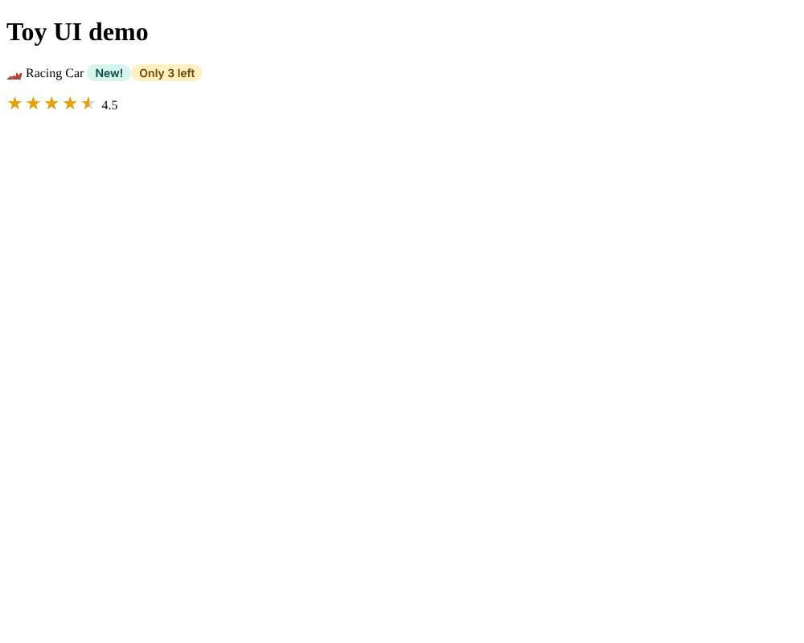

# Chapter 30: Libraries, monorepos and schematics

> **Like I'm 5:** If you make a really good toy part, like a wheel, you do not want to carve it again for every toy. You put the best wheels in a box with a label, and every toy maker can take wheels from the box. A library is that box of parts. A workspace is the big workshop where many toys and their part boxes are made side by side. And a schematic is a machine that makes a brand-new toy skeleton with one button press.

Concept reference: [26. Libraries, monorepos and schematics](../concepts/26-libraries-monorepos-and-schematics.md)

[Back: Chapter 29](29-pwa.md) · Next: [Chapter 31: Web components](31-web-components.md)

## What we build today

A second workspace, the **Toy Lab**, next to the Toy Shop:

1. A **library** called `toy-ui` with two reusable parts: `<toy-badge>` (a round label) and `<toy-stars>` (a rating).
2. A **demo app** in the same workspace that uses the library (a **monorepo**: many projects, one repository).
3. A **schematic** (a code generator) that creates a new shop page, with its test, in one command.



> This chapter works in a **new folder** (`toy-lab`), not inside the Toy Shop. The finished workspace is in [`toy-lab-final`](toy-lab-final/). Chapter 31 uses it, too.

## The big idea

When two apps need the same pieces (a rating widget, a button style, a form control), copying files between them is a trap: bug fixes have to be copied too, and the copies drift apart. Two clean answers:

| Answer | What it is |
|--------|------------|
| **A library** | A package of reusable components/services with a **public API** (only what you export can be used). Built with `ng-packagr`, it can be shared inside your workspace or published to npm. |
| **A monorepo (workspace)** | One repository containing **many projects** (apps and libraries) that are built and tested together. A change to the library is seen by every app at once. |

Angular workspaces support this natively: a workspace has an `angular.json` listing projects under `projects/`. (Tools like **Nx** add smart caching and boundaries on top of the same idea.)

A third tool, the **schematic**, is a **code generator**: it makes files from templates, like `ng generate component` does. You can write your own to enforce your team's structure ("every page has a spec file, a heading, a CSS file").

**Grown-up words:**

- **Workspace**: the root with `angular.json`; **project**: one app or library inside.
- **Public API (`public-api.ts`)**: the list of things a library exports; everything else is private.
- **`ng-packagr`**: the tool that turns library source into a publishable package.
- **Peer dependency**: a package the library needs but expects *the app* to provide (like `@angular/core`), so there is only one copy.
- **Partial compilation**: how Angular compiles libraries; the app's build finishes the job, so one library works with many patch versions of Angular.
- **Schematic / collection**: a generator, and a package of generators.

## Step 1: Create a workspace with no app

```bash
ng new toy-lab --create-application=false
cd toy-lab
```

`--create-application=false` makes an **empty workspace**: only the shared files (`angular.json`, `package.json`, `tsconfig.json`), and no `src/`. The real output:

```
CREATE toy-lab/.prettierrc
CREATE toy-lab/README.md
CREATE toy-lab/.editorconfig
CREATE toy-lab/.gitignore
CREATE toy-lab/angular.json
CREATE toy-lab/package.json
CREATE toy-lab/tsconfig.json
CREATE toy-lab/.vscode/...
```

## Step 2: Generate a library

```bash
ng generate library toy-ui --prefix=toy
```

```
CREATE projects/toy-ui/README.md
CREATE projects/toy-ui/ng-package.json
CREATE projects/toy-ui/package.json
CREATE projects/toy-ui/tsconfig.lib.json
CREATE projects/toy-ui/tsconfig.lib.prod.json
CREATE projects/toy-ui/tsconfig.spec.json
CREATE projects/toy-ui/src/public-api.ts
CREATE projects/toy-ui/src/lib/toy-ui.spec.ts
CREATE projects/toy-ui/src/lib/toy-ui.ts
UPDATE angular.json
UPDATE package.json
UPDATE tsconfig.json
```

`--prefix=toy` means the selectors of components in this library start with `toy-` (`<toy-badge>`), so they never clash with app tags (`app-...`).

The generator also edited `tsconfig.json`. This is the clever part:

**`tsconfig.json`**

```json
/* To learn more about Typescript configuration file: https://www.typescriptlang.org/docs/handbook/tsconfig-json.html. */
/* To learn more about Angular compiler options: https://angular.dev/reference/configs/angular-compiler-options. */
{
  "compileOnSave": false,
  "compilerOptions": {
    "noImplicitOverride": true,
    "noPropertyAccessFromIndexSignature": true,
    "noImplicitReturns": true,
    "noFallthroughCasesInSwitch": true,
    "skipLibCheck": true,
    "isolatedModules": true,
    "experimentalDecorators": true,
    "importHelpers": true,
    "target": "ES2022",
    "module": "preserve",
    "paths": {
      "toy-ui": ["./dist/toy-ui"]
    }
  },
  "angularCompilerOptions": {
    "enableI18nLegacyMessageIdFormat": false,
    "strictInjectionParameters": true,
    "strictInputAccessModifiers": true
  },
  "files": [],
  "references": [
    {
      "path": "./projects/toy-ui/tsconfig.lib.json"
    },
    {
      "path": "./projects/toy-ui/tsconfig.spec.json"
    },
    {
      "path": "./projects/demo/tsconfig.app.json"
    },
    {
      "path": "./projects/demo/tsconfig.spec.json"
    },
    {
      "path": "./projects/widget/tsconfig.app.json"
    },
    {
      "path": "./projects/widget/tsconfig.spec.json"
    }
  ]
}
```

`"paths": { "toy-ui": ["./dist/toy-ui"] }` lets any project in the workspace write `import { ToyBadge } from 'toy-ui'`, as if it were an npm package, while it really points at the library's **built** output.

Look at the library's own files:

**`projects/toy-ui/ng-package.json`**

```json
{
  "$schema": "../../node_modules/ng-packagr/ng-package.schema.json",
  "dest": "../../dist/toy-ui",
  "lib": {
    "entryFile": "src/public-api.ts"
  }
}
```

**`projects/toy-ui/package.json`**

```json
{
  "name": "toy-ui",
  "version": "0.0.1",
  "peerDependencies": {
    "@angular/common": "^22.2.0",
    "@angular/core": "^22.2.0"
  },
  "dependencies": {
    "tslib": "^2.3.0"
  },
  "sideEffects": false
}
```

- `entryFile` is the public API file.
- `peerDependencies` lists `@angular/core`: the library **does not carry its own copy** of Angular. If it did, apps would have two Angulars, and nothing would work.

## Step 3: Write two reusable parts

The generator made an example component `toy-ui`. Delete `toy-ui.ts` and its spec, and make two real ones. Notice the generator options for a library component: `--project=toy-ui` (which project), and `--inline-template --inline-style --skip-tests` (keep each part in one file):

```bash
ng generate component toy-badge --project=toy-ui --inline-template --inline-style --skip-tests
ng generate component toy-stars --project=toy-ui --inline-template --inline-style --skip-tests
```

**The badge** has a **content slot** (`<ng-content />`, Chapter 2) and one input, `tone`:

**`projects/toy-ui/src/lib/toy-badge/toy-badge.ts`**

```ts
import { Component, input } from '@angular/core';

export type BadgeTone = 'happy' | 'warning';

// A little round label, like "New!" or "Only 2 left". Whatever you write
// between <toy-badge> and </toy-badge> shows up inside it.
@Component({
  selector: 'toy-badge',
  template: `<span class="badge" [class.warning]="tone() === 'warning'"><ng-content /></span>`,
  styles: `
    .badge {
      display: inline-block;
      padding: 0.125rem 0.625rem;
      border-radius: 999px;
      background: #d6f5ef;
      color: #064e4a;
      font:
        600 0.875rem system-ui,
        sans-serif;
    }
    .badge.warning {
      background: #fff0c2;
      color: #6b4a00;
    }
  `,
})
export class ToyBadge {
  tone = input<BadgeTone>('happy');
}
```

**The stars** show a rating out of 5. Notice `numberAttribute`:

**`projects/toy-ui/src/lib/toy-stars/toy-stars.ts`**

```ts
import { Component, computed, input, numberAttribute } from '@angular/core';

// Shows a rating out of 5 as stars: <toy-stars [rating]="4.5" />
@Component({
  selector: 'toy-stars',
  template: `
    <span class="stars" role="img" [attr.aria-label]="'Rated ' + rating() + ' out of 5'">
      <span class="fill" [style.width.%]="percent()">★★★★★</span>
      <span class="back" aria-hidden="true">★★★★★</span>
    </span>
  `,
  styles: `
    .stars {
      position: relative;
      display: inline-block;
      font-size: 1.25rem;
      letter-spacing: 0.1em;
    }
    .back {
      color: #d4d4dc;
    }
    .fill {
      position: absolute;
      top: 0;
      left: 0;
      overflow: hidden;
      white-space: nowrap;
      color: #e8a100;
    }
  `,
})
export class ToyStars {
  // numberAttribute lets this work as an HTML attribute too: rating="4.5" arrives as text.
  rating = input(0, { transform: numberAttribute });
  percent = computed(() => Math.min(100, Math.max(0, (this.rating() / 5) * 100)));
}
```

- `input(0, { transform: numberAttribute })`: an **input transform**. HTML attributes always arrive as **text** (`rating="4.5"` is the string `"4.5"`). `numberAttribute` converts it to a number. Without it, `rating() / 5` would be `NaN`. This will matter in Chapter 31.
- `[style.width.%]="percent()"` sets the width of the gold stars as a percentage.
- `role="img"` and `aria-label` make the stars understandable for screen readers (Chapter 21).

Now the **public API**, the front door of the library. Only what is exported here is visible to apps:

**`projects/toy-ui/src/public-api.ts`**

```ts
/*
 * Public API Surface of toy-ui
 * Only what is exported here can be used by other projects.
 */

export * from './lib/toy-badge/toy-badge';
export * from './lib/toy-stars/toy-stars';
```

And a test for both parts:

**`projects/toy-ui/src/lib/toy-ui.spec.ts`**

```ts
import { Component } from '@angular/core';
import { TestBed } from '@angular/core/testing';
import { ToyBadge } from './toy-badge/toy-badge';
import { ToyStars } from './toy-stars/toy-stars';

@Component({
  imports: [ToyBadge, ToyStars],
  template: `
    <toy-badge tone="warning">Only 2 left</toy-badge>
    <toy-stars [rating]="4" />
  `,
})
class Host {}

describe('toy-ui', () => {
  it('shows what is written inside a badge, with the warning look', async () => {
    const fixture = TestBed.createComponent(Host);
    await fixture.whenStable();
    const badge = fixture.nativeElement.querySelector('.badge');
    expect(badge.textContent).toContain('Only 2 left');
    expect(badge.classList).toContain('warning');
  });

  it('fills four fifths of the stars for a rating of 4', async () => {
    const fixture = TestBed.createComponent(Host);
    await fixture.whenStable();
    expect(fixture.nativeElement.querySelector('.fill').style.width).toBe('80%');
    expect(fixture.nativeElement.querySelector('.stars').getAttribute('aria-label')).toBe(
      'Rated 4 out of 5',
    );
  });
});
```

## Step 4: Build the library

```bash
ng build toy-ui
```

```
Building Angular Package
Building entry point 'toy-ui'
- Compiling with Angular sources in partial compilation mode.
√ Compiling with Angular sources in partial compilation mode.
- Writing FESM and DTS bundles
√ Writing FESM and DTS bundles
- Writing package manifest
√ Writing package manifest

Built Angular Package
- from: .../projects/toy-ui
- to:   .../dist/toy-ui
```

The output, `dist/toy-ui`, is a real npm package: a bundled module (`fesm2022/toy-ui.mjs`), type definitions (`types/toy-ui.d.ts`), and a `package.json` with `exports`. To see exactly what would be published, without publishing:

```bash
cd dist/toy-ui
npm pack --dry-run
```

```
npm notice package: toy-ui@0.0.1
npm notice Tarball Contents
npm notice 1.4kB README.md
npm notice 3.9kB fesm2022/toy-ui.mjs
npm notice 3.4kB fesm2022/toy-ui.mjs.map
npm notice 479B package.json
npm notice 869B types/toy-ui.d.ts
```

Five small files. To publish for real you would run `npm publish` there (needs an npm account), and other projects would `npm install toy-ui`. Always bump the `version` in `projects/toy-ui/package.json` first, following **semantic versioning**: `1.2.3` is major.minor.patch, where a major number means "breaking change", minor "new feature", patch "bug fix".

## Step 5: Use the library in an app (the monorepo)

Add an app to the same workspace:

```bash
ng generate application demo --style=css --routing=false --ssr=false
```

```
CREATE projects/demo/src/app/app.css
CREATE projects/demo/src/app/app.spec.ts
CREATE projects/demo/src/app/app.ts
CREATE projects/demo/src/app/app.html
CREATE projects/demo/src/main.ts
CREATE projects/demo/src/app/app.config.ts
...
UPDATE angular.json
UPDATE tsconfig.json
```

Replace the demo's root component with one that uses our library. Remove `app.html` and `app.css` (the template is inline now):

**`projects/demo/src/app/app.ts`**

```ts
import { Component } from '@angular/core';
import { ToyBadge, ToyStars } from 'toy-ui';

@Component({
  imports: [ToyBadge, ToyStars],
  selector: 'app-root',
  template: `
    <h1>Toy UI demo</h1>
    <p>
      🏎️ Racing Car
      <toy-badge>New!</toy-badge>
      <toy-badge tone="warning">Only 3 left</toy-badge>
    </p>
    <p><toy-stars [rating]="4.5" /> 4.5</p>
  `,
})
export class App {}
```

Look at the import line: `from 'toy-ui'`, not a relative path. The demo uses the library the way any app would.

Run it:

```bash
ng build toy-ui        # the demo reads the library from dist/
ng serve demo
```

The demo shows "Racing Car", a green "New!" badge, an amber "Only 3 left" badge, and 4.5 stars.

Then test **everything** in the workspace:

```bash
ng test
```

```
 Test Files  1 passed (1)
      Tests  2 passed (2)    (toy-ui)
 Test Files  1 passed (1)
      Tests  1 passed (1)    (demo)
```

(`ng test` with no project name runs the tests of every project, one after the other.)

**Monorepo habits:**

- Build libraries **before** the apps that use them (`ng build toy-ui` first), or use `ng serve` with a watch on the library (`ng build toy-ui --watch`).
- Keep libraries **small and focused**, with a clear public API, and add a `README`.
- Never import from another project's internal files (`../../toy-ui/src/lib/...`); only use its public API.
- When the workspace grows, add caching and dependency rules with a tool such as **Nx**.

## Step 6: A schematic of our own

Every team has rituals: "a new page needs a component, a template, a CSS file, and a test with a heading check". A **schematic** automates a ritual. Create a schematics project (it is independent of Angular's apps) with the official helper:

```bash
npx -p @angular-devkit/schematics-cli schematics blank --name=toy-schematics
cd toy-schematics
npm install
```

The helper also creates an example schematic called `toy-schematics` in `src/`. Delete that folder (`src/toy-schematics`); we write our own. A schematics project has three parts: a **collection** (a list of schematics), a **schema** (the options each schematic accepts), and a **factory** (the code), plus **template files**.

**The collection** lists our one schematic:

**`toy-schematics/src/collection.json`**

```json
{
  "$schema": "../node_modules/@angular-devkit/schematics/collection-schema.json",
  "schematics": {
    "toy-page": {
      "description": "Creates a new toy-shop page: a component with a heading, a template and styles.",
      "factory": "./toy-page/index#toyPage",
      "schema": "./toy-page/schema.json"
    }
  }
}
```

**The schema** says it takes a `name` (asked as the first argument, or with a prompt) and an optional `path`:

**`toy-schematics/src/toy-page/schema.json`**

```json
{
  "$schema": "http://json-schema.org/schema",
  "$id": "ToyPageSchema",
  "title": "Toy page options",
  "type": "object",
  "properties": {
    "name": {
      "type": "string",
      "description": "The name of the page, like about-us.",
      "$default": { "$source": "argv", "index": 0 },
      "x-prompt": "What is the name of the page?"
    },
    "path": {
      "type": "string",
      "description": "Where to put it.",
      "default": "src/app/pages"
    }
  },
  "required": ["name"]
}
```

**The factory** is a function that returns a `Rule`, a recipe: take the template files, fill in the blanks, move them to the target folder:

**`toy-schematics/src/toy-page/index.ts`**

```ts
import { strings } from '@angular-devkit/core';
import { apply, applyTemplates, mergeWith, move, Rule, url } from '@angular-devkit/schematics';

export interface ToyPageOptions {
  name: string;
  path: string;
}

// A schematic is a function that returns a "Rule" (a list of instructions).
// This one says: take the files in ./files, fill in the blanks (names),
// move them to the right folder, and add them to the project.
export function toyPage(options: ToyPageOptions): Rule {
  return mergeWith(
    apply(url('./files'), [
      applyTemplates({ ...strings, ...options }), // fills in <%= name %> and __name__
      move(options.path),
    ]),
  );
}
```

- `url('./files')` points at the template folder.
- `applyTemplates({ ...strings, ...options })` replaces `<%= ... %>` blanks and `__name@dasherize__` in file names. `strings` gives helper functions: `dasherize('AboutUs')` is `about-us`, `classify('about-us')` is `AboutUs`, `capitalize(...)`.
- `move(options.path)` puts the files under `src/app/pages` by default.

**The templates** are the files the schematic writes. The names contain blanks: the folder `__name@dasherize__` becomes `about-us`.

**`toy-schematics/src/toy-page/files/__name@dasherize__/__name@dasherize__.ts.template`**

```
import { Component } from '@angular/core';

@Component({
  imports: [],
  selector: 'app-<%= dasherize(name) %>',
  styleUrl: './<%= dasherize(name) %>.css',
  templateUrl: './<%= dasherize(name) %>.html',
})
export class <%= classify(name) %> {}
```

**`toy-schematics/src/toy-page/files/__name@dasherize__/__name@dasherize__.html.template`**

```
<h1><%= capitalize(dasherize(name).replace(/-/g, ' ')) %> 🧸</h1>
<p>This page was made by the toy-page schematic.</p>
```

**`toy-schematics/src/toy-page/files/__name@dasherize__/__name@dasherize__.spec.ts.template`**

```
import { TestBed } from '@angular/core/testing';
import { <%= classify(name) %> } from './<%= dasherize(name) %>';

describe('<%= classify(name) %>', () => {
  it('shows its heading', async () => {
    const fixture = TestBed.createComponent(<%= classify(name) %>);
    await fixture.whenStable();
    expect(fixture.nativeElement.querySelector('h1')).not.toBeNull();
  });
});
```

(The CSS template is empty, like the one the Angular CLI makes.) Compile it, and try it on the **Toy Shop** with `--dry-run`:

```bash
cd toy-schematics
npm run build
cd ../../toy-shop            # go to the shop
ng generate ../toy-lab/toy-schematics/src/collection.json:toy-page about-us --dry-run
```

The real output:

```
CREATE src/app/pages/about-us/about-us.css (0 bytes)
CREATE src/app/pages/about-us/about-us.html (76 bytes)
CREATE src/app/pages/about-us/about-us.spec.ts (322 bytes)
CREATE src/app/pages/about-us/about-us.ts (191 bytes)

NOTE: The "--dry-run" option means no changes were made.
```

One command made a page with its test, in the right folder, with the right names. Without `--dry-run` the files are written. In a real team you would publish the schematics as a package and let people run `ng add your-package` or `ng generate your-package:toy-page`. (`ng add` itself runs a schematic called `ng-add`; that is how Material, the service worker, and SSR installed themselves in earlier chapters.)

Schematics can also **change** existing files (add a route, edit `app.config.ts`) and power **migrations** for `ng update` (Chapter 36).

## Check it works

- [ ] `ng build toy-ui` ends with `Built Angular Package`, and `dist/toy-ui` exists.
- [ ] `ng test` passes for the library and the demo.
- [ ] `ng serve demo` shows the badges and the stars.
- [ ] `ng generate .../collection.json:toy-page about-us --dry-run` lists four files.

## What you learned

- A **library** shares code through a public API; `ng-packagr` builds it as an npm package; the app's `paths` mapping lets projects import it by name.
- A **workspace (monorepo)** holds many projects that are built and tested together.
- Libraries need `peerDependencies` for Angular, and attributes arrive as text, so use input `transform`s like `numberAttribute`.
- A **schematic** is a generator: collection, schema, factory, and templates. `--dry-run` shows what it would do.
- Version libraries with semantic versioning.

## Try it yourself

1. Add a third component, `ToyPrice`, to the library that shows a number as a price (use the `currency` pipe). Export it from `public-api.ts` and use it in the demo.
2. Add a second schematic, `toy-service`, that creates a `@Service()` class and a spec.
3. Add an option `--title` to `toy-page` whose value is used in the `<h1>`. Where do you add it (schema, factory, template)?
4. Run `ng build toy-ui` and then look inside `dist/toy-ui/fesm2022/toy-ui.mjs`. Do you recognize your components?

## If something goes wrong

**`Cannot find module 'toy-ui'` in the demo:** the library has not been built yet (`ng build toy-ui`), or the `paths` entry in `tsconfig.json` is missing.

**Strange "no provider" or "injection context" errors at run time, even though everything looks right:** the library may carry its own copy of Angular (it was listed under `dependencies`), so the app has two Angulars. Put `@angular/core` under `peerDependencies`.

**The rating is `NaN` or the stars are empty when used as an HTML attribute:** you forgot `transform: numberAttribute`. The attribute arrives as a string.

**A schematic printed `CREATE` lines but no files appeared:** you passed `--dry-run`. Run it again without it. If files appear in a surprising folder, check the `path` option (`move(options.path)`).

**`ng generate` cannot find the collection:** build the schematics first (`npm run build` creates the `.js` files) and check the path before `:toy-page`.

Next: [Chapter 31: Web components](31-web-components.md)
