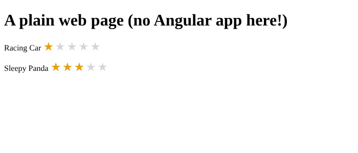

# Chapter 31: Web components (Angular Elements)

> **Like I'm 5:** Our star-rating part is so nice that other shops want it, but they build their toys from wood, plastic, or clay (other frameworks). A **web component** is a part with a standard plug that fits every kind of toy. We wrap our Angular star part in that plug, and now anyone can use it by writing `<toy-stars-widget rating="4.5">` in plain HTML.

Concept reference: [24. Web components and Angular Elements](../concepts/24-web-components-elements.md)

[Back: Chapter 30](30-libraries-and-schematics.md) · Next: [Chapter 32: Micro-frontends](32-micro-frontends.md)

## What we build today

In the **Toy Lab** workspace from Chapter 30, a third project, `widget`, that turns our `ToyStars` component into a **custom HTML element**, `<toy-stars-widget>`. Then we put it in a plain HTML page that has **no Angular app** in it:

```html
<p>Racing Car <toy-stars-widget rating="4.5"></toy-stars-widget></p>
```



## The big idea

**Web components** are a browser standard (not an Angular feature). You define a new HTML tag with JavaScript, and every page, in every framework, can use it. The pieces:

| Piece | What it does |
|-------|--------------|
| **Custom element** | A new tag with its own behaviour (`<toy-stars-widget>`). Registered with `customElements.define(tag, class)`. |
| **Shadow DOM** (optional) | A private tree of elements with scoped styles. |
| **Attributes and properties** | How the page sends data in (`rating="4.5"`). |
| **Events** | How the element sends data out (`addEventListener('changed', ...)`). |

**`@angular/elements`** wraps an Angular component as a custom element. `createCustomElement(Component, { injector })` returns the class; you register it with `customElements.define`. Angular's mapping:

| Angular | Becomes a custom element's... |
|---------|-------------------------------|
| `input()` | an **attribute** (`rating="4.5"`) and a **property** (`el.rating = 4.5`) |
| `output()` | a **DOM event** with the data in `event.detail` |
| `<ng-content>` | the element's children (only what exists when it is created) |
| Dependency injection | works, using the injector of a small Angular app you start first |

When to use it: to share a component with **non-Angular** pages (a CMS, a legacy site, other teams on other frameworks), or to embed a widget (a chat box, a rating, a map) in someone else's page. When **not** to: inside a normal Angular app. Use plain components there. Each element brings the Angular runtime with it (about 35 kB compressed for the first one), so the cost is only worth it when you cross a framework border.

**Grown-up words:**

- **Custom element**: a user-defined HTML tag.
- **Shadow DOM**: encapsulated DOM and CSS.
- **Attribute vs property**: attributes live in HTML and are always **text**; properties live in JavaScript and can be any type.
- **`CustomEvent`**: a DOM event that can carry data in `detail`.

## Step 1: Add the widget project and the package

From the workspace root:

```bash
ng generate application widget --style=css --routing=false --ssr=false
npm install @angular/elements
```

The widget is an *application* in the same workspace, because we build it into files (not into a library).

## Step 2: Register the element

Replace `projects/widget/src/main.ts`. Instead of starting a page, we start a tiny Angular app and register the element:

**`projects/widget/src/main.ts`**

```ts
import { createCustomElement } from '@angular/elements';
import { provideBrowserGlobalErrorListeners } from '@angular/core';
import { createApplication } from '@angular/platform-browser';
import { ToyStars } from 'toy-ui';

// 1. Start a tiny Angular app (without any page of its own).
// 2. Turn the ToyStars component into a custom HTML tag.
// 3. Tell the browser about the new tag.
createApplication({ providers: [provideBrowserGlobalErrorListeners()] }).then((app) => {
  const element = createCustomElement(ToyStars, { injector: app.injector });
  customElements.define('toy-stars-widget', element);
});
```

- `createApplication({ providers })` starts an **Angular application without a root component**. It only gives us an *injector* (Angular's dependency box, Chapter 9).
- `createCustomElement(ToyStars, { injector: app.injector })` makes a custom element class from the `ToyStars` component we built in Chapter 30, imported from `toy-ui`.
- `customElements.define('toy-stars-widget', element)` teaches the browser the new tag.
- **Tag names must contain a dash** (a rule of web components). Use your own prefix to avoid clashes.

Remember `numberAttribute` from Chapter 30? Here it earns its keep: `rating="4.5"` arrives as the text `"4.5"`, and `numberAttribute` makes it a number.

## Step 3: A plain page that uses it

Replace `projects/widget/src/index.html`:

**`projects/widget/src/index.html`**

```html
<!doctype html>
<html lang="en">
  <head>
    <meta charset="utf-8" />
    <title>Toy stars widget</title>
    <base href="/" />
    <meta name="viewport" content="width=device-width, initial-scale=1" />
  </head>
  <body>
    <h1>A plain web page (no Angular app here!)</h1>
    <p>Racing Car <toy-stars-widget rating="4.5"></toy-stars-widget></p>
    <p>Sleepy Panda <toy-stars-widget rating="3"></toy-stars-widget></p>
  </body>
</html>
```

Look at the page: `<h1>A plain web page (no Angular app here!)</h1>`, and our tags. The page has no `<app-root>`. Angular is only present as the script that defines the tags.

## Step 4: Build it into stable files

By default, the production build gives files names with a fingerprint (`main-XBFRWUB6.js`), which is perfect for an app. For a widget that *other people* load with a `<script>` tag, a **stable file name** is easier. In `angular.json`, under `widget`, `build`, `configurations`, `production`, change:

```json
"outputHashing": "none"
```

(It was `"all"`.) Then:

```bash
ng build toy-ui     # the widget reads the library from dist/
ng build widget
```

```
Initial chunk files | Names         |  Raw size | Estimated transfer size
main.js             | main          | 114.93 kB |                34.48 kB
styles.css          | styles        |   0 bytes |                 0 bytes

                    | Initial total | 114.93 kB |                34.48 kB
```

The widget is **115 kB raw, about 34 kB compressed**: that is Angular itself plus our component. The output is in `dist/widget/browser`; its `index.html` ends with:

```html
<script src="main.js" type="module"></script>
```

That one `<script>` line is all another page needs.

## Step 5: Try it

Serve the folder with any static file server, for example:

```bash
npx serve dist/widget/browser
```

Open it. Two rows of stars appear, drawn by Angular inside tags that are plain HTML. We checked this in a real browser:

```
stars drawn: 2
first fill width: 90% (rating 4.5 -> 90%)
second fill width: 60% (rating 3 -> 60%)
after setAttribute("rating","1"): 20%
no console problems
```

The last line matters. The test changed the attribute from **plain JavaScript** (`element.setAttribute('rating', '1')`), and the widget re-drew itself with 20 percent filled. The attribute is connected to the `input()`.

Add a test file so `ng test` stays happy (the generator makes none for a project with no components). It can be a placeholder:

**`projects/widget/src/widget.spec.ts`**

```ts
describe('widget', () => {
  it('has a test file so the test runner is happy', () => {
    expect(true).toBe(true);
  });
});
```

## Bonus lab: events and content, a second and third element

Real widgets also **send events out**, and some wrap **content**. The files in [`extras/ch31`](extras/ch31/) extend the widget with two more elements. Copy them into `projects/widget/src/` (rename `main.all-widgets.ts` to `main.ts` and `index.all-widgets.html` to `index.html`) and rebuild.

A component with an **input and an output**:

**`projects/widget/src/like-button.ts`**

```ts
import { Component, input, output, signal } from '@angular/core';

// A bigger example: it has an input (the toy name) AND an output (an event for the page).
// Angular Elements turns the input into an attribute/property, and the output into a
// real DOM event that plain JavaScript can listen to.
@Component({
  selector: 'toy-like',
  template: `
    <button type="button" (click)="press()">
      {{ liked() ? '❤️' : '🤍' }} {{ toy() }}
    </button>
  `,
})
export class ToyLike {
  toy = input('a toy');
  liked = signal(false);
  changed = output<{ toy: string; liked: boolean }>();

  press() {
    this.liked.update((v) => !v);
    this.changed.emit({ toy: this.toy(), liked: this.liked() });
  }
}
```

The main file registers all three elements with one helper:

**`projects/widget/src/main.ts`**

```ts
import { createCustomElement } from '@angular/elements';
import { provideBrowserGlobalErrorListeners } from '@angular/core';
import { createApplication } from '@angular/platform-browser';
import { ToyBadge, ToyStars } from 'toy-ui';
import { ToyLike } from './like-button';

createApplication({ providers: [provideBrowserGlobalErrorListeners()] }).then((app) => {
  const define = (tag: string, component: Parameters<typeof createCustomElement>[0]) =>
    customElements.define(tag, createCustomElement(component, { injector: app.injector }));

  define('toy-stars-widget', ToyStars);
  define('toy-badge-widget', ToyBadge);
  define('toy-like-widget', ToyLike);
});
```

And the page listens to the widget's event with plain JavaScript:

**`projects/widget/src/index.html`**

```html
<!doctype html>
<html lang="en">
  <head>
    <meta charset="utf-8" />
    <title>Toy widgets</title>
    <base href="/" />
    <meta name="viewport" content="width=device-width, initial-scale=1" />
  </head>
  <body>
    <h1>A plain web page (no Angular app here!)</h1>
    <p>Racing Car <toy-stars-widget rating="4.5"></toy-stars-widget></p>
    <p><toy-badge-widget tone="warning">Only 2 left</toy-badge-widget></p>
    <p><toy-like-widget toy="Racing Car"></toy-like-widget></p>
    <script>
      // Plain JavaScript, no framework: listen to the widget's event.
      document.querySelector('toy-like-widget').addEventListener('changed', (e) => {
        console.log('heard:', JSON.stringify(e.detail));
      });
    </script>
  </body>
</html>
```

Real results from a browser:

```
before click: 🤍 Racing Car
after click : ❤️ Racing Car
heard: {"toy":"Racing Car","liked":true}
heard: {"toy":"Racing Car","liked":false}
```

- The attribute `toy="Racing Car"` became the component's `input`.
- `output<{...}>()` became a DOM event named `changed`; the data is in `event.detail`. Any framework (or no framework) can use `addEventListener`.
- `<toy-badge-widget tone="warning">Only 2 left</toy-badge-widget>` showed the text **inside** the badge (content projection works for content that is there at creation). And changing the attribute `tone` to `happy` from JavaScript removed the warning class.

## Things to know about web components

| Topic | What to know |
|-------|--------------|
| **Styles** | By default Angular's emulated encapsulation applies. For full isolation use `encapsulation: ViewEncapsulation.ShadowDom`. Global page CSS then cannot leak in. |
| **Bundle cost** | Each widget bundle carries Angular. Several widgets on one page should share **one** Angular app (as we did). |
| **Change detection** | Zoneless Angular (the default) works well here; no zone.js is needed. |
| **Attribute names** | An input `ratingValue` becomes the attribute `rating-value` (kebab-case). Properties keep the camelCase name. |
| **Content projection** | Dynamic children added later are not projected. Prefer inputs for data. |
| **Server rendering** | Custom elements are drawn in the browser. They are not rendered by Angular SSR. |
| **Typed data** | Attributes are text. Use `transform: numberAttribute` / `booleanAttribute`, or set rich values with properties (`el.items = [...]`). |

## Check it works

- [ ] `ng build widget` makes `dist/widget/browser/main.js` (no fingerprint).
- [ ] A static server shows two rows of stars (90 percent and 60 percent filled).
- [ ] In the browser console, run `document.querySelector('toy-stars-widget').setAttribute('rating', '1')`: the stars update.
- [ ] `ng test` still passes for all projects.

## What you learned

- Web components are a browser standard; `@angular/elements` turns an Angular component into one.
- `createApplication` starts Angular without a root component; `createCustomElement` + `customElements.define` registers a tag.
- Inputs become attributes and properties, outputs become DOM events, and content projection works for initial children.
- Attributes are text, so inputs for widgets need transforms such as `numberAttribute`.
- Use Angular Elements to cross a framework border, not inside a normal Angular app.

## Try it yourself

1. Register `ToyBadge` as `toy-badge-widget` (use the bonus files) and put it on the page. Change its `tone` from the browser console.
2. Give `toy-like-widget` a boolean input `liked` using `booleanAttribute` and start it liked from HTML: `<toy-like-widget liked>`.
3. Switch `ToyStars` to `ViewEncapsulation.ShadowDom` and add a global CSS rule `span { color: red }` to the page. Does it reach into the stars? Try the same before the change.
4. Add a plain HTML page for a framework you know (React, Vue) that uses `<toy-stars-widget>`. (Hint: load `main.js`, then use the tag as normal.)

## If something goes wrong

**`Failed to execute 'define' on 'CustomElementRegistry': ... is not a valid custom element name`:** the tag has no dash. Use `toy-stars-widget`, not `starswidget`.

**`Failed to execute 'define' ... the name "toy-stars-widget" has already been used`:** the script ran twice (it was included two times, or two bundles define the same tag). Define each tag only once.

**The stars show `NaN` or nothing:** the input receives the text `"4.5"` but is not converted. Add `transform: numberAttribute`.

**The element appears but is empty:** the script that defines it has not loaded (or has an error). Open the console. Also check `type="module"` on the script tag.

**Styles from the page leak in or the widget's styles leak out:** choose `ViewEncapsulation.ShadowDom` for strict isolation, or `Emulated` (the default) for the Angular way.

Next: [Chapter 32: Micro-frontends](32-micro-frontends.md)
