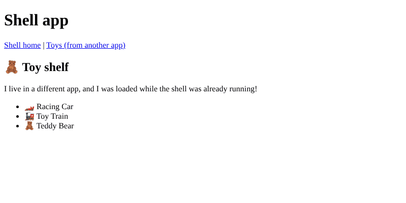

# Chapter 32: Micro-frontends

> **Like I'm 5:** A giant toy mall has many shops inside: a train shop, a doll shop, a puzzle shop. Each shop has its own owner, its own keys, and opens and closes on its own. The mall only provides the hallway and the signs. If the doll shop paints its walls, the train shop does not need to do anything. Micro-frontends split one giant website into small shops that are built, tested, and shipped separately, and are joined together in the browser.

Concept reference: [25. Micro-frontends](../concepts/25-micro-frontends.md)

[Back: Chapter 31](31-web-components.md) · Next: [Chapter 33: Build and bundling](33-build-and-bundling.md)

## What we build today

A tiny micro-frontend system in a new workspace, `toy-federation`:

- a **shell** app (the mall's hallway), running on port 4200, and
- a **remote** app, `toys-remote` (one shop), running on port 4201, which **exposes** a `ToyShelf` component.

When you click "Toys" in the shell, the shell **downloads the shelf from the other app while it is already running** and shows it. The two apps are built and served separately.



> **Be honest with yourself before you use this.** Micro-frontends solve an *organisation* problem (many teams that must ship independently), not a technical one. They add real cost: version mismatches, duplicate downloads, harder debugging, a shared design problem. For one team, a well-organised monorepo with libraries (Chapter 30) and lazy routes (Chapter 17) is simpler and faster. The Toy Shop stays a single app.

## The big idea

| Term | Plain words |
|------|-------------|
| **Shell / host** | The app the person opens. It decides the layout and loads the other pieces. |
| **Remote** | A separate app that **exposes** some components or routes. |
| **Federation** | Loading code from another app **at run time**, over the network. |
| **Shared dependencies** | Libraries like `@angular/core` that the shell and remotes should load **only once** (as singletons). |
| **Manifest** | A little JSON file in the shell that says where each remote lives. |
| **`remoteEntry.json`** | A JSON file each remote publishes that describes what it exposes and shares. |

**Native Federation** (the library `@angular-architects/native-federation`) does this with **web standards** (ES modules and import maps), so it works with Angular's modern `esbuild` builder. (Older projects use **Webpack Module Federation**, which needs a different, now older, builder.)

Ways to build micro-frontends, from simple to strong:

| Approach | Good for |
|----------|----------|
| Links between separate sites | Almost independent products |
| **iframes** | Strong isolation, clumsy UX |
| **Web components** (Chapter 31) | A framework-neutral widget embedded in other pages |
| **Federation** (today) | Several Angular apps sharing one page and one Angular |
| **Monorepo with libraries** (Chapter 30) | One team, one release. Often the best answer. |

Questions every micro-frontend project must answer:

- **Routing**: who owns the address bar? (Usually the shell.)
- **Shared state and login**: pass a token and events through a small shared library, not through global variables.
- **Design**: share one **design-system library** so shops look alike.
- **Versions**: all pieces must agree on the Angular version (singletons with `strictVersion`).
- **Deployment**: each remote is deployed alone; the shell finds it through the manifest. Never cache `remoteEntry.json` for long (Chapter 35).

## Step 1: Create the workspace and two apps

```bash
ng new toy-federation --create-application=false
cd toy-federation
ng generate application shell --style=css --routing --ssr=false
ng generate application toys-remote --style=css --routing=false --ssr=false
```

(Ten files for the empty workspace, then 12 for the shell and 11 for the remote.)

## Step 2: Make the remote a remote

```bash
ng add @angular-architects/native-federation --project toys-remote --type remote --port 4201
```

The real output:

```
CREATE projects/toys-remote/tsconfig.federation.json
CREATE projects/toys-remote/federation.config.mjs
CREATE projects/toys-remote/src/bootstrap.ts
UPDATE angular.json
UPDATE projects/toys-remote/src/main.ts
UPDATE package.json
```

What happened to the files:

- The app's old start-up code moved from `main.ts` to **`bootstrap.ts`**.
- The new `main.ts` first runs `initFederation()` and **then** imports `bootstrap`. Federation must be ready before the app starts, so `main.ts` is only a tiny loader:

**`projects/toys-remote/src/main.ts`**

```ts
import { initFederation } from '@angular-architects/native-federation';

initFederation(
  {},
  {
    hostRemoteEntry: { url: './remoteEntry.json' },
  },
)
  .catch((err) => console.error(err))
  .then((_) => import('./bootstrap'))
  .catch((err) => console.error(err));
```

**`projects/toys-remote/src/bootstrap.ts`**

```ts
import { bootstrapApplication } from '@angular/platform-browser';
import { appConfig } from './app/app.config';
import { App } from './app/app';

bootstrapApplication(App, appConfig).catch((err) => console.error(err));
```

- `angular.json` now uses the builder `@angular-architects/native-federation:build` for this project.
- **`federation.config.mjs`** says what this app calls itself, what it **exposes**, and what it **shares**:

**`projects/toys-remote/federation.config.mjs`**

```js
import {
  withNativeFederation,
  fromPackageJson,
} from '@angular-architects/native-federation/config';

export default withNativeFederation({
  name: 'toys-remote',

  exposes: {
    './ToyShelf': './projects/toys-remote/src/app/toy-shelf.ts',
  },

  shared: fromPackageJson({
    singleton: true,
    strictVersion: true,
    requiredVersion: 'auto',
    build: 'package',
  })
    // includeSecondaries is an opt-out of ignoreUnusedDeps, so all of
    // @angular/core is shared to prevent mismatches.
    .patch(['@angular/core'], { includeSecondaries: { keepAll: true } }),

  skip: [
    'rxjs/ajax',
    'rxjs/fetch',
    'rxjs/testing',
    'rxjs/webSocket',
    // Add further packages you don't need at runtime
  ],

  // Please read our FAQ about sharing libs:
  // https://shorturl.at/jmzH0

  features: {
    // ignoreUnusedDeps is enabled by default now
    // ignoreUnusedDeps: true,

    // Opt-in: groups chunks in remoteEntry.json for smaller metadata file
    denseChunking: true,
  },
});
```

Two parts matter to us:

- `name: 'toys-remote'`: the remote's name.
- `exposes: { './ToyShelf': './projects/toys-remote/src/app/toy-shelf.ts' }`: the public door. (The generated file exposed `./Component`, the whole app. We replaced it with the one component we want to share.)
- `shared: fromPackageJson({ singleton: true, strictVersion: true, ... })`: every package in `package.json` is shared as a **singleton**: the shell and the remote use **one** copy of Angular, not two. `strictVersion` makes a mismatch an error instead of a silent bug.

## Step 3: The component the remote exposes

**`projects/toys-remote/src/app/toy-shelf.ts`**

```ts
import { Component } from '@angular/core';

// This component lives in the REMOTE app. The shell borrows it while running.
@Component({
  selector: 'toys-toy-shelf',
  template: `
    <section>
      <h2>🧸 Toy shelf</h2>
      <p>I live in a different app, and I was loaded while the shell was already running!</p>
      <ul>
        @for (toy of toys; track toy) {
          <li>{{ toy }}</li>
        }
      </ul>
    </section>
  `,
})
export class ToyShelf {
  toys = ['🏎️ Racing Car', '🚂 Toy Train', '🧸 Teddy Bear'];
}
```

It is an ordinary standalone component (Chapter 2). Nothing in it knows it will be borrowed. The selector prefix `toys-` is the remote's own prefix.

## Step 4: Make the shell a host

```bash
ng add @angular-architects/native-federation --project shell --type dynamic-host --port 4200
```

```
CREATE projects/shell/public/federation.manifest.json
CREATE projects/shell/tsconfig.federation.json
CREATE projects/shell/federation.config.mjs
CREATE projects/shell/src/bootstrap.ts
UPDATE angular.json
UPDATE projects/shell/src/main.ts
UPDATE package.json
```

A **dynamic host** reads the list of remotes from a **manifest file** *at run time*. That means you can point the shell at a new version of a remote (or a new remote) without rebuilding the shell. The shell's `main.ts` hands the manifest to `initFederation`:

**`projects/shell/src/main.ts`**

```ts
import { initFederation } from '@angular-architects/native-federation';

initFederation('federation.manifest.json', {
  hostRemoteEntry: { url: './remoteEntry.json' },
})
  .catch((err) => console.error(err))
  .then((_) => import('./bootstrap'))
  .catch((err) => console.error(err));
```

Here is the manifest. **Watch the name!**

**`projects/shell/public/federation.manifest.json`**

```json
{
  "toys-remote": "http://localhost:4201/remoteEntry.json"
}
```

The generated file used the key `toysRemote` (the project name in camelCase). But the remote's `federation.config.mjs` calls itself `toys-remote`. **The key in the manifest, the name in `loadRemoteModule`, and the `name` in the remote's config must all be exactly the same.** We changed the manifest to `toys-remote`. If they differ, you get:

```
[NF][6]: Failed to load module toysRemote/./ToyShelf: {error: NFError: Remote 'toysRemote' is not initialized.}
```

(That is the real error we got while building this chapter, before we fixed the name.) The message looks mysterious, but it just says "no remote with that name was started".

## Step 5: Load the remote in a route

The shell has two pages: its own home, and `/toys`, which borrows the shelf:

**`projects/shell/src/app/app.routes.ts`**

```ts
import { loadRemoteModule } from '@angular-architects/native-federation';
import { Routes } from '@angular/router';
import { ShellHome } from './shell-home';

export const routes: Routes = [
  { path: '', component: ShellHome },
  {
    path: 'toys',
    // Ask the remote app for its ToyShelf, over the network, only when somebody visits /toys.
    loadComponent: () => loadRemoteModule('toys-remote', './ToyShelf').then((m) => m.ToyShelf),
  },
];
```

`loadRemoteModule('toys-remote', './ToyShelf')` is like `import(...)` (Chapter 17), but across the network: "ask the remote called `toys-remote` for the thing it exposes as `./ToyShelf`". It is lazy. Nothing is downloaded until someone opens `/toys`.

**`projects/shell/src/app/shell-home.ts`**

```ts
import { Component } from '@angular/core';

@Component({
  selector: 'app-shell-home',
  template: `<p>This page belongs to the shell.</p>`,
})
export class ShellHome {}
```

**`projects/shell/src/app/app.ts`**

```ts
import { Component } from '@angular/core';
import { RouterLink, RouterOutlet } from '@angular/router';

@Component({
  imports: [RouterOutlet, RouterLink],
  selector: 'app-root',
  template: `
    <h1>Shell app</h1>
    <nav>
      <a routerLink="/">Shell home</a> |
      <a routerLink="/toys">Toys (from another app)</a>
    </nav>
    <router-outlet />
  `,
})
export class App {}
```

## Step 6: Run both apps

Open **two terminals** and start each app:

```bash
ng serve toys-remote     # http://localhost:4201
ng serve shell           # http://localhost:4200
```

Open <http://localhost:4200/>. The shell shows "This page belongs to the shell." Click **Toys (from another app)**: the toy shelf appears, with a list of toys that comes from the other app.

We watched the network in a real browser, and it reported:

```
shell home says: This page belongs to the shell.
requests to the remote app (port 4201) so far: [ '/remoteEntry.json' ]
after clicking "Toys": 🧸 Toy shelf
list from the remote: [ '🏎️ Racing Car', '🚂 Toy Train', '🧸 Teddy Bear' ]
files fetched from the remote: [ '/remoteEntry.json', '/ToyShelf.js' ]
no console problems
```

Read what that means:

1. When the shell **opened**, it fetched only `remoteEntry.json` from the remote (the "menu": what is exposed and shared).
2. When we **clicked Toys**, it fetched `ToyShelf.js` (the shelf's code) from port 4201 and showed it.
3. No errors: Angular was loaded **once**, and shared.

You can look at the menu yourself: open <http://localhost:4201/remoteEntry.json>. It contains the remote's `name` (`toys-remote`), the `exposes` list (`./ToyShelf`), and the `shared` packages (`@angular/core` and its parts).

Now the independence test. Change the text of the list in `toy-shelf.ts`, save, and look at the shell in the browser. The remote rebuilt, and the shell shows the new list **without being rebuilt or redeployed**. In production that is the point: the toy team ships on its own schedule.

## Step 7: Beyond the demo (read, do not skip)

Things a real micro-frontend project must handle, and that we did **not** build:

| Topic | What to do |
|-------|------------|
| **Shared UI** | Put buttons, colours, and fonts in one design-system library (Chapter 30) used by shell and remotes, with a strict version policy. |
| **Login** | The shell logs the person in and passes the token down (a shared service exposed by a tiny shared library, or a custom event). A remote must not log in again. |
| **Routing** | The shell owns top-level routes; a remote may own its sub-routes (`loadChildren: () => loadRemoteModule(...).then(m => m.ROUTES)`). |
| **Error handling** | A remote can be down. Catch the failure of `loadRemoteModule` and show a friendly fallback (Chapter 23). |
| **Testing** | Test each remote alone, and add a few end-to-end tests for the integrated shell (Chapter 24). |
| **Deployment** | Each remote has its own pipeline (Chapter 35). The shell reads the manifest at run time, so the manifest and `remoteEntry.json` must **not** be cached for long. |
| **Version drift** | If a remote is built against Angular 22 and the shell runs 21, `strictVersion` stops the load. Plan upgrades together (Chapter 36). |
| **Performance** | Shared singletons avoid duplicate Angular; but each remote adds requests. Measure (Chapter 27). |

## Check it works

- [ ] `ng serve toys-remote` and `ng serve shell` both start without errors.
- [ ] `http://localhost:4201/remoteEntry.json` shows `"name": "toys-remote"` and `./ToyShelf` in `exposes`.
- [ ] The shell's home page loads, and the **Network** tab shows only `remoteEntry.json` from port 4201.
- [ ] Clicking **Toys** shows the shelf, and `ToyShelf.js` arrives from port 4201.
- [ ] The console has no errors.

## What you learned

- Micro-frontends split a large front end into separately built and deployed apps; they solve team independence, with a real cost.
- A **shell/host** loads **remotes** at run time. Native Federation uses ES modules and import maps, and works with Angular's modern builder.
- `exposes` lists what a remote shares; `shared` makes Angular a singleton; the **manifest** tells the host where remotes live.
- `loadRemoteModule(remoteName, exposedName)` is a network `import()`. The names must match everywhere.
- Often a monorepo with libraries is the simpler, better choice.

## Try it yourself

1. Add a second exposed component (`./ToyPrice`) to the remote and a second route in the shell that loads it.
2. Stop `ng serve toys-remote` and open `/toys` in the shell. What does the console say? Wrap `loadRemoteModule` in a `catch` that returns a "The toy shelf is not available" component.
3. Change the Angular version requirement for the remote on purpose (edit `requiredVersion`) and watch `strictVersion` complain.
4. Look at `federation.config.mjs`. What is the `skip` list for?

## If something goes wrong

**`NFError: Remote 'toysRemote' is not initialized.`:** the name does not match. Compare the manifest key, the first argument of `loadRemoteModule`, and `name` in the remote's `federation.config.mjs`. They must be identical.

**`Failed to fetch dynamically imported module` / the shelf never appears:** the remote is not running on the port in the manifest (4201), or the manifest path is wrong.

**`Invalid asm.js: Unexpected token` warning in the console:** a harmless warning from a dev-server helper. It is not part of your code.

**Two copies of Angular (strange `NG0201` or "injection context" errors across the border):** the shared singleton was not set up, or the versions do not match. Check `shared` in both configs.

**It works in development but not when deployed:** the manifest still points to `http://localhost:4201`. In production it must point to the deployed address of each remote.

Next: [Chapter 33: Build and bundling](33-build-and-bundling.md)
