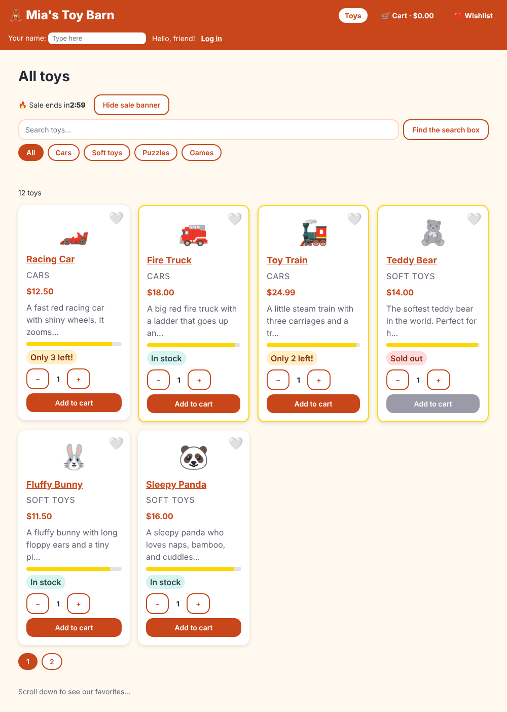

# Chapter 34: Environments and configuration

> **Like I'm 5:** You wear different clothes in different places: pyjamas at home, a school uniform at school, a party dress at a party. You are still you. An app is the same. It is the same app in your practice room (development), in the test room, and in the real shop (production), but a few things change: which server it talks to, how chatty it is, what the shop is called. **Environments** are the outfits. **Configuration** is the list of things that change with the outfit.

Concept reference: [33. Environments and configuration](../concepts/33-environments-and-configuration.md)

[Back: Chapter 33](33-build-and-bundling.md) · Next: [Chapter 35: CI/CD and deployment](35-cicd-and-deployment.md)

## What we build today

Two kinds of settings for the Toy Shop:

1. **Settings fixed when we build** (the address of the server, whether to print chatty messages). They live in *environment files*.
2. **Settings we can change after the build, without building again** (the shop's name, the tax rate, how many minutes the sale lasts). They live in a file called `config.json`.

At the end we change `config.json` *inside the finished build*, reload, and the shop turns into **Mia's Toy Barn** with a 3-minute sale and 10 percent tax. No rebuild.



## The big idea

| | Build-time (environment files) | Runtime (`config.json`) |
|--|--------------------------------|--------------------------|
| **Decided** | when you run `ng build` | when the app starts in the browser |
| **Change it by** | building again | editing a file on the server |
| **One build for all places?** | No. One build per environment. | **Yes.** Build once, deploy everywhere. |
| **Good for** | on/off switches for developers, things that never change per place | server addresses, shop name, feature flags, anything that differs between test and real shop |

**Build once, deploy everywhere** is a golden rule: the exact files you tested are the files that go live. If you rebuild for production, you ship something you never tested. Runtime configuration lets one build wear different outfits.

> **The most important rule of this chapter:** *Nothing in a browser app is secret.* Environment files and `config.json` are downloaded by every visitor, and anybody can read them. Never put a password, an API secret, or a private key in them. (We prove this in Step 4.)

## Step 1: Create the environment files

```bash
ng generate environments
```

The real output:

```
CREATE src/environments/environment.ts (31 bytes)
CREATE src/environments/environment.development.ts (31 bytes)
CREATE src/environments/environment.hi.ts (31 bytes)
UPDATE angular.json (3023 bytes)
```

Notice three things:

- `environment.ts` is the **default**, which in a new project means **production**. (Older tutorials use `environment.prod.ts`. The modern generator does not.)
- `environment.development.ts` is the practice-room version. The generator added a `fileReplacements` entry to the `development` build configuration, which means "when you build with `development` (that is what `ng serve` does), use this file **instead of** `environment.ts`."
- It also made `environment.hi.ts` because `hi` (Hindi, Chapter 22) is one of our build configurations. **We deleted that file and the matching entry.** Hindi is a *language*, not an *outfit*. An `ng serve --configuration hi` still gets the development file, because it builds with `development,hi` together.

The block in `angular.json`:

**`angular.json`** (lines 62-72)

```json
            "development": {
              "optimization": false,
              "extractLicenses": false,
              "sourceMap": true,
              "fileReplacements": [
                {
                  "replace": "src/environments/environment.ts",
                  "with": "src/environments/environment.development.ts"
                }
              ]
            },
```

Now fill the two files. Both are plain TypeScript objects:

**`src/environments/environment.ts`**

```ts
// The REAL shop (production). ng build uses this file.
export const environment = {
  production: true,
  apiUrl: '/api',
};
```

**`src/environments/environment.development.ts`**

```ts
// Practice mode. ng serve uses this file instead (angular.json swaps it in).
// Never put secrets here. Everything in these files is visible to everybody.
export const environment = {
  production: false,
  apiUrl: '/api',
};
```

Both say `/api` because the Toy Shop has no real server: our fake backend (Chapter 14) answers `/api/...`. In a real project, the production file would hold the real address, such as `https://api.example.com/api`, and the development one `http://localhost:8080/api`.

## Step 2: Stop typing server addresses by hand

Until now every service wrote `'/api/orders'` itself. That is the same word in many places, and if the address changes we hunt for it. Give it one name, using an **injection token** (Chapter 9):

**`src/app/tokens.ts`** (what changed)

```diff
@@ -1,4 +1,5 @@
 import { InjectionToken } from '@angular/core';
+import { environment } from '../environments/environment';
 
 // An InjectionToken is a name tag for a value that is not a class.
 // The "factory" is the default value if nobody gives a different one.
@@ -9,3 +10,9 @@ export const SHOP_NAME = new InjectionToken<string>('SHOP_NAME', {
 export const TAX_RATE = new InjectionToken<number>('TAX_RATE', {
   factory: () => 0.08, // 8 percent
 });
+
+// The address of the server. It comes from the environment file, so production
+// and practice mode can use different servers without changing any other code.
+export const API_URL = new InjectionToken<string>('API_URL', {
+  factory: () => environment.apiUrl,
+});
```

`API_URL` has a default `factory` that reads the environment file, so nobody has to provide it. A test can still override it with `{ provide: API_URL, useValue: '/test-api' }`.

Now use it. Here is the order service:

**`src/app/services/order-service.ts`** (what changed)

```diff
@@ -2,17 +2,19 @@ import { HttpClient, HttpContext } from '@angular/common/http';
 import { inject, Service } from '@angular/core';
 import { SKIP_ERROR_TOAST } from '../interceptors/error-interceptor';
 import { NewOrder, Order } from '../models/order';
+import { API_URL } from '../tokens';
 
 @Service()
 export class OrderService {
   private http = inject(HttpClient);
+  private api = inject(API_URL);
 
   place(order: NewOrder) {
-    return this.http.post<Order>('/api/orders', order, { context: quiet() });
+    return this.http.post<Order>(`${this.api}/orders`, order, { context: quiet() });
   }
 
   mine() {
-    return this.http.get<Order[]>('/api/orders', { context: quiet() });
+    return this.http.get<Order[]>(`${this.api}/orders`, { context: quiet() });
   }
 }
 
```

The same small change happens in five other files. Open the box to see them:

<details>
<summary>Show the other five changes (auth service, three interceptors, the error lab)</summary>

**`src/app/services/auth-service.ts`** (what changed)

```diff
@@ -3,6 +3,7 @@ import { computed, effect, inject, Service, signal } from '@angular/core';
 import { tap } from 'rxjs';
 import { SKIP_ERROR_TOAST } from '../interceptors/error-interceptor';
 import { User } from '../models/user';
+import { API_URL } from '../tokens';
 import { StorageService } from './storage-service';
 
 const SESSION_KEY = 'toyshop-user';
@@ -10,6 +11,7 @@ const SESSION_KEY = 'toyshop-user';
 @Service()
 export class AuthService {
   private http = inject(HttpClient);
+  private api = inject(API_URL);
   private storage = inject(StorageService);
 
   private readonly _user = signal<User | null>(this.load());
@@ -30,7 +32,7 @@ export class AuthService {
   login(email: string, password: string) {
     return this.http
       .post<User>(
-        '/api/login',
+        `${this.api}/login`,
         { email, password },
         { context: new HttpContext().set(SKIP_ERROR_TOAST, true) }, // the login page explains it
       )
```

**`src/app/interceptors/auth-interceptor.ts`** (what changed)

```diff
@@ -1,13 +1,15 @@
 import { HttpInterceptorFn } from '@angular/common/http';
 import { inject } from '@angular/core';
 import { AuthService } from '../services/auth-service';
+import { API_URL } from '../tokens';
 
 // Sticks the shopper's "ID card" (token) on every letter to OUR server.
 export const authInterceptor: HttpInterceptorFn = (req, next) => {
   const token = inject(AuthService).token();
+  const api = inject(API_URL);
 
   // Only our own API gets the token. Never send it to other websites!
-  if (token && req.url.startsWith('/api/')) {
+  if (token && req.url.startsWith(api + '/')) {
     return next(req.clone({ setHeaders: { Authorization: `Bearer ${token}` } }));
   }
   return next(req);
```

**`src/app/interceptors/error-interceptor.ts`** (what changed)

```diff
@@ -4,6 +4,7 @@ import { Router } from '@angular/router';
 import { catchError, throwError } from 'rxjs';
 import { AuthService } from '../services/auth-service';
 import { NotificationService } from '../services/notification-service';
+import { API_URL } from '../tokens';
 
 // A request can carry a little note. This note says: "I will explain a problem
 // to the person myself, so please do not show a pop-up."
@@ -13,6 +14,7 @@ export const errorInterceptor: HttpInterceptorFn = (req, next) => {
   const notify = inject(NotificationService);
   const auth = inject(AuthService);
   const router = inject(Router);
+  const api = inject(API_URL);
 
   return next(req).pipe(
     catchError((error: HttpErrorResponse) => {
@@ -20,7 +22,7 @@ export const errorInterceptor: HttpInterceptorFn = (req, next) => {
 
       if (error.status === 0 && !skip) {
         notify.show($localize`:@@err.offline:We cannot reach the server. Is the internet on?`);
-      } else if (error.status === 401 && req.url !== '/api/login') {
+      } else if (error.status === 401 && req.url !== `${api}/login`) {
         // The login has run out. Log out and go back to the login page.
         auth.logout();
         router.navigate(['/login'], { queryParams: { returnUrl: router.url } });
```

**`src/app/interceptors/fake-backend-interceptor.ts`** (what changed)

```diff
@@ -4,6 +4,7 @@ import { mergeMap, of, throwError, timer } from 'rxjs';
 import { NewOrder, Order } from '../models/order';
 import { User } from '../models/user';
 import { StorageService } from '../services/storage-service';
+import { API_URL } from '../tokens';
 
 export const FAKE_BACKEND_DELAY_MS = 300;
 const ORDERS_KEY = 'toyshop-orders';
@@ -12,7 +13,8 @@ const ORDERS_KEY = 'toyshop-orders';
 // learn without building a real backend. In a real project you delete this file
 // and the real server (for example Spring Boot) answers instead.
 export const fakeBackendInterceptor: HttpInterceptorFn = (req, next) => {
-  if (!req.url.startsWith('/api/')) return next(req);
+  const api = inject(API_URL);
+  if (!req.url.startsWith(api + '/')) return next(req);
   const storage = inject(StorageService);
 
   // Answer after a short wait, like a real server would.
@@ -26,10 +28,11 @@ export const fakeBackendInterceptor: HttpInterceptorFn = (req, next) => {
     );
 
   // GET /api/boom always fails with a 500, so we can practice handling errors.
-  if (req.url === '/api/boom') return reply(500, { message: 'Boom! The server broke on purpose.' });
+  if (req.url === `${api}/boom`)
+    return reply(500, { message: 'Boom! The server broke on purpose.' });
 
   // POST /api/login  (the password is always "toys123")
-  if (req.method === 'POST' && req.url === '/api/login') {
+  if (req.method === 'POST' && req.url === `${api}/login`) {
     const { email, password } = req.body as { email: string; password: string };
     if (password !== 'toys123') return reply(401, { message: 'Wrong email or password' });
     const user: User = {
@@ -46,14 +49,14 @@ export const fakeBackendInterceptor: HttpInterceptorFn = (req, next) => {
   const userEmail = token.startsWith('fake-token-') ? token.slice('fake-token-'.length) : '';
   if (!userEmail) return reply(401, { message: 'Please log in first' });
 
-  if (req.method === 'GET' && req.url === '/api/orders') {
+  if (req.method === 'GET' && req.url === `${api}/orders`) {
     return reply(
       200,
       loadOrders(storage).filter((o) => o.userEmail === userEmail),
     );
   }
 
-  if (req.method === 'POST' && req.url === '/api/orders') {
+  if (req.method === 'POST' && req.url === `${api}/orders`) {
     const orders = loadOrders(storage);
     const order: Order = {
       ...(req.body as NewOrder),
```

**`src/app/admin/error-lab/error-lab.ts`** (what changed)

```diff
@@ -1,6 +1,7 @@
 import { HttpClient } from '@angular/common/http';
 import { Component, inject, signal } from '@angular/core';
 import { LoggerService } from '../../services/logger-service';
+import { API_URL } from '../../tokens';
 
 // A practice corner: break things on purpose and watch the safety nets catch them.
 @Component({
@@ -11,12 +12,13 @@ import { LoggerService } from '../../services/logger-service';
 })
 export class ErrorLab {
   private http = inject(HttpClient);
+  private api = inject(API_URL);
   logger = inject(LoggerService);
   result = signal('');
 
   // 1. A broken server. The error interceptor shows a pop-up.
   breakServer() {
-    this.http.get('/api/boom').subscribe({
+    this.http.get(`${this.api}/boom`).subscribe({
       error: (e) => this.result.set(`The page heard: HTTP ${e.status}`),
     });
   }
```

</details>

Look closely at the auth interceptor. It only sticks the login token on requests that start with `api + '/'`. That rule (never send the token to other websites, Chapter 14 and 26) now follows the token if the API moves to another address.

## Step 3: Chatty messages only in practice mode

In Chapter 8 the countdown printed numbered messages so you could watch the lifecycle. A real shop should not shout into every visitor's console. A tiny helper prints only when the environment is not production:

**`src/app/utils/debug.ts`**

```ts
import { environment } from '../../environments/environment';

// Chatty messages for developers. They only print in practice mode,
// and stay silent in the real shop.
export function debug(...messages: unknown[]) {
  if (!environment.production) console.debug(...messages);
}
```

The countdown now calls `debug(...)` instead of `console.debug(...)`:

**`src/app/components/sale-countdown/sale-countdown.ts`** (what changed)

```diff
@@ -1,4 +1,5 @@
 import { afterNextRender, Component, input, OnDestroy, OnInit, signal } from '@angular/core';
+import { debug } from '../../utils/debug';
 
 @Component({
   imports: [],
@@ -14,23 +15,23 @@ export class SaleCountdown implements OnInit, OnDestroy {
 
   constructor() {
     // The constructor is only for getting helpers. Real work waits for later hooks.
-    console.debug('1. constructor: I was just born');
+    debug('1. constructor: I was just born');
 
     // afterNextRender runs once, after the first drawing is really on the screen.
     // It never runs on a server, so a server never starts a clock that nobody stops.
     afterNextRender(() => {
-      console.debug('3. afterNextRender: I am on the screen, start the clock');
+      debug('3. afterNextRender: I am on the screen, start the clock');
       this.timer = setInterval(() => this.tick(), 1000);
     });
   }
 
   ngOnInit() {
-    console.debug('2. ngOnInit: my inputs are ready, show the time');
+    debug('2. ngOnInit: my inputs are ready, show the time');
     this.tick();
   }
 
   ngOnDestroy() {
-    console.debug('4. ngOnDestroy: I am leaving, stop the clock');
+    debug('4. ngOnDestroy: I am leaving, stop the clock');
     clearInterval(this.timer);
   }
 
```

We checked in a real browser:

```
production build:       no debug messages
ng serve (development): 1. constructor: I was just born
                        2. ngOnInit: my inputs are ready, show the time
                        3. afterNextRender: I am on the screen, start the clock
```

> **Honest note:** the production bundle still *contains* the words "I was just born". The message is not printed, but the text is still in the file. A build-time switch that removes code completely needs more work (for example, constants the builder can see through). For a few strings it does not matter. For big or private code it does.

## Step 4: Everything here is public

Build for production and search for the server address in the files a visitor downloads:

```bash
npm run build
grep -l "apiUrl" dist/toy-shop/browser/*.js
```

You will find your settings inside the JavaScript, readable by anyone with DevTools. That is why the rule: **no secrets**. Anything that must stay private (a payment key, a database password) lives on a server, and the browser asks the server to use it.

## Step 5: Runtime settings with `config.json`

Put the file in `public/` so the build copies it next to `index.html`:

**`public/config.json`**

```json
{
  "shopName": "Toy Shop",
  "taxRate": 0.08,
  "saleMinutes": 10
}
```

A service loads it once, before anything else needs it:

**`src/app/services/config-service.ts`**

```ts
import { HttpClient } from '@angular/common/http';
import { inject, Service, signal } from '@angular/core';
import { catchError, firstValueFrom, of } from 'rxjs';

export interface AppConfig {
  shopName: string;
  taxRate: number;
  saleMinutes: number;
}

const DEFAULTS: AppConfig = { shopName: 'Toy Shop', taxRate: 0.08, saleMinutes: 10 };

// Settings that can change WITHOUT building the app again.
// They live in config.json, which the server can swap for each place (test, real shop...).
@Service()
export class ConfigService {
  private http = inject(HttpClient);
  private readonly _config = signal<AppConfig>(DEFAULTS);
  readonly config = this._config.asReadonly();

  // Called once, before the app starts. If the file is missing we keep the defaults.
  load(): Promise<void> {
    return firstValueFrom(
      this.http.get<Partial<AppConfig>>('config.json').pipe(catchError(() => of({}))),
    ).then((fromFile) => this._config.set({ ...DEFAULTS, ...fromFile }));
  }
}
```

- It starts with **defaults**, so the app still works if the file is missing.
- `load()` fetches `config.json` (relative address, so it also works if the shop lives in a sub-folder) and merges what it finds on top of the defaults. If the request fails, `catchError` keeps the defaults.
- `config` is a read-only **signal** (Chapter 10). Anything that reads it is up to date.

Now make Angular wait for it. `provideAppInitializer` runs a function **before the app starts**, and the app waits if the function returns a promise. The name and the tax rate come from the config, instead of the fixed values we had before:

**`src/app/app.config.ts`** (what changed)

```diff
@@ -3,6 +3,7 @@ import {
   ApplicationConfig,
   ErrorHandler,
   inject,
+  provideAppInitializer,
   provideBrowserGlobalErrorListeners,
   isDevMode,
 } from '@angular/core';
@@ -23,6 +24,7 @@ import { fakeBackendInterceptor } from './interceptors/fake-backend-interceptor'
 import { loadingInterceptor } from './interceptors/loading-interceptor';
 import { SelectivePreload } from './preload-strategy';
 import { AnnouncingTitleStrategy } from './title-strategy';
+import { ConfigService } from './services/config-service';
 import { LoggerService } from './services/logger-service';
 import { NotificationService } from './services/notification-service';
 import { SHOP_NAME, TAX_RATE } from './tokens';
@@ -63,8 +65,10 @@ export const appConfig: ApplicationConfig = {
     { provide: TitleStrategy, useExisting: AnnouncingTitleStrategy },
     // Our own safety net replaces Angular's plain one.
     { provide: ErrorHandler, useClass: GlobalErrorHandler },
-    { provide: SHOP_NAME, useValue: 'Toy Shop' },
-    { provide: TAX_RATE, useValue: 0.08 },
+    // Before the app starts, read config.json (the settings that can change without a rebuild).
+    provideAppInitializer(() => inject(ConfigService).load()),
+    { provide: SHOP_NAME, useFactory: () => inject(ConfigService).config().shopName },
+    { provide: TAX_RATE, useFactory: () => inject(ConfigService).config().taxRate },
     // After the server's page arrives, Angular "wakes it up" (hydration) instead of redrawing it.
     // withEventReplay remembers clicks that happen BEFORE it wakes up, and plays them back.
     provideClientHydration(withEventReplay()),
```

The sale length also comes from the config:

**`src/app/pages/home/home.ts`** (what changed)

```diff
@@ -32,6 +32,7 @@ import { SaleCountdown } from '../../components/sale-countdown/sale-countdown';
 import { CATEGORY_LABELS } from '../../models/category-labels';
 import { Category, Product } from '../../models/product';
 import { CartService } from '../../services/cart-service';
+import { ConfigService } from '../../services/config-service';
 import { ProductService } from '../../services/product-service';
 import { WishlistStore } from '../../services/wishlist-store';
 
@@ -60,7 +61,8 @@ export class Home {
   loading = signal(true);
   error = signal('');
 
-  saleEnds = new Date(Date.now() + 10 * 60 * 1000);
+  // How long the sale lasts is a setting in config.json (change it without rebuilding!).
+  saleEnds = new Date(Date.now() + inject(ConfigService).config().saleMinutes * 60 * 1000);
   showSale = signal(true);
 
   categories = (['all', 'cars', 'soft', 'puzzles', 'games'] as CategoryChoice[]).map((id) => ({
```

> **Watch out in an initializer:** call `inject(...)` at the **top** of the function, before the first `await`. After an `await`, Angular no longer knows which injector you mean. Our `load()` is written so the `inject` happens when the service is created, not later.

### Why the home page changed to server drawing

Remember Chapter 28? The home page was **prerendered**: drawn once, at build time, into a file. A prerendered page would freeze `Toy Shop` and `10 minutes` into the HTML file, and changing `config.json` later would not change the page that arrives first. So the home page now moves from `Prerender` to `Server` (drawn fresh on each visit):

**`src/app/app.routes.server.ts`** (what changed)

```diff
@@ -1,9 +1,13 @@
 import { RenderMode, ServerRoute } from '@angular/ssr';
 
-// For each address, who draws the page?
+// For each address, who draws the page, and when?
+//   Prerender = once, when we build (fast, but frozen until the next build)
+//   Server    = fresh on every visit (always up to date)
+//   Client    = in the browser (for pages about ONE person)
 export const serverRoutes: ServerRoute[] = [
-  // The home page is the same for everybody, so draw it once, when we build.
-  { path: '', renderMode: RenderMode.Prerender },
+  // The home page shows settings from config.json and the toy list. Both can change
+  // WITHOUT a new build, so the server draws it fresh each time.
+  { path: '', renderMode: RenderMode.Server },
 
   // A toy page changes with the toy in the address, so the server draws it on request.
   { path: 'product/:id', renderMode: RenderMode.Server },
```

This is a real trade-off: server drawing costs a little work per visit, but the page is always up to date. Pick `Prerender` only for pages whose content is the same until the next build.

### Tests

**`src/app/services/config-service.spec.ts`**

```ts
import { provideHttpClient } from '@angular/common/http';
import { HttpTestingController, provideHttpClientTesting } from '@angular/common/http/testing';
import { TestBed } from '@angular/core/testing';
import { ConfigService } from './config-service';

describe('ConfigService', () => {
  let server: HttpTestingController;
  let service: ConfigService;

  beforeEach(() => {
    TestBed.configureTestingModule({
      providers: [provideHttpClient(), provideHttpClientTesting()],
    });
    service = TestBed.inject(ConfigService);
    server = TestBed.inject(HttpTestingController);
  });

  it('starts with sensible defaults', () => {
    expect(service.config().shopName).toBe('Toy Shop');
  });

  it('takes the values it finds in config.json, and keeps defaults for the rest', async () => {
    const loading = service.load();
    server.expectOne('config.json').flush({ shopName: 'Mia’s Toys', saleMinutes: 3 });
    await loading;
    expect(service.config()).toEqual({ shopName: 'Mia’s Toys', taxRate: 0.08, saleMinutes: 3 });
  });

  it('keeps the defaults when config.json cannot be loaded', async () => {
    const loading = service.load();
    server.expectOne('config.json').flush('nope', { status: 404, statusText: 'Not Found' });
    await loading;
    expect(service.config().taxRate).toBe(0.08);
  });
});
```

Three promises are tested: defaults, merging, and a missing file. (`expectOne('config.json')` is the fake server from Chapter 13.)

## Step 6: Prove it, with no rebuild

```bash
npm run build
```

Open `dist/toy-shop/browser/config.json` and see the defaults:

```json
{
  "shopName": "Toy Shop",
  "taxRate": 0.08,
  "saleMinutes": 10
}
```

Start the server (`npm run serve:ssr:toy-shop`) and look at the page: the header says **🧸 Toy Shop**, the sale countdown starts at **9:59**, and adding the $12.50 Racing Car shows **$13.50** in the cart link (12.50 plus 8 percent).

Now **edit only the built file**, `dist/toy-shop/browser/config.json`:

```json
{ "shopName": "Mia's Toy Barn", "taxRate": 0.1, "saleMinutes": 3 }
```

Reload the page. Do not rebuild. Do not restart the server. We ran exactly this, and the browser reported:

```
before:  logo: 🧸 Toy Shop         countdown: 9:59   cart: $13.50
after:   logo: 🧸 Mia's Toy Barn   countdown: 2:59   cart: $13.75
no console errors
```

The server's own HTML (we checked with `curl`) already contains `Mia's Toy Barn`, so even the first paint, before JavaScript wakes up, has the new name.

That is the power: **the same build, a different shop.** In Chapter 35 the same trick lets one Docker image run as the test shop and the real shop, with a different `config.json` mounted for each.

## Feature flags (reading only)

A **feature flag** is a switch in configuration: `"newCheckout": true`. The code shows the new checkout page only if the flag is on. Benefits: you can ship unfinished work hidden, switch it on for 5 percent of people, and switch it off in a second if it breaks. The rule: **remove the flag and the old code once the feature is fully live**, or the code fills up with dead branches. Our `config.json` is a fine place for simple flags; bigger teams use a flag service.

## Check it works

```bash
npx ng test --watch=false
```

```
 Test Files  39 passed (39)
      Tests  99 passed (99)
```

- [ ] `ng serve` prints the three numbered messages in the browser console; the production build prints none.
- [ ] `npm run build` copies `config.json` to `dist/toy-shop/browser/`.
- [ ] After editing that copy, a reload shows the new name, countdown, and tax with **no** rebuild.
- [ ] If you delete `config.json` from the build folder, the shop still works with the defaults (try it).
- [ ] `grep -rn "'/api" src/app` finds no hard-coded addresses outside the environment and token files.

## What you learned

- **Environment files** are chosen at build time with `fileReplacements`. `ng generate environments` creates them (`environment.ts` is production).
- **Runtime configuration** (`config.json`) is read when the app starts, so one build can run anywhere. **Build once, deploy everywhere.**
- An **injection token** (`API_URL`) gives a setting one name, and tests can override it.
- `provideAppInitializer` makes Angular wait for the configuration before the app starts.
- Pages that show runtime settings cannot be prerendered. Draw them on the server.
- **Never put secrets in browser configuration.** It is public.

## Try it yourself

1. Add a boolean `"showSale": true` to `config.json` and `AppConfig`, and hide the sale banner when it is false. Test it by editing the built file.
2. Add a `staging` build configuration with its own `environment.staging.ts` (`apiUrl: '/staging-api'`) and run `ng build --configuration staging`. What do you need to copy from `production`?
3. Delete `config.json` and reload. Which defaults appear? Why is this a safe design? What could go wrong if `taxRate` had no default?
4. Make `ConfigService` complain loudly (a clear message in the console) when `taxRate` is not a number. Why is it better to fail on startup than at checkout?
5. Add a test that overrides `API_URL` with `{ provide: API_URL, useValue: '/test-api' }` and checks that `OrderService.mine()` calls `/test-api/orders`.

## If something goes wrong

**The shop name does not change after you edit `config.json`:** the browser kept the old file. Open DevTools, **Network**, tick **Disable cache**, and reload. In real life, tell the server to send `config.json` with `Cache-Control: no-cache`. We learn how in Chapter 35 (our own server cached it for a year by default, a real bug we found).

**`config.json` works in `ng serve` but 404s when deployed:** the file was not copied. Check that it is in `public/` and that your deployment publishes the whole `browser/` folder.

**The page flashes the old name for a moment, then switches:** the page was prerendered or cached with the old value. Use server drawing for pages that depend on runtime settings.

**`Cannot find module '../environments/environment'`:** you have not run `ng generate environments` (or deleted the folder).

**Production still prints debug messages:** you used `console.debug` directly instead of the `debug()` helper, or the file replacement is wired to the wrong configuration. Check that `development` has the `fileReplacements` and `production` has none.

Next: [Chapter 35: CI/CD and deployment](35-cicd-and-deployment.md)
