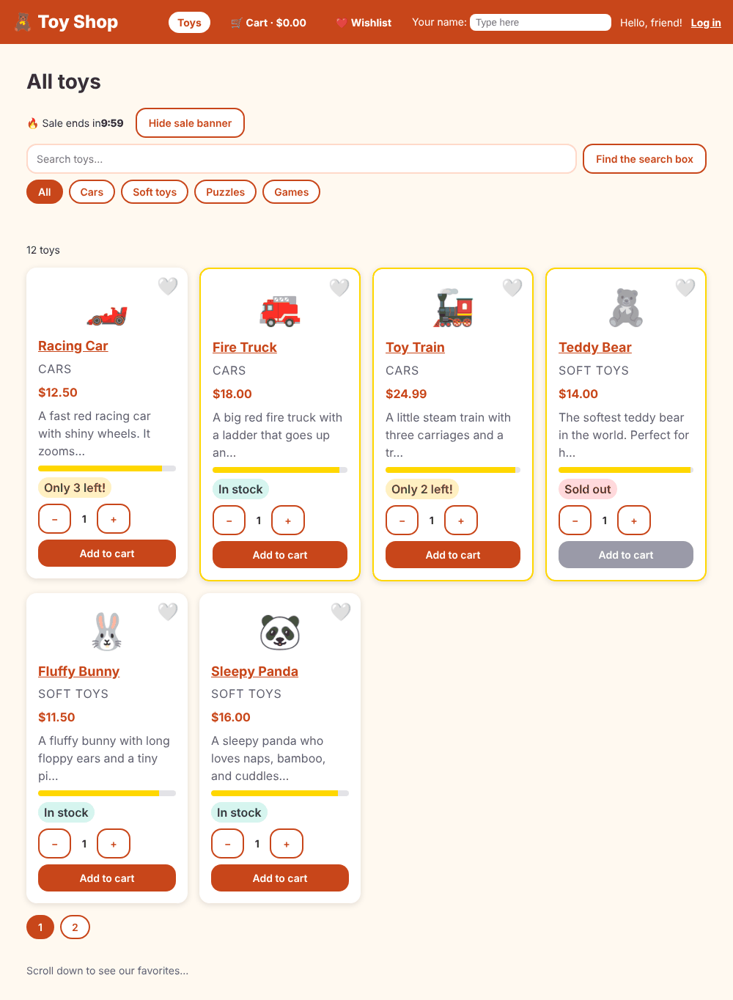

# Chapter 35: CI/CD and deployment

> **Like I'm 5:** Imagine a toy factory with a conveyor belt. Every time a toy-maker changes a toy, a robot picks it up and asks: *Is it neat? Does it work? Is it small enough? Is it safe?* If every answer is yes, the toy goes into a box, onto a truck, and to the shop. If any answer is no, the robot stops the belt and tells the toy-maker. **CI** is the robot that checks. **CD** is the truck that delivers.

Concept reference: [34. CI/CD and deployment](../concepts/34-cicd-and-deployment.md)

[Back: Chapter 34](34-environments-and-configuration.md) · Next: [Chapter 36: Upgrades and migration](36-upgrades-and-migration.md)

## What we build today

We make the Toy Shop ready for the real world:

1. A **linter** and a **formatter**, so the code stays tidy.
2. A **health page** and a **smoke test**, so we can ask a running shop "are you really OK?"
3. The right **cache rules**, a strict **security policy (CSP)**, and **proxy** settings on our server.
4. A **Docker image**: the whole shop in one sealed box.
5. An **nginx** front door that compresses answers.
6. A **GitHub Actions robot** that does all the checks on every change and builds the box.



## The big idea

| Word | Plain words |
|------|-------------|
| **CI** (continuous integration) | Every change is automatically installed, checked, tested, and built by a robot. |
| **CD** (continuous delivery or deployment) | Every change that passes is packed and sent to a place where people can use it. |
| **Pipeline** | The conveyor belt of steps. |
| **Artifact** | A thing the pipeline makes: a build folder, a Docker image. |
| **Container / Docker image** | A sealed box with your app and exactly what it needs to run. It runs the same on every computer. |
| **Reverse proxy (nginx)** | A front door that receives visitors and passes them to the app, compressing and protecting on the way. |
| **Smoke test** | A tiny check right after a deployment: "does it even turn on?" (Old electronics tests: plug it in and see if smoke comes out.) |

The belt for the Toy Shop, in order (cheapest check first, so a mistake stops the belt early):

1. `npm ci`: install **exactly** what `package-lock.json` says.
2. Format check, then lint.
3. `npm audit`: known security problems in libraries.
4. Unit tests with coverage.
5. Production build (this also enforces the size budgets from Chapter 33).
6. Browser tests (Playwright) against the real production server.
7. Build the Docker image and publish it.

Because we use server-side rendering (Chapter 28), the Toy Shop is **not** just static files. It needs Node to run. That is why a container is the natural box for it. (An app without SSR is just the files in `dist/.../browser`, and any static host can serve them.)

## Step 1: Lint and format

A **linter** reads your code and complains about risky patterns. A **formatter** (Prettier) makes the layout the same everywhere, so reviews are about ideas, not about spaces.

```bash
ng add angular-eslint
```

```
CREATE eslint.config.js (1004 bytes)
UPDATE package.json (1637 bytes)
UPDATE angular.json (3193 bytes)
```

It also installs the packages. Here is the config it made, which we kept as it was:

**`eslint.config.js`**

```js
// @ts-check
const eslint = require('@eslint/js');
const { defineConfig } = require('eslint/config');
const tseslint = require('typescript-eslint');
const angular = require('angular-eslint');

module.exports = defineConfig([
  {
    files: ['**/*.ts'],
    extends: [
      eslint.configs.recommended,
      tseslint.configs.recommended,
      tseslint.configs.stylistic,
      angular.configs.tsRecommended,
    ],
    processor: angular.processInlineTemplates,
    rules: {
      '@angular-eslint/directive-selector': [
        'error',
        {
          type: 'attribute',
          prefix: 'app',
          style: 'camelCase',
        },
      ],
      '@angular-eslint/component-selector': [
        'error',
        {
          type: 'element',
          prefix: 'app',
          style: 'kebab-case',
        },
      ],
    },
  },
  {
    files: ['**/*.html'],
    extends: [angular.configs.templateRecommended, angular.configs.templateAccessibility],
    rules: {},
  },
]);
```

- `tseslint.configs.recommended` and `stylistic`: TypeScript rules.
- `angular.configs.tsRecommended`: Angular rules for components, directives and services.
- `templateRecommended` and **`templateAccessibility`** for `.html` files: the linter reads our templates and finds accessibility mistakes (Chapter 21) while we type.

Add scripts to run them:

**`package.json`** (what changed)

```diff
@@ -10,7 +10,10 @@
     "test:coverage": "ng test --watch=false --coverage",
     "e2e": "playwright test",
     "serve:ssr:toy-shop": "node dist/toy-shop/server/server.mjs",
-    "analyze": "ng build --stats-json && node scripts/bundle-report.mjs dist/toy-shop/browser-stats.json"
+    "analyze": "ng build --stats-json && node scripts/bundle-report.mjs dist/toy-shop/browser-stats.json",
+    "lint": "ng lint",
+    "format": "prettier --write \"src/**/*.{ts,html,css}\" \"e2e/**/*.ts\" \"scripts/*.mjs\" playwright.config.ts",
+    "format:check": "prettier --check \"src/**/*.{ts,html,css}\" \"e2e/**/*.ts\" \"scripts/*.mjs\" playwright.config.ts"
   },
   "private": true,
   "packageManager": "npm@10.9.4",
@@ -37,13 +40,17 @@
     "@angular/compiler-cli": "^22.2.0",
     "@angular/localize": "^22.2.2",
     "@axe-core/playwright": "^4.13.0",
+    "@eslint/js": "^10.0.1",
     "@playwright/test": "^1.56.1",
     "@types/express": "^5.0.1",
     "@types/node": "^22.12.0",
     "@vitest/coverage-v8": "^5.0.3",
+    "angular-eslint": "22.5.0",
+    "eslint": "^10.9.1",
     "jsdom": "^30.0.0",
     "prettier": "^3.8.1",
     "typescript": "~6.0.2",
+    "typescript-eslint": "8.69.0",
     "vitest": "^5.0.0"
   }
 }
```

Run it for the first time:

```bash
npm run lint
```

```
src/app/directives/aria-invalid.ts
  11:5  error  The selector should start with one of these prefixes: "app"  @angular-eslint/directive-selector

src/app/error-handling.spec.ts
  29:59  error  Unexpected empty arrow function  @typescript-eslint/no-empty-function

✖ 2 problems (2 errors, 0 warnings)
```

Two real findings in our own code. They need two different kinds of fix:

**Finding 1: an empty function in a test.** `mockImplementation(() => {})` could hide a forgotten body. We write `() => undefined`, which says "I mean nothing":

**`src/app/error-handling.spec.ts`** (what changed)

```diff
@@ -26,7 +26,7 @@ describe('error handling', () => {
   describe('GlobalErrorHandler', () => {
     it('writes the mistake in the notebook and tells the person', () => {
       TestBed.configureTestingModule({ providers: [GlobalErrorHandler] });
-      vi.spyOn(console, 'error').mockImplementation(() => {});
+      vi.spyOn(console, 'error').mockImplementation(() => undefined);
 
       TestBed.inject(GlobalErrorHandler).handleError(new Error('kaboom'));
 
```

**Finding 2: the directive selector.** The rule wants every directive selector to start with `app`. Our `aria-invalid` directive (Chapter 21) deliberately attaches to *every* form input, so nobody has to remember it. A rule is a guide, not a law: we turn it off for this one line, and **write the reason** next to it:

**`src/app/directives/aria-invalid.ts`** (what changed)

```diff
@@ -3,8 +3,12 @@ import { NgControl } from '@angular/forms';
 
 // Tells screen readers "this box has a mistake in it" (aria-invalid).
 // It only says so after the person has touched the box, so it does not scold too early.
+//
+// Lint (ng lint) normally wants directive selectors to be attributes that start with "app".
+// Here we want it on EVERY form input without anybody having to remember it, so we turn that one rule off.
 @Directive({
   selector:
+    // eslint-disable-next-line @angular-eslint/directive-selector
     'input[formControlName], input[formControl], textarea[formControlName], textarea[formControl]',
   host: { '[attr.aria-invalid]': 'showInvalid() ? "true" : null' },
 })
```

Never silence a linter without a reason in a comment. Next, run the formatter once so every file matches (`npm run format`), and check it with:

```bash
npm run format:check
```

```
Checking formatting...
All matched files use Prettier code style!
```

(That is why `angular.json` and a few other files changed shape in this chapter's commit: the formatter tidied their lists.)

## Step 2: A health page and a safer server

Our SSR server is a small Express app in `src/server.ts` (Chapter 28). We improve it in five ways. Here is the whole change:

**`src/server.ts`** (what changed)

```diff
@@ -5,12 +5,43 @@ import {
   writeResponseToNodeResponse,
 } from '@angular/ssr/node';
 import express from 'express';
+import { randomBytes } from 'node:crypto';
 import { join } from 'node:path';
 
+// Only the real server (not `ng serve`) sends the strict security policy.
+const isRealServer = isMainModule(import.meta.url) || !!process.env['pm_id'];
+
+// index.html contains this word as the nonce. For every page we swap in a fresh random one.
+const NONCE_PLACEHOLDER = 'CSP_NONCE_PLACEHOLDER';
+
+function contentSecurityPolicy(nonce: string): string {
+  return [
+    "default-src 'self'",
+    `script-src 'self' 'nonce-${nonce}'`,
+    `style-src 'self' 'nonce-${nonce}'`,
+    // The server writes style="width: 90%" for the stars. A style attribute cannot carry a nonce,
+    // and it cannot run code, so we allow style attributes only.
+    "style-src-attr 'unsafe-inline'",
+    "img-src 'self' data:",
+    "font-src 'self' data:",
+    "connect-src 'self'",
+    "object-src 'none'",
+    "base-uri 'self'",
+    "frame-ancestors 'none'",
+    "form-action 'self'",
+  ].join('; ');
+}
+
 const browserDistFolder = join(import.meta.dirname, '../browser');
 
 const app = express();
-const angularApp = new AngularNodeAppEngine();
+
+// nginx (or a load balancer) tells us who really asked ("x-forwarded-for") and whether it was https.
+// Only believe those headers when the server is reachable ONLY through such a proxy.
+const behindProxy = process.env['BEHIND_PROXY'] === 'true';
+const angularApp = new AngularNodeAppEngine({
+  trustProxyHeaders: behindProxy ? ['x-forwarded-for', 'x-forwarded-proto'] : false,
+});
 
 /**
  * Example Express Rest API endpoints can be defined here.
@@ -25,13 +56,29 @@ const angularApp = new AngularNodeAppEngine();
  */
 
 /**
- * Serve static files from /browser
+ * A tiny "are you alive?" page for load balancers, Docker and smoke tests.
  */
+app.get('/healthz', (_req, res) => {
+  res.json({ status: 'ok' });
+});
+
+/**
+ * Serve static files from /browser.
+ * Files with a hash in their name (main-7U2YD3UK.js) never change, so they are cached for a year.
+ * Everything else (config.json, ngsw.json, ngsw-worker.js, ...) must be re-checked every time.
+ */
+const hashedFile = /-[A-Za-z0-9_-]{8}\.(?:js|css)$/;
+
 app.use(
   express.static(browserDistFolder, {
-    maxAge: '1y',
     index: false,
     redirect: false,
+    setHeaders: (res, path) => {
+      res.setHeader(
+        'Cache-Control',
+        hashedFile.test(path) ? 'public, max-age=31536000, immutable' : 'no-cache',
+      );
+    },
   }),
 );
 
@@ -41,7 +88,18 @@ app.use(
 app.use((req, res, next) => {
   angularApp
     .handle(req)
-    .then((response) => (response ? writeResponseToNodeResponse(response, res) : next()))
+    .then(async (response) => {
+      if (!response) {
+        return next();
+      }
+      if (!isRealServer) {
+        return writeResponseToNodeResponse(response, res);
+      }
+      const nonce = randomBytes(16).toString('base64');
+      const html = (await response.text()).replaceAll(NONCE_PLACEHOLDER, nonce);
+      res.setHeader('Content-Security-Policy', contentSecurityPolicy(nonce));
+      return writeResponseToNodeResponse(new Response(html, response), res);
+    })
     .catch(next);
 });
 
```

Go through the pieces.

### 2a. `/healthz`

```ts
app.get('/healthz', (_req, res) => {
  res.json({ status: 'ok' });
});
```

A load balancer, Docker, and our smoke test can ask `/healthz` "are you alive?" without drawing a whole page.

### 2b. Cache rules (a real bug we found)

The generated server told the browser to cache **every** static file for **one year** (`maxAge: '1y'`). That is perfect for `main-7U2YD3UK.js`, because a changed file gets a new name. It is a disaster for files **without** a fingerprint in the name:

- `config.json` (Chapter 34): the shop would show old settings for a year.
- `ngsw.json` and `ngsw-worker.js` (Chapter 29): browsers would never learn that a new version exists.

We found it with the `curl` header check and the smoke test. The fix: only files that end in a fingerprint (`-XXXXXXXX.js` or `.css`) get `immutable` for a year. Everything else gets `no-cache`, which means "keep a copy, but **ask me every time** if it is still fresh".

### 2c. A strict Content Security Policy (CSP)

A CSP is a header that tells the browser which scripts and styles it may run. If an attacker sneaks a `<script>` into the page (XSS, Chapter 26), the browser refuses to run it, because it has no permission slip. The permission slip is a random **nonce**: the server makes a new one for every page, puts it in the CSP header and in the page's own tags. The attacker cannot guess it.

Angular reads the nonce from an attribute on the root element, so `index.html` gets it:

**`src/index.html`** (what changed)

```diff
@@ -10,7 +10,7 @@
     <meta name="theme-color" content="#c8461a" />
   </head>
   <body>
-    <app-root></app-root>
+    <app-root ngCspNonce="CSP_NONCE_PLACEHOLDER"></app-root>
     <noscript>Please enable JavaScript to continue using this application.</noscript>
   </body>
 </html>
```

The server swaps `CSP_NONCE_PLACEHOLDER` for a fresh random value on every request and sends the matching header. Three real lessons while building this:

1. **`autoCsp` cannot be combined with SSR.** The first idea was Angular's `security.autoCsp` option. The build refused:

   ```
   ✖ Building... [FAILED: Cannot set both SSR and auto-CSP at the same time.]
   ```

   So we do it by hand, as shown in the diff.
2. **Style attributes are different.** The gold star bars (Chapter 6, `ngStyle`) are drawn by the server as inline `style="width: 90%"` attributes, and an attribute cannot carry a nonce. The browser console said: `Refused to apply inline style because it violates the following Content Security Policy directive: "style-src 'self' 'nonce-...'"`. The safe fix is `style-src-attr 'unsafe-inline'`, which allows style *attributes* only. A style attribute cannot run code.
3. **Test it with a real browser.** The new e2e test (Step 3) opens six pages and fails on any console error. A broken CSP shows up there at once.

> **Do not forget:** only the *real* server sends the CSP (see `isRealServer` in the diff). `ng serve` does not send it, so test the strict policy on the production server.

### 2d. Behind a proxy

When nginx is in front of Node, every visitor looks like it comes from `127.0.0.1`. The proxy adds headers (`X-Forwarded-For`, `X-Forwarded-Proto`) that say who really asked. But anyone can **fake** such headers if the server believes them blindly, so Angular refuses by default and prints:

```
Received "x-forwarded-for" header but "trustProxyHeaders" was not set up to allow it.
```

We switch it on only when we say so: `BEHIND_PROXY=true`. Same story for the hostnames the server will answer to (`allowedHosts`, Chapter 28): the environment variable **`NG_ALLOWED_HOSTS`** adds your real domain **when the container starts**, so you do not have to rebuild for a new domain.

## Step 3: Browser tests that survive a real server

The Playwright tests (Chapter 24) now run against the **production server**. Two changes make that fair.

**Point them anywhere.** If `BASE_URL` is set, Playwright tests that address and starts no server of its own. If it is not set, it starts `npm start` as before:

**`playwright.config.ts`** (what changed)

```diff
@@ -1,20 +1,22 @@
 import { defineConfig, devices } from '@playwright/test';
 
+// Set BASE_URL to test a server that is already running (for example a preview deployment).
+const baseURL = process.env['BASE_URL'] ?? 'http://localhost:4200';
+
 export default defineConfig({
   testDir: './e2e',
   fullyParallel: true,
   reporter: 'list',
   use: {
-    baseURL: 'http://localhost:4200',
+    baseURL,
     trace: 'on-first-retry',
     // Some build machines run as "root" and need this switch for Chromium to start.
     launchOptions: { args: process.env['CI'] ? ['--no-sandbox'] : [] },
   },
   projects: [{ name: 'chromium', use: { ...devices['Desktop Chrome'] } }],
-  // Playwright starts the app for us (or reuses it if it is already running).
-  webServer: {
-    command: 'npm start',
-    url: 'http://localhost:4200',
-    reuseExistingServer: true,
-  },
+  // Playwright starts the app for us (or reuses it if it is already running),
+  // unless BASE_URL points at a server that is already up.
+  webServer: process.env['BASE_URL']
+    ? undefined
+    : { command: 'npm start', url: baseURL, reuseExistingServer: true },
 });
```

**Wait until the page is awake.** A server-rendered page arrives fast, but it does not react to typing or clicking until the browser has "woken it up" (hydration, Chapter 28). A test that types too early loses its words. We saw it fail like this, only sometimes:

```
Error: expect(locator).toHaveCount(expected) failed
Locator:  getByRole('link', { name: 'Racing Car' })
Expected: 0
Received: 1
```

The test typed "panda" into the search box, but the typing happened before the page woke up, so the search never ran and "Racing Car" was still there. A fixed `waitForTimeout` would only hide it. The honest fix: the app raises a little flag when it is truly ready.

**`src/app/app.ts`** (what changed)

```diff
@@ -1,4 +1,12 @@
-import { Component, ElementRef, inject, viewChild } from '@angular/core';
+import {
+  afterNextRender,
+  ApplicationRef,
+  Component,
+  ElementRef,
+  inject,
+  signal,
+  viewChild,
+} from '@angular/core';
 import { takeUntilDestroyed } from '@angular/core/rxjs-interop';
 import { NavigationEnd, Router, RouterOutlet } from '@angular/router';
 import { filter, skip } from 'rxjs';
@@ -12,13 +20,20 @@ import { UpdateService } from './services/update-service';
   selector: 'app-root',
   styleUrl: './app.css',
   templateUrl: './app.html',
+  // Browser tests wait for this little flag (see e2e/helpers.ts).
+  host: { '[attr.data-ready]': 'ready() ? "" : null' },
 })
 export class App {
   loading = inject(LoadingService);
   connection = inject(ConnectionService);
+  // The server draws the page first. "ready" turns on once the browser has woken the page up.
+  protected ready = signal(false);
   private main = viewChild.required<ElementRef<HTMLElement>>('main');
 
   constructor() {
+    // "Stable" means: the page is drawn and nothing is still loading.
+    const appRef = inject(ApplicationRef);
+    afterNextRender(() => appRef.whenStable().then(() => this.ready.set(true)));
     inject(UpdateService); // starts listening for new versions
 
     // A web page that "changes" without reloading is silent for people who cannot see it.
```

`ApplicationRef.whenStable()` resolves when "the page is drawn and nothing is still loading". Then `data-ready` appears on `<app-root>`. The tests open pages through a helper that waits for that flag:

**`e2e/helpers.ts`**

```ts
import type { Page } from '@playwright/test';

// The server sends a finished page quickly, but it only starts to react to typing and clicking
// after the browser has "woken it up" (hydration). If a test types too early, the words are lost.
// So we open pages with this helper, which waits for the "data-ready" flag set by the App component.
export async function open(page: Page, path: string) {
  await page.goto(path);
  await page.locator('app-root[data-ready]').waitFor();
}
```

Every test now starts with `await open(page, '/')` instead of `page.goto('/')`:

**`e2e/shop.spec.ts`** (what changed)

```diff
@@ -1,7 +1,8 @@
 import { expect, test } from '@playwright/test';
+import { open } from './helpers';
 
 test('the home page shows toys, and the groups filter them', async ({ page }) => {
-  await page.goto('/');
+  await open(page, '/');
   await expect(page.getByRole('heading', { name: 'All toys', level: 1 })).toBeVisible();
   await expect(page.getByRole('link', { name: 'Racing Car' })).toBeVisible();
 
@@ -12,14 +13,14 @@ test('the home page shows toys, and the groups filter them', async ({ page }) =>
 });
 
 test('searching finds a toy by name', async ({ page }) => {
-  await page.goto('/');
+  await open(page, '/');
   await page.getByRole('searchbox', { name: 'Search toys' }).fill('panda');
   await expect(page.getByRole('link', { name: 'Sleepy Panda' })).toBeVisible();
   await expect(page.getByRole('link', { name: 'Racing Car' })).toHaveCount(0);
 });
 
 test('a shopper can fill the cart, log in, and place an order', async ({ page }) => {
-  await page.goto('/');
+  await open(page, '/');
   await page.getByRole('button', { name: 'Add to cart' }).first().click();
   await expect(page.getByRole('link', { name: /Cart/ })).toContainText('$13.50');
 
@@ -47,10 +48,10 @@ test('a shopper can fill the cart, log in, and place an order', async ({ page })
 });
 
 test('visitors cannot open the admin corner, but admins can', async ({ page }) => {
-  await page.goto('/admin');
+  await open(page, '/admin');
   await expect(page.getByRole('heading', { name: /Oops/ })).toBeVisible();
 
-  await page.goto('/login');
+  await open(page, '/login');
   await page.getByLabel('Email').fill('admin@toys.com');
   await page.getByLabel('Password').fill('toys123');
   await page.getByRole('button', { name: 'Log in' }).click();
@@ -58,3 +59,18 @@ test('visitors cannot open the admin corner, but admins can', async ({ page }) =
   await expect(page.getByRole('heading', { name: /Admin corner/ })).toBeVisible();
   await expect(page.getByRole('table')).toBeVisible();
 });
+
+test('the main pages open without console errors', async ({ page }) => {
+  // A broken security policy (CSP), a missing file, or a crash all show up here.
+  const problems: string[] = [];
+  page.on('console', (message) => {
+    if (message.type() === 'error') problems.push(message.text());
+  });
+  page.on('pageerror', (error) => problems.push(error.message));
+
+  for (const path of ['/', '/product/1', '/cart', '/wishlist', '/login', '/no-such-page']) {
+    await open(page, path);
+    await page.waitForLoadState('networkidle');
+  }
+  expect(problems).toEqual([]);
+});
```

The new last test visits six pages and **fails if the console prints an error or the page crashes**. After the fix we ran all ten browser tests **eight times each** (80 runs). All 80 passed.

## Step 4: A smoke test for a running shop

After you deploy, you want a 2-second answer to "is the shop really up, and set up right?" This script asks the live site six questions:

**`scripts/smoke.mjs`**

```js
// A quick "is the shop really up?" check. Run it right after a deployment:
//   node scripts/smoke.mjs https://shop.example.com
const base = (process.argv[2] ?? 'http://localhost:4000').replace(/\/$/, '');

const checks = [
  {
    name: 'the health page says ok',
    path: '/healthz',
    test: async (res) => (await res.json()).status === 'ok',
  },
  {
    name: 'the home page already contains the toys (server rendering works)',
    path: '/',
    test: async (res) => (await res.text()).includes('Racing Car'),
  },
  {
    name: 'a product page opens',
    path: '/product/1',
    test: async (res) => res.ok,
  },
  {
    name: 'config.json is never cached for long',
    path: '/config.json',
    test: async (res) => res.headers.get('cache-control') === 'no-cache',
  },
  {
    name: 'the service worker file is never cached for long',
    path: '/ngsw-worker.js',
    test: async (res) => res.headers.get('cache-control') === 'no-cache',
  },
  {
    name: 'the security policy uses the same nonce as the page',
    path: '/',
    test: async (res) => {
      const policy = res.headers.get('content-security-policy') ?? '';
      const nonce = /'nonce-([^']+)'/.exec(policy)?.[1];
      return !!nonce && (await res.text()).includes(`nonce="${nonce}"`);
    },
  },
];

let failed = 0;
for (const check of checks) {
  try {
    const res = await fetch(base + check.path);
    const ok = res.ok && (await check.test(res));
    console.log(`${ok ? 'PASS' : 'FAIL'}  ${check.name}  (${check.path})`);
    if (!ok) failed++;
  } catch (error) {
    console.log(`FAIL  ${check.name}  (${check.path}) -> ${error.message}`);
    failed++;
  }
}
console.log(failed ? `\n${failed} check(s) failed` : '\nAll good.');
process.exit(failed ? 1 : 0);
```

Run it against any address: `node scripts/smoke.mjs https://shop.example.com`. Notice that it checks the **headers** we fixed in Step 2 (no long caching of `config.json` and `ngsw-worker.js`, and a CSP whose nonce matches the page). The exit code is 1 if anything fails, so a pipeline can stop on it.

## Step 5: Put the shop in a box (Docker)

**`Dockerfile`**

```dockerfile
# ---- Stage 1: build the app (this stage is thrown away afterwards) ----
FROM node:24-alpine AS build
WORKDIR /app
COPY package.json package-lock.json ./
RUN npm ci
COPY . .
RUN npm run build

# ---- Stage 2: the small image we really ship ----
FROM node:24-alpine
ENV NODE_ENV=production \
    PORT=4000
WORKDIR /app
# The server bundle already contains everything it needs, so we copy only the build output.
COPY --from=build /app/dist/toy-shop ./dist/toy-shop
# Do not run as root.
USER node
# Behind nginx or a load balancer? Start the container with:  -e BEHIND_PROXY=true
# Visited under a real domain? Also add:  -e NG_ALLOWED_HOSTS=shop.example.com
EXPOSE 4000
HEALTHCHECK --interval=30s --timeout=3s --start-period=5s \
  CMD node -e "fetch('http://localhost:4000/healthz').then(r => process.exit(r.ok ? 0 : 1)).catch(() => process.exit(1))"
CMD ["node", "dist/toy-shop/server/server.mjs"]
```

Read it like a recipe with two kitchens:

- **Stage 1 (`build`)**: a big kitchen with all the tools. `npm ci` installs the exact packages, `npm run build` makes the shop. This stage is **thrown away** at the end.
- **Stage 2**: a small clean kitchen. We copy in **only** `dist/toy-shop` from stage 1. The server bundle already contains everything it needs (it is one bundled file), so we do not install `node_modules` again.
- `USER node`: the shop does **not** run as `root`. If someone breaks in, they get a small account.
- `HEALTHCHECK`: Docker asks `/healthz` every 30 seconds, and marks the box *unhealthy* if it does not answer.
- The comments show the two settings for real life: `BEHIND_PROXY` and `NG_ALLOWED_HOSTS`.

A file that tells Docker what to leave out of the box:

**`.dockerignore`**

```
node_modules
dist
.angular
coverage
test-results
playwright-report
.git
.github
.vscode
```

Build and run (this needs Docker installed):

```bash
docker build -t toy-shop .
docker run -d --name shop -p 4000:4000 toy-shop
```

We really built and ran this. The result:

```
size: 246MB
shop   Up 6 seconds (healthy)
uid=1000(node) gid=1000(node) groups=1000(node)
PASS  the health page says ok  (/healthz)
PASS  the home page already contains the toys (server rendering works)  (/)
PASS  a product page opens  (/product/1)
PASS  config.json is never cached for long  (/config.json)
PASS  the service worker file is never cached for long  (/ngsw-worker.js)
PASS  the security policy uses the same nonce as the page  (/)

All good.
```

> **A note about our build machine.** Our sandbox sits behind a security proxy, so for the test build we added the proxy's certificate to the build. That is a quirk of that machine, so the Dockerfile you see above does not contain it. On a normal computer you do not need it.

### One image, two shops (Chapter 34 pays off)

Because settings are in `config.json` and the allowed host is an environment variable, the **same image** can be a different shop. We started a second container with a different config file mounted over the built one:

```bash
docker run -d -p 4101:4000 \
  -e NG_ALLOWED_HOSTS=shop.example.com \
  -v "$(pwd)/config.json:/app/dist/toy-shop/browser/config.json:ro" \
  toy-shop
```

```
{"shopName":"Mia's Toy Barn","taxRate":0.1,"saleMinutes":3}      <- /config.json in container 2
Mia's Toy Barn                                                     <- the home page for host shop.example.com
wrong host -> 400                                                  <- a request pretending to be evil.example.org
default container (no override):
{ "shopName": "Toy Shop", "taxRate": 0.08, "saleMinutes": 10 }
```

(On our test machine we used `--network=host` and `PORT=4101` instead of `-p`, which does not change the result.) The shop name changed with **no new image**. And a request with a host name that was not on the list got a **400**, as it should.

## Step 6: nginx, the front door

In production you rarely let Node face the internet directly. nginx stands in front and does the boring jobs: compress, add safety headers, and keep the Node server private.

**`deploy/nginx.conf`**

```nginx
# nginx sits in front of the Node (SSR) server.
# It does the boring jobs: compress, add safety headers, and keep the Node server private.
# Run it with:  nginx -c /path/to/nginx.conf
worker_processes auto;
pid /tmp/nginx.pid;
error_log /dev/stderr warn;

events {}

http {
  include /etc/nginx/mime.types;
  access_log /dev/stdout;

  # Temp folders that any user is allowed to write to (handy inside a container).
  client_body_temp_path /tmp/nginx-body;
  proxy_temp_path /tmp/nginx-proxy;
  fastcgi_temp_path /tmp/nginx-fastcgi;
  uwsgi_temp_path /tmp/nginx-uwsgi;
  scgi_temp_path /tmp/nginx-scgi;

  gzip on;
  gzip_comp_level 6;
  gzip_min_length 512;
  gzip_vary on;
  gzip_proxied any;
  gzip_types text/css application/javascript text/javascript application/json application/manifest+json image/svg+xml;

  upstream toy_shop_node {
    # Same machine or same pod: 127.0.0.1. In Docker, use the name of the app container, e.g. toy-shop:4000.
    server 127.0.0.1:4000;
  }

  server {
    listen 8080;
    server_name _;

    # Safety headers on every answer.
    add_header X-Content-Type-Options "nosniff" always;
    add_header Referrer-Policy "strict-origin-when-cross-origin" always;
    add_header Permissions-Policy "camera=(), microphone=(), geolocation=()" always;

    location / {
      proxy_pass http://toy_shop_node;
      proxy_http_version 1.1;
      # $http_host keeps the port (localhost:8080). The Angular server uses it to call its own files.
      proxy_set_header Host $http_host;
      proxy_set_header X-Forwarded-For $proxy_add_x_forwarded_for;
      proxy_set_header X-Forwarded-Proto $scheme;
      # The Node server only believes these two headers when it starts with BEHIND_PROXY=true.
      # Cache-Control comes from the Node server (see src/server.ts); nginx does not change it.
    }
  }
}
```

We ran real nginx (version 1.24) in front of the real server and measured one visit:

| File | Straight from Node | Through nginx (gzip) |
|------|--------------------|----------------------|
| `/` (HTML) | 35,224 bytes | **6,933** bytes |
| `main-7U2YD3UK.js` | 154,051 | **38,981** |
| `chunk-BRdZgkGM.js` | 239,424 | **80,503** |
| `styles-PP25RTXV.css` | 10,810 | **2,236** |
| `config.json` | 69 | 69 (too small to bother) |

The headers of a big chunk through nginx:

```
Cache-Control: public, max-age=31536000, immutable
Content-Encoding: gzip
```

So the "estimated transfer size" of Chapter 33 becomes real: only **a fifth to a third** of the raw bytes travel. We also ran all ten browser tests through nginx on port 8080. All ten passed.

Two more real lessons here:

1. **`proxy_set_header Host $http_host;`**, not `$host`. `$host` drops the port. Our server asks *itself* for `config.json` while it draws the page. Without the port, it asked port 80, found nothing, and the page showed the toast **"We cannot reach the server. Is the internet on?"**. With `$http_host` the port stays.
2. **That toast broke an accessibility test.** The browser test of the product page failed on the production setup only, with axe reporting `aria-hidden-focus` on `.mat-mdc-snack-bar-label > div[aria-hidden="true"]`. The real cause was the toast that should never have appeared. Fix the cause (the Host header), not the test.

## Step 7: The robot (GitHub Actions)

GitHub Actions reads workflow files from `.github/workflows/`. Here is ours:

**`.github/workflows/ci.yml`**

```yaml
name: CI

on:
  push:
    branches: [main]
  pull_request:

# The robot only needs to read our code.
permissions:
  contents: read

# A new push cancels the older, still-running check of the same branch.
concurrency:
  group: ci-${{ github.ref }}
  cancel-in-progress: true

jobs:
  check:
    name: Check, test and build
    runs-on: ubuntu-latest
    steps:
      - uses: actions/checkout@v7
      - uses: actions/setup-node@v7
        with:
          node-version: 24
          cache: npm
      # "ci" installs exactly what package-lock.json says. Same result on every machine.
      - run: npm ci
      - run: npm run format:check
      - run: npm run lint
      - run: npm audit --audit-level=high --omit=dev
      - run: npm run test:coverage
      # The production build also enforces our size budgets (see angular.json).
      - run: npm run build
      - uses: actions/upload-artifact@v7
        with:
          name: toy-shop-dist
          path: dist/toy-shop
          retention-days: 7

  e2e:
    name: Browser tests
    needs: check
    runs-on: ubuntu-latest
    steps:
      - uses: actions/checkout@v7
      - uses: actions/setup-node@v7
        with:
          node-version: 24
          cache: npm
      - run: npm ci
      - run: npx playwright install --with-deps chromium
      - run: npm run build
      # Start the real production server, and wait until /healthz answers.
      - run: node dist/toy-shop/server/server.mjs &
      - run: curl --silent --fail --retry 20 --retry-connrefused --retry-delay 1 http://localhost:4000/healthz
      - run: npx playwright test
        env:
          BASE_URL: http://localhost:4000
      - run: node scripts/smoke.mjs http://localhost:4000

  publish:
    name: Publish the Docker image
    needs: [check, e2e]
    # Only for real changes on main, never for pull requests.
    if: github.event_name == 'push' && github.ref == 'refs/heads/main'
    runs-on: ubuntu-latest
    permissions:
      contents: read
      packages: write
    steps:
      - uses: actions/checkout@v7
      - run: echo "${{ secrets.GITHUB_TOKEN }}" | docker login ghcr.io -u "${{ github.actor }}" --password-stdin
      # The image name must be lowercase. We tag with the commit id, so every version can be found again.
      - run: |
          IMAGE=ghcr.io/$(echo "${{ github.repository_owner }}" | tr '[:upper:]' '[:lower:]')/toy-shop
          docker build -t "$IMAGE:${{ github.sha }}" -t "$IMAGE:latest" .
          docker push --all-tags "$IMAGE"
```

Read it from the top:

- `on: push to main, and pull_request`: run for every change and every proposed change.
- `permissions: contents: read`: the robot may read our code and nothing else (the publish job asks for more, only for itself). Give a robot the least power it needs.
- `concurrency ... cancel-in-progress`: if you push again, the old run stops. No queue of outdated checks.
- Job **`check`**: install, format check, lint, audit, unit tests with coverage, production build (budgets can fail it), then keep `dist/toy-shop` for 7 days as an **artifact**.
- Job **`e2e`**: build, start the **real production server**, wait for `/healthz`, then run the browser tests and the smoke test against it.
- Job **`publish`**: needs the two jobs above to pass, and runs only for a **push to `main`**, never for a proposed change. It builds the Docker image, tags it with the **commit id** (so every version can be found again) and `latest`, and sends it to GitHub's container registry.

The checks that ran for this chapter, locally, with their real results:

```
npm run format:check   -> All matched files use Prettier code style!
npm run lint           -> All files pass linting.
npm audit --audit-level=high --omit=dev -> found 0 vulnerabilities
npm run test:coverage  -> Test Files 39 passed (39), Tests 99 passed (99), Statements 87.09%
```

> **Be honest about what we ran.** We cannot start GitHub's servers from here, so we ran every *step* of the workflow ourselves, in order, on our own machine, and they passed. The workflow file as a whole has not run on GitHub yet. When you push it, watch the first run. We checked the action versions on their release pages (`actions/checkout`, `actions/setup-node`, `actions/upload-artifact` are all at major version 7 as we write), and a robot like Dependabot (Chapter 36) will tell you when newer ones appear.

### Where does the box go?

The workflow ends with an image in a registry. The last mile (running it) depends on where you host:

| Place | How it works |
|-------|--------------|
| **A container platform** (cloud container services, Kubernetes) | Run the image. Give it `BEHIND_PROXY`, `NG_ALLOWED_HOSTS`, and a mounted `config.json`. The platform's load balancer plays nginx's part. |
| **A virtual machine** | Install Docker, `docker run` the image, nginx in front (our `nginx.conf`). |
| **Static hosting** (only for apps *without* SSR) | Upload `dist/.../browser`. Add a rule "unknown addresses show `index.html`", and keep `index.html`, `config.json` and the service-worker files out of long caches. |

### Releasing without fear

| Strategy | Idea |
|----------|------|
| **Rolling** | Replace servers one by one. |
| **Blue-green** | Run the new version next to the old, then switch all traffic. Switch back if it breaks. |
| **Canary** | Send 5 percent of visitors to the new version and watch the errors first. |
| **Feature flags** | Ship the code switched off (Chapter 34), turn it on later. |

**Rollback** is easy when images are tagged by commit: run the previous tag. Do not rebuild old code; run the exact image that worked. And **after every deployment**, run the smoke test.

## Check it works

- [ ] `npm run format:check`, `npm run lint`, `npm audit --audit-level=high --omit=dev`, and `npm run test:coverage` all pass.
- [ ] `npm run build`, then `npm run serve:ssr:toy-shop`, then `node scripts/smoke.mjs http://localhost:4000` prints six `PASS` lines.
- [ ] `BASE_URL=http://localhost:4000 npx playwright test` runs all ten browser tests against the running server.
- [ ] `curl -I http://localhost:4000/config.json` shows `Cache-Control: no-cache`; a hashed `main-*.js` shows `immutable`.
- [ ] (With Docker) `docker build -t toy-shop .` works and `docker ps` shows `(healthy)`.

## What you learned

- **CI** checks every change automatically; **CD** delivers what passes. Put cheap checks first.
- `npm ci`, lint, format check, audit, tests with coverage, build with budgets, browser tests, smoke tests: each catches a different kind of mistake.
- Fingerprinted files can be cached for a year. `config.json`, `ngsw.json` and the service worker file must **not**.
- A strict CSP with a per-request nonce is the best safety net against XSS. Test it in a real browser.
- Behind a proxy, only trust the forwarded headers when you really are behind one (`BEHIND_PROXY`), and list your real domain in `NG_ALLOWED_HOSTS`.
- A multi-stage Docker image is small, runs as a normal user, and has a health check. With runtime config, one image can be many shops.
- A flaky test has a cause. Find it (here: typing before hydration); do not add sleeps.
- Tag images with the commit id so rollback means "run the old tag".

## Try it yourself

1. Make the budget error on purpose (Chapter 33) and think about where in `ci.yml` you would see it fail.
2. Add a seventh smoke check: the response of `/` must contain the header `x-content-type-options` when it comes through nginx.
3. Start the container with a different `config.json` where `saleMinutes` is `1`. How long does the sale last now?
4. Remove `BEHIND_PROXY=true` while running behind nginx. Read the warning in the logs.
5. Add a `workflow_dispatch:` trigger to `ci.yml` so you can start a run by hand. When is that useful?
6. Write a pipeline step that runs `node scripts/smoke.mjs` against a *deployed* address after `publish`, and fails the run if the shop is not healthy.

## If something goes wrong

**`Cannot set both SSR and auto-CSP at the same time.`:** use the manual nonce approach from Step 2c.

**`Refused to apply inline style because it violates the following Content Security Policy directive`:** something sets an inline `style` attribute (or `<style>` without the nonce). For attributes use `style-src-attr 'unsafe-inline'`; for `<style>` tags make sure they get the nonce.

**`Received "x-forwarded-for" header but "trustProxyHeaders" was not set up to allow it.`:** you are behind a proxy. Start with `BEHIND_PROXY=true`, but only if the Node server is reachable **only** through the proxy.

**A 400 for every request in production:** the host name is not on the allowed list. Set `NG_ALLOWED_HOSTS=your.domain` (Chapter 28).

**The page shows "We cannot reach the server" only behind the proxy:** check `proxy_set_header Host $http_host;`.

**A browser test passes alone but fails sometimes in the pipeline:** it probably acts before the page is ready. Open pages with the `open()` helper, and never use a fixed sleep.

**`docker build` fails at `npm ci` with a certificate error:** the build machine sits behind a proxy that re-signs HTTPS traffic. Give the build the proxy's certificate (`NODE_EXTRA_CA_CERTS`). Do not turn off certificate checks.

**The pipeline is green but the live site is old:** a cache is holding an old copy. Run the smoke test, then check the cache headers of `index.html`, `config.json`, and `ngsw.json`.

Next: [Chapter 36: Upgrades and migration](36-upgrades-and-migration.md)
