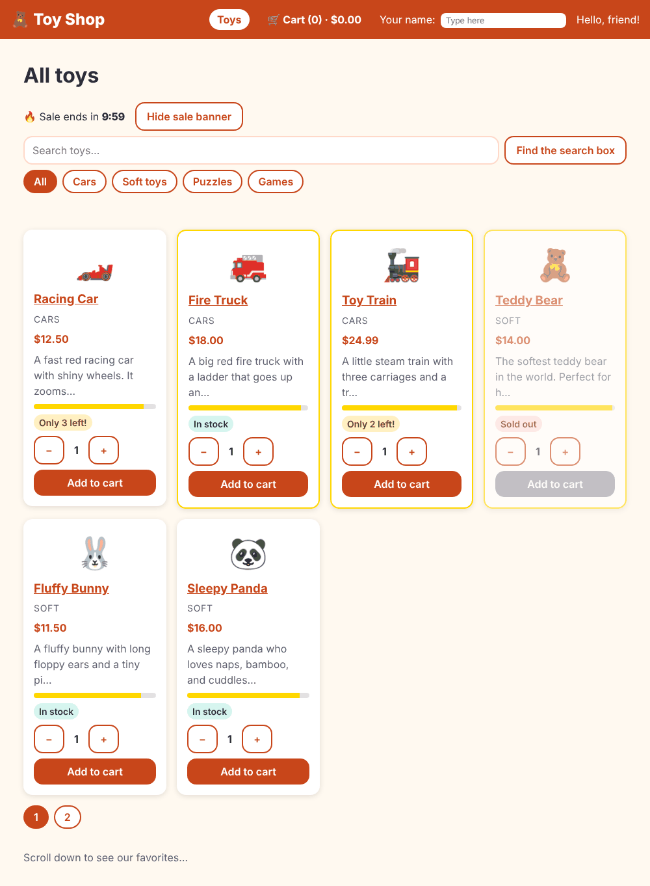

# Learn Angular by building a toy shop

> **Like I'm 5:** You will build a toy shop out of LEGO bricks. Every chapter gives you one new kind of brick and shows what it is for. At the end you have a whole shop, and you know what every brick does.

This is a step-by-step tutorial that teaches **every concept in the [concepts reference](../concepts/README.md)** by building one real project: the **Toy Shop**, an online shop with a cart, a login, a checkout, an admin corner, two languages, and an offline mode. It uses **Angular 22**.

## Start here

1. Read [Chapter 0: Welcome to the Toy Shop](00-welcome.md) (5 minutes: what you need, how each chapter works).
2. Do the chapters **in order**. Each one builds on the one before, and after every chapter the shop still works.
3. Stuck? The finished project is in [`toy-shop-final`](toy-shop-final/). Compare your files with it.

You do not need to know Angular. A little HTML, CSS, and JavaScript helps.

## All chapters

| # | Chapter | You learn | Concept page |
|---|---------|-----------|--------------|
| 0 | [Welcome to the Toy Shop](00-welcome.md) | The plan, the tools, how to read the chapters | |
| 1 | [Set up and meet the CLI](01-set-up-and-meet-the-cli.md) | `ng new`, `ng serve`, project files | [01 Project setup and CLI](../concepts/01-project-setup-and-cli.md) |
| 2 | [Components](02-components.md) | Component class, template, styles | [02 Components](../concepts/02-components.md) |
| 3 | [Templates and data binding](03-templates-and-data-binding.md) | `{{ }}`, `[x]`, `(x)`, `[(x)]`, `@let` | [03 Templates and data binding](../concepts/03-templates-and-data-binding.md) |
| 4 | [Talking between components](04-talking-between-components.md) | `input()`, `output()`, `model()`, content projection | [21 Component communication](../concepts/21-component-communication.md) |
| 5 | [Control flow](05-control-flow.md) | `@if`, `@for`, `@switch`, `@defer` | [05 Control flow](../concepts/05-control-flow.md) |
| 6 | [Directives](06-directives.md) | Attribute directives, host bindings, `ngClass`, `ngStyle` | [04 Directives](../concepts/04-directives.md) |
| 7 | [Pipes](07-pipes.md) | Built-in pipes, our own pipe, pure and impure | [06 Pipes](../concepts/06-pipes.md) |
| 8 | [Lifecycle hooks](08-lifecycle-hooks.md) | `ngOnInit`, `ngOnDestroy`, `afterNextRender` | [07 Lifecycle hooks](../concepts/07-lifecycle-hooks.md) |
| 9 | [Services and dependency injection](09-services-and-dependency-injection.md) | `@Service()`, `inject()`, tokens, providers | [08 Dependency injection and services](../concepts/08-dependency-injection-and-services.md) |
| 10 | [Signals](10-signals.md) | `signal`, `computed`, `effect`, `linkedSignal` | [09 Signals](../concepts/09-signals.md) |
| 11 | [Routing](11-routing.md) | Routes, parameters, `routerLink`, page titles | [12 Routing](../concepts/12-routing.md) |
| 12 | [RxJS](12-rxjs.md) | Observables, `switchMap`, `debounceTime`, interop with signals | [10 RxJS](../concepts/10-rxjs.md) |
| 13 | [The HTTP client](13-http-client.md) | `HttpClient`, loading and error states, `httpResource` | [14 HTTP client and interceptors](../concepts/14-http-client-and-interceptors.md) |
| 14 | [Interceptors](14-interceptors.md) | Loading bar, auth token, error pop-ups, a fake backend | [14 HTTP client and interceptors](../concepts/14-http-client-and-interceptors.md) |
| 15 | [Forms](15-forms.md) | Typed reactive forms, validators, an unsaved-changes guard, signal forms | [15 Forms](../concepts/15-forms.md) |
| 16 | [Change detection](16-change-detection.md) | OnPush, zoneless, when the screen updates | [11 Change detection](../concepts/11-change-detection.md) |
| 17 | [Lazy loading](17-lazy-loading.md) | `loadComponent`, `loadChildren`, a `canMatch` guard, preloading | [13 Lazy loading and preloading](../concepts/13-lazy-loading-and-preloading.md) |
| 18 | [State management](18-state-management.md) | A signal service, then an NgRx SignalStore | [16 State management](../concepts/16-state-management.md) |
| 19 | [Animations](19-animations.md) | `animate.enter`, `animate.leave`, view transitions | [17 Animations](../concepts/17-animations.md) |
| 20 | [Angular Material and the CDK](20-material-and-cdk.md) | Snackbar, dialog, drag and drop, virtual scroll | [20 Material and CDK](../concepts/20-material-and-cdk.md) |
| 21 | [Accessibility](21-accessibility.md) | Keyboard, focus, screen readers, axe | [19 Accessibility](../concepts/19-accessibility.md) |
| 22 | [Internationalization](22-internationalization.md) | `i18n`, `$localize`, ICU, a Hindi shop | [18 Internationalization](../concepts/18-internationalization-i18n.md) |
| 23 | [Error handling and logging](23-error-handling.md) | `ErrorHandler`, an error interceptor, `@error`, one logging service | [29 Error handling and logging](../concepts/29-error-handling-and-logging.md) |
| 24 | [Testing](24-testing.md) | Vitest, `TestBed`, `HttpTestingController`, Playwright, axe | [27 Testing](../concepts/27-testing.md) |
| 25 | [Debugging and DevTools](25-debugging.md) | Reading errors, breakpoints, Angular DevTools, the `ng` helper | [28 Debugging and DevTools](../concepts/28-debugging-and-devtools.md) |
| 26 | [Security](26-security.md) | XSS, sanitising, tokens, safe return addresses, headers | [30 Security](../concepts/30-security.md) |
| 27 | [Performance](27-performance.md) | Images, `@defer`, Lighthouse before and after | [31 Performance](../concepts/31-performance.md) |
| 28 | [Server-side rendering and hydration](28-server-side-rendering.md) | `RenderMode`, hydration, event replay | [22 SSR, hydration and prerendering](../concepts/22-ssr-hydration-and-prerendering.md) |
| 29 | [Progressive web apps and service workers](29-pwa.md) | Manifest, offline, `SwUpdate` | [23 Service workers and PWAs](../concepts/23-service-workers-and-pwa.md) |
| 30 | [Libraries, monorepos and schematics](30-libraries-and-schematics.md) | A component library, our own schematic | [26 Libraries, monorepos and schematics](../concepts/26-libraries-monorepos-and-schematics.md) |
| 31 | [Web components](31-web-components.md) | `@angular/elements`, custom elements | [24 Web components and Angular Elements](../concepts/24-web-components-elements.md) |
| 32 | [Micro-frontends](32-micro-frontends.md) | Native Federation, shell and remote | [25 Micro-frontends](../concepts/25-micro-frontends.md) |
| 33 | [Build and bundling](33-build-and-bundling.md) | Dev and prod builds, budgets, bundle analysis, tree shaking | [32 Build and bundling](../concepts/32-build-and-bundling.md) |
| 34 | [Environments and configuration](34-environments-and-configuration.md) | Environment files, runtime `config.json` | [33 Environments and configuration](../concepts/33-environments-and-configuration.md) |
| 35 | [CI/CD and deployment](35-cicd-and-deployment.md) | Lint, Docker, nginx, GitHub Actions, CSP | [34 CI/CD and deployment](../concepts/34-cicd-and-deployment.md) |
| 36 | [Upgrades and migration](36-upgrades-and-migration.md) | `ng update`, schematics, Dependabot | [35 Upgrades and migration](../concepts/35-upgrades-and-migration.md) |
| 37 | [Graduation day](37-graduation.md) | Recap, health check, glossary, next steps | [36 A to Z glossary](../concepts/36-a-to-z-glossary.md) |

All 36 concept pages are covered. (Concept 14 is split into two chapters, 13 and 14.)

## Which concept is in which chapter?

If you come from the concepts reference and want the matching lesson:

| Concept page | Chapter | Concept page | Chapter |
|--------------|---------|--------------|---------|
| 01 Project setup and CLI | 1 | 19 Accessibility | 21 |
| 02 Components | 2 | 20 Material and CDK | 20 |
| 03 Templates and data binding | 3 | 21 Component communication | 4 |
| 04 Directives | 6 | 22 SSR, hydration and prerendering | 28 |
| 05 Control flow | 5 | 23 Service workers and PWAs | 29 |
| 06 Pipes | 7 | 24 Web components | 31 |
| 07 Lifecycle hooks | 8 | 25 Micro-frontends | 32 |
| 08 Dependency injection | 9 | 26 Libraries and schematics | 30 |
| 09 Signals | 10 | 27 Testing | 24 |
| 10 RxJS | 12 | 28 Debugging | 25 |
| 11 Change detection | 16 | 29 Error handling | 23 |
| 12 Routing | 11 | 30 Security | 26 |
| 13 Lazy loading | 17 | 31 Performance | 27 |
| 14 HTTP and interceptors | 13, 14 | 32 Build and bundling | 33 |
| 15 Forms | 15 | 33 Environments | 34 |
| 16 State management | 18 | 34 CI/CD | 35 |
| 17 Animations | 19 | 35 Upgrades | 36 |
| 18 Internationalization | 22 | 36 A to Z glossary | 37 |

## Ways to use the tutorial

| You want to... | Do this |
|----------------|---------|
| Learn Angular from zero | Chapters 0 to 37, in order. About one chapter per evening. |
| Get the basics fast | Chapters 1 to 11, then 15 and 13. You can build a working app after these. |
| Prepare for an interview | Read each chapter, then the matching file in the [interview Q&A](../interviewQnA/README.md). Chapter 37 has the table. |
| Look up one idea | Use the table above to go to its chapter. The concepts pages are the short reference. |
| See the final result | Open [`toy-shop-final`](toy-shop-final/) and run it (`npm ci` and `npm start`). |

## What is in this folder

| Folder | What it holds |
|--------|---------------|
| `00-welcome.md` to `37-graduation.md` | The chapters |
| [`toy-shop-final`](toy-shop-final/) | The finished Toy Shop (after Chapter 36). Has its own [README](toy-shop-final/README.md) |
| [`toy-lab-final`](toy-lab-final/) | The side workspace for Chapters 30 and 31 (component library, web-component widget, schematic) |
| [`toy-federation-final`](toy-federation-final/) | The side workspace for Chapter 32 (shell and remote) |
| [`extras`](extras/) | Small practice files that go with chapters (labs, extra tests, the upgrade practice app) |
| `images/` | Screenshots used in the chapters |

## How each chapter is built

Every chapter has the same shape, so you always know where you are:

1. **Like I'm 5**: one picture of the idea.
2. **What we build today**: the goal, with a screenshot if there is something to see.
3. **The big idea**: a short story, then the "grown-up words".
4. **Steps**: numbered, with the exact commands and code.
5. **Check it works**: a command and what you should see.
6. **What you learned**, **Try it yourself**, and **If something goes wrong** (real error messages and their fixes).

## How the code was checked

Everything in this tutorial was run, not just written:

- The Toy Shop was built **chapter by chapter** as a real git project, with a tag for each chapter. After each chapter the author ran the build and the unit tests; in later chapters also the browser tests, an accessibility checker (axe), Lighthouse, a real Docker build, and a real nginx.
- The code listings in the chapters are **copied from those tagged versions** by a script, so a listing cannot drift away from code that worked.
- Numbers such as "99 tests passed" or "663.05 kB" are the numbers that really appeared.
- Error messages are the ones that really appeared.
- Where something could **not** be run here (for example a GitHub Actions workflow on GitHub's own computers), the chapter says so.

Versions used: Angular 22.2.2, Angular CLI 22.2.2, TypeScript 6.0.3, Node.js 24, npm 10.9.4, Vitest 5, Playwright 1.56. Angular moves quickly. If a command or an output differs a little on your computer, read the "If something goes wrong" part of the chapter, and check the [Angular update guide](https://update.angular.dev/).

## Related

- [Angular concepts reference](../concepts/README.md): one short page per topic
- [Angular interview Q&A](../interviewQnA/README.md): questions and answers by topic
- [TypeScript concepts](../../typescript/concepts/README.md): useful if you want to understand the labels on the code
